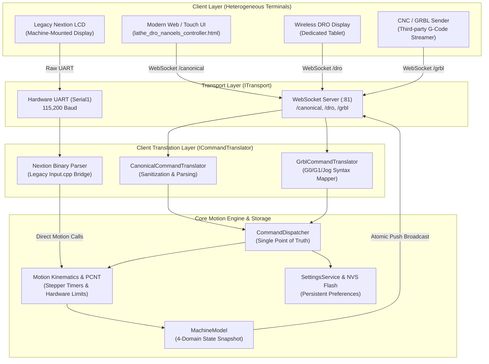

# NanoELS Client Architecture & Protocol Specification

> **Status:** Authoritative Specification (Subsystems 5 & 6)  
> **Master Blueprint:** [`NANOELS_MASTER_ARCHITECTURE.md`](./NANOELS_MASTER_ARCHITECTURE.md)  
> **Target Version:** NanoELS H5 Modular Multi-Client Suite  
> **Author:** Antigravity & Emil  
> **Date:** October 13, 2026  
> **Location:** `docs/ELS_CLIENT_ARCHITECTURE.md`  
> **Referenced By:** `NANOELS_MASTER_ARCHITECTURE.md`, `ELS_DESIGN_NOTEBOOK.md`, `ELS_MODE_ARCHITECTURE.md`, `LATHE_MACHINE_PROFILE.md`

---

## 1. Executive Summary & Core Role

The **NanoELS Client Architecture** defines the structure, communication protocol, state synchronization, and presentation layer for all operator interfaces interacting with the NanoELS motion controller. It serves as the authoritative deep-dive for **Subsystem 5 (Command Dispatcher & Transport)** and **Subsystem 6 (Human-Machine Interface Adapters)**.

For the system-wide 6-subsystem architecture, dual-core concurrency model, and full firmware file disposition, refer directly to the master blueprint: 👉 [`NANOELS_MASTER_ARCHITECTURE.md`](./NANOELS_MASTER_ARCHITECTURE.md).

### Governing Architectural Tenets
1. **The Controller is the Sole Authority:**  
   Connected clients (Web UI, tablet DROs, pendants, secondary displays) are pure reactive observers. Mode execution and kinematics run deterministically on the controller MCU. The client transmits *operator intent* (`CMD.*`), and state flows outward via domain-namespaced telemetry.
2. **Strict Layer Decoupling (Transport vs. Translation vs. Core):**  
   Transport code (WebSocket, Serial) manages raw sockets and frame buffers only. A dedicated Translation Layer sanitizes and decodes client-specific protocols into canonical machine commands. The motion engine never touches transport artifacts.
3. **Preservation of Operator Intent (No Float Round-Trip Drift):**  
   The controller stores exact operator intent (e.g. `20 TPI`, `1:3.5 taper`, `1.5 mm pitch`) alongside canonical deci-micron values (`du`, `dupr`). This guarantees zero round-trip display drift (entering `20 TPI` will never return as `19.9998`).
4. **Presentation is Client-Local:**  
   Units (`mm`/`in`) and cross-slide display representation (`Ø Diameter`/`R Radius`) are entirely client-local presentation settings. Toggling units never transmits network packets to the MCU and never affects other connected clients.
5. **Zero-Build, 100% Offline Runtime & ROM Asset Embedding:**  
   The Web UI operates with zero npm build step or bundler dependencies. In production, assets are gzipped and embedded into firmware Flash ROM (`PROGMEM`) so firmware updates deliver UI updates simultaneously without touching the user's LittleFS filesystem. For rapid development, the controller supports serving hot-reloaded assets from LittleFS `/www/` or loaded directly via `file:///`.
6. **Zero-WiFi Control Plane Mandate (Wired Physical Bus for Motion):**  
   Executing real-time cutting cycles or emergency stops over wireless Wi-Fi in an industrial machine shop with heavy motor and VFD EMI noise introduces hazardous failure modes (packet drops, latency jitter, stalled cuts). The primary machine control plane between the operator console and the NanoELS core is strictly wired over physical UART serial (`Serial1`) or on-chip memory. Wi-Fi/WebSocket transports are dedicated to supervisory observation, parameter configuration, and DRO telemetry.

---

## 2. System Topology & 3-Tier Layering



### Layer Responsibilities

#### 1. Transport Layer (`ITransport`)
* Manages network sockets and byte streams (ESP32 `WebSocketsServer` on port 81, hardware `Serial1` UART).
* Handles connection state, client registration, keep-alive heartbeats, and frame buffering.
* Completely agnostic to command syntax, motion state, or kinematics.

#### 2. Client Translation Layer (`ICommandTranslator`)
* Sanitizes incoming client commands: strips whitespace and line endings (`\r`, `\n`), enforces `char[256]` bounds, and checks syntax.
* Decodes client-specific framing into internal canonical calls (`CMD.*`, `SETTINGS.*`).
* Translates outgoing `MachineModel` domain snapshots into the wire format expected by the client.

#### 3. Core Motion Dispatcher (`CommandDispatcher`)
* Dispatches validated commands directly to hardware sub-systems (`Axis`, `Motion`, `SettingsService`).
* Single point of truth for all machine state modifications.

---

## 3. Composable Client Endpoint Pipeline (C++ Specification)

To ensure that any future client transport (Nextion v2 UART driver, USB-UART serial pendant, Bluetooth Low Energy, or CAN/Modbus bus) can be integrated without modifying kinematic firmware, the system defines a composable client pipeline:

$$\text{ClientEndpoint} = \text{Transport} + \text{Serializer} + \text{Translator}$$

```
   Raw Wire (Bytes/Text)              Inbound Translation                   Core Controller
[ Physical I/O Channel ] ──(Inbound)──► [ ICommandTranslator ] ──(Dispatch)──► [ Motion / Model ]
           ▲                                                                           │
           │                                                                           │
           └──────────────(Outbound)── [ ITelemetrySerializer ] ◄──(Capture)───────────┘
```

### C++ Interface Definitions

```cpp
// src/web/ClientEndpoint.h

class ITransport {
public:
    virtual ~ITransport() = default;
    virtual bool isConnected() const = 0;
    virtual bool sendText(const char* text) = 0;
    virtual bool sendBytes(const uint8_t* buffer, size_t length) = 0;
};

class ICommandTranslator {
public:
    virtual ~ICommandTranslator() = default;
    // Decodes raw client wire bytes/strings into canonical dispatcher actions
    virtual bool translateInbound(const char* payload, size_t length, CommandDispatcher& dispatcher) = 0;
};

class ITelemetrySerializer {
public:
    virtual ~ITelemetrySerializer() = default;
    // Serializes domain state snapshots into client-specific wire frames
    virtual size_t serialize(const MachineModel& model, uint8_t domainMask, char* outBuf, size_t maxLen) = 0;
};

class ClientEndpoint {
public:
    ClientEndpoint(ITransport& transport, ICommandTranslator& translator, ITelemetrySerializer& serializer)
        : transport_(transport), translator_(translator), serializer_(serializer) {}

    void onInboundData(const char* data, size_t len) {
        translator_.translateInbound(data, len, CommandDispatcher::instance());
    }

    void onStateChanged(const MachineModel& model, uint8_t domainMask) {
        if (!transport_.isConnected()) return;
        char buffer[256];
        size_t written = serializer_.serialize(model, domainMask, buffer, sizeof(buffer));
        if (written > 0) {
            transport_.sendText(buffer);
        }
    }

private:
    ITransport& transport_;
    ICommandTranslator& translator_;
    ITelemetrySerializer& serializer_;
};
```

### 3.1 Heterogeneous Channels & URL-Path Routing
When multiple clients connect via WebSockets, they may require different data formats. Routing is negotiated cleanly during HTTP upgrade via the request path:

| URL Path | Channel Type | Serializer Used | Target Client |
| :--- | :--- | :--- | :--- |
| `ws://<ip>:81/` or `/canonical` | `CHANNEL_CANONICAL` | `RichClientAdapter` (`K.*`, `I.*`, `C.*`, `P.*`) | Rich Web UI / Multi-Axis HMI |
| `ws://<ip>:81/grbl` | `CHANNEL_GRBL` | `GrblSerializer` (`<Idle\|WPos:...\|FS:...>`) | CNC Senders (UGS, CNCjs, OpenBuilds) |
| `ws://<ip>:81/dro` | `CHANNEL_DRO` | `DroSerializer` (`K.zDu`, `K.xDu`, `K.rpm`) | Minimal Wireless DRO Readouts |

- **Zero Runtime Overhead**: The channel is assigned **once** during the HTTP upgrade handshake. Runtime packets require no subscription parsing.
- **Active Channel Bitmask (`activeChannelMask`)**: The controller tracks which channels have active listeners. Formats with zero connected listeners are **never serialized**, burning zero CPU cycles.

### 3.2 Unicast Request-Response vs. Channel Broadcast Separation
1. **Unicast Request-Response (1-to-1)**:
   - Queries (`?get=...`, `?sysinfo`), Settings reads (`SETTINGS.get=...`), and command confirmations (`OK`, error messages) are sent **unicast** (`sendTXT(clientId)`) exclusively to the requesting socket.
   - Prevents network amplification ($O(N^2)$ traffic) when multiple displays are active.
   - New connections receive an immediate unicast hydration frame without disturbing existing screens.
2. **Channel Broadcast (1-to-Many)**:
   - When machine state changes, telemetry is serialized once per active channel and pushed to matching sockets.

### 3.3 Smart Clients vs. Dumb Displays (Stateful Presenters)
The client model accommodates both intelligent and protocol-constrained clients:
* **Smart Clients (Web UI / Alpine Reactive Store)**:
  - The client runs its own reactive state engine on its local CPU (browser).
  - The controller's serializer is thin and stateless: it emits raw canonical data (`K.*`, `I.*`). The client formats units, diameters, and DOM elements locally.
* **Dumb Displays (Physical Nextion LCD / Serial Pendants)**:
  - Nextion hardware has no domain logic; it only receives widget text strings (`t0.txt="-18.42"`) and emits component touch IDs (Page 1, Component 4).
  - Its `ClientEndpoint` acts as a **Stateful Presenter / Transformer**:
    1. **Diff Cache**: Stores previously rendered strings, active page ID, and widget colors to eliminate redundant UART transmissions and screen flicker.
    2. **Component Mapping**: Maps raw touch events into canonical `CommandDispatcher` actions.
    3. **Quirk Isolation**: Nextion-specific hashing and delta-rendering reside strictly inside the Nextion adapter, keeping core firmware clean.

---

## 4. Change-Driven Status Dispatch & Immutable `StatusSnapshot`

### 4.1 Zero-Polling Execution Invariant
* Core status updates are **strictly change-driven**; they are never generated by fixed periodic polling timers.
* The motion engine triggers status dispatch **only when machine properties mutate** (step pulses emitted, spindle pulses accumulated, mode changed, or limits modified).
* When the lathe is stationary and idle, **zero status packets are generated or pushed**, preserving radio bandwidth and CPU cycles.

### 4.2 Temporal Isolation & Value Semantics
On dual-core ESP32 systems, high-priority real-time motion control (stepper pulse timers, encoder ISRs on Core 0) runs asynchronously with lower-priority client communication tasks (FreeRTOS network/UART tasks on Core 1). Passing floating pointers or references to a mutable model results in temporal tearing.

The Core captures an immutable `StatusSnapshot` struct (~64 bytes) frozen in time, paired with a 32-bit `changedFields` bitmask:

```cpp
// src/core/StatusSnapshot.h

enum StatusField : uint32_t {
    FIELD_NONE        = 0,
    FIELD_POS_Z       = 1 << 0,
    FIELD_POS_X       = 1 << 1,
    FIELD_POS_Y       = 1 << 2,
    FIELD_LIMITS_Z    = 1 << 3,
    FIELD_LIMITS_X    = 1 << 4,
    FIELD_SPINDLE_RPM = 1 << 5,
    FIELD_SPINDLE_POS = 1 << 6,  // angle & turns
    FIELD_MOTION_MODE = 1 << 7,
    FIELD_MOTION_SYNC = 1 << 8,  // on/off
    FIELD_ESTOP       = 1 << 9,
    FIELD_FEED_RATE   = 1 << 10,
    FIELD_ALL         = 0xFFFFFFFF
};

struct StatusSnapshot {
    uint32_t timestamp;
    uint32_t changedFields; // Bitmask of which fields mutated in this event

    // Authoritative Canonical Kinematics at the instant of trigger
    int32_t  zDu;
    int32_t  xDu;
    int32_t  zLeftDu;
    int32_t  zRightDu;
    int32_t  xUpDu;
    int32_t  xDownDu;
    uint16_t rpm;
    float    turns;
    float    angle;
    uint8_t  mode;
    bool     isOn;
    bool     estop;
    int32_t  dupr;
};

class ClientInterface {
public:
    virtual ~ClientInterface() = default;
    virtual void onStatusUpdate(const StatusSnapshot& snapshot) = 0;
};
```

### 4.3 Decentralized Observer Filtering
The Core motion engine broadcasts the immutable snapshot to all registered clients without maintaining client-specific filters. Each client implementation evaluates `snapshot.changedFields` against its active interest mask in a single CPU cycle:

```cpp
void NextionClient::onStatusUpdate(const StatusSnapshot& snapshot) {
    // 1. Check if any fields visible on the active Nextion page mutated
    if (!(snapshot.changedFields & currentPageMask_)) {
        return; // Zero UART transmission
    }

    // 2. Local delta comparison to avoid redundant text draw
    if ((snapshot.changedFields & FIELD_POS_X) && snapshot.xDu != lastSnapshot_.xDu) {
        int32_t displayVal = isDiameterMode_ ? (snapshot.xDu * 2) : snapshot.xDu;
        renderCoordinate("t1", displayVal);
    }

    lastSnapshot_ = snapshot;
}
```

---

## 5. Generic Client Authoring Guide & Invariants

Every client implementation (Web UI, tablet DRO, physical serial pendant, or embedded display) must adhere to five universal architectural invariants:

### 5.1 Presentation is Client-Local (Zero Network Math)
* **Canonical Radius Invariant:** The core motion controller operates strictly in canonical radius (`xDu`). Clients commanding positions or limits in Diameter mode must convert to radius before transmission (`xDu = diameterDu / 2`).
* **Unit System Decoupling:** Toggling units between Metric (`mm`) and Imperial (`in`) must never transmit wire packets or mutate controller state. Conversion is performed strictly at render time.
* **Tearing & Decimal Drift:** Clients must never backward-calculate operator setpoints (such as TPI from a floating-point pitch or taper ratio from an angle). Always read the authoritative Intent domain (`I.*`).

### 5.2 Universal Emergency Stop & Feed Hold Access
* Regardless of the client's internal page hierarchy, menu depth, or active modal dialog, **the operator's tactile or visual path to Emergency Stop (`CMD.on=0` / `CMD.stop=1`) must remain 100% unobstructed at all times**.
* Full-screen dialogs, warnings, or toasts must never occlude the stop control.

### 5.3 Communication Heartbeats & Safety Watchdogs
* When commanding continuous motion (e.g. `CMD.jogHold=<axis>,<dir>`), the client must emit periodic heartbeats ($\le 250\text{ ms}$).
* If network or serial communication drops for $>500\text{ ms}$, the controller automatically decelerates all stepping to a safe stop.

### 5.4 Decentralized Filtering & Bandwidth Conservation
* Clients must inspect `snapshot.changedFields` or domain dirty masks before processing or re-rendering.
* Clients on constrained serial buses (e.g. Nextion LCD on UART) must filter updates against the active display page to prevent buffer congestion.

### 5.5 Architectural Hook: Controller-Backed Client Properties (Stateless Clients)
* Low-cost or stateless clients (e.g., bare microcontrollers without flash, or ephemeral browser sessions) may persist client-side preferences on the controller MCU via namespaced keys:
  - `client.global.<key>`: Preferences shared across all operator terminals (e.g. default startup units).
  - `client.<clientId>.<key>`: Private client preferences (e.g. theme, brightness, screen layout).
* The controller treats these keys as opaque byte storage in NVS flash and never consumes them for motion kinematics.

### 5.6 Industrial Shop-Floor EMI & Transient Network Hardening
Machine shop environments feature high electrical interference (VFD spindle drives, contactor arcing, servo switching), leading to occasional 2.4 GHz packet drops or beacon timeouts:

1. **Transient Disconnect Debounce (2.5 seconds)**:
   - When `WiFi.status() != WL_CONNECTED`, the controller does not immediately tear down connections or trigger a reconnection storm.
   - It debounces for 2,500 ms. If the AP beacon recovers during this window, normal streaming resumes without dropping TCP sockets or disrupting operator UI views.
2. **Exponential Backoff Reconnect Loop (3s $\rightarrow$ 30s)**:
   - If AP connectivity is genuinely lost, the controller initiates a background reconnection sequence.
   - Initial retry occurs after 3 seconds, doubling on subsequent failures (6s $\rightarrow$ 12s $\rightarrow$ 24s $\rightarrow$ 30s maximum cap) to prevent radio bus saturation and excessive CPU consumption.
3. **Physical Display Status Integration (Nextion LCD)**:
   - During reconnection, the controller publishes countdown telemetry to physical displays (`t3.txt="WiFi retry (Xs)"`).
   - Hardware operators at the lathe are immediately informed that remote web clients are in reconnect state.
   - Once reconnected, `t3.txt` is updated with `"See <ip>"`, and remote Web UIs reconnect and receive a fresh hydration frame automatically.

---

## 6. Multi-Domain State Protocol (`MachineModel`)

> **Authoritative Specification:** Complete C++ struct definitions, bitmask flags (`DomainFlags`), and temporal snapshot mechanics are specified authoritatively in [`ELS_CORE_STATE_MODEL.md`](./ELS_CORE_STATE_MODEL.md).

State synchronization between controller and clients is partitioned into four independent, cohesive domains:

```
+-------------------------------------------------------------------------+
|                              MachineModel                               |
+-------------------+-------------------+----------------+----------------+
|    Kinematics     |      Intent       |     Cycle      |   Properties   |
|   (Domain 'K')    |   (Domain 'I')    |  (Domain 'C')  |  (Domain 'P')  |
|     Bit: 0x01     |     Bit: 0x02     |   Bit: 0x04    |   Bit: 0x08    |
+-------------------+-------------------+----------------+----------------+
| zDu, xDu           | thFmt, thPitch    | passes         | measure        |
| zLeftDu, zRightDu | dupr              | opIdx (curr)   | dia, abs       |
| xUpDu, xDownDu    | tpMode, tpVal     | setupIdx       | zDro, xDro     |
| rpm, turns, angle | coneRatio         | starts         | screwZDu       |
| mode, on, estop   | feedStepDu        |                | screwXDu       |
| zDis, xDis        | jogStepDu         |                | motorStepsZ/X  |
| dupr, nextDupr    | feedRev           |                | encoderPpr     |
+-------------------+-------------------+----------------+----------------+
```

### 6.1 Wire Telemetry Format (Line-Oriented Stream)

To minimize packet overhead and eliminate complex JSON parsers on embedded microcontrollers, telemetry streams in human-readable, line-oriented key-value packets:

```text
K.zDu=125400
K.xDu=-45200
K.rpm=620
K.isOn=1
I.thPitch=1.5
C.opIdx=3
C.passes=6
```

#### Multi-Domain Pull Hydration (`?get=` or `CMD.get=`)
When a client connects or refreshes, it requests an atomic snapshot of required domains in a single command:
```text
CMD.get=K,I,C,P\n
```
The controller returns an atomic snapshot captured at instant $t_0$, completely eliminating torn-frame read hazards.

---

## 7. Client-Side Presentation Decoupling

A cornerstone of this architecture is that **display presentation is strictly client-local**:

### 7.1 Coordinate Units (`measure`: Metric `mm` vs. Imperial `in`)
* **Core Controller Invariant:** Physical motor steps and positions are tracked exclusively in **deci-microns** ($10{,}000\text{ du} = 1.0\text{ mm}$).
* **Client Translation:**
  * When in Metric mode: `displayZ = zDu / 10000.0`
  * When in Imperial mode: `displayZ = zDu / 254000.0`
* Tapping the unit toggle chip in the UI alters local presentation state. **No network packets are dispatched.**

### 7.2 Cross-Slide Representation (`dia`: Diameter `Ø` vs. Radius `R`)
* Physical leadscrew movement is always radial ($1.0\text{ mm}$ cross-slide movement $= 1.0\text{ mm}$ change in radius).
* When in Diameter Mode (`dia == true`), the client simply doubles the radial coordinate for display:
  `displayX = (xDu * 2) / 10000.0`
* Workpiece drawing diameters can be dialed directly on screen without mutating internal motion math.

### 7.3 Live Spindle Cutting Speed ($SMM$ / $SFM$)
* Spindle displays cycle through `RPM` $\rightarrow$ `TURNS` $\rightarrow$ `ANGLE (°)` $\rightarrow$ `SURFACE SPEED`.
* Surface cutting speed is computed purely on the client at render time from live $X$ diameter and spindle RPM:
  $$\text{SMM (m/min)} = \frac{\pi \times \text{Dia}_{\text{mm}} \times \text{RPM}}{1000.0}$$
  $$\text{SFM (ft/min)} = \frac{\pi \times \text{Dia}_{\text{in}} \times \text{RPM}}{12.0}$$

---

## 8. Semantic Operator Intent Protocol

To prevent machine crashes caused by mismatched sign conventions (e.g. front toolpost vs. rear toolpost, right-hand vs. left-hand leadscrews), clients never send raw coordinate increments. Instead, clients command **Operator Semantic Intent**:

```text
CMD.jogHold=X,INFEED       // Move tool inward into cut / towards spindle centerline
CMD.jogHold=X,RETRACT      // Move tool outward away from cut / towards operator
CMD.jogHold=Z,CHUCK        // Feed carriage left toward chuck
CMD.jogHold=Z,TAIL         // Feed carriage right toward tailstock
CMD.jogRelease=<axis>      // Operator released jog button
CMD.jogStep=<axis>,<dir>   // Discrete 1-step increment in semantic direction
```

---

## 9. UI Interaction Mapping & Client Ledger Reference

Because different physical clients (Web touchscreens, Nextion LCDs, wireless pendants) have different input capabilities, button layouts, and touch timings, **each client maintains its own interaction mapping and ledger**.

* For the canonical reference implementation of the Modern Web / Touch DRO interface, see:
  👉 **[`clients/web_ui/OVERVIEW.md`](./clients/web_ui/OVERVIEW.md)**  
  👉 **[`clients/web_ui/INTERACTION_LEDGER.md`](./clients/web_ui/INTERACTION_LEDGER.md)** (Complete 40-row interaction-to-wire ledger)

---

## 10. Canonical Protocol Command Reference (`CMD.*` & `SETTINGS.*`)

The motion controller dispatcher responds to the following standardized command vocabulary across all transports:

### Motion & Cycle Commands
* `CMD.on=1`: Starts current cycle or feed.
* `CMD.on=0`: Stops current cycle or feed immediately.
* `CMD.jogHold=<axis>,<dir>`: Starts continuous manual jog along `<axis>` (`Z` or `X`) in `<dir>` (`TAIL`, `CHUCK`, `INFEED`, `RETRACT`, `1`, `-1`).
* `CMD.jogRelease=<axis>`: Stops manual jog along `<axis>` (or all axes if omitted).
* `CMD.jogStep=<axis>,<dir>`: Executes a discrete single-step move of `moveStep` deci-microns in `<dir>`.
* `CMD.jogStepDu=<du>`: Sets single-step increment size in deci-microns (e.g. `100` = $0.01\text{ mm}$).
* `CMD.axisZero=<axis>`: Zeroes machine coordinate origin for `<axis>` (`Z`, `X`, `Y`).
* `CMD.axisPosDu=<axis>,<posDu>`: Sets absolute DRO position coordinate for `<axis>`.
* `CMD.axisLimitDu=<axis>,<L|R>,<du>`: Programs hardware travel limit for `<axis>`.
* `CMD.axisClearLimit=<axis>,<L|R>`: Clears specified travel limit register.

### Mode & Kinematics Commands
* `CMD.mode=<modeId>`: Sets operational mode (`0`=GEAR, `1`=TURN, `2`=FACE, `3`=CONE, `4`=CUT, `5`=THREAD, `6`=SLOT, `7`=ELLIPSE, `8`=GCODE).
* `CMD.feedRev`: Reverses feed direction (toggles sign of active pitch).
* `CMD.feedDupr=<du>`: Sets feedrate in deci-microns per spindle revolution.
* `CMD.feedMm=<mm>`: Sets feedrate/pitch in millimeters.
* `CMD.feedTpi=<tpi>`: Sets threading pitch in threads per inch.
* `CMD.feedInch=<inch>`: Sets threading pitch in decimal inches.
* `CMD.feedStepDu=<du>`: Sets manual feed step size in deci-microns.
* `CMD.feedStepCycle`: Cycles through standard feed step table entries.
* `CMD.taperAngle=<deg>`: Sets taper angle in degrees.
* `CMD.taperRatio=<ratioK>`: Sets taper ratio $1:K$.
* `CMD.taperPreset=<id>,<deg>,<ratio>`: Loads predefined standard taper preset (Morse, Brown & Sharpe, etc.).

### Settings & Configuration Commands
* `SETTINGS.get` / `SETTINGS.get=*`: Returns all persistent machine and operational settings.
* `SETTINGS.get=<key>`: Returns specific setting value.
* `SETTINGS.set=<key>,<value>`: Mutates setting, updates fast in-memory cache, persists to NVS flash, and triggers status broadcast.
  - Keys: `abs`, `zDro`, `xdro`, `measure`, `feedStepDu`, `deadbandAngle`, `deadbandTurns`, `screwZDu`, `screwXDu`, `motorStepsZ`, `motorStepsX`, `encoderPpr`.

### System & State Queries
* `?sysinfo`: Returns firmware build version, chip architecture, flash size, and feature capabilities (`SYSINFO.features=spindleSim`).
* `?state` / `?get=ALL`: Returns complete multi-domain telemetry frame (`K` Kinematics, `I` Identity, `S` Spindle, `T` Threading, `L` Limits, `O` Operations).
* `CMD.get=K,I,C,P`: Atomic snapshot hydration across requested domains.

---

## 11. Summary & Cross-References

This specification establishes:
* **True reactive decoupling**: Presentation changes remain on the client; physical control is authoritative on the MCU.
* **Deterministic protocol**: Line-oriented, typed domain telemetry completely eliminates floating-point round-trip drift.
* **Maximum shop safety**: Semantic operator directions and hardware heartbeats prevent tool crashes.

### Related Architecture Documents:
* **Core State Model & Domains:** [`ELS_CORE_STATE_MODEL.md`](./ELS_CORE_STATE_MODEL.md)
* **Physical Lathe Hardware & Presets:** [`LATHE_MACHINE_PROFILE.md`](./LATHE_MACHINE_PROFILE.md)
* **Mode Lifecycle & Inheritance:** [`ELS_MODE_ARCHITECTURE.md`](./ELS_MODE_ARCHITECTURE.md)
* **UI Design Decisions & Ergonomics:** [`ELS_DESIGN_NOTEBOOK.md`](./ELS_DESIGN_NOTEBOOK.md)

### Client Reference Implementations:
* **Modern Web UI / Touch DRO:** [`clients/web_ui/OVERVIEW.md`](./clients/web_ui/OVERVIEW.md)
* **Web UI Interaction Ledger:** [`clients/web_ui/INTERACTION_LEDGER.md`](./clients/web_ui/INTERACTION_LEDGER.md)

