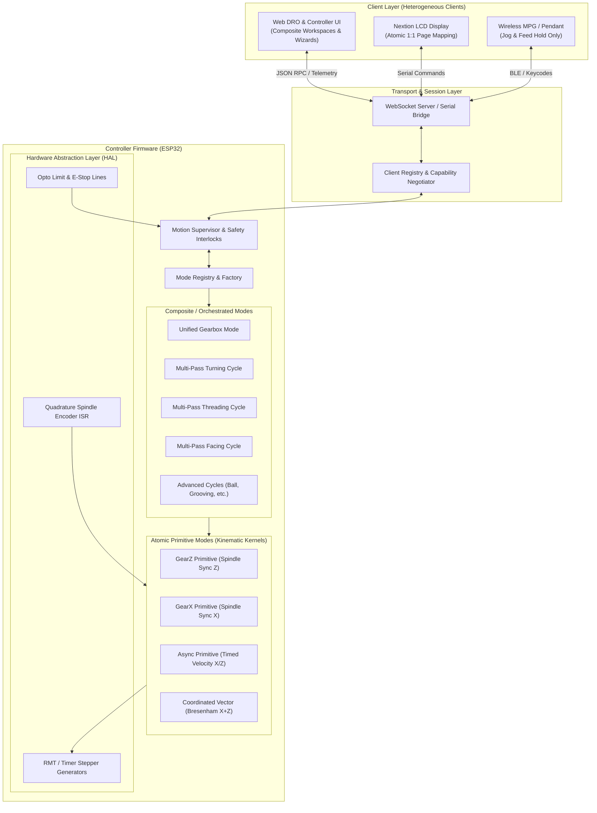
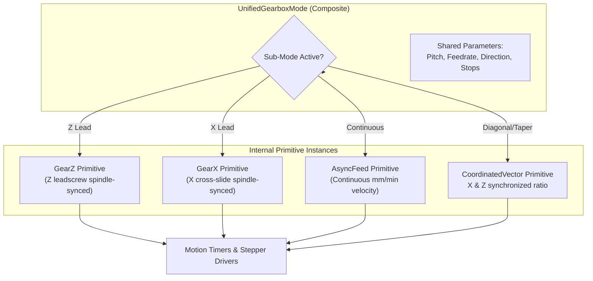
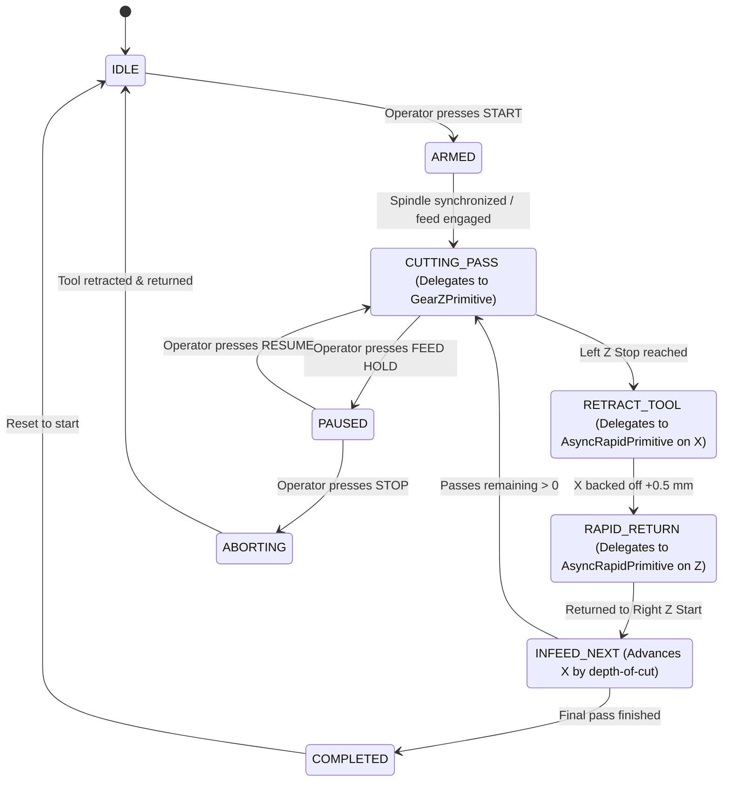
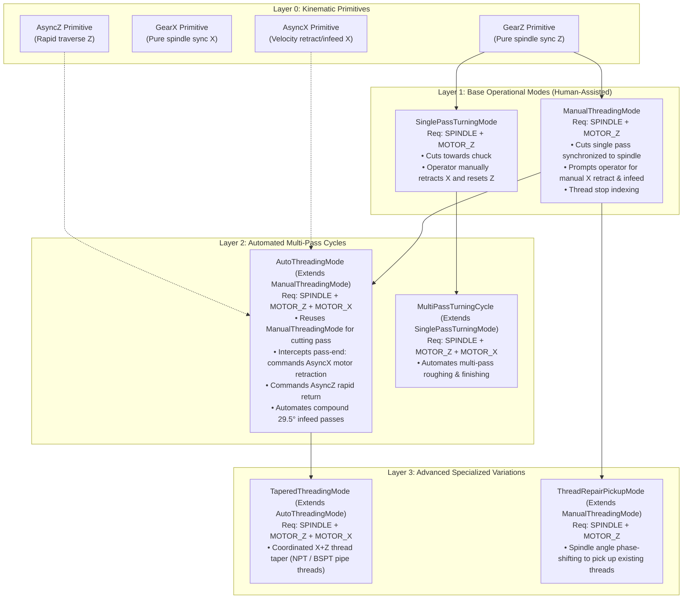
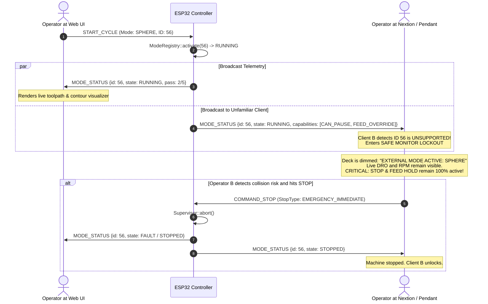
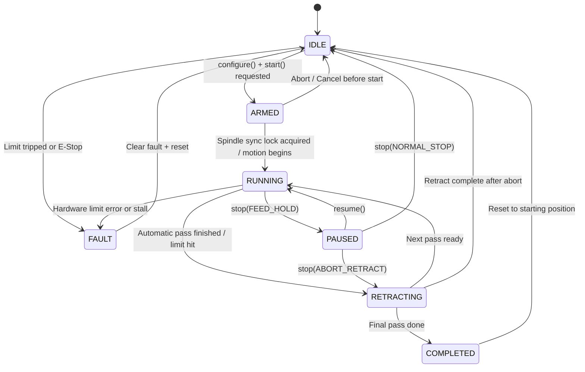

# NanoELS Generalized Mode Architecture Specification

> **Status:** Draft / Proposal for Review  
> **Target Version:** NanoELS H5 Modular Architecture (Firmware & Multi-Client Suite)  
> **Author:** Antigravity & Emil  
> **Date:** October 7, 2026  
> **Location:** `docs/ELS_MODE_ARCHITECTURE.md`  
> **Related Architecture Documents:** [`ELS_CORE_STATE_MODEL.md`](./ELS_CORE_STATE_MODEL.md), [`LATHE_MACHINE_PROFILE.md`](./LATHE_MACHINE_PROFILE.md), [`ELS_CLIENT_ARCHITECTURE.md`](./ELS_CLIENT_ARCHITECTURE.md), [`ELS_DESIGN_NOTEBOOK.md`](./ELS_DESIGN_NOTEBOOK.md)

---

## 1. Executive Summary & Problem Statement

### 1.1 Background & Motivation
In the original NanoELS H5 implementation, operating modes (`MODE_NORMAL` / `gear`, `MODE_XGEAR`, `MODE_ASYNC`, `MODE_CONE`, `MODE_TURN`, `MODE_FACE`, `MODE_CUT`, `MODE_THREAD`, etc.) were tightly coupled to individual Nextion display pages and ad-hoc global variables in `h5.ino` and `Motion.cpp`. 

While this 1:1 screen-to-mode mapping worked for a dedicated serial LCD, it breaks down as the system evolves:
1. **Divergent Operator Workflows:** Modern operator interfaces (such as our Web DRO/Controller suite) naturally consolidate related functions (e.g., electronic leadscrew gearing, cross-slide gearing, async continuous feed, and diagonal/cone feed) into a unified **Electronic Gearbox** workspace.
2. **Duplicated Control Loops & State Machines:** Multi-pass cutting cycles (turning, facing, threading) re-implemented their own axis movement, infeed sequencing, limit handling, and telemetry formatting with subtle differences.
3. **Multi-Client Race Conditions & Fragility:** Multiple heterogeneous client terminals (e.g., a physical machine-mounted Nextion LCD, a dedicated 10" tablet Web DRO, and a remote desktop monitor) can connect simultaneously. Without a structured mode contract and capability negotiation, activating a mode on one client risks corrupting state, generating contradictory commands, or crashing axes.

### 1.2 Core Architectural Principles
To solve these challenges, this architecture establishes five governing tenets:

1. **Controller Authority & Autonomous Orchestration:**  
   Motion execution, pass sequencing, and limit stops are strictly executed and orchestrated on the **controller MCU**. The client never streams real-time micro-coordinates over a network; it commands parametric cycles. If a client disconnects or lags, machine safety and execution determinism remain unaffected.
2. **Atomic Primitives vs. Composite Orchestration:**  
   The motion engine provides small, robust, deterministic **Primitive Modes** (e.g., spindle-synchronized gear step, velocity async step, coordinated vector step). Higher-level cycles (**Composite Modes**) compose and orchestrate these primitives rather than reinventing motor step math.
3. **Uniform Interface Contract:**  
   Every mode (primitive or composite) implements an identical lifecycle, telemetry, and control interface (`IELSMode`). Modes can be nested, wrapped, or substituted transparently.
4. **Client Capability Handshake & Filtering:**  
   Clients register which modes they support. Simple clients can include/exclude modes, and the controller filters available operations accordingly.
5. **Universal Safety Invariant:**  
   Even if a client does not understand an active mode running on the machine, **Emergency Stop and Feed Hold authority is universally active on all clients at all times**.

---

## 2. System Architecture & Component Hierarchy



---

## 3. Data Structures & Core Interfaces

### 3.1 Identifiers, Types, and Enumerations

```cpp
// Unique identifier for each mode
typedef uint16_t ModeId;

namespace ModeIds {
    constexpr ModeId NONE         = 0;
    // Primitive Modes (10 - 49)
    constexpr ModeId PRIM_GEAR_Z  = 10;
    constexpr ModeId PRIM_GEAR_X  = 11;
    constexpr ModeId PRIM_ASYNC_Z = 12;
    constexpr ModeId PRIM_ASYNC_X = 13;
    constexpr ModeId PRIM_CONE    = 14;
    constexpr ModeId PRIM_RAPID   = 15;

    // Composite / Operational Modes (50 - 99)
    constexpr ModeId GEARBOX      = 50; // Orchestrates PRIM_GEAR_Z, PRIM_GEAR_X, PRIM_ASYNC, PRIM_CONE
    constexpr ModeId TURNING      = 51; // Orchestrates PRIM_GEAR_Z/ASYNC + PRIM_RAPID
    constexpr ModeId FACING       = 52; // Orchestrates PRIM_GEAR_X/ASYNC + PRIM_RAPID
    constexpr ModeId THREADING    = 53; // Orchestrates PRIM_GEAR_Z (exact sync) + retraction
    constexpr ModeId CUTOFF       = 54; // Orchestrates PRIM_ASYNC_X with pecking
    constexpr ModeId SLOTTING     = 55; // Spindle-locked broaching / slotting
    constexpr ModeId SPHERE       = 56; // Parametric contouring
}

// Mode Execution Status State Machine
enum class ModeState : uint8_t {
    IDLE = 0,         // Ready, waiting for operator start
    ARMED,            // Waiting for spindle sync index / trigger
    RUNNING,          // Actively stepping motor(s)
    PAUSED,           // Feed hold active; axes decelerated to stop
    RETRACTING,       // Executing automatic clearance move
    COMPLETED,        // Cycle completed successfully
    FAULT             // Limit switch tripped, stall detected, or e-stop
};

// Mode Classification
enum class ModeCategory : uint8_t {
    PRIMITIVE = 0,    // Direct hardware stepper/encoder kernel
    COMPOSITE,        // Orchestrates one or more sub-modes
    UTILITY           // Setup, calibration, test
};

// Runtime capability flags advertised to clients
enum ModeCapabilityFlags : uint32_t {
    CAP_NONE            = 0,
    CAP_CAN_PAUSE       = 1 << 0,  // Supports Feed Hold without losing position/sync
    CAP_CAN_RESUME      = 1 << 1,  // Supports resuming after Feed Hold
    CAP_FEED_OVERRIDE   = 1 << 2,  // Supports runtime feedrate/pitch multiplier adjustment
    CAP_RPM_OVERRIDE    = 1 << 3,  // Supports VFD spindle speed adjustment
    CAP_MANUAL_JOG      = 1 << 4,  // Allows operator manual jog during pause
    CAP_SPINDLE_SYNC    = 1 << 5,  // Requires active spindle rotation to advance
    CAP_MULTI_PASS      = 1 << 6   // Exposes pass count / progress telemetry
};

// Stop actions
enum class StopType : uint8_t {
    NORMAL_STOP = 0,      // Decelerate and stop in place
    FEED_HOLD,            // Temporary pause, maintain synchronized index
    ABORT_RETRACT,        // Pull tool out along clearance vector, then stop
    EMERGENCY_IMMEDIATE   // Kill step pulses immediately (hard stop)
};
```

---

### 3.2 Parameter Manifest & Introspection Schema

To enable clients to validate inputs and optionally generate dynamic UIs without hardcoding mode details, each mode defines a **Parameter Descriptor**:

```cpp
enum class ParamType : uint8_t {
    INT32 = 0,
    FLOAT,
    BOOL,
    ENUM
};

// Visibility and substitution policy for modes in the UI
enum class VisibilityPolicy : uint8_t {
    ALWAYS_VISIBLE = 0,    // Always show in menus if hardware requirements are met
    PREFER_EXTENDED,       // Show extended mode by default, but allow accessing base mode via toggle/sub-option
    HIDE_IF_EXTENDED       // Completely hide base mode if an extended descendant is active/available
};

struct ParamDescriptor {
    const char* key;        // Machine key, e.g. "pitch_mm", "taper_ratio"
    const char* label;      // Human readable label
    ParamType type;
    const char* unit;       // "mm", "mm/rev", "deg", "TPI", "steps"
    float defaultVal;
    float minVal;
    float maxVal;
    float stepVal;
};

struct ModeManifest {
    ModeId            id;                     // Unique Mode ID (e.g. MODE_THREAD_AUTO)
    ModeId            baseModeId;             // Ancestor / Base Mode ID (e.g. MODE_THREAD_MANUAL or NONE)
    const char*       slug;                   // Machine slug ("thread_auto")
    const char*       name;                   // Display name ("Auto Threading")
    const char*       family;                 // Family group ("THREADING")
    ModeCategory      category;               // PRIMITIVE, COMPOSITE, or UTILITY
    uint32_t          runtimeCapabilities;    // Runtime flags: CAN_PAUSE, FEED_OVERRIDE, etc.
    uint32_t          requiredHardwareCaps;   // Bitmask of required LatheCapabilityFlags
    VisibilityPolicy  visibility;             // How it surfaces relative to base mode
    uint8_t           paramCount;
    const ParamDescriptor* params;
};
```

#### JSON Representation of Mode Manifest (Over WebSocket):
```json
{
  "id": 53,
  "base_mode_id": 52,
  "slug": "thread_auto",
  "name": "Automated Threading",
  "family": "THREADING",
  "category": "COMPOSITE",
  "runtime_capabilities": ["CAN_PAUSE", "FEED_HOLD", "SPINDLE_SYNC"],
  "required_hardware": ["SPINDLE_ENCODER", "MOTOR_Z", "MOTOR_X"],
  "visibility": "PREFER_EXTENDED",
  "params": [
    {
      "key": "pitch",
      "label": "Thread Pitch",
      "type": "float",
      "unit": "mm",
      "default": 1.5,
      "min": 0.25,
      "max": 6.0,
      "step": 0.05
    },
    {
      "key": "total_depth",
      "label": "Thread Depth",
      "type": "float",
      "unit": "mm",
      "default": 0.92,
      "min": 0.05,
      "max": 5.0,
      "step": 0.01
    },
    {
      "key": "passes",
      "label": "Total Passes",
      "type": "int",
      "unit": "passes",
      "default": 6,
      "min": 1,
      "max": 30,
      "step": 1
    }
  ]
}
```

---

### 3.3 The Core Interface: `IELSMode`

Every mode in the controller implements this abstract interface:

```cpp
class IELSMode {
public:
    virtual ~IELSMode() = default;

    // --- 1. Introspection & Metadata ---
    virtual const ModeManifest& getManifest() const = 0;
    virtual ModeId getId() const = 0;
    virtual const char* getName() const = 0;
    virtual ModeCategory getCategory() const = 0;
    virtual uint32_t getCapabilities() const = 0;

    // --- 2. Configuration & Parameter Validation ---
    virtual bool configure(const void* paramBuffer, size_t size) = 0;
    virtual bool validateParams(char* errBuf, size_t errBufLen) const = 0;

    // --- 3. Lifecycle Hooks ---
    // Called when the mode becomes the selected active mode in the controller
    virtual void onEnter() = 0;
    
    // Called when another mode is selected or when controller resets
    virtual void onExit() = 0;

    // --- 4. Execution State Machine Control ---
    // Start running the cycle / engagement
    virtual bool start() = 0;
    
    // Stop or pause execution
    virtual void stop(StopType stopType) = 0;
    
    // Resume from paused feed hold
    virtual bool resume() = 0;

    // Current execution state
    virtual ModeState getState() const = 0;
    virtual bool isRunning() const = 0;

    // --- 5. Real-Time Kinematic Hooks (Executed in ISR / High-Priority Task) ---
    // Called on spindle encoder quadrature edges
    virtual void onSpindlePulse(int32_t deltaPulses, uint32_t currentRpm) = 0;

    // Called on high-frequency timer tick for velocity / asynchronous feeds
    virtual void onTimerTick(uint32_t deltaMicros) = 0;

    // Called when an axis trips a soft-stop or hardware limit
    virtual void onLimitReached(uint8_t axisId, bool isHighLimit) = 0;

    // --- 6. Telemetry & Progress (10 Hz - 50 Hz poll) ---
    virtual void getTelemetry(void* telemetryBuffer, size_t bufferSize) const = 0;
};
```

---

## 4. The Orchestration Pattern: Composing Modes on the Controller

The most critical innovation of this architecture is **Controller-Side Orchestration**. Instead of a monolithic mode attempting to handle every edge case, complex cycles simply instantiate and control child primitive modes through their standard `IELSMode` interface.

### 4.1 Example: `UnifiedGearboxMode`

The **Unified Gearbox Mode** is a Composite Mode that unifies four primitive modes under one roof. The operator interacts with one cohesive screen, but the controller activates the appropriate underlying primitive:



#### Delegation Implementation:
```cpp
class UnifiedGearboxMode : public IELSMode {
private:
    GearZPrimitive   m_gearZ;
    GearXPrimitive   m_gearX;
    AsyncPrimitive   m_asyncFeed;
    ConePrimitive    m_cone;
    
    IELSMode*        m_activePrimitive = &m_gearZ; // Default to Z leadscrew
    ModeState        m_state = ModeState::IDLE;

public:
    void setSubMode(ModeId primitiveId) {
        if (m_state == ModeState::RUNNING) {
            // Cannot hot-swap kinematic kernels while actively cutting!
            return;
        }
        if (m_activePrimitive) m_activePrimitive->onExit();

        switch (primitiveId) {
            case ModeIds::PRIM_GEAR_X:  m_activePrimitive = &m_gearX; break;
            case ModeIds::PRIM_ASYNC_Z: m_activePrimitive = &m_asyncFeed; break;
            case ModeIds::PRIM_CONE:    m_activePrimitive = &m_cone; break;
            case ModeIds::PRIM_GEAR_Z:
            default:                    m_activePrimitive = &m_gearZ; break;
        }
        m_activePrimitive->onEnter();
    }

    // Delegated execution hooks:
    bool start() override {
        bool ok = m_activePrimitive->start();
        if (ok) m_state = ModeState::RUNNING;
        return ok;
    }

    void stop(StopType type) override {
        m_activePrimitive->stop(type);
        m_state = m_activePrimitive->getState();
    }

    void onSpindlePulse(int32_t delta, uint32_t rpm) override {
        if (m_state == ModeState::RUNNING) {
            m_activePrimitive->onSpindlePulse(delta, rpm);
        }
    }

    void onTimerTick(uint32_t dt) override {
        if (m_state == ModeState::RUNNING) {
            m_activePrimitive->onTimerTick(dt);
        }
    }
};
```

---

### 4.2 Example: Multi-Pass `TurningCycleMode`

Consider a multi-pass turning cycle. A naive implementation attempts to handle stepper acceleration, limit checks, retraction, and rapid returns in one messy loop. 

With the **Orchestrated Mode Architecture**, `TurningCycleMode` is a simple finite state machine (FSM) that commands child primitives sequentially:



#### Why this is superior:
1. **Zero Duplicated Math:** The turning cycle doesn't need its own stepper timing or acceleration logic. It delegates the cut pass to `GearZPrimitive` and the retract/rapid moves to `AsyncRapidPrimitive`.
2. **Reliable Limits:** If the operator hits Feed Hold during pass 4 of 6, `GearZPrimitive` pauses cleanly in microsecond sync. When resumed, `TurningCycleMode` continues with full pass tracking.
3. **Firmware Integrity:** Even if a web browser controlling the lathe crashes, the cycle completes safely inside the MCU.

---

## 5. Lathe Machine Configuration & Multi-Layer Mode Inheritance

Lathe operators build, upgrade, and configure their electronic leadscrew machines in progressive stages. A user may begin with only a Z-axis leadscrew stepper and a spindle encoder (manual cross-slide), later add glass optical DRO scales, and eventually install an X-axis stepper motor for full 2-axis CNC automation.

To support this physical reality cleanly, the architecture defines:
1. A canonical **Machine Configuration Profile** (`LatheConfiguration`), specified authoritatively in [`LATHE_MACHINE_PROFILE.md`](./LATHE_MACHINE_PROFILE.md).
2. A **Code-Inferred Mode Inheritance & Specialization Hierarchy** where modes extend and compose earlier modes without duplicating code, while preserving the operator's ability to choose manual control even on fully automated machines.
3. A **Client Translation Layer** with full authority to reshape or break this hierarchy for optimal touch UI ergonomics.

---

### 5.1 Machine Profile & Capability Flags (`LatheConfiguration`)

The machine's physical reality (axis motors, DRO scales, leadscrew pitches, travel limits, spindle encoder PPR, and physical bed/chuck dimensions) is maintained in `LatheConfiguration`.

> **Authoritative Specification:** See [`LATHE_MACHINE_PROFILE.md`](./LATHE_MACHINE_PROFILE.md) for full struct definitions, coordinate reference frames, bitmask flags, and standard workshop presets (Mini Lathe $7\times14$, Benchtop $10\times22$, Large Toolroom $14\times40$).

Summary of core flags used by the mode registry:
```cpp
// Hardware capabilities bitmask (from LATHE_MACHINE_PROFILE.md)
enum LatheCapabilityFlags : uint32_t {
    CAP_NONE            = 0,
    CAP_SPINDLE_ENCODER = 1 << 0, // Spindle quadrature pulse encoder
    CAP_SPINDLE_INDEX   = 1 << 1, // Single-pulse-per-rev index sensor
    CAP_SPINDLE_VFD     = 1 << 2, // VFD speed/direction control
    CAP_MOTOR_Z         = 1 << 3, // Z leadscrew motor installed
    CAP_MOTOR_X         = 1 << 4, // X cross-slide motor installed
    CAP_DRO_Z           = 1 << 6, // Optical linear scale on Z
    CAP_DRO_X           = 1 << 7, // Optical linear scale on X
    CAP_LIMIT_SWITCH_Z  = 1 << 9, // Hardware limit switches on Z
    CAP_LIMIT_SWITCH_X  = 1 << 10 // Hardware limit switches on X
};
```

---

### 5.2 Inferring Mode Hierarchy Directly from Code (`extends` / `BaseMode`)

Instead of maintaining brittle, disconnected configuration tables with manual parent IDs (`.baseModeId = 52`), the **hierarchy and mode families are inferred directly from the code structure**:

#### In JavaScript (Prototype, Simulator & UI):
```javascript
class BaseELSMode {
  static modeId = 'base';
}

// Layer 1: Base Operational Mode
class ManualThreadingMode extends BaseELSMode {
  static modeId = 'thread_manual';
  static requiredCaps = ['SPINDLE_ENCODER', 'MOTOR_Z'];
}

// Layer 2: Automated Multi-Pass Cycle (Extends Layer 1)
class AutoThreadingMode extends ManualThreadingMode {
  static modeId = 'thread_auto';
  static requiredCaps = ['SPINDLE_ENCODER', 'MOTOR_Z', 'MOTOR_X'];
}

// Layer 3: Advanced Specialized Variation (Extends Layer 2)
class TaperThreadingMode extends AutoThreadingMode {
  static modeId = 'thread_taper';
  static requiredCaps = ['SPINDLE_ENCODER', 'MOTOR_Z', 'MOTOR_X'];
}
```

The registry automatically inspects the prototype chain:
```javascript
// Automatically discovers ancestry via standard language reflection:
const baseClass = Object.getPrototypeOf(AutoThreadingMode);
const baseModeId = baseClass.modeId; // => 'thread_manual' automatically!
const isThreading = activeMode instanceof ManualThreadingMode; // true for all variants!
```

#### In C++ (ESP32 Controller Firmware):
Using standard type aliases or lightweight template traits, the hierarchy is compiled with zero runtime overhead:
```cpp
class ManualThreadingMode : public IELSMode {
public:
    using BaseMode = IELSMode;
    ModeId getId() const override { return ModeIds::THREAD_MANUAL; }
    uint32_t getRequiredHardware() const override { return CAP_SPINDLE_ENCODER | CAP_MOTOR_Z; }
};

class AutoThreadingMode : public ManualThreadingMode {
public:
    using BaseMode = ManualThreadingMode; // Declares parent type once
    ModeId getId() const override { return ModeIds::THREAD_AUTO; }
    uint32_t getRequiredHardware() const override { 
        return BaseMode::getRequiredHardware() | CAP_MOTOR_X; 
    }
};
```

When registering `AutoThreadingMode`, the registry inspects `AutoThreadingMode::BaseMode` and **automatically wires the parent link** into the mode graph.

---

### 5.3 The 4-Layer Mode Specialization Tree

Modes naturally organize into four distinct functional layers:



---

### 5.4 Two Hierarchy Resolution Behaviors: Replacement vs. Variant Addition

When the controller examines registered modes against `LatheConfiguration.capabilities`, it resolves modes in one of two distinct ways:

#### Case A: Replacing "Earlier" Modes (Superseding / Replacement)
* **Concept:** An extended mode completely replaces its predecessor because it is simply a superior implementation when hardware exists.
* **Example:** An advanced multi-axis S-curve rapid traverse algorithm replaces a primitive single-axis linear stepper generator.
* **Behavior:** If the lathe possesses the required hardware, the earlier mode is hidden/superseded. If the hardware is missing, the system gracefully degrades back to the earlier mode.

#### Case B: Adding a Variety "On Top Of" Earlier Modes (Variant / Menu Sibling)
* **Concept:** An extended mode introduces a new capability, but the earlier mode is still fundamentally useful in its own right.
* **Machinist Reality:** Even on a fully automated 2-axis CNC lathe, an experienced machinist frequently **wants manual control**:
  - Repairing an existing damaged thread or chasing threads where automated infeed could cross-thread.
  - Delicate materials where the operator wants to feel the cut and check thread wires between passes.
* **Behavior:**
  - **On a 1-Axis Lathe (Z motor only, manual X):** `AutoThreadingMode` fails hardware requirements (`CAP_MOTOR_X` missing). The system prunes it, and the operator sees **"THREADING [MANUAL-ASSISTED]"**.
  - **On a 2-Axis Lathe (Z and X motors):** Both modes satisfy hardware requirements. Both are registered! The UI presents a segmented selector:  
    `[ Full-Auto | Manual-Assisted | Tapered NPT ]`  
    The operator can freely switch between autonomous multi-pass execution and manual touch-up.

---

### 5.5 Client Translation Layer: Reshaping & Breaking Hierarchy for Presentation

While the controller’s code-inferred hierarchy represents **mechanical and kinematic truth**, the **Client Translation Layer** (e.g. `nanoels-service.js` or UI view managers) has full authority to **reshape, recombine, or alias that hierarchy** for optimal user experience:

1. **Recombining Unrelated Classes into Unified Workspaces:**
   - In the controller, `GearZMode` (spindle sync), `AsyncMode` (velocity timed), and `ConeMode` (linear vector interpolation) inherit from completely different kinematic kernels.
   - The Web UI groups all three under the single **Electronic Gearbox** workspace, letting the operator switch between leadscrew, continuous feed, and diagonal feeds with one tap.
2. **Promoting Deep Variants to Top-Level Actions:**
   - In the controller, `TaperThreadingMode` is 3 layers deep in the inheritance tree (`IELSMode` $\to$ `ManualThreading` $\to$ `AutoThreading` $\to$ `TaperThreading`).
   - If a workshop primarily turns plumbing fittings, the client translation layer can promote **"NPT Pipe Threading"** to a prominent top-level quick-action button on the dashboard without altering the controller's internal inheritance tree.
3. **Form-Factor Adaptation:**
   - A 5" wireless pendant display can prune deep variants to maintain huge touch targets.
   - A 12" widescreen tablet displays the full family tree with interactive 3D toolpath previews.

**Safety Guarantee:** Regardless of how the client reshapes presentation, execution commands dispatched to the controller always reference explicit, valid `ModeId`s that the MCU validates against `LatheConfiguration` before arming.

---

### 5.6 Visualizer & DRO Integration

Because `LatheConfiguration` is shared across controller and client:
1. **Scaled Digital Twin:** The visualizer reads `bedLengthMm`, `maxSwingDiameterMm`, and `chuckDiameterMm` to render the lathe bed, chuck, workpiece, and toolpost to true physical scale.
2. **Adaptive Toolpath Feedback:**
   - If `xAxis.hasMotor == true`: Renders the full multi-pass toolpath envelope including rapid clearance retracts and compound infeed angles.
   - If `xAxis.hasMotor == false`: Renders a prominent **Manual Handwheel Indicator** on the cross-slide and highlights the target dial position / DRO zero-target indicator for the operator.

---

## 6. Multi-Client Capability Filtering & Safety Lockout

### 6.1 The Multi-Client Challenge
A machine tool setup may feature:
- A **Dedicated Web UI / Tablet** featuring advanced wizards (Turning, Threading, Taper, Gearbox).
- A **Nextion Serial Panel** on the headstock with legacy single-purpose screens.
- A **Wireless Pendant / Jog Handwheel** with basic mode selectors and emergency controls.

### 6.2 Client Registration Handshake
When any client connects to the controller (via WebSocket or Serial), it exchanges a capability manifest:

#### Message: `CLIENT_REGISTER`
```json
{
  "type": "client_register",
  "client_id": "headstock_tablet_v14",
  "client_type": "WEB_UI",
  "supported_modes": [50, 51, 52, 53, 54, 55, 56],
  "supported_primitives": [10, 11, 12, 13, 14, 15]
}
```

#### Message: `REGISTER_ACK` (Controller to Client)
```json
{
  "type": "register_ack",
  "controller_version": "1.0.4-modular",
  "lathe_profile": {
    "model": "Precision Matthews 1022",
    "capabilities": ["SPINDLE_ENCODER", "MOTOR_Z", "MOTOR_X", "DRO_Z", "DRO_X"]
  },
  "available_modes": [
    { "id": 50, "name": "GEARBOX", "category": "COMPOSITE" },
    { "id": 51, "name": "TURNING", "category": "COMPOSITE" },
    { "id": 52, "name": "FACING", "category": "COMPOSITE" },
    { "id": 53, "name": "THREADING", "category": "COMPOSITE" },
    { "id": 54, "name": "CUTOFF", "category": "COMPOSITE" },
    { "id": 55, "name": "SLOTTING", "category": "COMPOSITE" },
    { "id": 56, "name": "SPHERE", "category": "COMPOSITE" }
  ],
  "active_mode_id": 50,
  "active_primitive_id": 10,
  "system_state": "IDLE"
}
```

---

### 6.3 The Universal Safety Lockout Protocol

What happens if Client A triggers an advanced cycle (e.g., `ModeId: 56 - SPHERE`) that Client B (an older physical panel) does not know how to render or control?



### 6.4 The 3 Client Capability Tiers

| Tier | Condition | Operator Experience |
|---|---|---|
| **Tier 1: Native Custom UI** | Client has a dedicated UI template for the active mode. | Full custom cockpit: custom dials, toolpath canvas, presets, and direct parameter tuning. |
| **Tier 2: Dynamic Schema UI** | Client does not have a bespoke template, but can parse the JSON manifest. | Dynamically generates standard numeric inputs, start/stop buttons, and progress bars. |
| **Tier 3: Safe Monitor Lockout** | Client cannot render the mode or it was started remotely by another terminal. | Controls lock to prevent accidental conflicts. Live DRO and Spindle RPM continue to stream. **STOP and FEED HOLD buttons remain fully active**. |

---

## 7. Coexistence Case Study: Nextion Display $\leftrightarrow$ Web UI

A central requirement is maintaining compatibility with the Nextion LCD without degrading the Web UI.

### 7.1 The Mapping Contract
- The **Nextion screen** has discrete hardware pages: `page_gear`, `page_xgear`, `page_async`, `page_cone`.
- The **Web UI** has a unified **Gearbox** workspace that presents these as sub-selectors with real-time DRO and pitch selectors.

#### Bidirectional Synchronization Flow:

```
┌─────────────────────────────────────────────────────────────────┐
│                        CONTROLLER CORE                          │
│                                                                 │
│   UnifiedGearboxMode (ModeId: 50)                               │
│     ├── Active Primitive: PRIM_CONE (ModeId: 14)                │
│     └── Status: RUNNING                                         │
└───────────────▲─────────────────────────────────▲───────────────┘
                │                                 │
     Telemetry & State Updates        Telemetry & State Updates
                │                                 │
                ▼                                 ▼
┌───────────────────────────────┐ ┌───────────────────────────────┐
│         WEB UI CLIENT         │ │      NEXTION LCD CLIENT       │
│                               │ │                               │
│ • Detects ModeId 50 (Gearbox) │ │ • Protocol adapter inspects   │
│ • Highlights GEARBOX nav tab  │ │   active primitive (ModeId 14)│
│ • Selects 'Cone / Taper' view │ │ • Sends command:              │
│ • Visualizer renders angle    │ │   `page page_cone`            │
│ • Shows Pitch & Ratio inputs  │ │ • Updates cone pitch text     │
└───────────────────────────────┘ └───────────────────────────────┘
```

1. **Operator uses Nextion:** Taps `page_cone` and sets pitch $\to$ Controller sets `UnifiedGearboxMode.setSubMode(PRIM_CONE)` $\to$ Web UI receives state broadcast and automatically switches its Gearbox tab to "Cone/Taper".
2. **Operator uses Web UI:** Clicks "Cross-Slide (X)" $\to$ Controller sets `UnifiedGearboxMode.setSubMode(PRIM_GEAR_X)` $\to$ Controller bridge sends `page page_xgear` to Nextion $\to$ Nextion screen updates to show X-gear controls.

Neither display conflicts with the other; both represent views into the same underlying controller state machine.

---

## 8. Mode Lifecycle State Machine

Each mode adheres to a strict state machine to prevent illegal transitions (such as starting while an E-stop is tripped or swapping pitch parameters mid-step):



---

## 9. Implementation Roadmap

### Phase 1: Prototype / Simulator Implementation (JavaScript)
- [ ] Create `ELSMode` base class and `ModeRegistry` in `nanoels-emulator.js` and `nanoels-service.js`.
- [ ] Implement `LatheConfiguration` model with capability flags in `nanoels-state.js`.
- [ ] Refactor existing emulator modes (`gear`, `xgear`, `async`, `cone`) into discrete primitive modes.
- [ ] Implement `UnifiedGearboxMode` composite wrapper in the emulator.
- [ ] Implement multi-layer mode inheritance (`ManualThreadingMode` $\to$ `AutoThreadingMode`).
- [ ] Add client registration and capability negotiation to `nanoels-service.js`.
- [ ] Build the **Safe Monitor Lockout** overlay in `lathe_dro_nanoels_controller.html`.

### Phase 2: Web UI Workspace Integration
- [ ] Wire the Web UI mode switcher so it communicates using canonical `ModeId`s.
- [ ] Bind the composite Gearbox workspace to the underlying `UnifiedGearboxMode` sub-modes.
- [ ] Add the Lathe Machine Profile modal to adjust machine dimensions and axis motor/DRO checkboxes.
- [ ] Connect the visualizer to use `LatheConfiguration` dimensions directly.
- [ ] Test multi-client simulation (two browser tabs interacting with the same emulator session).

### Phase 3: ESP32 Firmware C++ Refactoring
- [ ] Implement `IELSMode.h`, `ModeRegistry.h`, `ModeManifest.h`, and `LatheProfile.h` in `src/motion/` and `src/core/`.
- [ ] Refactor `Motion.cpp` kinematic routines into `GearZPrimitive`, `GearXPrimitive`, `AsyncPrimitive`, and `ConePrimitive`.
- [ ] Create the C++ composite modes for Gearbox, Turning, Facing, and Threading.
- [ ] Implement `ModeRegistry::resolveDefaultModeForFamily()`.
- [ ] Adapt the Nextion serial parser to map page IDs to canonical mode IDs.

---

## 10. Conclusion & Feedback Notes
This architecture establishes:
- **Rock-solid determinism** by keeping motion execution and cycle orchestration on the MCU.
- **Adaptive hardware scalability** via `LatheConfiguration` and graceful multi-layer fallback.
- **Maximum operator flexibility** by keeping manual modes first-class options even on fully automated 2-axis machines.
- **Uncompromised shop safety** through capability registration, universal emergency stop authority, and graceful remote lockout.
- **Limitless future extensibility** for any advanced multi-axis cycle without risking existing features.
