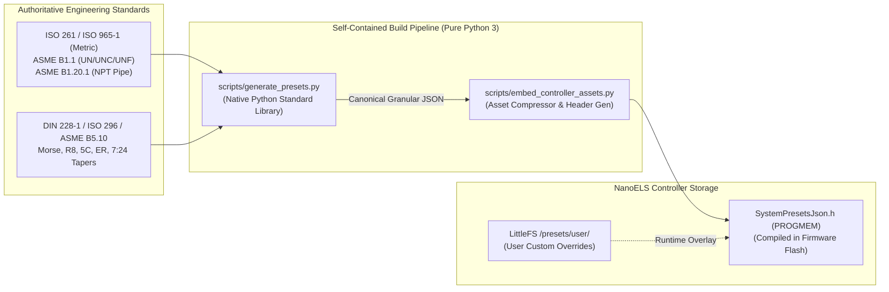

# NanoELS Machining Preset Catalog & Storage Architecture

> **Status:** Authoritative Specification (Subsystems 5, 6 & Core Storage)  
> **Target Version:** NanoELS H5 Modular Multi-Client Suite  
> **Author:** Antigravity & Emil  
> **Date:** October 14, 2026  
> **Location:** `docs/ELS_PRESET_CATALOG.md`  
> **Referenced By:** [`NANOELS_MASTER_ARCHITECTURE.md`](./NANOELS_MASTER_ARCHITECTURE.md), [`ELS_CLIENT_ARCHITECTURE.md`](./ELS_CLIENT_ARCHITECTURE.md), [`modes/threading/WIZARD_WORKFLOW.md`](./modes/threading/WIZARD_WORKFLOW.md), [`modes/taper/SPECIFICATION.md`](./modes/taper/SPECIFICATION.md)

---

## 1. Executive Summary & Design Principles

The **NanoELS Machining Preset Catalog** provides a unified, domain-extensible repository of machining specifications (threads, tapers, tooling, feeds/speeds, and custom shop recipes). It serves as the single point of truth across all operator interfaces (Web UI, Nextion LCD, wireless DRO tablets, and hardware pendants).

### Governing Architectural Tenets

1. **The Controller is the Master Authority:**  
   Machining presets belong to the lathe, not a browser's ephemeral `localStorage`. Switching between a workshop tablet, phone, or Nextion LCD yields identical engineering values, tolerances, and custom shop presets.
2. **Zero Manual Authoring (Upstream Provenance Mandate):**  
   NanoELS core developers do not hand-type or manually curate thousands of complex engineering tolerance numbers. Standard catalog datasets are ingested automatically from authoritative, machine-verified, open-source engineering engines (specifically **ThreadBuddy** for threads and **DIN 228 / ISO 296 / ASME B5.10** for tapers) via automated extraction pipelines.
3. **Two-Tier Storage Topology (ROM Flash vs LittleFS):**  
   - **Tier 1 (Factory ROM):** Standard international standards are compiled directly into microcontroller Flash ROM (`PROGMEM`) via `scripts/embed_controller_assets.py`. Upgrading standard tables occurs seamlessly with regular firmware updates via USB/OTA without touching or re-flashing the LittleFS partition.
   - **Tier 2 (Operator LittleFS):** Custom shop presets, shop favorites, and user overrides reside in LittleFS (`/presets/user/`). The filesystem is never wiped or required for basic factory operation.
4. **Targeted, Step-Wise Querying (Buffer-Safe):**  
   To prevent buffer overruns on memory-constrained serial links (e.g. 256-byte UART ring buffers on Nextion) and avoid heap fragmentation on ESP32 Core 1, the controller exposes an OData-inspired query protocol (`PRESET.discover`, `PRESET.get`). Clients request only the data needed for the active wizard step rather than dumping multi-kilobyte JSON blobs.
5. **Decoupled Units & Granular Presentation:**  
   All dimensions in the core catalog use exact canonical integer units (deci-microns `du`, deci-microns per revolution `dupr`, or tenths of degrees). Compound specifications are decomposed into atomic attributes (`standard_org`, `standard_id`, `tolerance_class`, `major_dia`, `pitch_dia`, `minor_dia`), allowing the Client Translation Layer to project either condensed display strings (Nextion) or rich graphical inspection cards (Web UI).
6. **Zero Motion Impact:**  
   Preset discovery and queries occur strictly while the machine is in `STANDBY` state (wizard authoring). In addition, File I/O and command dispatching execute on **Core 1**, completely isolated from the real-time PCNT and motion ISRs on **Core 0**.

---

## 2. Domain-Extensible Taxonomy

The preset architecture is organized into distinct, pluggable domains. While initial focus is dedicated to **Threads** and **Tapers**, the schema is intentionally structured to accommodate tooling, materials, and composite workshop operations.

```text
/presets/ (Root Catalog)
  ├── threads/             (Thread standards: ISO, ASME, NPT, Whitworth, ACME)
  │     ├── iso_metric.json
  │     ├── unified_national.json
  │     ├── pipe_npt.json
  │     └── trapezoidal_acme.json
  ├── tapers/              (Machine tapers, collets, spindles, pins, chamfers)
  │     ├── morse_din228.json
  │     ├── collets_spindles.json
  │     ├── standard_pins.json
  │     └── centers_chamfers.json
  ├── materials/           (Future: Cutting speeds & feeds per stock alloy)
  │     ├── aluminum_6061.json
  │     ├── steel_1018.json
  │     └── brass_360.json
  ├── tooling/             (Future: Insert geometries, nose radii, parting blades)
  │     └── lathe_carbide_inserts.json
  └── user/                (User custom additions & shop favorites)
        ├── threads/
        └── tapers/
```

---

## 3. Upstream Data Sources & Ingestion Pipeline

To ensure absolute accuracy without liability for manual transcription typos, standard datasets are generated via automated tooling scripts.



### 1. Primary Thread Standards (Machinery's Handbook / ISO / ASME)
- **Zero External Dependencies:** Built with pure Python 3 (`json`, `math`) in `scripts/generate_presets.py`.
- **Complete Engineering Triplet:**
  - **Stock Prep:** Major diameter min/max (turning prep) and minor diameter min/max (boring prep).
  - **Cutting Geometry:** Pitch ($P$ or $TPI$), flank angle, single-depth of cut ($h_3$).
  - **Inspection:** Pitch diameter tolerances ($d_2, D_2$), Best Wire Diameter ($W = 0.57735 \times P$), and Measurement Over Wires (MOW) target dimensions for thread micrometers.
  - **Tap Drills:** Standard cutting tap drill sizes from standard shop tables.

### 2. Primary Taper Standards
- **Standards:** DIN 228-1 (Morse tapers), ASME B5.10 (Machine tapers), ISO 7388 (7:24 steep tapers), ISO 2339 / ASME B18.8.2 (Taper pins).
- **Scope:** Complete set of machine tapers covering all lathe and milling spindle / collet geometries.

---

## 4. Canonical Granular Schema

Every preset item stores the **complete geometric triplet**:
1. **Stock / Blank Prep:** Dimensions to turn or bore the workpiece *before* cutting.
2. **Kinematic / Cutting:** Parameters governing axis synchronization, depth of cut, and infeed angle.
3. **Inspection / Quality:** Dimensions used to verify the finished feature with micrometers or calipers.

### A. Thread Preset Schema Example (`threads/iso_metric.json`)

```json
{
  "meta": {
    "domain": "threads",
    "standard_org": "ISO",
    "standard_id": "261 / 965-1",
    "standard_title": "ISO General Purpose Metric Screw Threads",
    "unit_system": "metric",
    "flank_angle_deg": 60.0,
    "version": "1.0.0"
  },
  "items": [
    {
      "id": "iso_m12x1_75_6g",
      "designation": "M12x1.75",
      "series": "coarse",
      "gender": "external",
      "tolerance_class": "6g",
      "nominal_dia_du": 120000,
      "pitch_du": 17500,
      "tpi": 0,
      "major_dia_max_du": 11966,
      "major_dia_min_du": 11701,
      "pitch_dia_max_du": 10829,
      "pitch_dia_min_du": 10679,
      "minor_dia_max_du": 9853,
      "minor_dia_min_du": 9573,
      "thread_depth_du": 10730,
      "tap_drill_dia_du": 10200,
      "wire_best_dia_du": 1010,
      "wire_mow_target_du": 12344,
      "taper_ratio": 0.0
    }
  ]
}
```

### B. Taper Preset Schema Example (`tapers/morse_din228.json`)

```json
{
  "meta": {
    "domain": "tapers",
    "standard_org": "DIN",
    "standard_id": "228-1",
    "standard_title": "Morse Tapers and Metric Tapers",
    "unit_system": "metric",
    "version": "1.0.0"
  },
  "items": [
    {
      "id": "mt3",
      "designation": "MT3",
      "series": "MT",
      "form": "external",
      "cone_ratio": 0.050196,
      "half_angle_deg": 1.4376,
      "included_angle_deg": 2.8752,
      "taper_in_per_ft": 0.6024,
      "gauge_dia_large_du": 23825,
      "gauge_dia_small_du": 19799,
      "gauge_length_du": 81000
    }
  ]
}
```

---

## 5. Command Protocol & Step-Wise OData-Style Querying

Presets are queried through the central `CommandDispatcher` over any transport (WebSocket, Serial1 UART). To maintain low latency and prevent serial buffer overruns, the protocol supports targeted filtering and projections.

### Command Syntax

```text
PRESET.discover [path=<domain>]
PRESET.get path=<domain>/<catalog>[/<item_id>] [$select=<fields>] [$filter=<expression>] [$metadata=true]
```

### Query Operations

| Operation | Command Example | Controller Response | Purpose |
| :--- | :--- | :--- | :--- |
| **Discover Domains** | `PRESET.discover` | `{"domains":["threads","tapers","materials","user"]}` | Populates root UI navigation. |
| **Discover Families** | `PRESET.discover path=threads` | `{"files":["iso_metric","unified_national","pipe_npt"]}` | Populates wizard standard tabs. |
| **Read Catalog Meta** | `PRESET.get path=threads/iso_metric $metadata=true` | Returns `meta` header block only. | Displays standard title, flank angle, and authoring unit. |
| **Field Projection** | `PRESET.get path=threads/iso_metric $select=id,designation` | `[{"id":"m10","designation":"M10x1.5"},...]` | Extremely lightweight payload for populating touch dropdown pickers. |
| **Item Detail** | `PRESET.get path=threads/iso_metric/iso_m12x1_75_6g` | Returns complete JSON record for M12x1.75. | Hydrates wizard calculation engine, prep alerts, and infeed passes. |
| **Attribute Filter** | `PRESET.get path=threads/iso_metric $filter=series eq 'coarse'` | Returns coarse sizes only. | Reduces picker list size for user convenience. |

---

## 6. Client Translation Layer Integration

In conformance with **Tenet 2 (Strict Layer Decoupling)** of [`ELS_CLIENT_ARCHITECTURE.md`](./ELS_CLIENT_ARCHITECTURE.md), the core returns raw canonical values. The Client Translation Layer translates this data to suit each client interface:

### 1. Rich Touch Web UI (`lathe_dro_nanoels_controller.html`)
- Directly consumes the structured JSON objects over WebSocket.
- Renders:
  - **Stock Prep Card:** Directs operator: *"Turn stock OD to 11.88 mm – 11.96 mm"*.
  - **Pass Schedule:** Computes auto depth-of-cut progression based on `thread_depth_du`.
  - **Inspection Card:** Shows *"Best Wire: 1.01 mm | 3-Wire Target: 12.344 mm"*.

### 2. Legacy / Low-Memory Nextion Display (UART `Serial1`)
- The Nextion display cannot parse large nested JSON arrays.
- The `NextionTranslationAdapter` queries the core internally and serializes compact, human-readable strings over UART:
  - Sets Nextion text component: `tTitle.txt="M12x1.75 (6g)"`
  - Sets Nextion prep label: `tPrep.txt="Prep: 11.90mm"`
  - Sets Nextion pitch value: `tPitch.txt="1.75mm"`

---

## 7. Storage Engine & Firmware Lifecycle

```mermaid
stateDiagram-v2
    [*] --> Standby: Controller Boot
    
    state Standby {
        [*] --> CatalogReady
        CatalogReady --> ReadROM: Query System Standard
        CatalogReady --> ReadLittleFS: Query User Preset (/presets/user/)
        ReadROM --> SendResponse
        ReadLittleFS --> SendResponse
    }

    Standby --> ModeActive: Operator Starts Cycle (Engage ELS)
    
    state ModeActive {
        note right of ModeActive
            Preset queries locked out during active cutting.
            Core 0 PCNT & motion ISRs have 100% bus priority.
        end note
    }

    ModeActive --> Standby: Cycle Stop / Disengage
```

1. **Read-On-Demand (Zero Permanent SRAM):**  
   Neither system nor user presets reside permanently in ESP32 RAM. When a query is received, Core 1 opens the stream (`PROGMEM` string or LittleFS file), serializes the filtered response to the transport buffer, and immediately frees memory.
2. **Deterministic Motion Safety:**  
   Preset queries are strictly servicing configuration in `STANDBY` state. Once an operational mode is active (Threading, Taper, Turning), client configuration commands are ignored or rejected, ensuring zero bus contention while the spindle and lead screw are coupled.
