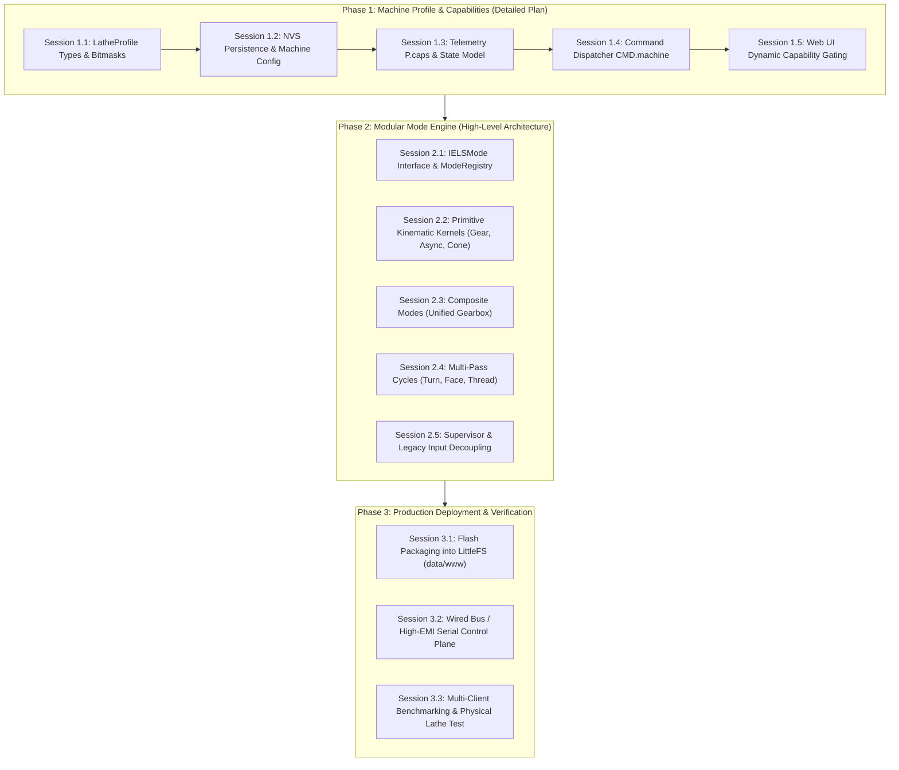

# NanoELS Modular Architecture Implementation Plan

> **Status:** Approved for Phased Execution  
> **Target Version:** NanoELS H5 Modular Architecture  
> **Source Documents:** [`ELS_MODE_ARCHITECTURE.md`](./ELS_MODE_ARCHITECTURE.md), [`ELS_CORE_STATE_MODEL.md`](./ELS_CORE_STATE_MODEL.md), [`LATHE_MACHINE_PROFILE.md`](./LATHE_MACHINE_PROFILE.md), [`ELS_CLIENT_ARCHITECTURE.md`](./ELS_CLIENT_ARCHITECTURE.md), [`clients/web_ui/OVERVIEW.md`](./clients/web_ui/OVERVIEW.md)  
> **Location:** `docs/IMPLEMENTATION_PLAN.md`

---

## 1. Overview & Phased Roadmap Strategy

To transform the NanoELS firmware and client ecosystem from its legacy monolithic structure into the modular architecture defined in `docs/`, the implementation is partitioned into three progressive phases.

Because this represents a significant engineering effort across firmware C++ (ESP32-S3), wire protocols, and frontend JavaScript, **each phase is structured into discrete, single-conversation milestones**. Each conversation milestone produces compilable, testable code without breaking existing lathe operation.

---

## 2. Phase 1: Lathe Machine Profile & Hardware Capabilities (Comprehensive Plan)

### Objective
Replace rigid compile-time `#define` flags (`HAS_DRO_X`, `ACTIVE_Y`, etc.) with a dynamic, capability-negotiating hardware abstraction. Expose hardware reality to connected clients so the UI can adapt dynamically to any lathe configuration (from a basic 7×14 mini-lathe to a motorized 2-axis bench lathe).

---

### Session 1.1: Core Data Structures & Capability Bitmask Definition
* **Goal:** Create a standalone, self-contained header [`src/motion/LatheProfile.h`](../src/motion/LatheProfile.h) declaring the typed profile structs and bitmasks without modifying existing motion logic.
* **Firmware Scope:**
  1. Define `LatheCapabilityFlags` bitmask (`uint32_t`):
     - Spindle: `CAP_SPINDLE_ENCODER`, `CAP_SPINDLE_INDEX`, `CAP_SPINDLE_VFD`.
     - Axes: `CAP_MOTOR_Z`, `CAP_MOTOR_X`.
     - Scales: `CAP_DRO_Z`, `CAP_DRO_X`.
     - Limits & Inputs: `CAP_LIMIT_SWITCH_Z`, `CAP_LIMIT_SWITCH_X`, `CAP_MPG_Z`, `CAP_MPG_X`, `CAP_JOYSTICK`.
  2. Define component structs:
     - [`AxisHardwareConfig`](./LATHE_MACHINE_PROFILE.md#32-axis-hardware-configuration-axishardwareconfig) (pitch, steps/mm, backlash, travel limits, rapid ceilings).
     - [`SpindleHardwareConfig`](./LATHE_MACHINE_PROFILE.md#33-spindle-hardware-configuration-spindlehardwareconfig) (encoder PPR, max safe RPM, min sync RPM, VFD parameters).
     - [`LatheDimensions`](./LATHE_MACHINE_PROFILE.md#34-physical-envelope--geometry-lathedimensions) (bed length, max swing, cross-slide clearance, chuck dimensions).
     - [`LatheConfiguration`](./LATHE_MACHINE_PROFILE.md#35-the-complete-lathe-profile-latheconfiguration) aggregating all parameters.
  3. Declare standard baseline fallback profile (`getDefaultProfile()`, WM210V 8×16 baseline). Avoid multi-preset ROM bloat in favor of LittleFS JSON storage.
* **Verification:** Run PlatformIO build to ensure header compiles cleanly with zero warnings and no runtime changes.

---

### Session 1.2: Machine Configuration Storage & NVS Persistence
* **Goal:** Integrate `LatheConfiguration` into [`Config.h`](../src/core/Config.h) / [`Config.cpp`](../src/core/Config.cpp) and enable persistent storage.
* **Firmware Scope:**
  1. Add an active `LatheConfiguration activeMachineProfile` instance.
  2. Implement `loadMachineProfile()` and `saveMachineProfile()` using ESP32 `Preferences` under namespace `"machine"`.
  3. **Zero-Regression Invariant:** If NVS namespace `"machine"` is uninitialized, automatically populate `activeMachineProfile` using the existing compile-time defaults (`DEFAULT_SCREW_Z_DU`, `MOTOR_STEPS_Z`, `HAS_DRO_Z`, etc.).
  4. Expose getters/setters in [`SettingsService.h`](../src/core/SettingsService.h).
* **Verification:** Verify ESP32 boot log outputs active machine capabilities and loads stored overrides cleanly.

---

### Session 1.3: Telemetry Stream & State Model Integration
* **Goal:** Extend the 4-Domain State Model to publish hardware capabilities and machine geometry to connected clients.
* **Firmware Scope:**
  1. Add `uint32_t capabilities` to [`MachineProperties`](../src/core/MachineModel.h#L56-L71) in [`MachineModel.h`](../src/core/MachineModel.h).
  2. Update [`MachineModel::captureProperties()`](../src/core/MachineModel.cpp#L73-L90) to sample `activeMachineProfile.capabilities`.
  3. In [`RichClientAdapter.cpp`](../src/display/RichClientAdapter.cpp), serialize `P.caps=0x<HEX>` into the Properties domain stream.
  4. Ensure `hasChanged()` triggers a push update when machine capabilities or profile properties are modified.
* **Verification:** Connect to WebSocket endpoint and verify telemetry emits `P.caps` in response to `CMD.get=P`.

---

### Session 1.4: Command Dispatcher Wire Protocol, LittleFS Presets & Schema Introspection (COMPLETED)
* **Goal:** Allow client interfaces to manage presets (`/presets/*.json`), inspect JSON Schema, modify calibration, and select presets over canonical wire commands.
* **Firmware Scope:**
  1. Extend [`CommandDispatcher.cpp`](../src/web/CommandDispatcher.cpp):
     - `SETTINGS.preset.list`: Returns list of available presets (embedded ROM templates + LittleFS `/presets/` user profiles).
     - `SETTINGS.preset.get=<slug>`: Streams JSON preset file payload from LittleFS or ROM.
     - `SETTINGS.preset.apply=<slug>`: Parses JSON preset from LittleFS or ROM, updates active profile in RAM, and saves active slug to NVS.
     - `SETTINGS.preset.save=<slug>`: In-place serialization and saving of active configuration to LittleFS (blocks overwriting system templates).
     - `SETTINGS.preset.delete=<slug>`: Deletes user preset file from LittleFS (safeguards protect system templates, active preset, and default preset).
     - `SETTINGS.preset.setDefault=<slug>` / `SETTINGS.preset.resetToDefault`: Manages catalog default profile.
     - `SETTINGS.schema=<name>`: Streams authoritative JSON Schema (`/schemas/lathe-profile.schema.json` embedded in ROM with LittleFS override fallback).
     - `SETTINGS.set=machine.<key>,<val>`: Updates physical calibration with sparse NVS override.
  2. Enforce safety checks: Disallow preset switches while lathe motion is active (`isOn == true`).
  3. HTTP Endpoints in [`WebServerModule.cpp`](../src/web/WebServerModule.cpp): `GET /api/schema/profile` and `GET /schemas/lathe-profile.schema.json`.
* **Verification:** Verified compilation (`pio run -e esp32s3`) clean with zero errors and warnings. Dispatch and schema streaming operational.

---

### Session 1.5: Client-Side Capability Hydration & UI Gating (Web UI & Simulator)
* **Goal:** Update the Web UI client and emulator to dynamically adapt layout and controls based on reported `P.caps`.
* **Frontend Scope:**
  1. **Store Extension ([`nanoels-state.js`](../clients/web_ui/nanoels-state.js)):**
     - Parse `P.caps` into a reactive capability object (`$store.machine.capabilities`).
     - Provide helper method `$store.machine.hasCap(flagName)`.
  2. **Simulator Parity ([`nanoels-emulator.js`](../clients/web_ui/nanoels-emulator.js)):**
     - Emulate `P.caps` and wire `CMD.machine.*` responses for offline browser testing.
  3. **Adaptive UI Controls ([`lathe_dro_nanoels_controller.html`](../clients/web_ui/lathe_dro_nanoels_controller.html)):**
     - Visually gate cross-slide power feed / facing buttons if `!hasCap('CAP_MOTOR_X')`.
     - Toggle DRO indicator badges (`DRO X`, `DRO Z`) based on `CAP_DRO_*`.
     - Link machine profile dimensions directly to the Digital Twin visualizer ([`lathe-viz.js`](../clients/web_ui/dev/lathe-viz.js)).
* **Verification:** Verify in browser with simulator and live controller; switching profiles dynamically updates UI controls and canvas dimensions.

---

## 3. Phase 2: Operational Mode Architecture (`IELSMode`) (High-Level Architecture)

> **Objective:** Transition the motion engine from procedural functions in [`Motion.cpp`](../src/motion/Motion.cpp) into polymorphic, modular classes adhering to [`IELSMode`](./ELS_MODE_ARCHITECTURE.md#32-the-mode-interface-contract-ielsmode).

### Planned Conversations:
* **Session 2.1: `IELSMode` Base Interface & `ModeRegistry` Framework [COMPLETE]**
  - Implement base lifecycle: `init()`, `enter()`, `loop()`, `exit()`, `start()`, `stop()`, `handleCommand()`, `getTelemetry()`.
  - Create `ModeRegistry` to map operational `ModeId` to mode instances with hardware capability preconditions.
* **Session 2.2: Kinematic Kernel Functions & Conversion Utilities (Subsystem 2) (ADR 0001)**
  - Implement pure kinematic step functions in `motion/`: `stepSynchronized()`, `stepVelocity()`.
  - Implement `MotionConversions.h`: Cartesian direction parsing (`semanticToDirection`), unit conversions (`mmToDu`, `feedMmPerMinToDu`).
  - Modernize timer stepping (`onAsyncTimer`) to step active axis in coordinate polarity, strictly bounded by universal soft limits (`leftStop`, `rightStop`).
* **Session 2.3: Consolidated Gearbox Operational Mode (`GearboxMode`) (ADR 0001)**
  - Refactor `UnifiedGearboxMode` into a clean, unified `GearboxMode` directly invoking Subsystem 2 kinematic functions.
  - Retire pseudo-mode wrapper classes (`GearZPrimitive`, `GearXPrimitive`, `AsyncPrimitive`).
  - Implement G94/G95 "Feed is Feed" context and `startFeed(FeedRequest)` atomic invocation.
* **Session 2.4: Command Dispatcher & Ingress Staging Adapter (Subsystem 5) (ADR 0001 & ADR 0002)**
  - Implement canonical rich client commands: `CMD.startFeed=<A,S,F,D,[dist]>`, `CMD.stop`, `CMD.feedNudge`.
  - Quarantine and isolate legacy drip-fed modal setters (`gearAxis`, `gearSync`, `gearDir`, `feedMm`) into a dedicated compatibility staging adapter.
* **Session 2.5: Web UI Atomic Invocation Integration (Subsystem 6) (ADR 0001)**
  - Update `clients/web_ui/lathe-controller.js` to dispatch `CMD.startFeed` atomically on START.
  - Remove unnecessary intermediate drip-feeding during form editing.
* **Session 2.6: Multi-Pass Machining Cycles (Turning, Facing, Threading)**
  - Implement `TurnCycleMode`, `FaceCycleMode`, and `ThreadCycleMode` as clean state machines using Subsystem 2 kinematic functions directly.

---

## 4. Phase 3: Production Web UI Deployment & Validation (High-Level Architecture)

> **Objective:** Deploy the prototype web application to the ESP32 filesystem and validate multi-client industrial operation.

### Planned Conversations:
* **Session 3.1: Production Asset Packaging for LittleFS (`data/www`)**
  - Package [`clients/web_ui`](../clients/web_ui) assets (HTML, CSS, JS, Alpine runtime) into [`data/www`](../data/www).
  - Configure LittleFS build flags and gzip asset compression to minimize flash footprint and load times.
* **Session 3.2: Wired Bus / High-EMI Serial Control Plane Validation**
  - Enforce the Zero-WiFi Control Plane Mandate: verify that motion commands and safety interlocks operate with 100% determinism over physical UART (`Serial1`), while Wi-Fi remains dedicated to supervisory DRO telemetry.
* **Session 3.3: Multi-Client Concurrency & Real-Hardware Benchmark**
  - Verify concurrent operation across heterogeneous clients: Nextion machine-mounted LCD, tablet Web DRO, and USB serial pendant.
  - Test E-stop priority and state synchronization under spindle load.

---

## 5. Execution Protocol & Verification Milestones

1. **Self-Contained Sessions:** Each session represents one focused conversational pair-programming session.
2. **Compile-Pass Invariant:** At the conclusion of every session, `pio run` must pass with zero compilation errors.
3. **Safety Guarantee:** Lathe motion and limit stop enforcement remain functional at every step.
