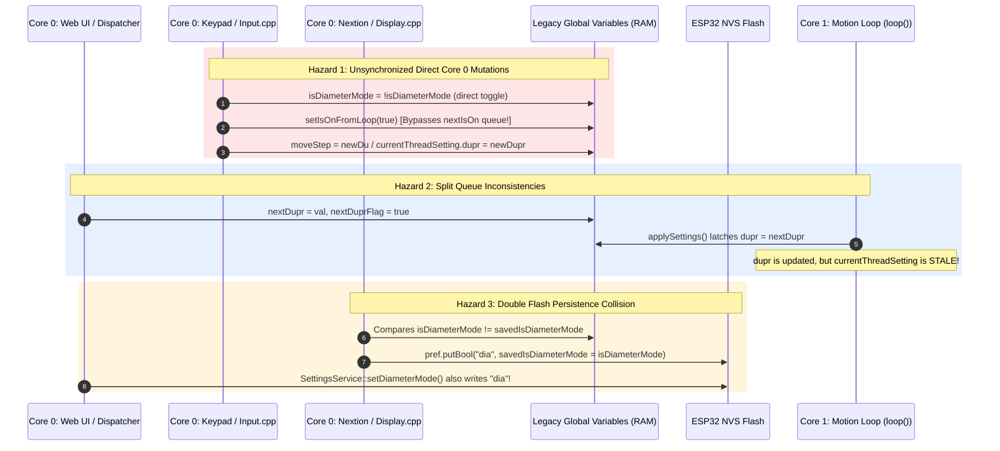

# NanoELS H5 — Tier 2 State Audit & Mapping Specification

> **Status:** Authoritative Architectural Mapping & Audit  
> **Target Version:** NanoELS H5 Modular Architecture  
> **Author:** Antigravity & Emil  
> **Date:** October 8, 2026  
> **Location:** `docs/TIER2_STATE_MAPPING.md`  
> **Referenced By:** [`NANOELS_MASTER_ARCHITECTURE.md`](./NANOELS_MASTER_ARCHITECTURE.md), [`ELS_CORE_STATE_MODEL.md`](./ELS_CORE_STATE_MODEL.md), [`ELS_PROPERTIES_AND_SETTINGS.md`](./ELS_PROPERTIES_AND_SETTINGS.md)  
> **Strict Mandate:** Audit & Analysis Only — Zero C++ Firmware Mutations in this Step.

---

## 1. Executive Summary: Bridging Supervisory Intent (Core 0) & Real-Time Motion (Core 1)

In the ongoing evolution of NanoELS H5 from a monolithic Arduino sketch into an industrial-grade, multi-client electronic leadscrew platform, configuration and state are divided into four hierarchical tiers:

```
┌────────────────────────────────────────────────────────────────────────────────────────┐
│ TIER 1: PHYSICAL MACHINE PROFILE (Lathe Mechanics & Iron) — [MIGRATED]                 │
│ Leadscrew pitches, motor steps/mm, encoder PPR, physical travels, bed geometry.         │
│ Canonical Container: activeMachineProfile in LatheProfile.h / SettingsService.h        │
├────────────────────────────────────────────────────────────────────────────────────────┤
│ TIER 2: OPERATOR INTENT, SETUPS, MODES & BOUNDARIES — [CURRENT AUDIT FOCUS]            │
│ Pitch/feedrate intent, multi-start indexing, taper ratios, travel stops, active mode,  │
│ motion enable (isOn), emergency stop, and coordinate display modes.                    │
│ Current State: Scattered across raw globals in Config.h, Axis.h, Motion.h              │
│ Target Container: MachineModel (K, I, C, P) & SettingsService                          │
├────────────────────────────────────────────────────────────────────────────────────────┤
│ TIER 3: WORKSHOP OPERATOR PREFERENCES (Shared Defaults & Tuning)                       │
│ Startup measurement units, jog step increments, telemetry deadbands.                   │
│ Canonical Container: SettingsService (prefs namespace)                                 │
├────────────────────────────────────────────────────────────────────────────────────────┤
│ TIER 4: CLIENT PRESENTATION (Ephemeral Display Ergonomics)                             │
│ Diameter vs Radius view, DRO source, Web UI theme, speech feedback.                   │
│ Canonical Container: Client-local storage & Controller-backed broker                   │
└────────────────────────────────────────────────────────────────────────────────────────┘
```

### 1.1 The "Split-Brain" Problem
While Tier 1 hardware calibration was cleanly migrated into [`LatheConfiguration activeMachineProfile`](../src/motion/LatheProfile.h#L130-L148) via [`SettingsService`](../src/core/SettingsService.h#L19-L24), **Tier 2 state remains trapped in raw, unencapsulated procedural global variables**.

This creates a dangerous "split-brain" architecture:
1. **Divergent State Pipelines:** Modern web clients and the native LVGL display communicate via [`CommandDispatcher`](../src/web/CommandDispatcher.cpp) and [`MachineModel`](../src/core/MachineModel.cpp) over Core 0. Concurrently, legacy hardware inputs ([`Input.cpp`](../src/input/Input.cpp)) and the Nextion LCD task ([`Display.cpp`](../src/display/Display.cpp)) directly mutate raw globals like `isDiameterMode`, `moveStep`, and `turnPasses` in RAM.
2. **Double Persistence & NVS Clashes:** [`Display.cpp`](../src/display/Display.cpp#L180-L228) runs an uncoordinated background timer that compares raw globals against shadow `saved*` variables and writes directly to NVS flash (`"h5"`). Concurrently, [`SettingsService`](../src/core/SettingsService.cpp#L267-L327) provides typed setters that also write to NVS.
3. **Core 0 / Core 1 Cross-Core Hazards:** Core 1 runs the real-time motion loop ([`main.cpp:loop()`](../src/main.cpp#L195-L240)) and high-speed stepper timers. Core 0 FreeRTOS tasks mutate operational variables without atomic locks or with inconsistent flag staging, risking mid-calculation state tearing.

### 1.2 Target Four-Domain State Model (`MachineModel`)
Every audited Tier 2 variable must map deterministically into one of the four canonical domains defined in [`ELS_CORE_STATE_MODEL.md`](./ELS_CORE_STATE_MODEL.md):

* **Kinematics Domain `[K]` (Bit `0x01`):** Real-time physical machine dynamics, axis positions, travel boundaries (`zLeftDu`, `zRightDu`, `xUpDu`, `xDownDu`), active operational mode (`mode`), motion state (`isOn`), and safety interlock (`estop`).
* **Intent Domain `[I]` (Bit `0x02`):** Pure operator authoring intent, preserving exact authoring units (`thFmt`, `thPitch`, `tpMode`, `tpVal`, `coneRatio`), manual feed/jog step sizes (`feedStepDu`, `jogStepDu`), and feed direction (`feedReverse`).
* **Cycle Domain `[C]` (Bit `0x04`):** Multi-pass canned cycle parameters, total pass count (`turnPasses`), active pass (`currentPass` / `opIndex`), setup wizard step (`setupIndex`), and multi-start index (`starts`).
* **Properties Domain `[P]` (Bit `0x08`):** Persistent machine properties, unit system (`measure`), diameter mode (`isDiameterMode`), absolute mode (`isAbsoluteMode`), and active DRO scale source (`zDroActive`, `xDroActive`).

---

## 2. Comprehensive Tier 2 Inventory & Codebase Mapping Table

The following table documents every Tier 2 variable audited across [`src/core/Config.h`](../src/core/Config.h), [`src/motion/Axis.h`](../src/motion/Axis.h), [`src/motion/Motion.h`](../src/motion/Motion.h), and all implementation files in `src/`.

| Variable Group & Legacy Name | Legacy Location | Type & Semantics | Target Domain | Canonical Target Accessor / Container | Read Locations (`src/*.cpp`) | Write / Mutation Locations (`src/*.cpp`) |
| :--- | :--- | :--- | :---: | :--- | :--- | :--- |
| **1. Travel Stops & Boundaries** | | | | | | |
| `z.leftStop`<br>`z.rightStop` | [`Axis.h:38,43`](../src/motion/Axis.h#L38-L43) | `long`<br>Workpiece left (chuck) and right (tailstock) travel soft-limits in raw leadscrew motor steps relative to axis internal coordinates. Unset = `LONG_MAX` / `LONG_MIN`. Volatile in RAM (resets to unbound on boot). | **`[K]`** | [`SettingsService::setAxisLimitDu(AXIS_Z, ...)`](../src/core/SettingsService.h)<br>[`KinematicsState::zLeftDu`](../src/core/MachineModel.h#L24)<br>[`KinematicsState::zRightDu`](../src/core/MachineModel.h#L25) | [`Motion.cpp:73, 590, 676`](../src/motion/Motion.cpp#L73)<br>[`Axis.cpp:202, 212, 401, 717`](../src/motion/Axis.cpp#L202)<br>[`MachineModel.cpp:22, 35`](../src/core/MachineModel.cpp#L22)<br>[`Display.cpp:62, 180`](../src/display/Display.cpp#L62)<br>[`DisplayModel.cpp:40, 241`](../src/display/DisplayModel.cpp#L40)<br>[`Input.cpp:271, 1036`](../src/input/Input.cpp#L271) | [`main.cpp`](../src/main.cpp) (initialized unbound on boot)<br>[`Motion.cpp:168, 170`](../src/motion/Motion.cpp#L168) (`reset()`)<br>[`Motion.cpp:280, 286`](../src/motion/Motion.cpp#L280) (`applyLeftStop`, `applyRightStop`)<br>[`Motion.cpp:364, 367`](../src/motion/Motion.cpp#L364) (`markOrigin`)<br>[`Axis.cpp:106, 110`](../src/motion/Axis.cpp#L106) (`initAxis`)<br>[`Axis.cpp:225, 228`](../src/motion/Axis.cpp#L225) (`markAxisOrigin`) |
| `z.savedLeftStop`<br>`z.savedRightStop` | [`Axis.h:39,44`](../src/motion/Axis.h#L39-L44) | `long`<br>Legacy shadow copy of Z stops. Volatile in RAM. | **`[K]`** | Managed in RAM by [`SettingsService`](../src/core/SettingsService.h). | [`Display.cpp:180`](../src/display/Display.cpp#L180) | [`main.cpp`](../src/main.cpp) (initialized unbound on boot)<br>[`Axis.cpp:107, 111`](../src/motion/Axis.cpp#L107) |
| `z.nextLeftStop`<br>`z.nextLeftStopFlag`<br>`z.nextRightStop`<br>`z.nextRightStopFlag` | [`Axis.h:40-41, 45-46`](../src/motion/Axis.h#L40-L46) | `long`, `bool`<br>Staging register and latch flag for asynchronous Z stop modification across cores. | **`[K]` / Latch** | Core 1 atomic latching queue via [`SettingsService`](../src/core/SettingsService.h). | [`Motion.cpp:280, 286, 853, 857`](../src/motion/Motion.cpp#L280) | [`Motion.cpp:169, 171`](../src/motion/Motion.cpp#L169) (`reset()`)<br>[`Motion.cpp:261-262, 266-267`](../src/motion/Motion.cpp#L261) (`setLeftStop`, `setRightStop`)<br>[`Motion.cpp:855, 859`](../src/motion/Motion.cpp#L855) (`applySettings`)<br>[`Axis.cpp:108, 112`](../src/motion/Axis.cpp#L108) |
| `x.leftStop`<br>`x.rightStop`<br>(and `saved*`, `next*`) | [`Axis.h:38-46`](../src/motion/Axis.h#L38-L46) | `long`, `bool`<br>Cross-slide infeed (up) and retract (down) travel soft-limits in raw motor steps. Unset = `LONG_MAX` / `LONG_MIN`. Volatile in RAM. | **`[K]`** | [`SettingsService::setAxisLimitDu(AXIS_X, ...)`](../src/core/SettingsService.h)<br>[`KinematicsState::xUpDu`](../src/core/MachineModel.h#L26)<br>[`KinematicsState::xDownDu`](../src/core/MachineModel.h#L27) | [`Motion.cpp:81, 475, 596, 623`](../src/motion/Motion.cpp#L81)<br>[`Axis.cpp:202, 212, 401, 807`](../src/motion/Axis.cpp#L202)<br>[`MachineModel.cpp:22, 37`](../src/core/MachineModel.cpp#L22)<br>[`Display.cpp:63, 182`](../src/display/Display.cpp#L63)<br>[`DisplayModel.cpp:40, 241`](../src/display/DisplayModel.cpp#L40)<br>[`Input.cpp:271, 1036`](../src/input/Input.cpp#L271) | [`main.cpp`](../src/main.cpp) (initialized unbound on boot)<br>[`Motion.cpp:177, 179`](../src/motion/Motion.cpp#L177) (`reset()`)<br>[`Motion.cpp:280, 286`](../src/motion/Motion.cpp#L280) (`applyLeftStop`, `applyRightStop`)<br>[`Motion.cpp:364, 367`](../src/motion/Motion.cpp#L364)<br>[`Axis.cpp:106-112, 225, 228`](../src/motion/Axis.cpp#L106) |
| **2. Pitch, Threading & Feed Intent** | | | | | | |
| `dupr` | [`Axis.h:104`](../src/motion/Axis.h#L104)<br>[`Axis.cpp:32`](../src/motion/Axis.cpp#L32) | `long`<br>Active kinematic feed/lead per spindle revolution in deci-microns ($0.1\,\mu\text{m}$). Sign indicates carriage direction. Volatile in RAM (resets to 0 on boot). | **`[K]` / `[I]`** | [`SettingsService::setFeedrateDupr()`](../src/core/SettingsService.h)<br>[`KinematicsState::dupr`](../src/core/MachineModel.h#L37)<br>[`IntentState::thread`](../src/core/MachineModel.h#L42) | [`Motion.cpp:73, 114, 232, 476, 526, 575, 623, 744`](../src/motion/Motion.cpp#L73)<br>[`Axis.cpp:408, 570`](../src/motion/Axis.cpp#L408)<br>[`MachineModel.cpp:48, 59`](../src/core/MachineModel.cpp#L48)<br>[`RichClientAdapter.cpp:23, 72`](../src/display/RichClientAdapter.cpp#L23)<br>[`Display.cpp:159, 180`](../src/display/Display.cpp#L159)<br>[`DisplayModel.cpp:350-363`](../src/display/DisplayModel.cpp#L350)<br>[`Input.cpp:976, 1070`](../src/input/Input.cpp#L976)<br>[`main.cpp:210`](../src/main.cpp#L210) | [`main.cpp`](../src/main.cpp) (initialized to 0 on boot)<br>[`Motion.cpp:174`](../src/motion/Motion.cpp#L174) (`reset()` to 0)<br>[`Motion.cpp:234`](../src/motion/Motion.cpp#L234) (`applyDupr()` latches `nextDupr`) |
| `savedDupr` | [`Axis.h:105`](../src/motion/Axis.h#L105)<br>[`Axis.cpp:33`](../src/motion/Axis.cpp#L33) | `long`<br>Legacy shadow copy of `dupr`. Volatile in RAM. | **`[I]`** | Managed in RAM by [`SettingsService`](../src/core/SettingsService.h). | [`Display.cpp:180`](../src/display/Display.cpp#L180) | [`main.cpp`](../src/main.cpp) (initialized to 0 on boot) |
| `nextDupr`<br>`nextDuprFlag` | [`Axis.h:106-107`](../src/motion/Axis.h#L106-L107)<br>[`Axis.cpp:34-35`](../src/motion/Axis.cpp#L34-L35) | `long`, `bool`<br>Staging register and latch flag for non-blocking Core 0 pitch intent changes. | **`[K]` / Latch** | [`KinematicsState::nextDupr`](../src/core/MachineModel.h#L38)<br>Latched in [`Motion.cpp:applyDupr()`](../src/motion/Motion.cpp#L228-L250) | [`Motion.cpp:229, 232, 845, 1331`](../src/motion/Motion.cpp#L229)<br>[`MachineModel.cpp:49, 59`](../src/core/MachineModel.cpp#L49)<br>[`RichClientAdapter.cpp:24, 73`](../src/display/RichClientAdapter.cpp#L24)<br>[`Input.cpp:976`](../src/input/Input.cpp#L976) | [`Motion.cpp:137-138`](../src/motion/Motion.cpp#L137) (`setDupr`)<br>[`Motion.cpp:847`](../src/motion/Motion.cpp#L847) (`applySettings`) |
| `ThreadSetting`<br>(`currentThreadSetting`) | [`Motion.h:84-89, 103`](../src/motion/Motion.h#L84-L103)<br>[`Motion.cpp:36`](../src/motion/Motion.cpp#L36) | `struct`<br>`format` (Metric, TPI, Inch), `authorPitch` (`float`), `dupr` (`long`). Preserves lossless operator authoring input. | **`[I]`** | [`SettingsService::getThreadSetting()`](../src/core/SettingsService.h)<br>[`IntentState::thread`](../src/core/MachineModel.h#L42) | [`Motion.cpp:1395`](../src/motion/Motion.cpp#L1395) (`getThreadSetting`)<br>[`MachineModel.cpp:55, 132`](../src/core/MachineModel.cpp#L55)<br>[`RichClientAdapter.cpp:28-30, 75-77`](../src/display/RichClientAdapter.cpp#L28) | [`Motion.cpp:205`](../src/motion/Motion.cpp#L205) (`reset`)<br>[`Motion.cpp:1336-1381`](../src/motion/Motion.cpp#L1336) (`setFeedrate*`)<br>[`Motion.cpp:1390`](../src/motion/Motion.cpp#L1390) (`reverseFeedDirection`)<br>[`Input.cpp:999`](../src/input/Input.cpp#L999) *(Hazard: bypasses setter)* |
| `moveStep` | [`Axis.h:122`](../src/motion/Axis.h#L122)<br>[`Axis.cpp:50`](../src/motion/Axis.cpp#L50) | `long`<br>Manual jogging step increment in deci-microns ($0.1\,\mu\text{m}$, e.g. 100, 1000, 10000). | **`[I]` / `[P]`** | [`SettingsService::setJogStepDu(long du)`](../src/core/SettingsService.h#L48)<br>[`IntentState::jogStepDu`](../src/core/MachineModel.h#L45) | [`Axis.cpp:438, 570, 708, 798`](../src/motion/Axis.cpp#L438)<br>[`MachineModel.cpp:58, 140`](../src/core/MachineModel.cpp#L58)<br>[`RichClientAdapter.cpp:34, 80`](../src/display/RichClientAdapter.cpp#L34)<br>[`Display.cpp:70, 181`](../src/display/Display.cpp#L70)<br>[`DisplayModel.cpp:365`](../src/display/DisplayModel.cpp#L365)<br>[`Input.cpp:556, 1096-1107`](../src/input/Input.cpp#L556)<br>[`SettingsService.cpp:468`](../src/core/SettingsService.cpp#L468) | [`main.cpp:114`](../src/main.cpp#L114) (NVS restore)<br>[`Motion.cpp:197`](../src/motion/Motion.cpp#L197) (`reset`)<br>[`Config.cpp:720`](../src/core/Config.cpp#L720) (`setMeasure`)<br>[`SettingsService.cpp:320`](../src/core/SettingsService.cpp#L320)<br>[`Input.cpp:300, 1097-1109`](../src/input/Input.cpp#L300) *(Direct cycle)*<br>[`CommandDispatcher.cpp:146`](../src/web/CommandDispatcher.cpp#L146) *(Direct set)* |
| `savedMoveStep` | [`Axis.h:123`](../src/motion/Axis.h#L123)<br>[`Axis.cpp:51`](../src/motion/Axis.cpp#L51) | `long`<br>Shadow copy of `moveStep` for dirty detection in `Display.cpp`. | **`[P]` / NVS** | Managed internally by [`SettingsService`](../src/core/SettingsService.h). | [`Display.cpp:181`](../src/display/Display.cpp#L181) | [`main.cpp:114`](../src/main.cpp#L114)<br>[`Display.cpp:205`](../src/display/Display.cpp#L205) (writes NVS `PREF_MOVE_STEP`) |
| **3. Cycle & Geometry Parameters** | | | | | | |
| `starts` | [`Axis.h:109`](../src/motion/Axis.h#L109)<br>[`Axis.cpp:37`](../src/motion/Axis.cpp#L37) | `int`<br>Multi-start thread index count (1 to 124). | **`[C]` / `[I]`** | [`SettingsService::setStarts(int starts)`](../src/core/SettingsService.h)<br>[`CycleState::starts`](../src/core/MachineModel.h#L53) | [`Motion.cpp:253, 476, 501-506`](../src/motion/Motion.cpp#L253)<br>[`Axis.cpp:570`](../src/motion/Axis.cpp#L570)<br>[`MachineModel.cpp:69, 148`](../src/core/MachineModel.cpp#L69)<br>[`RichClientAdapter.cpp:44, 104`](../src/display/RichClientAdapter.cpp#L44)<br>[`Display.cpp:180`](../src/display/Display.cpp#L180)<br>[`DisplayModel.cpp:297`](../src/display/DisplayModel.cpp#L297)<br>[`Input.cpp:1003`](../src/input/Input.cpp#L1003) | [`main.cpp:86`](../src/main.cpp#L86) (NVS restore)<br>[`Motion.cpp:175`](../src/motion/Motion.cpp#L175) (`reset` to 1)<br>[`Motion.cpp:256`](../src/motion/Motion.cpp#L256) (`applyStarts`)<br>[`Motion.cpp:303`](../src/motion/Motion.cpp#L303) (`setStarts(1)`) |
| `savedStarts` | [`Axis.h:110`](../src/motion/Axis.h#L110)<br>[`Axis.cpp:38`](../src/motion/Axis.cpp#L38) | `int`<br>Shadow copy of `starts` for dirty detection in `Display.cpp`. | **`[C]` / NVS** | Managed internally by [`SettingsService`](../src/core/SettingsService.h). | [`Display.cpp:180`](../src/display/Display.cpp#L180) | [`main.cpp:86`](../src/main.cpp#L86)<br>[`Display.cpp:191`](../src/display/Display.cpp#L191) (writes NVS `PREF_STARTS`) |
| `nextStarts`<br>`nextStartsFlag` | [`Axis.h:111-112`](../src/motion/Axis.h#L111-L112)<br>[`Axis.cpp:39-40`](../src/motion/Axis.cpp#L39-L40) | `int`, `bool`<br>Staging register and latch flag for thread start updates. | **`[C]` / Latch** | Core 1 atomic latch in [`Motion.cpp:applyStarts()`](../src/motion/Motion.cpp#L252-L258) | [`Motion.cpp:253, 849`](../src/motion/Motion.cpp#L253) | [`Motion.cpp:142-143`](../src/motion/Motion.cpp#L142) (`setStarts`)<br>[`Motion.cpp:851`](../src/motion/Motion.cpp#L851) (`applySettings`) |
| `turnPasses` | [`Axis.h:130`](../src/motion/Axis.h#L130)<br>[`Axis.cpp:58`](../src/motion/Axis.cpp#L58) | `int`<br>Total number of cutting passes configured for multi-pass canned cycles. | **`[C]`** | [`SettingsService::setTurnPasses(int passes)`](../src/core/SettingsService.h)<br>[`CycleState::turnPasses`](../src/core/MachineModel.h#L50) | [`Motion.cpp:473, 501, 506, 623, 639, 646, 675, 696, 739, 762, 800`](../src/motion/Motion.cpp#L473)<br>[`MachineModel.cpp:66, 145`](../src/core/MachineModel.cpp#L66)<br>[`RichClientAdapter.cpp:41, 101`](../src/display/RichClientAdapter.cpp#L41)<br>[`Display.cpp:160, 184`](../src/display/Display.cpp#L160)<br>[`DisplayModel.cpp:266, 297`](../src/display/DisplayModel.cpp#L266)<br>[`Input.cpp:1015-1017`](../src/input/Input.cpp#L1015) | [`main.cpp:124`](../src/main.cpp#L124) (NVS restore)<br>[`Motion.cpp:150`](../src/motion/Motion.cpp#L150) (`setTurnPasses`)<br>[`Motion.cpp:200`](../src/motion/Motion.cpp#L200) (`reset` to 3) |
| `savedTurnPasses` | [`Axis.h:131`](../src/motion/Axis.h#L131)<br>[`Axis.cpp:59`](../src/motion/Axis.cpp#L59) | `int`<br>Shadow copy of `turnPasses` for dirty detection in `Display.cpp`. | **`[C]` / NVS** | Managed internally by [`SettingsService`](../src/core/SettingsService.h). | [`Display.cpp:184`](../src/display/Display.cpp#L184) | [`main.cpp:124`](../src/main.cpp#L124)<br>[`Display.cpp:223`](../src/display/Display.cpp#L223) (writes NVS `PREF_TURN_PASSES`) |
| `coneRatio` | [`Axis.h:125`](../src/motion/Axis.h#L125)<br>[`Axis.cpp:53`](../src/motion/Axis.cpp#L53) | `float`<br>Resolved diametral taper ratio ($k = \Delta\varnothing / \Delta Z$). | **`[I]`** | [`SettingsService::getTaperSetting()`](../src/core/SettingsService.h)<br>[`IntentState::taper.coneRatio`](../src/core/MachineModel.h#L43) | [`Motion.cpp:160, 526, 536, 575, 579`](../src/motion/Motion.cpp#L160)<br>[`MachineModel.cpp:137`](../src/core/MachineModel.cpp#L137)<br>[`Display.cpp:160, 184`](../src/display/Display.cpp#L160)<br>[`DisplayModel.cpp:301-304`](../src/display/DisplayModel.cpp#L301) | [`main.cpp:123`](../src/main.cpp#L123) (NVS restore)<br>[`Motion.cpp:163`](../src/motion/Motion.cpp#L163) (`applyConeRatio`)<br>[`Motion.cpp:199`](../src/motion/Motion.cpp#L199) (`reset` to 1) |
| `savedConeRatio` | [`Axis.h:126`](../src/motion/Axis.h#L126)<br>[`Axis.cpp:54`](../src/motion/Axis.cpp#L54) | `float`<br>Shadow copy of `coneRatio` for dirty detection in `Display.cpp`. | **`[I]` / NVS** | Managed internally by [`SettingsService`](../src/core/SettingsService.h). | [`Display.cpp:184`](../src/display/Display.cpp#L184) | [`main.cpp:123`](../src/main.cpp#L123)<br>[`Display.cpp:222`](../src/display/Display.cpp#L222) (writes NVS `PREF_CONE_RATIO`) |
| `nextConeRatio`<br>`nextConeRatioFlag` | [`Axis.h:127-128`](../src/motion/Axis.h#L127-L128)<br>[`Axis.cpp:55-56`](../src/motion/Axis.cpp#L55-L56) | `float`, `bool`<br>Staging register and latch flag for non-blocking taper changes. | **`[I]` / Latch** | Core 1 atomic latch in [`Motion.cpp:applyConeRatio()`](../src/motion/Motion.cpp#L159-L165) | [`Motion.cpp:160, 877`](../src/motion/Motion.cpp#L160) | [`Motion.cpp:155-156`](../src/motion/Motion.cpp#L155) (`setConeRatio`)<br>[`Motion.cpp:879`](../src/motion/Motion.cpp#L879) (`applySettings`) |
| `TaperSetting`<br>(`currentTaperSetting`) | [`Motion.h:96-101, 104`](../src/motion/Motion.h#L96-L104)<br>[`Motion.cpp:37`](../src/motion/Motion.cpp#L37) | `struct`<br>`modeType` (Ratio 1:k, Angle deg, Preset), `authorVal` (`float`), `coneRatio` (`float`), `presetId` (`int`). | **`[I]`** | [`SettingsService::getTaperSetting()`](../src/core/SettingsService.h)<br>[`IntentState::taper`](../src/core/MachineModel.h#L43) | [`Motion.cpp:1440`](../src/motion/Motion.cpp#L1440) (`getTaperSetting`)<br>[`MachineModel.cpp:56, 135-138`](../src/core/MachineModel.cpp#L56)<br>[`RichClientAdapter.cpp:31-33, 78-79`](../src/display/RichClientAdapter.cpp#L31) | [`Motion.cpp:204`](../src/motion/Motion.cpp#L204) (`reset`)<br>[`Motion.cpp:1401-1404`](../src/motion/Motion.cpp#L1401) (`setTaperRatio`)<br>[`Motion.cpp:1412-1415`](../src/motion/Motion.cpp#L1412) (`setTaperAngle`)<br>[`Motion.cpp:1431-1434`](../src/motion/Motion.cpp#L1431) (`setTaperPreset`) |
| `auxForward` | [`Axis.h:133`](../src/motion/Axis.h#L133)<br>[`Axis.cpp:61`](../src/motion/Axis.cpp#L61) | `bool`<br>Auxiliary axis direction / orientation (true = external turning / right-to-left; false = internal boring / left-to-right). | **`[I]`** | [`SettingsService::setAuxForward(bool fwd)`](../src/core/SettingsService.h)<br>[`IntentState::feedReverse`](../src/core/MachineModel.h#L46) | [`Motion.cpp:75, 81, 483-486, 527, 579, 684, 789`](../src/motion/Motion.cpp#L75)<br>[`Display.cpp:160, 184`](../src/display/Display.cpp#L160)<br>[`DisplayModel.cpp:271, 275, 302`](../src/display/DisplayModel.cpp#L271) | [`main.cpp:125`](../src/main.cpp#L125) (NVS restore)<br>[`Motion.cpp:206`](../src/motion/Motion.cpp#L206) (`reset` to true)<br>[`Input.cpp:1244`](../src/input/Input.cpp#L1244) *(Keypad toggle `!auxForward`)* |
| `savedAuxForward` | [`Axis.h:134`](../src/motion/Axis.h#L134)<br>[`Axis.cpp:62`](../src/motion/Axis.cpp#L62) | `bool`<br>Shadow copy of `auxForward` for dirty detection in `Display.cpp`. | **`[I]` / NVS** | Managed internally by [`SettingsService`](../src/core/SettingsService.h). | [`Display.cpp:184`](../src/display/Display.cpp#L184) | [`main.cpp:125`](../src/main.cpp#L125)<br>[`Display.cpp:224`](../src/display/Display.cpp#L224) (writes NVS `PREF_AUX_FORWARD`) |
| `setupIndex` | [`Motion.h:8`](../src/motion/Motion.h#L8)<br>[`Motion.cpp:10`](../src/motion/Motion.cpp#L10) | `long`<br>Interactive cycle setup wizard step index (0 = armed/ready, 1..3 = prompt parameter entry). | **`[C]`** | [`CycleState::setupIndex`](../src/core/MachineModel.h#L52) | [`MachineModel.cpp:68, 147`](../src/core/MachineModel.cpp#L68)<br>[`RichClientAdapter.cpp:43, 103`](../src/display/RichClientAdapter.cpp#L43)<br>[`Display.cpp:160`](../src/display/Display.cpp#L160)<br>[`DisplayModel.cpp:241-303`](../src/display/DisplayModel.cpp#L241)<br>[`Input.cpp:219, 1008, 1041, 1243`](../src/input/Input.cpp#L219) | [`Motion.cpp:310`](../src/motion/Motion.cpp#L310) (`setModeFromLoop` resets to 0)<br>[`Axis.cpp:296, 317`](../src/motion/Axis.cpp#L296) (`setIsOnFromLoop` resets to 0)<br>[`Input.cpp:221, 224, 227, 1043`](../src/input/Input.cpp#L221) (increments wizard) |
| `opIndex` | [`Motion.h:9`](../src/motion/Motion.h#L9)<br>[`Motion.cpp:11`](../src/motion/Motion.cpp#L11) | `long`<br>Current active cutting pass index in canned cycle (0 = idle, 1..passes). | **`[C]`** | [`CycleState::currentPass`](../src/core/MachineModel.h#L51) | [`Motion.cpp:487, 501, 631, 639, 687, 696, 757, 762, 800`](../src/motion/Motion.cpp#L487)<br>[`MachineModel.cpp:67, 146`](../src/core/MachineModel.cpp#L67)<br>[`RichClientAdapter.cpp:42, 102`](../src/display/RichClientAdapter.cpp#L42)<br>[`Display.cpp:160`](../src/display/Display.cpp#L160)<br>[`DisplayModel.cpp:297`](../src/display/DisplayModel.cpp#L297) | [`Axis.cpp:314`](../src/motion/Axis.cpp#L314) (`setIsOnFromLoop` resets to 0)<br>[`Motion.cpp:498, 504, 554, 636, 660, 693, 729, 758, 796`](../src/motion/Motion.cpp#L498) (pass advances) |
| `opSubIndex` | [`Motion.h:11`](../src/motion/Motion.h#L11)<br>[`Motion.cpp:13`](../src/motion/Motion.cpp#L13) | `long`<br>Active sub-step of canned cycle pass state machine (e.g. 0=approach, 1=cut, 2=retract, 3=rapid return). | **`[C]`** | Canned cycle execution state machine. | [`Motion.cpp:509, 517, 523, 540, 547, 640, 644, 655, 702, 708, 718, 724, 768, 774, 782`](../src/motion/Motion.cpp#L509) | [`Axis.cpp:316`](../src/motion/Axis.cpp#L316) (`setIsOnFromLoop` resets to 0)<br>[`Motion.cpp:499, 512, 520, 537, 544, 553, 637, 642, 652, 659, 694, 706, 716, 722, 728, 759, 772, 778, 797`](../src/motion/Motion.cpp#L499) |
| `opIndexAdvanceFlag` | [`Motion.h:10`](../src/motion/Motion.h#L10)<br>[`Motion.cpp:12`](../src/motion/Motion.cpp#L12) | `bool`<br>Flag indicating operator manual advance to next canned pass. | **`[C]` / Latch** | [`CycleState`](../src/core/MachineModel.h#L49) / Supervisor queue. | [`Motion.cpp:502`](../src/motion/Motion.cpp#L502) | [`Axis.cpp:315`](../src/motion/Axis.cpp#L315) (cleared)<br>[`Motion.cpp:503`](../src/motion/Motion.cpp#L503) (cleared)<br>[`Input.cpp:1045`](../src/input/Input.cpp#L1045) (set on keypress) |
| `opDuprSign`<br>`opDupr` | [`Motion.h:12-13`](../src/motion/Motion.h#L12-L13)<br>[`Motion.cpp:14-15`](../src/motion/Motion.cpp#L14-L15) | `int`, `long`<br>Kinematic feed direction sign (+1/-1) and pitch latched at start of pass. | **`[K]` / `[C]`** | Kinematic canned cycle kernel. | [`Motion.cpp:476, 481, 493, 536, 549, 623, 628, 744, 749`](../src/motion/Motion.cpp#L476) | [`Axis.cpp:312-313`](../src/motion/Axis.cpp#L312) (`setIsOnFromLoop`) |
| **4. Display & Unit Modes** | | | | | | |
| `measure` | [`Axis.h:119`](../src/motion/Axis.h#L119)<br>[`Axis.cpp:47`](../src/motion/Axis.cpp#L47) | `MeasureUnit`<br>Measurement unit system (`MeasureUnit::METRIC` = 0, `MeasureUnit::INCH` = 1, `MeasureUnit::TPI` = 2). | **`[P]`** | [`SettingsService::setMeasure(MeasureUnit m)`](../src/core/SettingsService.h#L47)<br>[`MachineProperties::measure`](../src/core/MachineModel.h#L59) | [`Axis.cpp:438`](../src/motion/Axis.cpp#L438)<br>[`Config.cpp:720`](../src/core/Config.cpp#L720)<br>[`MachineModel.cpp:79, 152`](../src/core/MachineModel.cpp#L79)<br>[`RichClientAdapter.cpp:52, 92`](../src/display/RichClientAdapter.cpp#L52)<br>[`Display.cpp:70, 159, 182`](../src/display/Display.cpp#L70)<br>[`DisplayModel.cpp:18, 41, 107`](../src/display/DisplayModel.cpp#L18)<br>[`Input.cpp:556, 1115-1120`](../src/input/Input.cpp#L556)<br>[`Motion.cpp:94, 1143, 1335, 1493`](../src/motion/Motion.cpp#L94)<br>[`SettingsService.cpp:472`](../src/core/SettingsService.cpp#L472) | [`main.cpp:122`](../src/main.cpp#L122) (NVS restore)<br>[`Config.cpp:719`](../src/core/Config.cpp#L719) (`setMeasure`)<br>[`SettingsService.cpp:309`](../src/core/SettingsService.cpp#L309)<br>[`Display.cpp:207`](../src/display/Display.cpp#L207) (writes NVS `PREF_MEASURE`) |
| `savedMeasure` | [`Axis.h:120`](../src/motion/Axis.h#L120)<br>[`Axis.cpp:48`](../src/motion/Axis.cpp#L48) | `MeasureUnit`<br>Shadow copy of `measure` for dirty detection in `Display.cpp`. | **`[P]` / NVS** | Managed internally by [`SettingsService`](../src/core/SettingsService.h). | [`Display.cpp:182`](../src/display/Display.cpp#L182) | [`main.cpp:122`](../src/main.cpp#L122)<br>[`Display.cpp:207`](../src/display/Display.cpp#L207) |
| `isDiameterMode` | **[RESOLVED]** Migrated from `Config.h`/`Config.cpp` to [`SettingsService`](../src/core/SettingsService.h) | `bool`<br>Cross-slide readout mode (true = Diameter $\varnothing$, false = Radius $R$). Motion engine always operates in Radius. | **`[P]` / Tier 4** | [`SettingsService::setDiameterMode(bool dia)`](../src/core/SettingsService.h#L43)<br>[`MachineProperties::isDiameterMode`](../src/core/MachineModel.h#L60) | [`MachineModel.cpp:80, 153`](../src/core/MachineModel.cpp#L80)<br>[`RichClientAdapter.cpp:53, 93`](../src/display/RichClientAdapter.cpp#L53)<br>[`Display.cpp:95, 119, 175`](../src/display/Display.cpp#L95)<br>[`DisplayModel.cpp:19, 335, 386`](../src/display/DisplayModel.cpp#L19)<br>[`SettingsService.cpp:448, 605`](../src/core/SettingsService.cpp#L448)<br>[`WebServerModule.cpp:476`](../src/web/WebServerModule.cpp#L476) | [`main.cpp`](../src/main.cpp) (NVS restore via SettingsService)<br>[`Input.cpp`](../src/input/Input.cpp) (calls `settingsService.setDiameterMode(...)`) |
| `savedIsDiameterMode` | **[RESOLVED]** Retired | `bool`<br>Shadow copy of `isDiameterMode` for dirty detection in `Display.cpp`. | **`[P]` / NVS** | Managed internally by [`SettingsService`](../src/core/SettingsService.h). | Internal to `SettingsService` | `SettingsService` persistence |
| `isAbsoluteMode` | **[RESOLVED]** Migrated from `Config.h`/`Config.cpp` to [`SettingsService`](../src/core/SettingsService.h) | `bool`<br>Coordinate readout frame (true = Absolute workpiece origin, false = Incremental reference). | **`[P]` / Tier 4** | [`SettingsService::setAbsoluteMode(bool abs)`](../src/core/SettingsService.h#L44)<br>[`MachineProperties::isAbsoluteMode`](../src/core/MachineModel.h#L61) | [`MachineModel.cpp:81, 154`](../src/core/MachineModel.cpp#L81)<br>[`RichClientAdapter.cpp:54, 94`](../src/display/RichClientAdapter.cpp#L54)<br>[`Display.cpp:95, 135, 175`](../src/display/Display.cpp#L95)<br>[`DisplayModel.cpp:387`](../src/display/DisplayModel.cpp#L387)<br>[`SettingsService.cpp:452, 612`](../src/core/SettingsService.cpp#L452)<br>[`WebServerModule.cpp:476`](../src/web/WebServerModule.cpp#L476) | [`main.cpp`](../src/main.cpp) (NVS restore via SettingsService)<br>[`Input.cpp`](../src/input/Input.cpp) (calls `settingsService.setAbsoluteMode(...)`) |
| `savedIsAbsoluteMode` | **[RESOLVED]** Retired | `bool`<br>Shadow copy of `isAbsoluteMode` for dirty detection in `Display.cpp`. | **`[P]` / NVS** | Managed internally by [`SettingsService`](../src/core/SettingsService.h). | Internal to `SettingsService` | `SettingsService` persistence |
| `zDisplayModeDRO`<br>`xDisplayModeDRO` | **[RESOLVED]** Migrated from `Config.h`/`Config.cpp` to [`SettingsService`](../src/core/SettingsService.h) | `bool`<br>Readout source toggle (true = optical linear glass scale, false = motor pulse step count). | **`[P]`** | [`SettingsService::setZDroMode()`](../src/core/SettingsService.h#L45)<br>[`SettingsService::setXDroMode()`](../src/core/SettingsService.h#L46)<br>[`MachineProperties::zDroActive`](../src/core/MachineModel.h#L62)<br>[`MachineProperties::xDroActive`](../src/core/MachineModel.h#L63) | [`Axis.cpp:192, 195`](../src/motion/Axis.cpp#L192)<br>[`MachineModel.cpp:12, 14, 82-83`](../src/core/MachineModel.cpp#L12)<br>[`RichClientAdapter.cpp:55-56, 95-96`](../src/display/RichClientAdapter.cpp#L55)<br>[`Display.cpp:93-95, 175`](../src/display/Display.cpp#L93)<br>[`DisplayModel.cpp:11, 13, 384-385`](../src/display/DisplayModel.cpp#L11)<br>[`SettingsService.cpp:456, 460`](../src/core/SettingsService.cpp#L456) | [`main.cpp`](../src/main.cpp) (NVS restore via SettingsService)<br>[`Input.cpp`](../src/input/Input.cpp) (calls `settingsService.setZDroMode()` / `setXDroMode()`) |
| `savedZDisplayModeDRO`<br>`savedXDisplayModeDRO` | **[RESOLVED]** Retired | `bool`<br>Shadow copy of DRO mode flags for dirty detection in `Display.cpp`. | **`[P]` / NVS** | Managed internally by [`SettingsService`](../src/core/SettingsService.h). | Internal to `SettingsService` | `SettingsService` persistence |
| `showAngle`<br>`showTacho`<br>(and `saved*`) | [`Axis.h:146-149`](../src/motion/Axis.h#L146-L149)<br>[`Axis.cpp:74-77`](../src/motion/Axis.cpp#L74-L77) | `bool`<br>Transitional Nextion display toggles for spindle angle and tachometer readout. | **`[P]` / Tier 4** | Transitional Display Client Adapter. | [`Display.cpp:159, 181`](../src/display/Display.cpp#L159) | [`main.cpp:112-113`](../src/main.cpp#L112) (NVS restore)<br>[`Motion.cpp:201-202`](../src/motion/Motion.cpp#L201) (`reset` to false)<br>[`Display.cpp:203-204`](../src/display/Display.cpp#L203) (writes NVS) |
| `spindleDisplayMode` | **[RESOLVED]** Migrated from `Config.h`/`Config.cpp` to [`DisplayModel`](../src/display/DisplayModel.h) | `int`<br>Header spindle readout presentation mode (0 = RPM, 1 = Turns, 2 = Angle deg). | **`[P]` / Tier 4** | Transitional Display Client Adapter / `DisplaySnapshot`. | [`Display.cpp:70`](../src/display/Display.cpp#L70)<br>[`DisplayModel.cpp:220, 372`](../src/display/DisplayModel.cpp#L220) | Keypad button `B_SPINDLE_UNITS` cycle via `DisplayModel` |
| **5. Operational Mode & State** | | | | | | |
| `mode` | [`Axis.h:114`](../src/motion/Axis.h#L114)<br>[`Axis.cpp:42`](../src/motion/Axis.cpp#L42) | `volatile LatheMode`<br>Active operational mode ID (`LatheMode::NORMAL` to `LatheMode::SLOT`, see `enum class LatheMode : uint8_t` in `Config.h`). | **`[K]`** | [`SettingsService::requestMode(LatheMode m)`](../src/core/SettingsService.h)<br>[`KinematicsState::mode`](../src/core/MachineModel.h#L34) | [`main.cpp:205, 214`](../src/main.cpp#L205) (`loop` mode dispatcher)<br>[`Motion.cpp:73-84, 271, 296, 302, 526`](../src/motion/Motion.cpp#L73)<br>[`MachineModel.cpp:45, 124`](../src/core/MachineModel.cpp#L45)<br>[`RichClientAdapter.cpp:21, 68`](../src/display/RichClientAdapter.cpp#L21)<br>[`Display.cpp:159, 182`](../src/display/Display.cpp#L159)<br>[`DisplayModel.cpp:18, 59, 219`](../src/display/DisplayModel.cpp#L18)<br>[`Input.cpp:219, 1008, 1152-1238`](../src/input/Input.cpp#L219) | [`main.cpp:119`](../src/main.cpp#L119) (`setModeFromLoop(savedMode)`)<br>[`Motion.cpp:309`](../src/motion/Motion.cpp#L309) (`setModeFromLoop` mutates `mode = value`) |
| `savedMode` | [`Axis.h:117`](../src/motion/Axis.h#L117)<br>[`Axis.cpp:45`](../src/motion/Axis.cpp#L45) | `LatheMode`<br>Shadow copy of `mode` for dirty detection in `Display.cpp`. | **`[K]` / NVS** | Managed internally by [`SettingsService`](../src/core/SettingsService.h). | [`Display.cpp:182`](../src/display/Display.cpp#L182) | [`main.cpp:115`](../src/main.cpp#L115) (NVS restore)<br>[`Display.cpp:206`](../src/display/Display.cpp#L206) (writes NVS `PREF_MODE`) |
| `nextMode`<br>`nextModeFlag` | [`Axis.h:115-116`](../src/motion/Axis.h#L115-L116)<br>[`Axis.cpp:43-44`](../src/motion/Axis.cpp#L43-L44) | `LatheMode`, `bool`<br>Staging register and latch flag for cross-core mode transition requests. | **`[K]` / Latch** | Core 1 atomic latch in [`Motion.cpp:applySettings()`](../src/motion/Motion.cpp#L885-L887) | [`Motion.cpp:885-886`](../src/motion/Motion.cpp#L885) | [`Motion.cpp:291-292`](../src/motion/Motion.cpp#L291) (`setModeFromTask`)<br>[`Motion.cpp:887`](../src/motion/Motion.cpp#L887) (`applySettings` clears flag) |
| `isOn` | [`Axis.h:100`](../src/motion/Axis.h#L100)<br>[`Axis.cpp:28`](../src/motion/Axis.cpp#L28) | `bool`<br>Binary machine motion engagement status (true = `RUNNING` / motors active; false = `STOPPED`). | **`[K]`** | [`SettingsService::requestIsOn(bool on)`](../src/core/SettingsService.h)<br>[`KinematicsState::isOn`](../src/core/MachineModel.h#L35) | [`main.cpp:210, 211`](../src/main.cpp#L210) (gates motion loops)<br>[`Motion.cpp:147, 232, 299, 477, 624, 678, 745`](../src/motion/Motion.cpp#L147)<br>[`Axis.cpp:290`](../src/motion/Axis.cpp#L290)<br>[`MachineModel.cpp:46, 125`](../src/core/MachineModel.cpp#L46)<br>[`RichClientAdapter.cpp:22, 69`](../src/display/RichClientAdapter.cpp#L22)<br>[`Display.cpp:160`](../src/display/Display.cpp#L160)<br>[`DisplayModel.cpp:239, 265, 301, 381`](../src/display/DisplayModel.cpp#L239)<br>[`Input.cpp:1039, 1041, 1134, 1261`](../src/input/Input.cpp#L1039) | [`Axis.cpp:295, 311`](../src/motion/Axis.cpp#L295) (`setIsOnFromLoop` sets `isOn = true/false`)<br>[`Motion.cpp:300`](../src/motion/Motion.cpp#L300) (`setModeFromLoop` clears `isOn` via `setIsOnFromLoop(false)`) |
| `nextIsOn`<br>`nextIsOnFlag` | [`Axis.h:101-102`](../src/motion/Axis.h#L101-L102)<br>[`Axis.cpp:29-30`](../src/motion/Axis.cpp#L29-L30) | `bool`, `bool`<br>Staging register and latch flag for non-blocking Core 0 ON/OFF commands. | **`[K]` / Latch** | Core 1 atomic latch in [`Motion.cpp:applySettings()`](../src/motion/Motion.cpp#L881-L884) | [`Motion.cpp:881-882`](../src/motion/Motion.cpp#L881) | [`Axis.cpp:285-286`](../src/motion/Axis.cpp#L285) (`setIsOnFromTask`)<br>[`Motion.cpp:883`](../src/motion/Motion.cpp#L883) (`applySettings` clears flag) |
| `emergencyStop` | [`Axis.h:98`](../src/motion/Axis.h#L98)<br>[`Axis.cpp:26`](../src/motion/Axis.cpp#L26) | `EstopCode`<br>Hardware/software safety interlock state (`EstopCode::NONE` (0), `EstopCode::POS` (2), `EstopCode::MARK_ORIGIN` (3), `EstopCode::ON_OFF` (4), `EstopCode::OFF_MANUAL_MOVE` (5)). | **`[K]`** | [`SettingsService::triggerEstop(EstopCode c)`](../src/core/SettingsService.h)<br>[`KinematicsState::estop`](../src/core/MachineModel.h#L36) | [`main.cpp:196`](../src/main.cpp#L196) (halts `loop`)<br>[`Axis.cpp:258, 468, 483, 675, 734, 762, 826, 853, 899`](../src/motion/Axis.cpp#L258) (halts motions)<br>[`Motion.cpp:1205`](../src/motion/Motion.cpp#L1205)<br>[`MachineModel.cpp:47, 126`](../src/core/MachineModel.cpp#L47)<br>[`RichClientAdapter.cpp:25, 74`](../src/display/RichClientAdapter.cpp#L25)<br>[`Display.cpp:234, 252-258`](../src/display/Display.cpp#L234)<br>[`Input.cpp:1134, 1392`](../src/input/Input.cpp#L1134)<br>[`WebServerModule.cpp:1753`](../src/web/WebServerModule.cpp#L1753) | [`Axis.cpp:259, 277, 746, 838`](../src/motion/Axis.cpp#L259) (`setEmergencyStop`) |

---

## 3. Read/Write Hazard & Concurrency Analysis

An exhaustive review of the call sites listed in Section 2 reveals five distinct classes of architectural hazards, race conditions, and persistence flaws in the existing code.



### 3.1 Hazard Class 1: Direct Global Mutations Bypassing `SettingsService`
While `SettingsService` defines typed mutators for properties like `isDiameterMode`, `isAbsoluteMode`, `zDisplayModeDRO`, `xDisplayModeDRO`, and `moveStep`, legacy routines bypass these accessors entirely:
1. **Keypad Display Mode Toggling ([`Input.cpp`](../src/input/Input.cpp)) [RESOLVED]:**
   > [!NOTE]
   > **Status: RESOLVED.** The raw globals `isDiameterMode`, `isAbsoluteMode`, `zDisplayModeDRO`, `xDisplayModeDRO`, and `spindleDisplayMode` have been removed from `Config.h` / `Config.cpp`. Physical key handling in `Input.cpp` now routes cleanly through `settingsService.setDiameterMode()`, `setAbsoluteMode()`, `setZDroMode()`, and `setXDroMode()`, ensuring atomic state synchronization and WebSocket push notification dispatch.
2. **Keypad Jog Step Cycling ([`Input.cpp:1096-1109`](../src/input/Input.cpp#L1096-L1109)):**
   Pressing the `STEP` button directly mutates `moveStep = MOVE_STEP_2`, bypassing `SettingsService::setJogStepDu()`.
3. **Command Dispatcher Jog Step Setting ([`CommandDispatcher.cpp:146`](../src/web/CommandDispatcher.cpp#L146)):**
   Parsing `CMD.jogStepDu=<du>` directly assigns `if (val > 0) moveStep = val;` instead of delegating to `SettingsService`.

### 3.2 Hazard Class 2: Dangerous Cross-Core Invocation of `setIsOnFromLoop()`
The firmware enforces a split between Core 0 and Core 1 task execution:
* Core 0 calls should use `setIsOnFromTask(bool on)`, which sets `nextIsOn` and flags `nextIsOnFlag = true`. Core 1's `applySettings()` safely checks this flag at the top of the motion cycle.
* Core 1 executes `setIsOnFromLoop(bool on)`, which directly toggles hardware stepper enable pins ([`stepperEnable(&z, on)`](../src/motion/Axis.cpp#L298)), invokes [`markOrigin()`](../src/motion/Axis.cpp#L305), and modifies cycle registers (`opDuprSign`, `opDupr`, `opIndex`, `opSubIndex`).

**The Hazard:** In [`Input.cpp:1047`](../src/input/Input.cpp#L1047), the keypad task running on Core 0 directly invokes:
```cpp
setIsOnFromLoop(true); // Line 1047 in Input.cpp (running on Core 0!)
```
This violates dual-core isolation. Core 0 directly manipulates stepper driver GPIOs and mutates kinematic cycle variables concurrently with Core 1's real-time motion control loop.

### 3.3 Hazard Class 3: "Split-Brain" Intent Desynchronization
When an operator configures a thread or feedrate:
1. In [`CommandDispatcher.cpp`](../src/web/CommandDispatcher.cpp#L104-L126), calling `CMD.feedMm=1.5` invokes [`setFeedrateMm(1.5)`](../src/motion/Motion.cpp#L1350-L1360). This function properly populates `currentThreadSetting` with `THREAD_METRIC`, `authorPitch = 1.5`, and `dupr = 15000`, before calling `setDupr(15000)`.
2. However, legacy keypad routines in [`Input.cpp:999`](../src/input/Input.cpp#L999) directly mutate:
   ```cpp
   currentThreadSetting.dupr = newDupr;
   ```
   without updating `currentThreadSetting.authorPitch` or `currentThreadSetting.format`!
3. Even worse, legacy `@dupr:` wire commands or legacy Nextion buttons directly invoke `setDupr(val)`. Calling `setDupr()` updates `nextDupr`, but leaves `currentThreadSetting` completely untouched. When `MachineModel::captureIntent()` samples `currentThreadSetting`, it emits **stale authoring pitch values**, creating a desynchronization between what the lathe cuts and what connected digital readouts display.

### 3.4 Hazard Class 4: Double Flash Persistence Collisions
The system currently has two completely uncoordinated systems persisting Tier 2 state into ESP32 NVS:
1. **Periodic NVS Sweeper ([`Display.cpp:180-228`](../src/display/Display.cpp#L180-L228)):**
   `taskDisplay` executes every 50 ms on Core 0. Every 5 seconds, it evaluates a massive `if` condition comparing 25 global variables against shadow copies (`dupr != savedDupr`, `starts != savedStarts`, `measure != savedMeasure`, `isDiameterMode != savedIsDiameterMode`, `z.leftStop != z.savedLeftStop`, etc.). If any mismatch is found, it opens `Preferences pref` under namespace `"h5"` and writes all dirty variables to flash.
2. **Immediate Sparse Override Setter ([`SettingsService.cpp:267-327`](../src/core/SettingsService.cpp#L267-L327)):**
   When `SettingsService::setDiameterMode()` or `SettingsService::setMeasure()` is called, it opens `Preferences pref` under `"h5"` and writes immediately to flash.

**The Hazard:** Both systems write to the exact same flash keys without mutual exclusion. Furthermore, `Display.cpp` creates massive flash wear by continuously re-evaluating raw coordinate and boundary variables that change during normal operation.

### 3.5 Hazard Class 5: Non-Atomic Multi-Word Reads in `MachineModel::captureAll()`
In [`MachineModel.cpp:30-94`](../src/core/MachineModel.cpp#L30-L94), `captureKinematics()`, `captureIntent()`, and `captureCycle()` sample variables like `z.leftStop`, `z.rightStop`, `dupr`, `currentThreadSetting`, and `opIndex` on Core 0 to format telemetry packets.
* While 32-bit aligned reads are atomic on ESP32, compound structs (`currentThreadSetting`, `currentTaperSetting`) and cross-variable dependencies (`z.pos` vs `z.originPos`, or `dupr` vs `opDuprSign`) are NOT protected by a mutex during capture.
* If Core 1 executes `applyDupr()` or `applySettings()` while `captureKinematics()` is reading, Core 0 can capture an inconsistent point-in-time snapshot where `dupr` reflects the new pitch but `zLeftDu` or `opDuprSign` still reflects the old state.

---

## 4. Step 2 Implementation Blueprint: Canonical Broker Specification

To resolve the hazards identified above, Step 2 will expand [`SettingsService`](../src/core/SettingsService.h) and [`MachineModel`](../src/core/MachineModel.h) into the single, authoritative broker for all Tier 2 state.

```
┌────────────────────────────────────────────────────────────────────────────────────────┐
│                        CORE 0: SUPERVISORY & INTENT AUTHORITY                          │
│   Web UI WebSocket  │  Native LVGL 9 HMI  │  Keypad / MPG  │  Transitional Nextion     │
└─────────────────────┴─────────────────────┴────────────────┴───────────────────────────┘
                                           │ Dispatches Commands (CMD.*, SETTINGS.*)
                                           ▼
┌────────────────────────────────────────────────────────────────────────────────────────┐
│ SettingsService (The Canonical Tier 2 Parameter Broker)                                │
│ • Validates input against LatheConfiguration hardware boundaries.                      │
│ • Updates authoritative IntentState / CycleState / MachineProperties in RAM.           │
│ • Employs Sparse NVS Persistence (eliminates Display.cpp periodic sweeper).            │
│ • Stages motion updates into atomic Core 1 latch registers (next* / next*Flag).        │
└──────────────────────────────────────────▲─────────────────────────────────────────────┘
                                           │ Telemetry Snapshots
┌──────────────────────────────────────────┴─────────────────────────────────────────────┐
│ MachineModel::captureAll()                                                             │
│ • Atomic value-semantic capture of K, I, C, P domains with sequence counter.           │
└──────────────────────────────────────────▲─────────────────────────────────────────────┘
                                           │ Latch at Motion Cycle Boundary
┌──────────────────────────────────────────┴─────────────────────────────────────────────┐
│ CORE 1: REAL-TIME MOTION LOOP (main.cpp: applySettings() / loop())                     │
│ • Latches next* variables deterministically at step ticks.                             │
│ • Zero mutex contention, zero heap allocation, zero flash I/O.                         │
└────────────────────────────────────────────────────────────────────────────────────────┘
```

### 4.1 Canonical Accessor Signatures for `SettingsService`

In Step 2, the following typed accessors will be added to [`SettingsService.h`](../src/core/SettingsService.h), replacing all direct mutations of legacy globals:

```cpp
// ============================================================================
// Step 2 Target Blueprint: SettingsService Tier 2 Additions
// ============================================================================

enum AxisId : uint8_t {
  AXIS_Z = 0,
  AXIS_X = 1
};

enum LimitDirection : uint8_t {
  LIMIT_LEFT_OR_UP   = 0, // Z left (chuck) or X infeed (up)
  LIMIT_RIGHT_OR_DOWN = 1  // Z right (tailstock) or X retract (down)
};

class SettingsService {
public:
  // --- Category 1: Travel Stops & Boundaries ---
  // Sets axis travel limit in canonical deci-microns (du) relative to workpiece origin
  static bool setAxisLimitDu(AxisId axis, LimitDirection dir, long limitDu);
  static bool clearAxisLimit(AxisId axis, LimitDirection dir);
  static long getAxisLimitDu(AxisId axis, LimitDirection dir);

  // --- Category 2: Pitch, Threading & Feed Intent ---
  static bool setFeedrateDupr(long dupr, bool preserveDirection = true);
  static bool setFeedrateMm(float pitchMm, bool preserveDirection = true);
  static bool setFeedrateTpi(float tpi, bool preserveDirection = true);
  static bool setFeedrateInch(float pitchInch, bool preserveDirection = true);
  static bool reverseFeedDirection();
  static ThreadSetting getThreadSetting();
  static bool setJogStepDu(long stepDu);
  static long getJogStepDu();
  static bool cycleJogStep();

  // --- Category 3: Cycle & Geometry Parameters ---
  static bool setStarts(int starts);
  static int getStarts();
  static bool setTurnPasses(int passes);
  static int getTurnPasses();
  static bool setTaperRatio(float ratioK);
  static bool setTaperAngle(float angleDeg);
  static bool setTaperPreset(int presetIdx, float angleDeg, float ratioVal);
  static TaperSetting getTaperSetting();
  static bool setAuxForward(bool fwd);
  static bool getAuxForward();

  // --- Category 4: Display & Unit Modes ---
  static bool setMeasure(MeasureUnit m);
  static MeasureUnit getMeasure();
  static bool setDiameterMode(bool dia);
  static bool isDiameterMode();
  static bool setAbsoluteMode(bool abs);
  static bool isAbsoluteMode();
  static bool setZDroMode(bool zdro);
  static bool isZDroMode();
  static bool setXDroMode(bool xdro);
  static bool isXDroMode();
  static bool setSpindleDisplayMode(int mode);
  static int getSpindleDisplayMode();

  // --- Category 5: Operational Mode & Motion State ---
  static bool requestMode(LatheMode targetMode);
  static LatheMode getMode();
  static bool requestIsOn(bool on);
  static bool isOn();
  static void triggerEstop(EstopCode estopCode);
  static void clearEstop();
  static EstopCode getEstopCode();

  // Core 1 Synchronization Hook (Called exclusively from main.cpp:applySettings())
  static void applyCore1PendingLatches();
};
```

### 4.2 Core 1 Atomic Latching & Synchronization Contract

To ensure that Core 1 motion control remains completely free of blocking mutexes and latency jitter:
1. **Core 0 Writes Staging Registers:** When `SettingsService::setFeedrateDupr()`, `setAxisLimitDu()`, `requestMode()`, or `requestIsOn()` is called from Core 0 (Web UI, UART, Keypad), the function:
   - Validates the requested value against `activeMachineProfile` hardware limits.
   - Updates the authoring intent struct (`currentThreadSetting`, `currentTaperSetting`, etc.).
   - Stages the target kinematic value into the `next*` register (e.g. `nextDupr`, `a->nextLeftStop`, `nextMode`, `nextIsOn`).
   - Asserts the corresponding latch flag (`nextDuprFlag = true`, etc.).
   - Flags `machineStatusForcePublish = true` so connected clients receive telemetry immediately.
2. **Core 1 Latches at Motion Boundaries:** In [`main.cpp:loop()`](../src/main.cpp#L195-L202), [`applySettings()`](../src/motion/Motion.cpp#L844-L890) executes at the start of every iteration before motion calculations:
   - Evaluates each latch flag.
   - Updates the active kinematic global (`dupr = nextDupr`, `mode = nextMode`, `isOn = nextIsOn`).
   - Clears the latch flag.
   - Execution time is deterministic and requires zero mutex acquisitions.

### 4.3 Unified Sparse Persistence Strategy
In Step 2, the legacy periodic persistence sweeper in [`Display.cpp`](../src/display/Display.cpp#L180-L228) will be **permanently retired**:
* **Event-Driven Sparse Writes:** Only user-initiated changes dispatched through `SettingsService` will trigger NVS flash writes.
* **Transient State Remains in RAM:** Dynamic cycle progress (`opIndex`, `opSubIndex`, `setupIndex`) and transient machine states will never be written to flash.
* **Pristine Flash & Zero Wear:** Flash writes will occur strictly on explicit operator parameter updates, eliminating constant background flash wear.

---

## 5. Summary & Verification Checklist for Step 2

With this exhaustive audit and mapping completed, the transition to Step 2 can proceed with complete architectural clarity and zero ambiguity.

### Step 2 Implementation Checklist
- [ ] Implement typed Tier 2 accessors in [`SettingsService.h`](../src/core/SettingsService.h) and [`SettingsService.cpp`](../src/core/SettingsService.cpp).
- [ ] Refactor [`CommandDispatcher.cpp`](../src/web/CommandDispatcher.cpp) to route all `CMD.*` commands through `SettingsService`.
- [ ] Refactor [`Input.cpp`](../src/input/Input.cpp) keypad handlers to call `SettingsService` rather than directly mutating globals.
- [ ] Replace `setIsOnFromLoop(true)` in `Input.cpp` with `SettingsService::requestIsOn(true)`.
- [ ] Retire redundant periodic persistence sweeper in [`Display.cpp:180-228`](../src/display/Display.cpp#L180-L228).
- [ ] Verify build compilation via PlatformIO with zero warnings.
