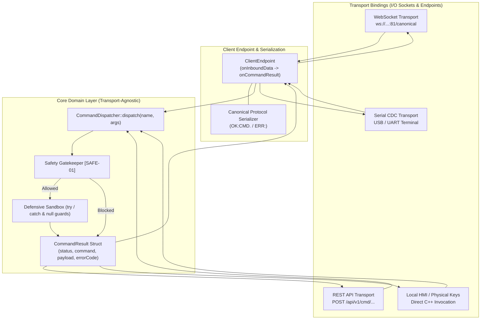

# ADR 0003: CommandResult Domain Object, Fault-Contained Dispatcher, and Baseline Native Client Architecture

* **Status:** Accepted
* **Date:** October 19, 2026
* **Authors:** Emil & Antigravity
* **Deciders:** Emil & Antigravity
* **Context:** Command response standardization, error propagation guarantees, decoupling of transport serialization from core domain logic, and formalization of the Baseline Native Client.
* **Complements:** 
  - [ADR 0001: Consolidated Motion Invocation, Cartesian Polarity, and Kinematic Kernel Refactoring](./0001-motion-invocation-and-gearbox-consolidation.md)
  - [ADR 0002: Command Surface Rationalization and Decoupling of Dumb Client State](./0002-command-surface-rationalization-and-dumb-client-decoupling.md)
  - [ELS Client Architecture Specification](../clients/ELS_CLIENT_ARCHITECTURE.md)

---

## 1. Context & Problem Statement

In the evolution of the NanoELS firmware from an Arduino sketch to an asynchronous multi-client system, command dispatching and response handling remained coupled to the legacy web server (`WebServerModule.cpp`):

1. **Repetitive & Fragmented Response Formatting**:  
   Every static command handler in `CommandDispatcher.cpp` (`handleStartFeed`, `handleStop`, `handleAxisZero`, etc.) was manually responsible for mutating a raw `String* reply` parameter with boilerplate strings (`if (reply) *reply = "OK:CMD.<name>\n"`). If a handler returned `false` without writing an error string, or if a developer forgot to write the response line, the client received silence and timed out.

2. **Conflation of Routing Recognition and Execution Success**:  
   `CommandDispatcher::dispatch(...)` returned a primitive `bool`. This boolean conflated two distinct meanings:
   - *Was this command recognized in the routing table?*
   - *Did the command succeed during execution?*  
   Because of this ambiguity, when the in-motion safety gatekeeper (`[SAFE-01]`) rejected an illegal move during cutting, `dispatch()` set `*reply = "ERR:Command locked..."` and returned `false`. The outer `WebServerModule` interpreted `false` as "unrecognized command", discarded the gatekeeper's `ERR:` reply, and broadcasted `CMD.error=unknown_command\n`.

3. **Transport Layer Leakage into Core Domain**:  
   `CommandDispatcher` directly wrote wire-formatted ASCII strings (`OK:CMD...`, `ERR:...`). This tightly coupled the core command dispatcher to text-line streaming, making it difficult to expose native controller capabilities cleanly over alternative transports (such as REST APIs, binary UART, or direct C++ calls from physical control inputs).

4. **Monolithic WebServerModule Middleman**:  
   Although a composable `ClientEndpoint` pipeline was specified in `ELS_CLIENT_ARCHITECTURE.md`, `WebServerModule.cpp` remained a monolithic 1,250-line file that handled raw socket callbacks, ad-hoc string slicing, and captive portal logic in a single file, bypassing the formal client architecture.

---

## 2. Decision Drivers

* **Single Responsibility Principle**: `CommandDispatcher` must own domain execution and safety gating; transport layers must own wire serialization.
* **Guaranteed Response Delivery**: Every recognized command submitted to the controller must deterministically yield a structured response (`OK` or `FAILED`). Clients must never hang waiting for acknowledgments.
* **Fault Containment (Defensive Sandbox)**: Internal exceptions, parameter parse errors, or hardware faults within command handlers must be caught and returned as structured errors rather than crashing the firmware or dropping the connection.
* **Native Baseline Client as First-Class Citizen**: The controller natively exposes its baseline capabilities. The primary client (Touch DRO Web UI, Python HIL test harness) speaks this native protocol directly without artificial translation layers.
* **Multi-Transport Interoperability**: Exposing native controller commands over WebSockets, REST HTTP endpoints, USB CDC Serial, or physical buttons must use the exact same domain dispatcher with zero duplicated logic.

---

## 3. Decision Details



### 3.1 The `CommandResult` Domain Model

`CommandDispatcher` ceases all string formatting and returns a strongly typed domain object:

```cpp
namespace whatels {

enum class CommandStatus : uint8_t {
  OK = 0,            // Command recognized and executed successfully
  FAILED,            // Command recognized, but rejected or failed during execution
  UNRECOGNIZED       // Command was not recognized in any routing table
};

struct CommandResult {
  CommandStatus status;
  const char*   command;     // Canonical command name (e.g. "stop", "axisZero", "startFeed")
  String        payload;     // Detail: error message on failure, data/ack on success
  uint32_t      errorCode;   // Structured error code (0 = NONE)

  // Factory helpers
  static CommandResult ok(const char* cmd, const String& data = "") {
    return { CommandStatus::OK, cmd, data, 0 };
  }

  static CommandResult failed(const char* cmd, const String& reason, uint32_t code = 0) {
    return { CommandStatus::FAILED, cmd, reason, code };
  }

  static CommandResult unrecognized(const char* cmd = "") {
    return { CommandStatus::UNRECOGNIZED, cmd, "", 0 };
  }

  bool isOk() const { return status == CommandStatus::OK; }
  bool isHandled() const { return status != CommandStatus::UNRECOGNIZED; }
};

} // namespace whatels
```

### 3.2 Single-Gate Dispatcher & Fault Containment

The central dispatcher executes in three deterministic phases:

1. **Route Resolution**: Looks up the command in the routing table. If not found, immediately returns `CommandResult::unrecognized(name)`.
2. **Safety Gatekeeper (`[SAFE-01]`)**: Checks `activeMode->canExecuteCommand(...)`. If the machine is cutting and the mutation is forbidden, returns:
   ```cpp
   CommandResult::failed(name, "Command locked during active motion", ERR_CODE_LOCKED_IN_MOTION);
   ```
3. **Defensive Execution Sandbox**: Wraps handler execution in fault containment guards:
   ```cpp
   CommandResult result;
   #if __cpp_exceptions
   try {
     result = route.handler(args);
   } catch (const std::exception& ex) {
     result = CommandResult::failed(route.name, String("INTERNAL_ERROR:") + ex.what());
   } catch (...) {
     result = CommandResult::failed(route.name, "INTERNAL_ERROR:unknown_fault");
   }
   #else
   result = route.handler(args);
   #endif
   return result;
   ```

### 3.3 The Native Client vs. Alien Adapters & Directory Structure

To cleanly isolate the controller-side client infrastructure from legacy web code, all controller-side client implementations reside in **`src/core_client/`**:

```text
src/
├── core/                           <-- Pure Domain Logic & Services
│   ├── CommandDispatcher.h / .cpp  <-- Native Command Router & Safety Gatekeeper
│   ├── SettingsService.h / .cpp
│   └── MachineModel.h / .cpp
│
├── core_client/                    <-- Controller-Side Client Infrastructure
│   ├── ClientEndpoint.h / .cpp     <-- Base Composable Endpoint & CommandResult
│   ├── ClientManager.h / .cpp      <-- Multi-Client Session Registry & Router
│   │
│   ├── transports/                 <-- Reusable Transport Bindings
│   │   ├── ITransport.h            <-- Abstract I/O Pipe
│   │   ├── WebSocketTransport.h    <-- Wraps WebSocketsServer Client Slot
│   │   └── SerialTransport.h       <-- (Future) USB CDC / Hardware UART
│   │
│   └── clients/                    <-- Client-Specific Implementations
│       ├── native/                 <-- The Native Controller Client (/canonical)
│       │   ├── NativeClient.h / .cpp
│       │   ├── NativeTranslator.h  <-- Native Command Dispatch & OK:/ERR: Formatting
│       │   └── NativeSerializer.h  <-- References Core TelemetrySerializer
│       │
│       ├── grbl/                   <-- CNC Stream Client (/grbl)
│       │   ├── GrblClient.h / .cpp
│       │   └── GrblTranslator.h    <-- G-code to CommandDispatcher Adapter
│       │
│       └── dro/                    <-- Minimal DRO Coordinate Readout (/dro)
│           ├── DroClient.h / .cpp
│           └── DroSerializer.h
│
└── web/                            <-- Stripped Legacy Web Server
    └── WebServerModule.cpp / .h    <-- Limited strictly to Wi-Fi, LittleFS HTTP, and OTA
```

* **The Native Client (`src/core_client/clients/native/`)**:
  The primary Web UI, Touch DRO, and HIL test harness speak the native command set (`CMD.*`, `SETTINGS.*`). The native client performs zero lossy conversion and directly binds to `CommandDispatcher`.
* **Alien Adapters (`src/core_client/clients/grbl/`, `nextion/`)**:
  Foreign protocols are quarantined in their own isolated folders. They translate foreign wire grammar into native `CommandDispatcher` invocations and map `CommandResult` back to foreign responses (`ok` / `error:20`).

### 3.4 Multi-Transport Serialization Specification

The `ClientEndpoint` / transport layer serializes `CommandResult` according to the transport's protocol specification:

| Transport | `CommandStatus::OK` | `CommandStatus::FAILED` | `CommandStatus::UNRECOGNIZED` |
| :--- | :--- | :--- | :--- |
| **Native WebSocket / Serial** | • Without payload: `OK:CMD.<name>\n`<br>• With payload: `OK:CMD.<name>:<payload>\n` *(or raw multi-line)* | `ERR:<payload>\n`<br>*(e.g. `ERR:SAFETY_INTERLOCK_ACTIVE\n`)* | `CMD.error=unknown_command\n` |
| **Native REST API** | HTTP `200 OK`<br>`{"status": "ok", "command": "<name>", "data": "<payload>"}` | HTTP `400 Bad Request`<br>`{"status": "error", "command": "<name>", "message": "<payload>"}` | HTTP `404 Not Found`<br>`{"status": "unknown_command"}` |
| **Alien GRBL Transport** | `ok\n` | `error:<errorCode>\n` | `error:1\n` |

---

## 4. Consequences & Benefits

### Positive
* **Total Elimination of Dropped Replies**: The outer transport always receives an unambiguous `CommandStatus`. Safety errors (`ERR:...`) are guaranteed to reach the client.
* **Elimination of Handler Boilerplate**: Handlers focus purely on kinematic/domain logic, returning `CommandResult::ok()` or `CommandResult::failed(...)`.
* **Robust Fault Containment**: Handler faults or parameter exceptions cannot bring down the WebSocket connection or leave the test runner hung.
* **Domain Core Cleanliness**: `CommandDispatcher` moves to `src/core/`, completely separating domain motion control from networking.
* **Modular Client Isolation**: Adding a new client (e.g. Nextion) is isolated to a new subfolder in `src/core_client/clients/` without modifying core motion or existing transports.
* **Clean Decommissioning Path for `WebServerModule.cpp`**: Paves the way to dismantle the 1,250-line monolith into single-responsibility services (`WifiService`, `HttpStaticServer`, `ClientManager`).

### Negative / Trade-offs
* Requires updating all command handler signatures in `CommandDispatcher.cpp` from `bool (*)(const char*, String*)` to `CommandResult (*)(const char*)`.
* Requires migrating `CommandDispatcher` from `src/web/` to `src/core/`.

---

## 5. Implementation Roadmap

1. **Step 1 (Core Domain Refactor)**: Move `CommandDispatcher` to `src/core/`, define `CommandResult` and `CommandStatus`, update handler signatures to return `CommandResult`, and implement fault containment.
2. **Step 2 (Core Client Infrastructure)**: Create `src/core_client/` with `ITransport`, `WebSocketTransport`, `ClientEndpoint`, and `ClientManager`.
3. **Step 3 (Native Client Implementation)**: Implement `src/core_client/clients/native/` (`NativeClient`, `NativeTranslator`, `NativeSerializer`) and wire it to serialize `CommandResult` to the canonical wire contract.
4. **Step 4 (WebServerModule Integration)**: Connect port 81 socket callbacks in `WebServerModule.cpp` to `ClientManager`.
5. **Step 5 (HIL Verification)**: Update the 4 test cases that sent `CMD.on=0` to send canonical `CMD.stop`, flash hardware, and execute the full 27-test HIL suite.
6. **Step 6 (Decommission Dead Code)**: Strip legacy routing and dead translation code from `WebServerModule.cpp`.
