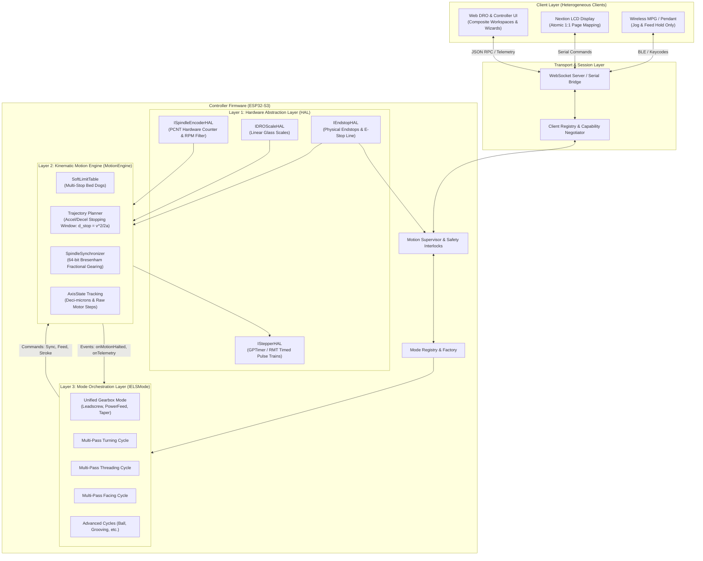
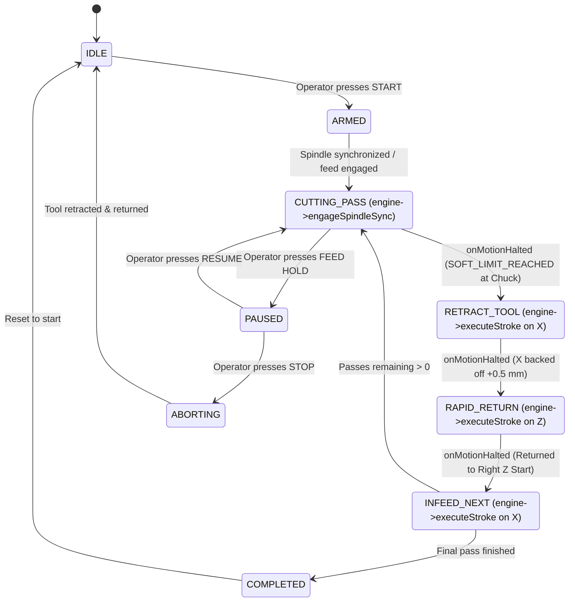
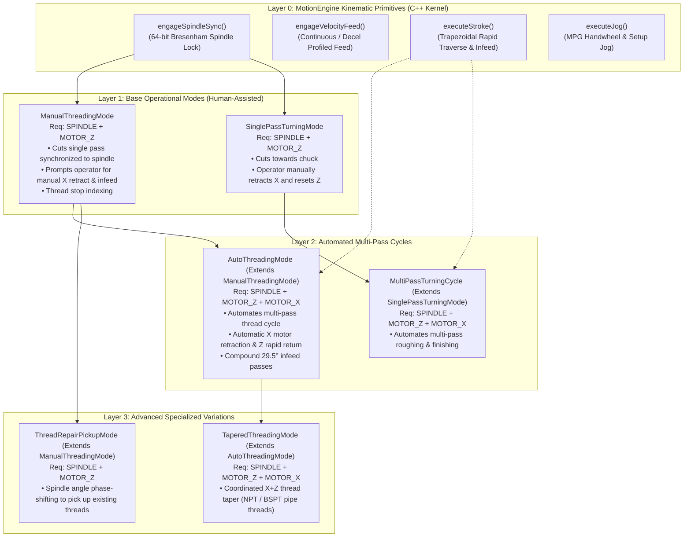
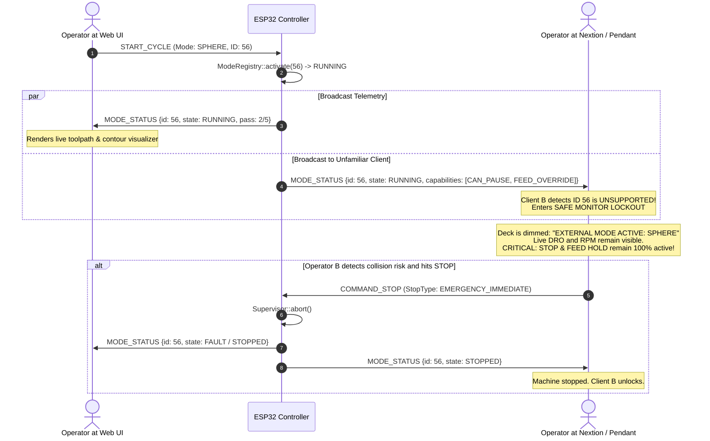
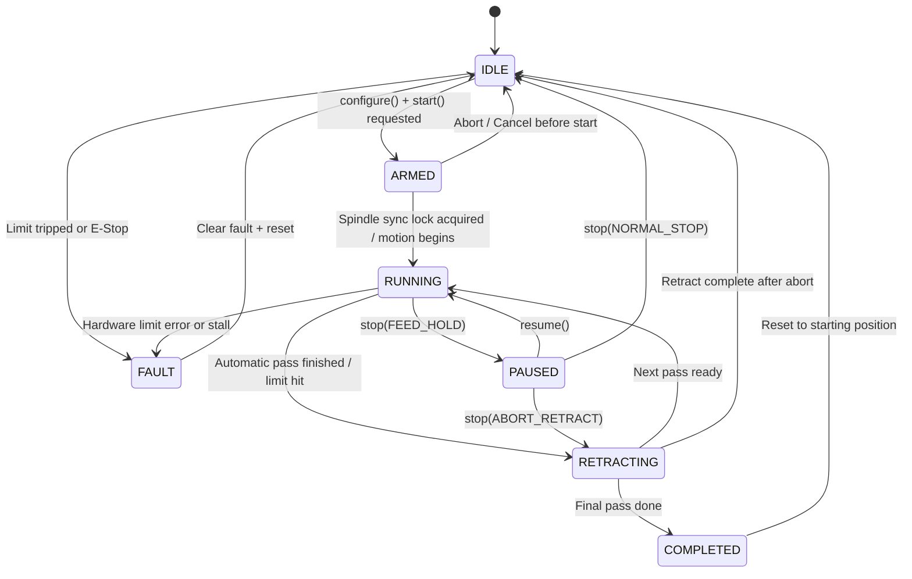
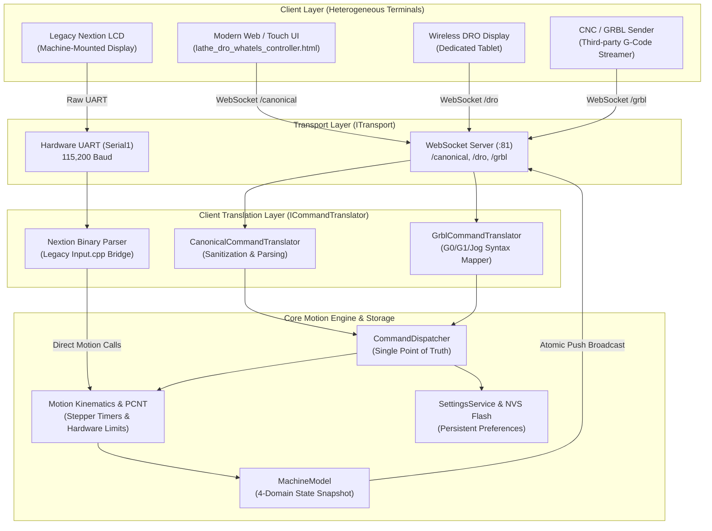

# whatELS — Master System Architecture & Implementation Compendium (Unabridged)

> **Document Type:** Unabridged Engineering Compendium & Peer Review Submission  
> **Target Platform:** whatELS Electronic Leadscrew & Lathe Controller (ESP32-S3)  
> **Authors:** Emil & Antigravity Pair-Programming Team  
> **Date:** October 2026  
> **Target Reviewer:** Google DeepMind / Google Research Argon Model (Large-Context Engineering Review)  

---

# EXECUTIVE PEER REVIEW CHARTER & INSTRUCTIONS FOR ARGON

## 1. Reviewer Persona & Mandate
**Role:** Principal Embedded Systems Architect, High-Reliability Real-Time Motion Control Engineer, and Safety-Critical Firmware Auditor.

**Context:**  
You are reviewing the complete, end-to-end software and motion architecture for **whatELS**, an industrial-grade, open-source Electronic Leadscrew (ELS) and Digital Readout (DRO) controller designed for metalworking engine lathes. whatELS replaces mechanical change gears, Norton gearboxes, and half-nut assemblies with an electronic leadscrew synchronized to a spindle quadrature encoder.

The controller runs on an **ESP32-S3** (dual-core 240 MHz Xtensa LX7 with FreeRTOS). It directly drives stepper/digital servo motors (Leadshine EM542S / TMC2209), samples a spindle optical encoder via dedicated hardware Pulse Counter (PCNT) units, interfaces with optical linear glass scales (DRO), monitors opto-isolated limit switches and hardware E-Stop lines, and serves a high-resolution touch Web DRO interface over WebSockets.

---

## 2. What We Are Asking You to Evaluate

Please perform a rigorous, critical architectural and implementation review across the following five core domains:

### Domain A: Real-Time Determinism, Timing & Concurrency (Core 0 vs. Core 1)
1. **Core Partitioning:** Is the strict functional boundary between **Core 0 (Supervisory, WebSocket, JSON RPC, Flash I/O, Mode Orchestration)** and **Core 1 (Real-Time Stepping, PCNT sampling, Trajectory Planning, Limits)** sound?
2. **Lock-Free State Synchronization:** Evaluate the `TelemetryMailbox` seqlock implementation (`CONCURRENCY_AND_TIMING.md`). Is it provably race-free on the dual-core Xtensa LX7? Could rapid Core 0 read cycles starve or create torn reads?
3. **Interrupt Latency & Jitter Budget:** We have budgeted a worst-case Core 1 motion service loop time of $\le 35\,\mu\text{s}$ at a $250\,\mu\text{s}$ period ($14\%$ CPU utilization). Given ESP32-S3 FreeRTOS interrupt latency, cache misses, and flash bus arbitration, is this budget realistic and safe?
4. **Hardware Offload (PCNT):** At 3,000 RPM with a 1,024 PPR encoder ($4\times$ decoding $\implies 204.8\text{ kHz}$ edge rate), we sample the hardware PCNT counter every 1 ms or 250 µs without CPU interrupts. Are there overflow, glitch filter, or edge-case wrap hazards?

### Domain B: Kinematics, Trajectory & Stepper Safety
1. **Stopping Distance Window Lookahead:** Evaluate the real-time stopping window trigger ($d_{\text{stop}} = \frac{v_i^2 - v_{\text{end}}^2}{2a}$) in `MOTION_ENGINE_SPECIFICATION.md`. Does this guarantee that carriage motion glides smoothly to an exact stop on soft limit shoulders without missed steps, mechanical shock, or overshoot?
2. **Multi-Stop Soft Limits (`SoftLimitTable`):** Evaluate our elimination of legacy sentinels (`LONG_MAX`, `LONG_MIN`) in favor of explicit `defined`, `enabled`, `coordDu`, and semantic labeling. Is the multi-stop drum algorithm (`findNextEnforcedLimit`) robust against direction reversals and deadband creep?
3. **Canonical Units (Deci-Microns):** Linear coordinates are stored as integer deci-microns ($1\text{ du} = 0.1\,\mu\text{m}$, $10{,}000\text{ du} = 1.0\text{ mm}$). Does the 64-bit integer conversion math (`stepsToDu`, `duToSteps`) completely prevent cumulative rounding drift?
4. **Spindle Synchronization & Threading:** Does the 64-bit fractional Bresenham accumulator prevent lead pitch error over thousands of continuous spindle turns? How robust is thread phase registration when the carriage rests at a shoulder limit or during spindle direction reversals?

### Domain C: Layer Boundaries & Decoupling
1. **HAL (`IStepperHAL`, `ISpindleEncoderHAL`, `IDROScaleHAL`, `IEndstopHAL`):** Are the electrical timing contracts (`StepTimingConfig`: setup, hold, pulse widths) comprehensive for modern digital drives?
2. **MotionEngine $\leftrightarrow$ Mode Integration Contract:** Is the inversion of responsibility in `MODE_INTEGRATION_CONTRACT.md` sound? Modes no longer receive 10 kHz interrupts or generate steps; they command high-level primitives (`engageSpindleSync`, `engageVelocityFeed`, `executeStroke`) and listen for `onMotionHalted(...)` events. Does this contract support both simple power feed and complex multi-pass threading/turning cycles?

### Domain D: State Model, Properties & Persistence
1. **Canonical 4-Domain State Model (`K`, `I`, `C`, `P`):** Does the partitioning between real-time kinematics (`K`), operator intent (`I`), machine configuration (`C`), and presentation (`P`) prevent network bloat while preserving exact user authoring values (e.g. `13 TPI` or `1:3.5 taper` without float conversion drift)?
2. **4-Tier Properties & NVS Sparse Overrides:** Is the "Dynamic Default vs. Sparse Override" engine in `ELS_PROPERTIES_AND_SETTINGS.md` sound? How well does it prevent flash wear and flash-read latency from blocking motion?

### Domain E: Multi-Client Architecture & Wire Protocol
1. **Safety Gatekeeper & In-Motion Lockout:** Evaluate the `canExecuteCommand()` gatekeeper and the In-Motion Safety Permissions matrix. Does it reliably reject hazardous commands (axis swap, pitch rewrite) while permitting live feed nudging and universal emergency stop?
2. **Safe Monitor Lockout:** Does the multi-client capability handshake properly handle heterogeneous clients (a 10" tablet Web DRO vs. a transitional Nextion serial LCD)?

---

## 3. Output Format & Actionable Feedback Expectations
To ensure our pair-programming team can immediately triage and incorporate your review findings into our implementation plan, please structure your response as follows:

### 1. Executive Verdict & Readiness Scorecard
- Overall Architectural Readiness Score (0% – 100% ready for physical lathe iron).
- High-level summary of architectural strengths and primary risk areas.

### 2. Domain-by-Domain Analysis
Detailed evaluation of the 5 domains (A through E above), explicitly confirming what is sound and dissecting any weak points.

### 3. Actionable Findings & Recommendations Table
Please format all technical issues, race conditions, and recommended changes into a structured table:

| Finding ID | Severity (`BLOCKER` / `CRITICAL` / `ENHANCEMENT` / `NOTE`) | Affected Component / Specification | Issue Description & Failure Mode | Recommended Concrete Fix / Code Snippet |
|---|---|---|---|---|
| `[CONC-01]` | `CRITICAL` | `TelemetryMailbox` / `CONCURRENCY_AND_TIMING.md` | ... | ... |
| `[KIN-01]` | `BLOCKER` | `SoftLimitTable` / `MOTION_ENGINE_SPECIFICATION.md` | ... | ... |

*Definitions:*
- **`BLOCKER`**: Risk of physical lathe carriage crash, motor stall, tool collision, or leadscrew stripping.
- **`CRITICAL`**: Latency spike, priority inversion, memory tear, or logic flaw that breaks deterministic execution.
- **`ENHANCEMENT`**: CNC best practice or mathematical optimization that improves surface finish or code elegance.
- **`NOTE`**: Architectural observation, cosmetic polish, or future expansion suggestion.

### 4. Implementation Readiness Checklist
A clear checklist of specific items that should be adjusted in the specifications *before* writing firmware code.

---

# COMPENDIUM TABLE OF CONTENTS
- [1. Master System Architecture Blueprint](#1-master-system-architecture-blueprint)
- [2. Hardware Abstraction Layer (HAL) Specification](#2-hardware-abstraction-layer-hal-specification)
- [3. Kinematic Motion Engine Specification](#3-kinematic-motion-engine-specification)
- [4. Motion Engine to Mode Integration Contract](#4-motion-engine-to-mode-integration-contract)
- [5. Real-Time Concurrency, Timing & Core Architecture](#5-real-time-concurrency-timing--core-architecture)
- [6. Generalized Mode Architecture Specification](#6-generalized-mode-architecture-specification)
- [7. Core State Model Specification](#7-core-state-model-specification)
- [8. Lathe Machine Profile Specification](#8-lathe-machine-profile-specification)
- [9. Properties & Settings Architecture Specification](#9-properties--settings-architecture-specification)
- [10. Client Architecture & Wire Protocol Specification](#10-client-architecture--wire-protocol-specification)

---


================================================================================
# 1. MASTER SYSTEM ARCHITECTURE BLUEPRINT
# Source: /home/emil/code/whatels/docs/WHATELS_MASTER_ARCHITECTURE.md
================================================================================

# whatELS — Master System Architecture & Subsystem Specification

> **Status:** Authoritative "Ground Floor" Master Architecture Blueprint  
> **Target Platform:** whatELS Electronic Leadscrew & Multi-Client Suite (ESP32-S3)  
> **Author:** Antigravity & Emil  
> **Date:** October 8, 2026  
> **Location:** `docs/WHATELS_MASTER_ARCHITECTURE.md`  
> **Supersedes:** `ELS_DESIGN_NOTEBOOK.md` (as the root architectural index)

---

## 1. Executive System Vision & Core Tenets

The **whatELS Architecture** modernizes an open-source embedded lathe controller into an industrial-grade, multi-client electronic leadscrew (ELS) and digital readout (DRO) platform.

### 1.1 The Evolutionary Leap
* **From:** A monolithic Arduino sketch (`h5.ino`, ~370 KB) with 200+ unencapsulated procedural globals, hardwired Nextion LCD packets, and high-frequency stepper timer ISRs interleaved with serial communication.
* **To:** A clean, decoupled **6-subsystem architecture** built on strict hardware abstraction, deterministic dual-core concurrency, domain-driven telemetry, and a client-agnostic wire protocol.

```
┌────────────────────────────────────────────────────────────────────────────────────────┐
│                        PHYSICAL MACHINE TOOL (LATHE IRON)                              │
│ • Carriage (Z), Cross-Slide (X), Auxiliary (Y) Leadscrews & Motors                     │
│ • Spindle Quadrature Encoder & VFD / Servo Spindle Drive                               │
│ • Linear Glass Scales (DRO), Physical Limit Switches, Apron Handwheels (MPG)          │
└───────────────────────────────────────────▲────────────────────────────────────────────┘
                                            │ Hardware Pins & ISRs
┌───────────────────────────────────────────┴────────────────────────────────────────────┐
│ CORE 1: DETERMINISTIC REAL-TIME MOTION                                                 │
│ [Subsystem 1: HAL & Hardware Timing] ──► [Subsystem 2: Kinematic Kernel & Motion]     │
│                                      ▲                                                 │
│                                      │ Motion Primitives                               │
│                      [Subsystem 3: Operational Modes Engine]                           │
└───────────────────────────────────────────▲────────────────────────────────────────────┘
                                            │ Atomic Point-in-Time Telemetry / CMDs
┌───────────────────────────────────────────┴────────────────────────────────────────────┐
│ CORE 0: ASYNCHRONOUS SUPERVISORY & COMMUNICATIONS                                     │
│ [Subsystem 4: State Model & Settings] ◄──► [Subsystem 5: Command Dispatcher & Transport]│
│                                                           │                            │
│                                                           ▼                            │
│                                            [Subsystem 6: HMI & Client Adapters]        │
└───────────────────────────────────────────────────────────┬────────────────────────────┘
                                                            │
    ┌───────────────────────────────┬───────────────────────┴───────┬────────────────────┐
    ▼                               ▼                               ▼                    ▼
┌───────────────────────┐ ┌───────────────────┐ ┌────────────────────────┐ ┌─────────────────┐
│ Modern Web UI (Tablet)│ │ Native LVGL 9 HMI │ │ Physical Inputs & MPG  │ │ Transitional    │
│ (800×480 Capacitive)  │ │ (ESP32-S3 Display)│ │ (Keypad, Joystick)     │ │ Nextion Display │
└───────────────────────┘ └───────────────────┘ └────────────────────────┘ └─────────────────┘
```

---

### 1.2 Dual-Core Concurrency & FreeRTOS Architecture

The ESP32-S3 dual-core processor enforces strict hardware isolation between deterministic motion timing and asynchronous communication:

| Core | Primary Role | Execution Paradigm | Safety & Timing Invariants |
| :--- | :--- | :--- | :--- |
| **Core 1** | **Real-Time Motion Control** | High-frequency hardware timer ISRs, pulse counters (`PCNT`), deterministic DDA stepping (`taskMoveZ`, `taskMoveX`). | **Zero Heap Allocation, Zero Blocking Mutexes, Zero Network I/O.** Must execute in nanoseconds without latency jitter. |
| **Core 0** | **Supervisory & Comms** | FreeRTOS tasks (`taskWiFi`, `taskDisplay`) handling WebSockets, HTTP server, UART line parsing, NVS flash writes. | May perform JSON parsing, network transfers, and flash I/O. Communicates with Core 1 strictly via atomic state snapshots and thread-safe queues. |

#### Recursive Mutex & Task Protection (`wsMutex`)
To prevent race conditions between asynchronous network events and telemetry broadcasts on Core 0:
- **`taskWiFi`**: Runs `webSocket.loop()`, client handshakes, and command parsing. When a client sends a command, `handleWebUiEventCommand()` synchronously dispatches replies.
- **`taskDisplay`**: Periodically publishes changed machine telemetry (`publishMachineStatus()`) across active transports.
- **`wsMutex`**: Shared WebSocket access is protected by a recursive FreeRTOS mutex (`xSemaphoreCreateRecursiveMutex`). This allows re-entrant calls when command handlers synchronously emit response frames without self-deadlock, while ensuring Core 1 stepper pulses remain 100% untouched and unblocked.

---

### 1.3 Governing Architectural Invariants

1. **The Controller is the Sole Authority:** Mode execution, boundary collision enforcement, electronic gearing ratios, and multi-pass canned cycles run deterministically on the controller MCU. Connected screens (Web, tablet, LVGL, Nextion) are reactive observers transmitting *operator intent*.
2. **Radical Hardware Fidelity & Transparency:** The motion core operates on a strict binary state: `STOPPED` (`isOn == false`) or `RUNNING` (`isOn == true`). There are no software "ghost limits", no simulated mid-pass pauses, and no synthetic machine state that does not map directly to controller registers.
3. **Running Safety Lockout & Permanent STOP:** When lathe motion is engaged (`isOn == true`), modal dialogs that occlude live DRO readouts are locked out, and mode switching is prohibited. The red **`STOP`** button is permanently anchored and universally unoccluded across all client views.
4. **Zero-WiFi Control Plane Mandate:** Wireless networks in a machine shop are subject to severe EMI from VFDs and motor brushes. Automated threading cycles, electronic gearing, and emergency stops execute strictly via on-chip memory or wired serial UART. Wi-Fi and WebSockets are dedicated to supervisory telemetric observation and setup.

---

## 2. The 6 Subsystems: Responsibilities & Invariants

To eliminate cross-file coupling and provide clear architectural homes for all code, the system is partitioned into **6 distinct subsystems**:

```
┌─────────────────────────────────────────────────────────────────────────────────────────────────┐
│                                   THE 6 ARCHITECTURAL SUBSYSTEMS                                │
├─────────────────────┬────────────────────────────────┬──────────────────────────────────────────┤
│ Subsystem           │ Core Responsibility            │ Strict Boundaries & Invariants           │
├─────────────────────┼────────────────────────────────┼──────────────────────────────────────────┤
│ 1. Hardware Timing  │ Stepper pulse timer ISRs, pin  │ • Core 1 only.                           │
│    & HAL (`hal/`)   │ drivers, quadrature spindle    │ • NEVER include WiFi, WebSockets, or UI. │
│                     │ interrupts, optical DRO scales.│ • Lock-free hardware register access.    │
├─────────────────────┼────────────────────────────────┼──────────────────────────────────────────┤
│ 2. Kinematic Kernel │ Atomic kinematic functions     │ • Core 1 only.                           │
│    & Motion         │ (`FollowSpindle`,              │ • Operates in integer deci-microns (du). │
│    (`motion/`)      │  `MoveVelocity`), gearing math,│ • Universal soft limit safety envelope   │
│                     │ backlash, accel/decel profiling│   enforced across ALL modes.             │
│                     │ and hardware pulse generation. │ • Pure math & pulse coordination.        │
├─────────────────────┼────────────────────────────────┼──────────────────────────────────────────┤
│ 3. Operational Mode │ Operational mode state machines│ • Implements `IELSMode` (enter/loop/exit)│
│    Engine (`modes/`)| (`GearboxMode`, `TurnCycle`,   │ • Orchestrates functions from Subsystem 2│
│                     │ `FaceCycle`, `ThreadCycle`).   │ • Atomic motion execution (`startFeed`). │
│                     │ Prunes unavailable via `caps`. │ • Mode-agnostic extensibility.           │
├─────────────────────┼────────────────────────────────┼──────────────────────────────────────────┤
│ 4. State Model &    │ Single source of truth. 4-tier │ • Atomic point-in-time snapshots (K,I,C,P│
│    Persistence      │ properties (`machine`, `sys`,  │ • Sparse NVS overrides (pristine flash). │
│    (`model/`,       │ `prefs`, `client`), LittleFS   │ • 3-tier preset fallback hierarchy:      │
│    `settings/`)     │ JSON catalog & schema streaming│   Active (NVS) ──► Default ──► ROM Failsafe│
├─────────────────────┼────────────────────────────────┼──────────────────────────────────────────┤
│ 5. Command          │ Line protocol decoder, client  │ • Canonical ASCII wire strings (`CMD.*`, │
│    Dispatcher &     │ multiplexing, routing incoming │   `SETTINGS.*`).                         │
│    Transport        │ commands, broadcasting deltas. │ • Normalizes semantic terms (CHUCK/TAIL) │
│    (`transport/`)   │ Ingress Staging Adapter for    │   to Cartesian signs (-1/+1).            │
│                     │ simple clients; atomic cmds.   │ • Transports (WS, UART) feed Dispatcher. │
├─────────────────────┼────────────────────────────────┼──────────────────────────────────────────┤
│ 6. Human-Machine    │ Hardware inputs (keypad, MPG,  │ • "Input is just an internal client."    │
│    Interface (HMI)  │ joystick), Nextion display,    │ • Translates buttons/ticks into CMD.*    │
│    Adapters (`hmi/`)| native LVGL display, Web UI.   │ • Displays observe telemetry; never run  │
│                     │                                │   motion logic directly.                 │
└─────────────────────┴────────────────────────────────┴──────────────────────────────────────────┘
```

---

## 3. Transitional Adapters & Verification Bridges

During this architectural transition, two specific legacy components require careful isolation to avoid polluting the core:

### 3.1 Nextion Display: The Transitional "Oracle" & Isolation Boundary
* **Why It Remains Today:**  
  The physical Nextion LCD screen running over UART (`Serial1`) serves as a physical **verification oracle**. During bench testing and refactoring, having a known-working hardware display lets the developer glance at physical DRO coordinates, confirm spindle encoder pulse counts, and verify motor motion without relying on the network stack.
* **Strict Isolation Boundary:**  
  1. The Nextion code ([`Display.cpp`](../src/display/Display.cpp) / [`DisplayModel.cpp`](../src/display/DisplayModel.cpp)) is strictly an **external client adapter**.
  2. It receives read-only state updates from `MachineModel` / `DisplayModel` and transmits key codes or command strings.
  3. **It is strictly forbidden from holding core motion logic, calculating gearing math, or directly mutating axis structs.**
* **Deprecation Path:**  
  Once the modern Web UI and native LVGL display clients are fully commissioned and bench-tested, the Nextion module will be cleanly retired by deleting `Display.cpp` and `Display.h` with zero impact on the rest of the controller.

---

### 3.2 Flash Partition Topology & Web Delivery

To guarantee that firmware upgrades never destroy user calibrations, custom machine profiles, or uploaded part programs (lathecode / G-code), the ESP32 storage architecture strictly separates system code from operator runtime data:

```
┌─────────────────────────────────────────────────────────────────────────────┐
│                       WHATELS FLASH PARTITION ROLES                         │
├────────────────────────────────┬────────────────────────────────────────────┤
│ 1. APPLICATION FLASH (`app0`)  │ • C++ Motion Core & Hard Real-Time Loops   │
│    Firmware Binary (.bin)      │ • Embedded Gzipped Web UI (`PROGMEM`)      │
│    Over-The-Air (OTA) Target   │ • Factory System Templates (WM210V, etc.)  │
│                                │ • Authoritative JSON Configuration Schemas │
├────────────────────────────────┼────────────────────────────────────────────┤
│ 2. NON-VOLATILE STORAGE (`nvs`)│ • Sparse Machine Overrides (`screw_z_du`)  │
│    Fast Key-Value Flash        │ • Active Profile Identifier (`preset`)     │
│                                │ • Wi-Fi Credentials & Hardware Diagnostics │
├────────────────────────────────┼────────────────────────────────────────────┤
│ 3. USER FILESYSTEM (LittleFS)  │ • User Custom Lathe Profiles (`/presets/`) │
│    Dedicated Operator Storage  │ • User Lathecode & G-Code Programs (`/`)   │
│    NEVER WIPED BY FIRMWARE     │ • User Tool Libraries & Wear Offsets       │
│                                │ • (Optional Dev Mode: `/www/` live assets) │
└────────────────────────────────┴────────────────────────────────────────────┘
```

* **Single-Binary OTA Deployment:** All firmware logic, the complete responsive Web UI (`clients/web_ui/`), and built-in factory lathe templates are compiled directly into `firmware.bin`. Updating via USB or Web OTA (`/update`) flashes only the application partition, guaranteeing that backend kinematics and frontend UI update atomically with zero version desynchronization.
* **Preservation of User Files:** The LittleFS filesystem partition is **never formatted, wiped, or overwritten during firmware updates**. Custom user presets and uploaded machining files remain 100% persistent across firmware releases.
* **Developer Hot-Reload Mode:** During Web UI development, if `/www/index.html` exists on LittleFS, `WebServerModule.cpp` serves that loose file instead, allowing rapid iteration without recompiling firmware. If absent (production), assets are served directly from flash ROM via `send_P` with `Content-Encoding: gzip`.
* **Drop-In Protocol Alignment:** The web client connects to the controller WebSocket endpoint and exchanges canonical ASCII line commands (`CMD.*`, `SETTINGS.*`) and domain telemetry frames (`K`, `I`, `C`, `P`).

---

## 4. Current Codebase File Audit & Target Subsystem Mapping

Below is the complete audit of all implementation and header files across `src/`, detailing their current role, target subsystem, and migration path:

| File (in `src/`) | Current Role in Codebase | Target Subsystem | Architectural Disposition & Migration Task |
| :--- | :--- | :--- | :--- |
| [`main.cpp`](../src/main.cpp) | Boot orchestrator, task creator, procedural `loop()` mode ladder. | **System Bootstrap** | Refactor `loop()` to delegate to `IELSModeRegistry::getActiveMode()->update()`. Remove procedural mode `if-else` ladder. |
| [`Axis.cpp`](../src/motion/Axis.cpp)<br>[`Axis.h`](../src/motion/Axis.h) | `Axis` struct, hardware stepping pins, backlash, motor step math. | **Subsystem 1 (HAL)** | Extract hardware pin stepping and pulse generation into clean HAL classes. Remove coupling to legacy global variables. |
| [`Motion.cpp`](../src/motion/Motion.cpp)<br>[`Motion.h`](../src/motion/Motion.h) | Mixed: Timer ISRs, spindle pulse tracking, legacy mode loops (`modeTurn`, etc.). | **Subsystem 2 (Kinematics)** | Separate real-time timer ISRs & spindle math from mode logic. Move canned cycles (`modeTurn`, `modeCone`) into Subsystem 3 `IELSMode` classes. |
| [`Config.cpp`](../src/core/Config.cpp)<br>[`Config.h`](../src/core/Config.h) | Legacy globals (`z`, `x`, `dupr`, `starts`), NVS loader, hardware pin `#define`s. | **Subsystem 4 (Persistence)** | Systematically retire raw globals. Hardware pins move to HAL; configuration persistence moves entirely to `SettingsService`. |
| [`Input.cpp`](../src/input/Input.cpp)<br>[`Input.h`](../src/input/Input.h) | Keypad matrix, button debounce, joystick ADC, Nextion input parser. Directly mutates state. | **Subsystem 6 (HMI Adapters)** | Refactor so input routines NEVER mutate motion state directly. They must emit canonical `CMD.*` strings into `CommandDispatcher`. |
| [`Display.cpp`](../src/display/Display.cpp)<br>[`Display.h`](../src/display/Display.h) | Nextion LCD serial protocol, page flipping, text drawing. | **Subsystem 6 (HMI Adapters)** | Maintain as transitional verification oracle. Isolate as read-only subscriber to `DisplayModel`. |
| [`DisplayModel.cpp`](../src/display/DisplayModel.cpp)<br>[`DisplayModel.h`](../src/display/DisplayModel.h) | Bridge between raw variables and display formatting. | **Subsystem 6 (HMI Adapters)** | Refactor to consume clean `MachineModel` domain snapshots (`K`, `I`) rather than raw globals. |
| [`WebServerModule.cpp`](../src/web/WebServerModule.cpp)<br>[`WebServerModule.h`](../src/web/WebServerModule.h) | HTTP file server (LittleFS), WebSocket server, network routing. | **Subsystem 5 (Transport)** | Strip all legacy direct-state mutation routes. Restrict strictly to serving static web files and piping WebSocket frames to `ClientEndpoint`. |
| [`DRO_Scale.cpp`](../src/motion/DRO_Scale.cpp)<br>[`DRO_Scale.h`](../src/motion/DRO_Scale.h) | ESP32 PCNT hardware pulse counter for optical linear scales. | **Subsystem 1 (HAL)** | Clean HAL component. Keep and integrate with `QuadratureEncoderConfig`. |
| [`UsbKeyboard.cpp`](../src/input/UsbKeyboard.cpp)<br>[`UsbKeyboard.h`](../src/input/UsbKeyboard.h) | USB Host keyboard driver. | **Subsystem 6 (HMI Adapters)** | Clean input driver. Maps USB key scancodes to canonical `CMD.*` strings. |
| [`LatheProfile.cpp`](../src/motion/LatheProfile.cpp)<br>[`LatheProfile.h`](../src/motion/LatheProfile.h) | Typed `LatheConfiguration`, capabilities bitmask, baseline profiles. | **Subsystem 4 (Persistence)** | Modern foundation. Simplify to single ROM baseline `getDefaultProfile()`; presets migrate to LittleFS `/presets/profiles.json`. |
| [`SettingsService.cpp`](../src/core/SettingsService.cpp)<br>[`SettingsService.h`](../src/core/SettingsService.h) | 4-tier parameter registry, sparse NVS overrides, in-memory RAM cache. | **Subsystem 4 (Persistence)** | Modern foundation. Add LittleFS profile catalog file I/O and dynamic schema streaming (`SETTINGS.schema=*`). |
| [`MachineModel.cpp`](../src/core/MachineModel.cpp)<br>[`MachineModel.h`](../src/core/MachineModel.h) | Atomic state capture across 4 domains (`K`, `I`, `C`, `P`), delta detection. | **Subsystem 4 (State Model)** | Modern foundation. Authoritative state bridge between Core 1 and Core 0. |
| [`CommandDispatcher.cpp`](../src/web/CommandDispatcher.cpp)<br>[`CommandDispatcher.h`](../src/web/CommandDispatcher.h) | Line protocol command router (`CMD.*`, `SETTINGS.*`). | **Subsystem 5 (Transport)** | Modern foundation. The single entry point for all commands across all clients (Web, physical keys, serial). |
| [`ClientEndpoint.cpp`](../src/web/ClientEndpoint.cpp)<br>[`ClientEndpoint.h`](../src/web/ClientEndpoint.h) | Client session manager and broadcast distributor. | **Subsystem 5 (Transport)** | Modern foundation. Multiplexes connected clients, tracks subscription flags, handles unicast replies. |
| [`RichClientAdapter.cpp`](../src/display/RichClientAdapter.cpp)<br>[`RichClientAdapter.h`](../src/display/RichClientAdapter.h) | Domain state serializer (`K.*`, `I.*`, `C.*`, `P.*`). | **Subsystem 5 (Transport)** | Modern foundation. Serializes atomic `MachineModel` snapshots into compact wire strings. |

---

## 5. Authoritative Specification Hierarchy & Deep-Dive Documents

To prevent architectural drift and maintain single-topic depth, all detailed implementation rules are partitioned into dedicated standalone specifications:

```
WHATELS_MASTER_ARCHITECTURE.md (This Master Blueprint)
│
├── 1. Core State & Concurrency Model
│    └── ELS_CORE_STATE_MODEL.md
│        (The 4 Domains: K Kinematic, I Intent, C Configuration, P Profile;
│         Point-in-time atomic snapshots; Core 1 vs. Core 0 FreeRTOS concurrency)
│
├── 2. Machine Profile, Presets & Schema Introspection
│    └── LATHE_MACHINE_PROFILE.md
│        (Physical geometry, capability bitmasks, decoupled spindle ratio,
│         LittleFS catalog /presets/profiles.json, 3-tier fallback hierarchy,
│         standard JSON Schema draft-07 introspection)
│
├── 3. Operational Mode Engine & Kinematics
│    └── ELS_MODE_ARCHITECTURE.md & modes/README.md
│        (IELSMode lifecycle interface, mode registry, atomic motion primitives,
│         unified gearbox, and canned cycle manifests)
│
├── 4. Client Transport, Protocol & Multi-Client Safety
│    └── ELS_CLIENT_ARCHITECTURE.md
│        (3-tier transport pipeline, multi-channel WebSockets, wire line protocol,
│         and the Zero-WiFi safety control plane mandate)
│
├── 5. Properties, Settings & Persistence
│    └── ELS_PROPERTIES_AND_SETTINGS.md
│        (4-tier properties taxonomy, dynamic defaults vs. sparse NVS overrides,
│         lock-free RAM cache, universal reset mechanics, legacy migration audit)
│
└── 6. HMI Ergonomics & Client Implementations
     ├── hmi/HMI_DESIGN_GUIDELINES.md (Universal ergonomics, Cartesian viewpoints)
     ├── hmi/RICH_TOUCH_800X480.md (800×480 screen layout, hitboxes, keypad)
     ├── clients/web_ui/OVERVIEW.md (Modern Alpine.js/Vanilla web client architecture)
     └── clients/web_ui/INTERACTION_LEDGER.md (40-row UI gesture to wire command ledger)
```

---

## 6. Rules of Engagement for Human Developers & AI Agents

All contributors and AI pair-programming agents working in this repository MUST adhere to the following rules:

1. **Verify Against the 6 Subsystems Before Modifying Code:**
   * Before adding or editing code, identify which subsystem the file belongs to.
   * If a file bridges multiple subsystems (e.g. `Input.cpp` calling motion math), **refactor the boundary** rather than deepening the coupling.
2. **Never Treat Legacy Globals in `Config.h` as Sacred:**
   * Raw globals (`dupr`, `starts`, `z`, `x`, `isOn`) are legacy migration baggage.
   * When touching a feature, migrate access to `MachineModel` (for state) or `SettingsService` (for configuration).
3. **Strict Adherence to Core 1 Motion Safety:**
   * Never introduce blocking calls (`delay()`, flash writes, mutex locks, JSON serialization) into Core 1 motion loops.
   * Motion timing must remain deterministic under all cutting conditions.
4. **"Input and Display are Just Clients":**
   * Physical keypads, joysticks, MPG handwheels, and Nextion screens must interact with the motion engine exclusively through `CommandDispatcher` (`CMD.*`) and `MachineModel`.
5. **Clean Milestone Verification:**
   * Build the firmware via PlatformIO (`pio run`) after every change.
   * Ensure zero warnings and zero regressions in existing lathe motion.


================================================================================
# 2. HARDWARE ABSTRACTION LAYER (HAL) SPECIFICATION
# Source: /home/emil/code/whatels/docs/motion/HAL_SPECIFICATION.md
================================================================================

# whatELS Hardware Abstraction Layer (HAL) Specification

> **Status:** Authoritative Engineering Specification  
> **Target Version:** whatELS Modular Architecture  
> **Audience:** Firmware Engineers, Hardware Integrators, Motion Core  
> **Location:** `docs/motion/HAL_SPECIFICATION.md`

---

## 1. Executive Summary & Architectural Role

The **Hardware Abstraction Layer (HAL)** is the lowest software layer in the whatELS motion controller. It provides deterministic, typed, non-blocking hardware interfaces to physical pins, timer peripherals, and hardware pulse counters on the ESP32-S3 microcontroller.

### 1.1 Strict Layer Boundaries & Invariants
1. **Zero Domain Logic:** The HAL knows **nothing** about millimeters, inches, threads per inch, conical tapers, workpiece coordinates, or cutting cycles.
2. **Deterministic Time & Pin Signaling:** The HAL is the sole component permitted to write to motor `STEP`/`DIR`/`ENA` pins or read hardware quadrature counters.
3. **Non-Blocking Guarantee:** HAL functions executed from Core 0 or Core 1 tasks never execute blocking delay loops (`delay()` or busy `micros()` spins). Step pulses and timing windows are handled strictly by hardware peripherals (RMT, GPTimer) or short, bounded microsecond pin toggles.
4. **Hardware Driver Agnostic:** Whether driven by basic step/direction stepper drivers (TB6600, DM542), smart digital drives (Leadshine EM542S), or SPI/UART smart drivers (TMC2209), the interface contract remains identical.

```
┌─────────────────────────────────────────────────────────────┐
│             LAYER 2: KINEMATIC MOTION ENGINE                │
│    (Coordinates, Trajectory Planner, Gearing, Limits)       │
└──────────────────────────────┬──────────────────────────────┘
                               │ Step pulses, frequencies, directions
                               ▼
┌─────────────────────────────────────────────────────────────┐
│             LAYER 1: HARDWARE ABSTRACTION LAYER             │
│  ┌────────────────┐ ┌────────────────┐ ┌────────────────┐   │
│  │  IStepperHAL   │ │ISpindleEncoder │ │  IDROScaleHAL  │   │
│  │ (Step/Dir/Ena) │ │(PCNT Counter)  │ │(Linear Scales) │   │
│  └───────┬────────┘ └───────┬────────┘ └───────┬────────┘   │
└──────────┼──────────────────┼──────────────────┼────────────┘
           │                  │                  │
           ▼                  ▼                  ▼
┌─────────────────────────────────────────────────────────────┐
│                 ESP32-S3 PHYSICAL HARDWARE                  │
│   GPIO / RMT / GPTimer   PCNT Peripherals     Opto Inputs   │
└─────────────────────────────────────────────────────────────┘
```

---

## 2. Stepper Hardware Abstraction (`IStepperHAL`)

### 2.1 Electrical Signal & Timing Contract (`StepTimingConfig`)
Steppers and digital servo drives require strict adherence to minimum electrical timing windows to avoid missed steps, direction reversal glitches, and driver faults:

```cpp
struct StepTimingConfig {
  uint16_t dirSetupDelayUs  = 5;    // t_setup: Min time DIR pin must be stable before STEP rising edge
  uint16_t dirHoldTimeUs    = 5;    // t_hold:  Min time DIR pin must be held after STEP active edge
  uint16_t stepPulseWidthUs = 4;    // t_high:  Active STEP pulse duration (high or low)
  uint16_t enableDelayMs    = 50;   // t_ena:   Settling time after ENA active before first step pulse
  bool     invertStep       = false;// True = Active LOW pulse; False = Active HIGH pulse
  bool     invertDir        = false;// True = Invert physical direction pin logic
  bool     invertEnable     = false;// True = Active HIGH enable; False = Active LOW enable
};
```

### 2.2 The `IStepperHAL` Interface

```cpp
#pragma once
#include <cstdint>

enum AxisId : uint8_t {
  AXIS_Z = 0,  // Longitudinal carriage leadscrew
  AXIS_X = 1   // Transverse cross-slide leadscrew
};

class IStepperHAL {
public:
  virtual ~IStepperHAL() = default;

  /**
   * @brief Configures physical GPIO pins and timing constraints for an axis.
   * @param axis Target axis (AXIS_Z or AXIS_X).
   * @param stepPin GPIO pin connected to driver STEP/PUL.
   * @param dirPin GPIO pin connected to driver DIR.
   * @param enablePin GPIO pin connected to driver ENA (-1 if hardwired).
   * @param timing Electrical timing parameters for the drive.
   * @return True if GPIO configuration succeeded.
   */
  virtual bool configureAxis(AxisId axis, int stepPin, int dirPin, int enablePin, const StepTimingConfig& timing) = 0;

  /**
   * @brief Sets the physical motion direction for an axis.
   * @details Enforces dirSetupDelayUs if direction changes while stationary.
   * @param axis Target axis.
   * @param dir Cartesian polarity: -1 (Chuck / Centerline) or +1 (Tailstock / Retract).
   */
  virtual void setDirection(AxisId axis, int8_t dir) = 0;

  /**
   * @brief Returns the currently latched direction pin polarity.
   */
  virtual int8_t getDirection(AxisId axis) const = 0;

  /**
   * @brief Enables or disables power to the stepper motor windings.
   * @param axis Target axis.
   * @param enable True to energize motor; false to allow free manual movement.
   */
  virtual void setEnabled(AxisId axis, bool enable) = 0;

  /**
   * @brief Returns whether the axis stepper is energized.
   */
  virtual bool isEnabled(AxisId axis) const = 0;

  /**
   * @brief Fires a single non-blocking step pulse on the specified axis.
   * @details Used by synchronous spindle gearing (Bresenham step dispatch) and discrete jogs.
   *          Enforces stepPulseWidthUs.
   */
  virtual void pulseStep(AxisId axis) = 0;

  /**
   * @brief Starts an asynchronous hardware-timed pulse train for continuous or profiled feed.
   * @param axis Target axis.
   * @param frequencyHz Step pulse rate in steps per second (f = steps/sec).
   * @param direction Cartesian polarity (-1 or +1).
   */
  virtual void startPulseTrain(AxisId axis, uint32_t frequencyHz, int8_t direction) = 0;

  /**
   * @brief Dynamically updates the step pulse rate without stopping or interrupting motion.
   * @details Essential for modern CNC trapezoidal and S-curve acceleration/deceleration profiling.
   * @param axis Target axis.
   * @param frequencyHz New target frequency in steps per second.
   */
  virtual void updatePulseFrequency(AxisId axis, uint32_t frequencyHz) = 0;

  /**
   * @brief Halts the asynchronous pulse train immediately.
   */
  virtual void stopPulseTrain(AxisId axis) = 0;

  /**
   * @brief Returns true if an asynchronous pulse train is actively generating steps.
   */
  virtual bool isPulseTrainActive(AxisId axis) const = 0;

  /**
   * @brief Returns true if hardware driver fault pin is asserted (if wired).
   */
  virtual bool hasDriverFault(AxisId axis) const = 0;
};
```

---

## 3. Spindle Encoder Abstraction (`ISpindleEncoderHAL`)

The spindle encoder is the primary timing and synchronization source for the entire electronic leadscrew.

### 3.1 Pulse Counter Hardware Contract (ESP32-S3 PCNT)
- Uses ESP32-S3 dedicated **Pulse Counter (PCNT)** hardware module to sample Phase A and Phase B quadrature signals without CPU interrupt overhead.
- Supports $4\times$ quadrature decoding ($2\times$ or $4\times$ edge evaluation).
- Optional Index pulse (Phase Z) hardware reset for single-point thread threading synchronization.

### 3.2 The `ISpindleEncoderHAL` Interface

```cpp
#pragma once
#include <cstdint>

class ISpindleEncoderHAL {
public:
  virtual ~ISpindleEncoderHAL() = default;

  /**
   * @brief Initializes the hardware PCNT unit for spindle encoder tracking.
   * @param pinA GPIO for Phase A.
   * @param pinB GPIO for Phase B.
   * @param pinIndex GPIO for Phase Z / Index pulse (-1 if not wired).
   * @param nativePpr Native pulses per revolution (e.g. 1024, 1200, 2048).
   * @param pulleyRatio Spindle-to-encoder pulley mechanical ratio (typically 1.0).
   */
  virtual bool init(int pinA, int pinB, int pinIndex, uint16_t nativePpr, float pulleyRatio) = 0;

  /**
   * @brief Samples the delta pulses elapsed since the last read.
   * @details Called at high frequency (1 kHz - 10 kHz) in the motion control loop.
   * @return Signed pulse delta (positive for forward/CCW, negative for reverse/CW).
   */
  virtual int32_t getPulseDelta() = 0;

  /**
   * @brief Returns total continuous signed pulses accumulated since machine boot/origin.
   */
  virtual int64_t getAccumulatedPulses() const = 0;

  /**
   * @brief Returns filtered real-time spindle rotational speed in RPM.
   * @details Computed via hardware timer delta with low-pass jitter filtering.
   */
  virtual uint32_t getFilteredRpm() const = 0;

  /**
   * @brief Returns exact spindle angular position within the current turn [0.0°, 360.0°).
   */
  virtual float getAngleDegrees() const = 0;

  /**
   * @brief Returns true if the physical 1/rev index pulse has been observed and synchronized.
   */
  virtual bool hasIndexSynced() const = 0;

  /**
   * @brief Resets index synchronization latch, forcing re-sync on next passing marker.
   */
  virtual void resetIndexSync() = 0;
};
```

---

## 4. Optical DRO Linear Scales Abstraction (`IDROScaleHAL`)

For lathes equipped with optical linear glass scales or magnetic encoders on the carriage and cross-slide:

```cpp
#pragma once
#include <cstdint>
#include "IStepperHAL.h"

class IDROScaleHAL {
public:
  virtual ~IDROScaleHAL() = default;

  virtual bool init(AxisId axis, int pinA, int pinB, uint32_t resolutionNm) = 0;
  
  /**
   * @brief Returns real physical linear carriage position in deci-microns (du).
   */
  virtual int32_t getPositionDu(AxisId axis) const = 0;

  /**
   * @brief Zeros the scale hardware accumulator at current position.
   */
  virtual void zero(AxisId axis) = 0;

  /**
   * @brief Sets absolute position preset on the physical scale reader.
   */
  virtual void setPositionDu(AxisId axis, int32_t posDu) = 0;
};
```

---

## 5. Hardware Endstops & Emergency Stop Abstraction (`IEndstopHAL`)

For physical machine protection switches:

```cpp
#pragma once
#include <cstdint>
#include "IStepperHAL.h"

enum EndstopId : uint8_t {
  ENDSTOP_Z_MIN = 0, // Physical limit switch near chuck
  ENDSTOP_Z_MAX = 1, // Physical limit switch near tailstock
  ENDSTOP_X_MIN = 2, // Physical limit switch at spindle centerline
  ENDSTOP_X_MAX = 3, // Physical limit switch at full retract
  ENDSTOP_ESTOP = 4  // Physical E-stop mushroom button line
};

class IEndstopHAL {
public:
  virtual ~IEndstopHAL() = default;

  virtual bool init() = 0;

  /**
   * @brief Returns true if a physical endstop switch is currently asserted.
   */
  virtual bool isAsserted(EndstopId id) const = 0;

  /**
   * @brief Returns bitmask of all currently asserted hardware endstops.
   */
  virtual uint8_t getAssertedMask() const = 0;

  /**
   * @brief Returns true if the hardwired Emergency Stop line is broken/tripped.
   */
  virtual bool isEmergencyStopAsserted() const = 0;
};
```


================================================================================
# 3. KINEMATIC MOTION ENGINE SPECIFICATION
# Source: /home/emil/code/whatels/docs/motion/MOTION_ENGINE_SPECIFICATION.md
================================================================================

# whatELS Motion Engine & Kinematic Core Specification

> **Status:** Authoritative Engineering Specification  
> **Target Version:** whatELS Modular Architecture  
> **Audience:** Firmware Engineers, Motion Control Specialists  
> **Location:** `docs/motion/MOTION_ENGINE_SPECIFICATION.md`  
> **Layer Dependency:** Built on `docs/motion/HAL_SPECIFICATION.md`

---

## 1. Executive Summary & Architectural Scope

The **Motion Engine (`MotionEngine`)** is the mathematical and kinematic core of whatELS. It translates operator intent (commanded feed rates, leadscrew thread leads, target distances, virtual soft limits) into precisely timed, acceleration-profiled step pulse sequences executed via `IStepperHAL`.

```
┌─────────────────────────────────────────────────────────────┐
│             LAYER 3: MODE ORCHESTRATION LAYER               │
│          (UnifiedGearboxMode, Canned Cycles, HMI)           │
└──────────────────────────────┬──────────────────────────────┘
                               │ Commands: startFeed, jog, setLimit
                               ▼
┌─────────────────────────────────────────────────────────────┐
│             LAYER 2: KINEMATIC MOTION ENGINE                │
│                                                             │
│  ┌───────────────────────┐       ┌───────────────────────┐  │
│  │     AxisState (Z,X)   │       │    SoftLimitTable     │  │
│  │  (Pos, Origin, Steps) │       │(Multi-Stop Drum/Stops)│  │
│  └───────────┬───────────┘       └───────────┬───────────┘  │
│              │                               │              │
│              ▼                               ▼              │
│  ┌───────────────────────────────────────────────────────┐  │
│  │       CNC-Grade Trajectory & Accel/Decel Engine       │  │
│  │   (Trapezoidal/S-Curve Profiler, Soft Limit Guard)    │  │
│  └───────────────────────────┬───────────────────────────┘  │
│                              │                              │
│              ┌───────────────┴───────────────┐              │
│              ▼                               ▼              │
│  ┌───────────────────────┐       ┌───────────────────────┐  │
│  │  SpindleSynchronizer  │       │     VelocityFeed      │  │
│  │ (ELS Electronic Gear) │       │ (Continuous PowerFeed)│  │
│  └───────────┬───────────┘       └───────────┬───────────┘  │
└──────────────┼───────────────────────────────┼──────────────┘
               │                               │
               ▼                               ▼
┌─────────────────────────────────────────────────────────────┐
│             LAYER 1: HARDWARE ABSTRACTION (HAL)             │
│                 IStepperHAL, ISpindleEncoder                │
└─────────────────────────────────────────────────────────────┘
```

---

## 2. Core Domain Entities & Coordinates

### 2.1 Pure Cartesian Machine Polarity (ISO 841)
- **$Z$ (Longitudinal Carriage):**
  - $-1$ (Negative): Toward Chuck / Spindle Nose ($-Z$, cut depth).
  - $+1$ (Positive): Toward Tailstock ($+Z$, retract).
- **$X$ (Transverse Cross-Slide):**
  - $-1$ (Negative): Toward Spindle Centerline ($-X$, infeed/plunge).
  - $+1$ (Positive): Away from Centerline ($+X$, retract).

### 2.2 Canonical Unit System: Deci-Microns (`du`)
- All user-facing linear positions and travel dimensions are stored in **canonical integer deci-microns** ($0.1\,\mu\text{m}$):
  $$1\text{ du} = 0.0001\text{ mm} = 0.1\,\mu\text{m}$$
  $$10{,}000\text{ du} = 1.0000\text{ mm}$$
  $$254{,}000\text{ du} = 1.0000\text{ in}$$
- Cross-slide ($X$) is tracked strictly in **canonical radius** (`xDu`).

### 2.3 The `AxisState` Model
The `AxisState` struct isolates kinematic position tracking from physical GPIO pins:

```cpp
#pragma once
#include <cstdint>
#include "docs/motion/HAL_SPECIFICATION.md"

struct AxisGeometry {
  int32_t screwPitchDu;    // Leadscrew lead in deci-microns (e.g. 20000 for 2.0mm)
  int32_t motorStepsPerRev;// Steps per complete leadscrew revolution (e.g. 800)
  int32_t backlashSteps;   // Lost motion compensation in motor steps
  float   maxVelocityMmSec;// Physical rapid limit
  float   maxAccelMmSec2;  // Safe acceleration limit
};

struct AxisState {
  AxisId       id;
  AxisGeometry geometry;

  // Pure Kinematic Positions
  int32_t posSteps;        // Physical carriage position in raw motor steps
  int32_t originSteps;     // Coordinate offset between physical bed zero and operator zero
  int32_t motorPosSteps;   // Motor rotor position before backlash compensation
  int32_t backlashAccum;   // Active backlash hysteresis steps [0, backlashSteps]
  
  // Power state
  bool    movingManually;  // True during handwheel/MPG jogging
  bool    disabled;        // True if motor driver is de-energized
};
```

#### Canonical Conversion Primitives:
```cpp
inline int32_t stepsToDu(const AxisGeometry& geom, int32_t steps) {
  return static_cast<int32_t>((static_cast<int64_t>(steps) * geom.screwPitchDu) / geom.motorStepsPerRev);
}

inline int32_t duToSteps(const AxisGeometry& geom, int32_t du) {
  return static_cast<int32_t>((static_cast<int64_t>(du) * geom.motorStepsPerRev) / geom.screwPitchDu);
}

inline int32_t getWorkpieceCoordDu(const AxisState& axis) {
  return stepsToDu(axis.geometry, axis.posSteps + axis.originSteps);
}
```

---

## 3. The Multi-Stop Soft Limit Subsystem (`SoftLimitTable`)

A soft limit represents an operator-clamped virtual stop (such as a chuck shoulder stop or thread relief groove).

### 3.1 The `SoftLimit` Entity
Zero magic sentinels (`LONG_MAX`, `LONG_MIN`). State is explicitly modeled:

```cpp
struct SoftLimit {
  uint8_t id        = 0;       // Slot ID (1..MAX_LIMITS)
  bool    defined   = false;   // True if coordinate exists (saved in memory/recipe)
  bool    enabled   = false;   // True if actively enforced during physical motion
  char    label[16] = {0};     // Semantic tag (e.g. "CHUCK", "SHLDR_1", "GROOVE")
  int32_t coordDu   = 0;       // Workpiece coordinate in canonical deci-microns
  int32_t stepPos   = 0;       // Raw leadscrew machine position in motor steps

  inline bool isEnforced() const {
    return defined && enabled;
  }
};
```

### 3.2 The `SoftLimitTable` Class

```cpp
class SoftLimitTable {
public:
  static constexpr size_t MAX_LIMITS = 8;
  static constexpr int32_t ADVANCE_DEADBAND_STEPS = 2; // Steps past stop to advance to next

  /**
   * @brief Queries the immediate next enforced soft limit strictly ahead in the motion path.
   * @param currentSteps Current axis position in raw motor steps.
   * @param direction Cartesian motion polarity (-1 toward Chuck/Center, +1 toward Tail/Retract).
   * @return Pointer to next active limit, or nullptr if path is completely unbounded.
   */
  const SoftLimit* findNextEnforcedLimit(int32_t currentSteps, int8_t direction) const {
    const SoftLimit* candidate = nullptr;

    if (direction < 0) {
      // Negative travel: find closest enforced limit strictly below current position
      int32_t highestPosBelow = INT32_MIN;
      for (size_t i = 0; i < MAX_LIMITS; ++i) {
        if (m_limits[i].isEnforced() && (m_limits[i].stepPos < (currentSteps - ADVANCE_DEADBAND_STEPS))) {
          if (m_limits[i].stepPos > highestPosBelow) {
            highestPosBelow = m_limits[i].stepPos;
            candidate = &m_limits[i];
          }
        }
      }
    } else if (direction > 0) {
      // Positive travel: find closest enforced limit strictly above current position
      int32_t lowestPosAbove = INT32_MAX;
      for (size_t i = 0; i < MAX_LIMITS; ++i) {
        if (m_limits[i].isEnforced() && (m_limits[i].stepPos > (currentSteps + ADVANCE_DEADBAND_STEPS))) {
          if (m_limits[i].stepPos < lowestPosAbove) {
            lowestPosAbove = m_limits[i].stepPos;
            candidate = &m_limits[i];
          }
        }
      }
    }

    return candidate;
  }

  // Backwards-compatible convenience getters for single-limit displays
  const SoftLimit* getLeftLimit() const { return m_limits[0].isEnforced() ? &m_limits[0] : nullptr; }
  const SoftLimit* getRightLimit() const { return m_limits[1].isEnforced() ? &m_limits[1] : nullptr; }

  bool setLimit(size_t slot, int32_t coordDu, int32_t stepPos, const char* label = nullptr, bool enable = true);
  bool setEnabled(size_t slot, bool enable);
  bool clearLimit(size_t slot);
  void clearAll();
  void updateOrigin(const AxisState& axis);

  const SoftLimit& getSlot(size_t slot) const;

private:
  SoftLimit m_limits[MAX_LIMITS];
};
```

---

## 4. Modern CNC Acceleration & Trajectory Engine

### 4.1 Trajectory Mathematical Model
To prevent tool chatter, carriage vibration, and missed steps, motion is governed by acceleration and velocity constraints:

$$\text{Profile Parameters}: \quad v_{\text{start}}, \quad v_{\text{cruise}}, \quad a_{\text{max}}, \quad j_{\text{max}}$$

```
Velocity (v)
     ^
v_max|          ┌───────────────────────────┐  (Cruising)
     |         /                             \
     |        /                               \
v_min|  ─────┘                                 └─────  (Target / Soft Limit Halt)
     |  (Acceleration Ramp)                    (Deceleration Ramp)
     +───────────────────────────────────────────────────> Time (t)
```

### 4.2 Real-Time Deceleration Window Calculation
At every step position $P_i$ during motion at velocity $v_i$:

1. **Calculate stopping distance:**
   $$d_{\text{stop}} = \frac{v_i^2 - v_{\text{end}}^2}{2a}$$
2. **Query path clearance to the next soft limit:**
   $$D_{\text{remaining}} = \text{abs}(P_{\text{limit}} - P_i)$$
3. **Deceleration Condition:**
   $$\text{If } D_{\text{remaining}} \le d_{\text{stop}}, \quad \text{transition from CRUISE to DECELERATION ramp!}$$

This guarantees that the carriage glides smoothly into the shoulder stop, landing on the exact step coordinate at zero velocity without mechanical shock.

---

## 5. Spindle Synchronous Gearing Engine (`SpindleSynchronizer`)

In synchronized electronic leadscrew mode, carriage motion is geometrically locked to the rotating spindle.

### 5.1 Fractional Bresenham Gearing Accumulator
To prevent integer truncation drift over thousands of spindle revolutions, the gearing engine uses a 64-bit fractional accumulator:

$$\text{Target Position (Steps)} = \text{round}\left( \frac{\text{AccumulatedSpindlePulses} \times \text{MotorSteps} \times \text{PitchDupr}}{\text{ScrewPitchDu} \times \text{EncoderPPR}} \right)$$

### 5.2 Spindle Slip & Thread Phase Registration
When the carriage reaches a soft limit shoulder during high-speed threading or turning:
1. Stepping halts cleanly at the shoulder limit (`p = limit.stepPos`).
2. Spindle pulses continue accumulating in the spindle encoder HAL.
3. The synchronizer tracks **spindle modulo turns** relative to the resting position.
4. When the operator reverses the spindle or disengages, the carriage retraces the exact thread helical path without jumping teeth or stripping threads.

---

## 6. Complete `MotionEngine` Interface Contract

```cpp
#pragma once
#include <cstdint>
#include "AxisState.h"
#include "SoftLimitTable.h"
#include "docs/motion/HAL_SPECIFICATION.md"

enum class MotionMode : uint8_t {
  STOPPED,
  VELOCITY_FEED,
  SPINDLE_SYNC_GEARING,
  MANUAL_JOG
};

struct FeedParameters {
  AxisId  axis;
  int8_t  direction;       // -1 (Chuck / Centerline), +1 (Tailstock / Retract)
  int32_t speedDuPerMin;   // Commanded velocity (for async power feed)
  int32_t pitchDupr;       // Commanded thread lead (for spindle sync gearing)
  int32_t targetDistDu;    // Optional stroke distance (-1 = continuous to soft limit)
};

class MotionEngine {
public:
  MotionEngine(IStepperHAL* stepperHal, ISpindleEncoderHAL* encoderHal, IDROScaleHAL* droHal, IEndstopHAL* endstopHal);

  // Axis Configuration
  bool configureAxis(AxisId axis, const AxisGeometry& geometry, const StepTimingConfig& timing);
  
  // Coordinate & Zeroing APIs
  void zeroAxis(AxisId axis);
  void setAxisPositionDu(AxisId axis, int32_t posDu);
  int32_t getAxisPositionDu(AxisId axis) const;

  // Soft Limit Table Management
  SoftLimitTable& getSoftLimits(AxisId axis);
  const SoftLimitTable& getSoftLimits(AxisId axis) const;

  // Motion Execution APIs
  bool startVelocityFeed(const FeedParameters& params);
  bool startSpindleSync(const FeedParameters& params);
  bool startJog(AxisId axis, int8_t direction, int32_t stepDu);
  void stop(AxisId axis, bool emergency = false);
  void stopAll(bool emergency = false);

  // Status & Telemetry
  bool isMoving(AxisId axis) const;
  MotionMode getActiveMode(AxisId axis) const;
  int32_t getDistanceToNextLimitDu(AxisId axis) const;

  // Real-Time Service Hooks (Called from Core 1 ISR / Loop)
  void onMotionTick();
  void onSpindlePulse(int32_t deltaPulses, uint32_t currentRpm);

private:
  AxisState        m_axes[2];
  SoftLimitTable   m_limits[2];
  IStepperHAL*     m_stepperHal;
  ISpindleEncoderHAL* m_encoderHal;
  IDROScaleHAL*    m_droHal;
  IEndstopHAL*     m_endstopHal;
};
```


================================================================================
# 4. MOTION ENGINE TO MODE INTEGRATION CONTRACT
# Source: /home/emil/code/whatels/docs/motion/MODE_INTEGRATION_CONTRACT.md
================================================================================

# whatELS Motion Engine to Mode Integration Contract

> **Status:** Authoritative Engineering Specification  
> **Target Version:** whatELS Modular Architecture  
> **Audience:** Firmware Engineers, Motion Control Specialists, Mode Authors  
> **Location:** `docs/motion/MODE_INTEGRATION_CONTRACT.md`  
> **Predecessor Docs:** [`HAL_SPECIFICATION.md`](./HAL_SPECIFICATION.md), [`MOTION_ENGINE_SPECIFICATION.md`](./MOTION_ENGINE_SPECIFICATION.md)

---

## 1. Executive Summary & Design Rationale

This specification defines the boundary between **Layer 2 (Kinematic Motion Engine)** and **Layer 3 (Mode Orchestration Layer)**.

### 1.1 Inversion of Responsibility
In legacy firmware and early draft architectures, modes were burdened with low-level motion responsibilities:
- Modes received high-frequency spindle encoder ISR pulses (up to 10 kHz) and directly ran step math.
- Modes implemented their own ad-hoc limit switch evaluations with binary "high/low" sentinels.
- Modes implemented ad-hoc `delay()` or busy-wait loops to handle rapid returns and tool clearance.

**First-Principles Motion Principle:**
The `MotionEngine` is the sole authority for physical kinematics, hardware pulse generation, acceleration/deceleration profiling, and soft limit enforcement.  
An `IELSMode` (whether `UnifiedGearboxMode`, `TurnCycle`, `FaceCycle`, or `ThreadCycle`) is strictly an **orchestrator of machining intent**. It commands the `MotionEngine` using clean, high-level primitives and responds to motion lifecycle events.

```
┌────────────────────────────────────────────────────────────────────────┐
│               LAYER 3: MODE ORCHESTRATION LAYER                        │
│                                                                        │
│   UnifiedGearboxMode     TurnCycle      ThreadCycle      FaceCycle    │
│   (State, Passes, Infeed, Retract Sequences, User Parameter Checks)    │
└───────────────────────────────────┬────────────────────────────────────┘
                                    │
                         Commands   │   Events / Telemetry
                      (Start, Stop, │ (Limit Reached, Stroke Done,
                       Sync, Rapid) │  Sync Acquired, Position)
                                    ▼
┌────────────────────────────────────────────────────────────────────────┐
│               LAYER 2: KINEMATIC MOTION ENGINE                         │
│                                                                        │
│   ┌────────────────────┐  ┌────────────────────┐  ┌─────────────────┐  │
│   │   SoftLimitTable   │  │ Trajectory Engine  │  │   Bresenham     │  │
│   │ (Multi-Stop Drum)  │  │(Accel/Decel Window)│  │  Synchronizer   │  │
│   └────────────────────┘  └────────────────────┘  └─────────────────┘  │
│   • Enforces stopping distance: d_stop = v^2 / 2a                     │
│   • Glides into stops with zero mechanical shock                       │
│   • Maintains continuous feed when no limit is active                  │
└───────────────────────────────────┬────────────────────────────────────┘
                                    │
                                    ▼
┌────────────────────────────────────────────────────────────────────────┐
│               LAYER 1: HARDWARE ABSTRACTION (HAL)                      │
│                  IStepperHAL, ISpindleEncoderHAL                       │
└────────────────────────────────────────────────────────────────────────┘
```

---

## 2. Motion Engine Command Interface

Modes communicate with the `MotionEngine` strictly through typed command structures and methods. No global variables, no pin manipulation, and no sentinels.

### 2.1 Motion Primitives

A mode commands one of four fundamental physical primitives:

| Primitive | Engine Method | Description | Primary Use Case |
|---|---|---|---|
| **Spindle-Synchronous Feed** | `engageSpindleSync()` | Carriage motion locked to spindle encoder pulses via 64-bit Bresenham accumulator | Threading, Single-point turning/facing |
| **Continuous Velocity Feed** | `engageVelocityFeed()` | Asynchronous timed pulse train with controlled acceleration/deceleration | Electronic Power Feed, Facing cuts |
| **Controlled Stroke Move** | `executeStroke()` | Absolute or relative move of fixed length with trapezoidal profiling | Retract moves, multi-pass stepover, clearance |
| **Manual Jog** | `executeJog()` | Incremental jog step or MPG handwheel tracking | Touch-off, workpiece setup |

---

### 2.2 Data Structures & Parameter Types

```cpp
#pragma once
#include <cstdint>
#include "HAL_SPECIFICATION.md"
#include "MOTION_ENGINE_SPECIFICATION.md"

// Reason why a motion move came to a halt
enum class MotionHaltReason : uint8_t {
  NORMAL_STOP = 0,          // Operator commanded stop, completed deceleration ramp
  SOFT_LIMIT_REACHED,       // Decelerated smoothly and landed exactly on an active soft limit
  TARGET_DISTANCE_REACHED,  // Stroke move reached commanded coordinate
  FEED_HOLD,                // Paused by operator; position latched, sync preserved
  HARD_ENDSTOP_TRIPPED,     // Physical machine switch hit (Emergency hard stop)
  DRIVER_FAULT,             // Stepper driver alarm line asserted
  ESTOP                     // Emergency stop button hit or supervisory abort
};

// Motion command parameters for Spindle-Synchronous Gearing
struct SpindleSyncParams {
  AxisId  axis;             // AXIS_Z or AXIS_X
  int8_t  direction;        // -1 (Toward Chuck / Centerline), +1 (Toward Tail / Retract)
  int32_t pitchDupr;        // Pitch / Lead in deci-microns per revolution (e.g. 20000 = 2.0 mm/rev)
  int32_t maxRapidSpeedDuMin;// Maximum rapid velocity clamp during spindle sync
  bool    respectSoftLimits;// True = halt automatically at nearest enforced limit
  bool    syncIndex;        // True = wait for 1/rev index marker before initiating step pulses (Threading)
  int32_t targetDistDu;     // Optional stroke limit (0 = continuous until stopped or limit reached)
};

// Motion command parameters for Continuous / Profiled Velocity Feed
struct VelocityFeedParams {
  AxisId  axis;             // AXIS_Z or AXIS_X
  int8_t  direction;        // -1 (Toward Chuck / Centerline), +1 (Toward Tail / Retract)
  int32_t feedRateDuPerMin; // Velocity in deci-microns per minute (e.g. 1000000 = 100 mm/min)
  float   accelMmSec2;      // Acceleration ramp rate (0.0 = use axis default)
  bool    respectSoftLimits;// True = halt automatically at nearest enforced limit
  int32_t targetDistDu;     // Optional stroke limit (0 = continuous until stopped or limit reached)
};

// Motion command parameters for Rapid Positioning & Multi-Pass Clearance
struct StrokeParams {
  AxisId  axis;
  int32_t targetCoordDu;    // Absolute workpiece coordinate target in deci-microns
  int32_t rapidSpeedDuMin;  // Rapid traverse rate (e.g. 2500000 = 250 mm/min)
  float   accelMmSec2;      // Acceleration ramp rate
  bool    respectSoftLimits;// True = enforce limits during stroke
};
```

---

## 3. The Motion Event Listener Contract (`IMotionEventListener`)

When a motion completes, encounters a soft limit, or changes state, `MotionEngine` dispatches events asynchronously to registered listeners (the active mode and the telemetry dispatcher).

```cpp
class IMotionEventListener {
public:
  virtual ~IMotionEventListener() = default;

  /**
   * @brief Fired when motion on an axis halts for any reason.
   * @param axis Axis that halted.
   * @param reason The specific reason motion ceased (limit, target, stop, estop).
   * @param haltedPosSteps Physical leadscrew position where motor stopped.
   * @param haltedCoordDu Active workpiece coordinate in deci-microns.
   * @param triggeredLimit Pointer to the limit that caused the stop (or nullptr).
   */
  virtual void onMotionHalted(
      AxisId axis,
      MotionHaltReason reason,
      int32_t haltedPosSteps,
      int32_t haltedCoordDu,
      const SoftLimit* triggeredLimit) = 0;

  /**
   * @brief Fired in threading mode when the spindle 1/rev index marker is acquired
   *        and carriage motion actively engages.
   */
  virtual void onSpindleSyncAcquired(AxisId axis) = 0;

  /**
   * @brief Fired periodically (e.g. 50 Hz - 100 Hz) to deliver filtered telemetry.
   * @param zCoordDu Current Z workpiece coordinate.
   * @param xCoordDu Current X workpiece coordinate.
   * @param currentRpm Filtered spindle rotational speed.
   * @param isMoving True if either axis has active step generation.
   */
  virtual void onMotionTelemetry(
      int32_t zCoordDu,
      int32_t xCoordDu,
      uint32_t currentRpm,
      bool isMoving) = 0;
};
```

---

## 4. Refined Mode Architecture Interface (`IELSMode`)

To decouple `IELSMode` from legacy hardware-level ISRs, the updated `IELSMode` interface interacts with motion exclusively via high-level engine services.

```cpp
#pragma once
#include <cstdint>
#include "docs/motion/HAL_SPECIFICATION.md"
#include "docs/motion/MOTION_ENGINE_SPECIFICATION.md"
#include "docs/motion/MODE_INTEGRATION_CONTRACT.md"

class MotionEngine; // Forward declaration

class IELSMode : public IMotionEventListener {
public:
  virtual ~IELSMode() = default;

  // --- 1. Identity & Manifest ---
  virtual ModeId getId() const = 0;
  virtual const char* getSlug() const = 0;
  virtual const char* getName() const = 0;
  virtual const ModeManifest& getManifest() const = 0;

  // --- 2. Lifecycle & Engine Binding ---
  /**
   * @brief Called when mode is activated. Injects authoritative MotionEngine pointer.
   */
  virtual void onEnter(MotionEngine* engine) = 0;

  /**
   * @brief Called before switching away to another mode. Must stop all motion safely.
   */
  virtual void onExit() = 0;

  // --- 3. Operator Execution Controls ---
  virtual bool start() = 0;
  virtual void stop(StopType stopType) = 0;
  virtual bool pause() = 0;
  virtual bool resume() = 0;

  virtual ModeState getState() const = 0;
  virtual bool isRunning() const = 0;

  // --- 4. Live Runtime Permission Gatekeeper ---
  virtual uint32_t getLivePermissions() const = 0;
  virtual bool canExecuteCommand(CommandId cmd, ModeState state) const = 0;

  // --- 5. Mode Parameters ---
  virtual bool setParam(const char* key, float value) = 0;
  virtual bool setParam(const char* key, const char* strValue) = 0;
  virtual bool getParam(const char* key, float& outVal) const = 0;
  virtual bool validateParams(char* errBuf, size_t errBufLen) const = 0;

  // --- 6. Telemetry & Progress Serialization ---
  virtual void writeTelemetry(TelemetryWriter& writer) const = 0;
};
```

---

## 5. Typical Execution Flows

### 5.1 Scenario A: Continuous Electronic Gearbox Feed to Shoulder Stop
This scenario describes how `UnifiedGearboxMode` interacts with `MotionEngine` when the operator engages feed toward a chuck shoulder stop:

```
Operator / UI               UnifiedGearboxMode               MotionEngine              IStepperHAL
     │                              │                             │                         │
     │── [FEED_LEFT] ──────────────>│                             │                         │
     │                              │── engageSpindleSync() ─────>│                         │
     │                              │   (Z, Dir=-1, Pitch=0.2mm,  │                         │
     │                              │    respectSoftLimits=true)  │                         │
     │                              │                             │── findNextEnforcedLimit()
     │                              │                             │   (Found Slot 1 at -25mm)
     │                              │                             │                         │
     │                              │                             │── Bresenham Gearing ───>│ pulseStep(Z)
     │                              │                             │── Bresenham Gearing ───>│ pulseStep(Z)
     │                              │                             │                         │
     │                              │                             │ [At D_remain <= d_stop] │
     │                              │                             │── Deceleration Ramp ───>│ updatePulseFreq
     │                              │                             │                         │
     │                              │                             │ [Landed on Step -5000]  │
     │                              │                             │── stopPulseTrain() ────>│ stop()
     │                              │<── onMotionHalted() ────────│                         │
     │                              │    (SOFT_LIMIT_REACHED,     │                         │
     │                              │     Slot 1, -25.000 mm)     │                         │
     │<── Telemetry (STOPPED, ──────│                             │                         │
     │     at Limit Slot 1)         │                             │                         │
```

1. **Engagement:** Operator presses feed left in Web UI.
2. **Intent Command:** `UnifiedGearboxMode` calls `engine->engageSpindleSync(AXIS_Z, -1, pitch, true)`.
3. **Limit Lookahead:** `MotionEngine` queries `SoftLimitTable::findNextEnforcedLimit()`. It locates the chuck limit at $-25.000\text{ mm}$ (step $-5000$).
4. **Motion:** Motion runs synchronously with spindle rotation.
5. **Deceleration Window:** As the carriage approaches $-25.000\text{ mm}$, the deceleration window triggers. Stepper frequency ramps down smoothly to prevent missed steps or overshoot.
6. **Stop & Notification:** Motion lands exactly on step $-5000$. `MotionEngine` dispatches `onMotionHalted(AXIS_Z, SOFT_LIMIT_REACHED, -5000, -250000, &limit)`.
7. **Mode State:** `UnifiedGearboxMode` transitions to `PAUSED` or `IDLE` and updates UI telemetry.

---

### 5.2 Scenario B: Multi-Pass Turning Cycle Orchestration
This demonstrates how higher-level canned cycles compose simple motion primitives:

1. **Cycle Start:** Operator configures:
   - Initial diameter: $30\text{ mm}$, Target diameter: $26\text{ mm}$
   - Cut depth per pass: $1\text{ mm}$ on diameter ($0.5\text{ mm}$ on radius)
   - Cut length: $40\text{ mm}$ (from $Z = 0$ to $Z = -40\text{ mm}$)
2. **Pass 1 Infeed:**
   - Mode calls `engine->executeStroke(AXIS_X, targetRadius, infeedRate)`.
   - Engine executes stroke and fires `onMotionHalted(AXIS_X, TARGET_DISTANCE_REACHED)`.
3. **Pass 1 Cut:**
   - Mode calls `engine->engageSpindleSync(AXIS_Z, -1, feedPitch, true, targetZ = -400000)`.
   - Engine cuts to $-40\text{ mm}$ and fires `onMotionHalted(AXIS_Z, TARGET_DISTANCE_REACHED)`.
4. **Pass 1 Retract:**
   - Mode calls `engine->executeStroke(AXIS_X, clearanceRadius, rapidRate)`.
   - Tool pulls away from workpiece.
5. **Pass 1 Return:**
   - Mode calls `engine->executeStroke(AXIS_Z, 0, rapidRate)`.
   - Carriage rapids back to start.
6. **Pass 2 Execution:**
   - Mode increments pass counter, recalculates infeed depth, and repeats steps 2–5 until target diameter is reached.

**Key Architectural Takeaway:** The canned cycle contains **zero** motor pulse math, **zero** hardware timer code, and **zero** encoder quadrature counters. It is a pure, clean state machine commanding the `MotionEngine`.

---

## 6. Live Parameter Trim & In-Motion Safety Protocol

Modern CNC operation requires trimming feed rates or adjusting chip loads while the tool is under active cut.

### 6.1 Safe vs. Prohibited In-Motion Adjustments

| Command | Permitted In-Motion? | Enforcement Action |
|---|---|---|
| **Feed Trim ([−] / [+])** | **YES** (if mode declares `PERM_LIVE_FEED_TRIM`) | `MotionEngine::updatePitch()` or `updateFeedRate()` updates Bresenham ratio or timer frequency dynamically without stopping or losing step count |
| **Feed Hold / Pause** | **YES** (if mode declares `PERM_FEED_HOLD`) | `MotionEngine::pause()` decelerates smoothly to stop; spindle angle & thread registration preserved |
| **Emergency Stop** | **YES** (Universally permitted at all times) | `MotionEngine::stopAll(emergency = true)` immediately kills step trains and asserts motor disable |
| **Axis Swap (Z $\leftrightarrow$ X)** | **NO** (Strictly locked) | Command rejected with `ERR_MOTION_ACTIVE` |
| **Direction Flip** | **NO** (Strictly locked) | Must come to full stop before direction pin toggle to prevent mechanical shock |
| **Change Cut Dimensions** | **NO** (Strictly locked) | Major coordinate rewrites rejected until cycle is completed or paused |

### 6.2 Atomic Live Trim Execution
When an operator nudges feed rate via Web UI:
1. Web UI sends `{"cmd":"feed_nudge", "delta_percent": 10}`.
2. Mode verifies `getLivePermissions() & PERM_LIVE_FEED_TRIM`.
3. Mode calculates new pitch/feed and calls `engine->updateFeedParameters(...)`.
4. `MotionEngine` recalculates the fractional ratio and applies it to the active accumulator on the very next spindle pulse or timer tick without discontinuity.


================================================================================
# 5. REAL-TIME CONCURRENCY, TIMING & CORE ARCHITECTURE
# Source: /home/emil/code/whatels/docs/motion/CONCURRENCY_AND_TIMING.md
================================================================================

# whatELS Concurrency, Real-Time Timing & Core Architecture

> **Status:** Authoritative Engineering Specification  
> **Target Version:** whatELS Modular Architecture (ESP32-S3)  
> **Audience:** Firmware Engineers, Systems Architects, Motion Core  
> **Location:** `docs/motion/CONCURRENCY_AND_TIMING.md`  
> **Related Specifications:** [`HAL_SPECIFICATION.md`](./HAL_SPECIFICATION.md), [`MOTION_ENGINE_SPECIFICATION.md`](./MOTION_ENGINE_SPECIFICATION.md), [`MODE_INTEGRATION_CONTRACT.md`](./MODE_INTEGRATION_CONTRACT.md)

---

## 1. Executive Summary & Problem Statement

The ESP32-S3 is a dual-core Xtensa LX7 microcontroller running at 240 MHz with FreeRTOS.
A lathe electronic leadscrew controller has two conflicting operational profiles:

1. **Deterministic Microsecond Real-Time Domain (Core 1):**  
   - Spindle encoder sampling, quadrature counter phase tracking.
   - Stepper step pulse dispatch, hardware timer management, acceleration profiling.
   - Real-time limit lookahead and stopping distance enforcement.
   - Emergency stop lines and hardware alarms.
   - *Failure Mode:* A jitter spike of even $20\,\mu\text{s}$ can cause stepper motor resonance, lost steps, or thread pitch lead error.

2. **Asynchronous Soft Real-Time Supervisory Domain (Core 0):**  
   - Web server (HTTP, WebSocket broadcast at 50 Hz - 100 Hz).
   - WiFi/Ethernet network stack (LwIP).
   - JSON serialization, parameter parsing, and HMI state updates.
   - Flash filesystem reads/writes (LittleFS settings storage).
   - Mode state machine transitions and canned cycle orchestration.
   - *Characteristic:* Network packet processing can block for hundreds of microseconds or milliseconds.

**Core Invariant:**  
Core 0 (Network & Supervisory) must **never, under any circumstance, block, stall, or delay Core 1 (Motion Execution)**. Motion execution must remain 100% deterministic even when the web browser reconnects, transfers large JSON payloads, or reloads assets.

---

## 2. Dual-Core Allocation & Task Architecture

```
┌────────────────────────────────────────────────────────────────────────┐
│                        CORE 0: SUPERVISORY & HMI                       │
│                                                                        │
│   ┌───────────────────────┐  ┌───────────────────────┐                 │
│   │   Web/WS Server Task  │  │   HMI / Mode Task     │                 │
│   │   (Priority 3, 8KB)   │  │   (Priority 5, 8KB)   │                 │
│   └───────────┬───────────┘  └───────────┬───────────┘                 │
│               │                          │                             │
│               │ Broadcast 50Hz           │ Commands: Run, Stop, Limit  │
│               ▼                          ▼                             │
└───────────────┼──────────────────────────┼─────────────────────────────┘
                │                          │
        Lock-Free Snapshot          Lock-Free Command
        Mailbox (Core 1 -> Core 0)  Queue (Core 0 -> Core 1)
                │                          │
┌───────────────┼──────────────────────────┼─────────────────────────────┘
│               ▼                          ▼                             │
│   ┌──────────────────────────────────────────────────┐                 │
│   │         Motion Engine Core Task (Priority 22)    │                 │
│   │         (Core 1, FreeRTOS Task, 1 kHz - 4 kHz)   │                 │
│   └──────────────────────────┬───────────────────────┘                 │
│                              │                                         │
│                              ▼                                         │
│   ┌──────────────────────────────────────────────────┐                 │
│   │       ESP32-S3 Hardware Timer / PCNT ISRs        │                 │
│   │       (Priority Level 3 / Level 5 Hardware ISR)  │                 │
│   └──────────────────────────────────────────────────┘                 │
│                                                                        │
│                        CORE 1: DETERMINISTIC MOTION                    │
└────────────────────────────────────────────────────────────────────────┘
```

---

## 3. Inter-Core Communication & Synchronization Primitives

Traditional mutexes (`std::mutex`, FreeRTOS `SemaphoreHandle_t`) are strictly prohibited in the real-time motion path because they cause **priority inversion** and unpredictable task preemption.

Instead, inter-core data transfer uses two lock-free communication patterns:

### 3.1 Lock-Free State Mailbox (Core 1 $\to$ Core 0 Telemetry)
To pass real-time coordinates, RPM, and motor state from Core 1 to the Web UI and display tasks on Core 0 without locking:

```cpp
#pragma once
#include <cstdint>
#include <atomic>

struct MotionTelemetrySnapshot {
  int32_t  zPosSteps;        // Current leadscrew step position
  int32_t  zCoordDu;         // Workpiece coordinate in deci-microns
  int32_t  xPosSteps;        // Current cross-slide step position
  int32_t  xCoordDu;         // Workpiece coordinate in deci-microns
  uint32_t spindleRpm;       // Filtered RPM
  int32_t  spindlePulses;    // Raw continuous spindle encoder pulses
  uint16_t motionMode;       // Active MotionMode enum
  bool     isMoving;         // Active stepping flag
  bool     isFeedHold;       // Pause flag
  uint8_t  activeLimitSlot;  // Limit currently being approached or rested on (0 if none)
  int32_t  distToLimitDu;    // Remaining distance to stop
  uint32_t sequenceNumber;   // Monotonic sequence tag for atomic consistency
};

class TelemetryMailbox {
public:
  void publish(const MotionTelemetrySnapshot& snapshot) {
    uint32_t seq = m_seq.load(std::memory_order_relaxed) + 1;
    m_seq.store(seq, std::memory_order_release);
    m_data = snapshot;
    m_seq.store(seq + 1, std::memory_order_release);
  }

  bool read(MotionTelemetrySnapshot& outSnapshot) const {
    for (int retries = 0; retries < 3; ++retries) {
      uint32_t seq1 = m_seq.load(std::memory_order_acquire);
      if (seq1 & 1) continue; // Writer is currently updating the mailbox; spin retry
      
      outSnapshot = m_data;
      
      uint32_t seq2 = m_seq.load(std::memory_order_acquire);
      if (seq1 == seq2) {
        return true; // Successfully read clean snapshot with zero torn words
      }
    }
    return false;
  }

private:
  std::atomic<uint32_t>    m_seq{0};
  MotionTelemetrySnapshot  m_data{};
};
```

### 3.2 Lock-Free Command Queue (Core 0 $\to$ Core 1 Commands)
When the operator presses a button or an `IELSMode` transitions state, commands are posted into a fixed-size FreeRTOS ringbuffer:

```cpp
struct MotionCommandPacket {
  enum class Type : uint8_t {
    START_SPINDLE_SYNC,
    START_VELOCITY_FEED,
    EXECUTE_STROKE,
    EXECUTE_JOG,
    STOP_NORMAL,
    STOP_EMERGENCY,
    PAUSE_FEED_HOLD,
    RESUME_FEED_HOLD,
    UPDATE_FEED_PITCH,
    UPDATE_VELOCITY,
    UPDATE_SOFT_LIMITS,
    ZERO_AXIS
  } type;

  AxisId axis;
  int8_t direction;
  int32_t pitchDupr;
  int32_t speedDuMin;
  int32_t targetCoordDu;
  bool respectSoftLimits;
};
```
- Core 1 consumes packets at the start of each motion service cycle.
- High-priority Emergency Stop uses direct-to-task notification or hardware atomic flags to trigger instantaneous abort without waiting for the command queue.

---

## 4. Hardware Peripherals & Real-Time Timing Budgets

### 4.1 Spindle Quadrature Tracking (PCNT Unit)
- **Hardware Module:** ESP32-S3 dedicated **Pulse Counter (PCNT)** peripheral.
- **Physical Rate:** At $3{,}000\text{ RPM}$ with a $1{,}024\text{ PPR}$ optical encoder ($4{,}096$ quadrature edges/rev):
  $$\text{Edge Rate} = \frac{3000}{60} \times 4096 = 204{,}800\text{ edges/second} \quad (4.88\,\mu\text{s per edge})$$
- **CPU Offload:** The PCNT peripheral samples and counts edges directly in silicon. The CPU executes **zero interrupts per encoder pulse**.
- **Sampling Cycle:** Core 1 polls the hardware 16-bit PCNT accumulator at **1 kHz - 4 kHz** ($250\,\mu\text{s} - 1000\,\mu\text{s}$ interval) using `pcnt_unit_get_count()`, accumulating pulses into a 64-bit continuous signed integer.

### 4.2 Stepper Pulse Generation Strategies

| Technique | Peripheral | Maximum Pulse Rate | Jitter | Use Case in whatELS |
|---|---|---|---|---|
| **Hardware RMT** | ESP32-S3 RMT | Up to $1\text{ MHz}$ | $< 50\text{ ns}$ | Asynchronous velocity rapids & smooth continuous feed |
| **GPTimer ISR** | ESP32-S3 64-bit Timer | Up to $100\text{ kHz}$ | $< 0.5\,\mu\text{s}$ | Spindle-synchronized Bresenham gearing & multi-axis coordinated vectoring |
| **High-Precision Direct Toggle** | Fast GPIO (`gpio_set_level`) | Up to $20\text{ MHz}$ | Bounded by ISR latency | Fine single-step discrete jogs & index homing touch-off |

### 4.3 Worst-Case Latency Budgets (Core 1)

| Subsystem / Operation | Execution Budget | Maximum Permitted Jitter |
|---|---|---|
| Spindle Delta Calculation & RPM Filter | $\le 8\,\mu\text{s}$ | $\pm 2\,\mu\text{s}$ |
| Trajectory Deceleration Window Evaluation ($d_{\text{stop}}$) | $\le 12\,\mu\text{s}$ | $\pm 3\,\mu\text{s}$ |
| Bresenham 64-bit Fractional Gearing Step Dispatch | $\le 6\,\mu\text{s}$ | $\pm 1\,\mu\text{s}$ |
| Soft Limit Boundary Verification | $\le 5\,\mu\text{s}$ | $\pm 1\,\mu\text{s}$ |
| **Total Real-Time Service Loop Time** | **$\le 35\,\mu\text{s}$** | **Loop Period: $250\,\mu\text{s}$ ($14\%$ CPU load on Core 1)** |

---

## 5. Failsafe Mechanisms & Watchdog Architecture

To protect machine and operator in the event of hardware or software hangs:

1. **Hardware Task Watchdog (Core 1):**  
   A dedicated hardware watchdog timer is subscribed to the Core 1 Motion Engine loop. If Core 1 fails to service the watchdog within $50\text{ ms}$, the watchdog trips:
   - Stepper driver `ENABLE` lines are de-asserted instantly via GPIO register write.
   - VFD spindle run relay is opened.
   - The microcontroller performs a safe reboot and writes a diagnostic panic log to RTC memory.

2. **Decoupled Network Fault Isolation:**  
   If WiFi drops, WebSocket disconnects, or Core 0 experiences an out-of-memory condition during browser activity:
   - Core 1 continues executing the active feed, cycle, or thread without interruption.
   - Limit stops remain 100% active and enforced on Core 1.
   - The physical Emergency Stop button and limit switches are wired directly to Core 1 hardware interrupts.


================================================================================
# 6. GENERALIZED MODE ARCHITECTURE SPECIFICATION
# Source: /home/emil/code/whatels/docs/ELS_MODE_ARCHITECTURE.md
================================================================================

# whatELS Generalized Mode Architecture Specification

> **Status:** Draft / Proposal for Review  
> **Target Version:** whatELS Modular Architecture (Firmware & Multi-Client Suite)  
> **Author:** Antigravity & Emil  
> **Date:** October 7, 2026  
> **Location:** `docs/ELS_MODE_ARCHITECTURE.md`  
> **Related Architecture Documents:** [`ELS_CORE_STATE_MODEL.md`](./ELS_CORE_STATE_MODEL.md), [`LATHE_MACHINE_PROFILE.md`](./LATHE_MACHINE_PROFILE.md), [`ELS_CLIENT_ARCHITECTURE.md`](./ELS_CLIENT_ARCHITECTURE.md), [`ELS_DESIGN_NOTEBOOK.md`](./ELS_DESIGN_NOTEBOOK.md)

---

## 1. Executive Summary & Problem Statement

### 1.1 Background & Motivation
In the original whatELS H5 implementation, operating modes (`MODE_NORMAL` / `gear`, `MODE_XGEAR`, `MODE_ASYNC`, `MODE_CONE`, `MODE_TURN`, `MODE_FACE`, `MODE_CUT`, `MODE_THREAD`, etc.) were tightly coupled to individual Nextion display pages and ad-hoc global variables in `h5.ino` and `Motion.cpp`. 

While this 1:1 screen-to-mode mapping worked for a dedicated serial LCD, it breaks down as the system evolves:
1. **Divergent Operator Workflows:** Modern operator interfaces (such as our Web DRO/Controller suite) naturally consolidate related functions (e.g., electronic leadscrew gearing, cross-slide gearing, async continuous feed, and diagonal/cone feed) into a unified **Electronic Gearbox** workspace.
2. **Duplicated Control Loops & State Machines:** Multi-pass cutting cycles (turning, facing, threading) re-implemented their own axis movement, infeed sequencing, limit handling, and telemetry formatting with subtle differences.
3. **Multi-Client Race Conditions & Fragility:** Multiple heterogeneous client terminals (e.g., a physical machine-mounted Nextion LCD, a dedicated 10" tablet Web DRO, and a remote desktop monitor) can connect simultaneously. Without a structured mode contract and capability negotiation, activating a mode on one client risks corrupting state, generating contradictory commands, or crashing axes.

### 1.2 Core Architectural Principles
To solve these challenges, this architecture establishes eight governing tenets:

1. **Controller Authority & Autonomous Orchestration:**  
   Motion execution, pass sequencing, and limit stops are strictly executed and orchestrated on the **controller MCU**. The client never streams real-time micro-coordinates over a network; it commands parametric cycles. If a client disconnects or lags, machine safety and execution determinism remain unaffected.
2. **Kinematic Core Primitives vs. Mode Orchestration:**  
   The motion subsystem provides deterministic, acceleration-profiled kinematic motion primitives (`engageSpindleSync`, `engageVelocityFeed`, `executeStroke`, `executeJog`) inside the authoritative **Motion Engine (Layer 2)**. Higher-level machining cycles (**Operating Modes, Layer 3**) orchestrate these primitives according to operator intent and canned cycle workflows rather than reinventing motor step math or implementing low-level timer ISRs.
3. **Uniform Interface Contract:**  
   Every operating mode implements an identical lifecycle, telemetry, and control interface (`IELSMode`). Modes are pure orchestrators that listen to motion events (`IMotionEventListener`) and command `MotionEngine`.
4. **Client Capability Handshake & Filtering:**  
   Clients register which modes they support. Simple clients can include/exclude modes, and the controller filters available operations accordingly.
5. **Universal Safety Invariant:**  
   Even if a client does not understand an active mode running on the machine, **Emergency Stop and Feed Hold authority is universally active on all clients at all times**.
6. **Mode-Agnostic Extensibility (Open-Closed Principle):**  
   The core motion loop and supervisory engine interact exclusively through abstract interfaces (`IELSMode`, `ModeRegistry`). Adding new modes in the future (e.g. Spheres, Broaching, Knurling, Thread Repair) is strictly additive—zero modifications required to `main.cpp`, command routers, or supervisory logic.
7. **In-Motion Safety Contract & Running Lockout:**  
   A mode is not just a kinematic calculator; it is an authoritative runtime contract. Each mode explicitly declares what live operations (`LivePermissionFlags`) are permitted during active motion (e.g., live chip-load feed trim vs. strictly forbidden axis swaps or pitch rewrites), and the controller acts as an impenetrable gatekeeper rejecting invalid commands.
8. **Core-First Architecture:**  
   The ESP32 controller firmware motion engine is the single authoritative source of truth. UI clients (Web DRO, Nextion) consume canonical modes and permissions; legacy display idiosyncrasies are isolated to client adapters without compromising the core.


---

## 2. System Architecture & Component Hierarchy



---

## 3. Data Structures & Core Interfaces

### 3.1 Identifiers, Types, and Enumerations

```cpp
// Unique identifier for each mode
typedef uint16_t ModeId;

namespace ModeIds {
    constexpr ModeId NONE         = 0;

    // Operational Modes (50 - 99)
    constexpr ModeId GEARBOX      = 50; // Unified Gearbox: Leadscrew, Cross-feed, Async feed, Taper
    constexpr ModeId TURNING      = 51; // Multi-pass turning cycle
    constexpr ModeId FACING       = 52; // Multi-pass facing cycle
    constexpr ModeId THREADING    = 53; // Multi-pass threading cycle
    constexpr ModeId CUTOFF       = 54; // Parting / cutoff cycle
    constexpr ModeId SLOTTING     = 55; // Spindle-locked broaching / slotting
    constexpr ModeId SPHERE       = 56; // Parametric contouring
    constexpr ModeId CONE         = 57; // Standalone taper turning
}

// Mode Execution Status State Machine
enum class ModeState : uint8_t {
    IDLE = 0,         // Ready, waiting for operator start
    ARMED,            // Waiting for spindle sync index / trigger
    RUNNING,          // Actively stepping motor(s)
    PAUSED,           // Feed hold active; axes decelerated to stop
    RETRACTING,       // Executing automatic clearance move
    COMPLETED,        // Cycle completed successfully
    FAULT             // Limit switch tripped, stall detected, or e-stop
};

// Mode Classification
enum class ModeCategory : uint8_t {
    PRIMITIVE = 0,    // Direct hardware stepper/encoder kernel
    COMPOSITE,        // Orchestrates one or more sub-modes
    UTILITY           // Setup, calibration, test
};

// Runtime permission flags governing what live interventions are permitted during active motion
enum LivePermissionFlags : uint32_t {
    PERM_NONE               = 0,
    PERM_FEED_HOLD          = 1 << 0,  // Supports Feed Hold (pause with sync and position retained)
    PERM_LIVE_FEED_TRIM     = 1 << 1,  // Supports runtime feedrate/pitch nudge ([−] / [+]) under chip load
    PERM_LIVE_STEP_CYCLE    = 1 << 2,  // Supports cycling feed step increment (e.g. 0.01 -> 0.05mm) while running
    PERM_LIVE_RPM_OVERRIDE  = 1 << 3,  // Supports VFD / spindle RPM adjustment while running
    PERM_PAUSE_MANUAL_JOG   = 1 << 4,  // Allows operator manual jog during pause (e.g., to inspect tool or clear chips)
    PERM_LIVE_LIMIT_TRIM    = 1 << 5,  // Supports dynamic limit adjustment during operation
    PERM_MULTI_PASS_TELEMETRY = 1 << 6 // Exposes pass count / cut depth progress telemetry
};

// Canonical Controller Command Identifiers for In-Motion Safety Validation
enum class CommandId : uint8_t {
    CMD_STOP = 0,             // Normal deceleration stop (universally permitted)
    CMD_ESTOP,                // Immediate emergency stop (universally permitted)
    CMD_RUN,                  // Engage / start motion
    CMD_FEED_HOLD,            // Temporary pause / feed hold
    CMD_FEED_RESUME,          // Resume from feed hold
    CMD_FEED_NUDGE,           // Live feed trim ([−] / [+])
    CMD_STEP_CYCLE,           // Cycle feed step size
    CMD_RPM_OVERRIDE,         // VFD spindle override
    CMD_SET_PARAM,            // Generic parameter write
    CMD_SET_AXIS,             // Switch active motion axis
    CMD_SET_SYNC,             // Switch between spindle sync and async velocity
    CMD_SET_DIR,              // Flip motion travel direction
    CMD_SET_PITCH,            // Major pitch / lead re-specification
    CMD_SET_LIMIT,            // Adjust axis limit stops
    CMD_ZERO_AXIS,            // Zero out DRO coordinate
    CMD_SWITCH_MODE           // Change operating mode
};

// Stop actions
enum class StopType : uint8_t {
    NORMAL_STOP = 0,      // Decelerate and stop in place
    FEED_HOLD,            // Temporary pause, maintain synchronized index
    ABORT_RETRACT,        // Pull tool out along clearance vector, then stop
    EMERGENCY_IMMEDIATE   // Kill step pulses immediately (hard stop)
};
```

---

### 3.2 Parameter Manifest & Introspection Schema

To enable clients to validate inputs and dynamically discover and configure modes without hardcoded firmware schemas, each mode defines a **Parameter Descriptor**:

```cpp
enum class ParamType : uint8_t {
    INT32 = 0,
    FLOAT,
    BOOL,
    ENUM,
    STRING
};

// Visibility and substitution policy for modes in the UI
enum class VisibilityPolicy : uint8_t {
    ALWAYS_VISIBLE = 0,    // Always show in menus if hardware requirements are met
    PREFER_EXTENDED,       // Show extended mode by default, but allow accessing base mode via toggle/sub-option
    HIDE_IF_EXTENDED       // Completely hide base mode if an extended descendant is active/available
};

struct ParamDescriptor {
    const char* key;        // Machine key, e.g. "axis", "pitch_mm", "taper_ratio"
    const char* label;      // Human readable label
    ParamType type;
    const char* unit;       // "mm", "mm/rev", "deg", "TPI", "steps"
    float defaultVal;
    float minVal;
    float maxVal;
    float stepVal;
    const char* options;    // Comma-separated enum options, e.g. "Z,X,ZX"
};

struct ModeManifest {
    ModeId            id;                     // Unique Mode ID (e.g. ModeIds::GEARBOX)
    ModeId            baseModeId;             // Ancestor / Base Mode ID (or ModeIds::NONE)
    const char*       slug;                   // Machine slug ("gearbox", "thread_auto")
    const char*       name;                   // Display name ("Electronic Gearbox")
    const char*       family;                 // Family group ("GEARBOX", "THREADING")
    ModeCategory      category;               // PRIMITIVE, COMPOSITE, or UTILITY
    uint32_t          livePermissions;        // Bitmask of LivePermissionFlags allowed when running
    uint32_t          requiredHardwareCaps;   // Bitmask of required LatheCapabilityFlags
    VisibilityPolicy  visibility;             // How it surfaces relative to base mode
    uint8_t           paramCount;
    const ParamDescriptor* params;
};
```

#### JSON Representation of Mode Manifest (Over WebSocket):
```json
{
  "id": 50,
  "base_mode_id": 0,
  "slug": "gearbox",
  "name": "Electronic Gearbox",
  "family": "GEARBOX",
  "category": "COMPOSITE",
  "live_permissions": ["FEED_HOLD", "LIVE_FEED_TRIM", "LIVE_STEP_CYCLE", "LIVE_RPM_OVERRIDE"],
  "required_hardware": ["SPINDLE_ENCODER", "MOTOR_Z"],
  "visibility": "ALWAYS_VISIBLE",
  "params": [
    {
      "key": "axis",
      "label": "Active Feed Axis",
      "type": "enum",
      "options": "Z,X,ZX",
      "default": "Z"
    },
    {
      "key": "sync",
      "label": "Spindle Synchronized",
      "type": "bool",
      "default": true
    },
    {
      "key": "pitch_mm",
      "label": "Feedrate / Pitch",
      "type": "float",
      "unit": "mm",
      "default": 0.10,
      "min": 0.001,
      "max": 10.0,
      "step": 0.01
    }
  ]
}
```

---

### 3.3 The Core Interface: `IELSMode`

Every mode in the controller implements this abstract, mode-agnostic interface. Adding a new mode in the future requires implementing this interface and registering the instance with `ModeRegistry`—**zero alterations to the core motion loop, state machine, or command dispatcher**:

```cpp
class TelemetryWriter; // Forward declaration for streaming telemetry buffer
class MotionEngine;    // Forward declaration for Layer 2 Kinematic Engine

class IELSMode : public IMotionEventListener {
public:
    virtual ~IELSMode() = default;

    // --- 1. Introspection & Metadata ---
    virtual const ModeManifest& getManifest() const = 0;
    virtual ModeId getId() const = 0;
    virtual const char* getSlug() const = 0;
    virtual const char* getName() const = 0;
    virtual ModeCategory getCategory() const = 0;
    virtual uint32_t getRequiredHardware() const = 0;

    // --- 2. Mode-Agnostic Parameter Interface ---
    virtual bool setParam(const char* key, float value) = 0;
    virtual bool setParam(const char* key, const char* strValue) = 0;
    virtual bool getParam(const char* key, float& outVal) const = 0;
    virtual bool validateParams(char* errBuf, size_t errBufLen) const = 0;

    // --- 3. Lifecycle & Engine Binding ---
    // Injects the authoritative MotionEngine pointer upon activation
    virtual void onEnter(MotionEngine* engine) = 0;
    
    // Called when another mode is selected or when controller resets
    virtual void onExit() = 0;

    // --- 4. Execution State Machine Control ---
    virtual bool start() = 0;
    virtual void stop(StopType stopType) = 0;
    virtual bool pause() = 0;
    virtual bool resume() = 0;

    virtual ModeState getState() const = 0;
    virtual bool isRunning() const = 0;

    // --- 5. In-Motion Safety Contract & Gatekeeper ---
    virtual uint32_t getLivePermissions() const = 0;
    
    // Evaluates whether an incoming command is permitted in the current execution state
    virtual bool canExecuteCommand(CommandId cmd, ModeState state) const {
        // Stop and E-Stop are inviolable and universally permitted in all states
        if (cmd == CommandId::CMD_STOP || cmd == CommandId::CMD_ESTOP) return true;
        
        if (state == ModeState::RUNNING) {
            if (cmd == CommandId::CMD_FEED_HOLD) return (getLivePermissions() & PERM_FEED_HOLD) != 0;
            if (cmd == CommandId::CMD_FEED_NUDGE) return (getLivePermissions() & PERM_LIVE_FEED_TRIM) != 0;
            if (cmd == CommandId::CMD_STEP_CYCLE) return (getLivePermissions() & PERM_LIVE_STEP_CYCLE) != 0;
            if (cmd == CommandId::CMD_RPM_OVERRIDE) return (getLivePermissions() & PERM_LIVE_RPM_OVERRIDE) != 0;
            // Any structural change (axis, direction, mode, pitch rewrite) is locked
            return false;
        }

        if (state == ModeState::PAUSED) {
            if (cmd == CommandId::CMD_FEED_RESUME) return true;
            if (cmd == CommandId::CMD_FEED_NUDGE) return (getLivePermissions() & PERM_LIVE_FEED_TRIM) != 0;
            // Manual MPG jog only allowed if mode specifically permits pause-jogging
            return false;
        }

        return true; // All configuration commands permitted when IDLE/STOPPED
    }

    // --- 6. Motion Event Callbacks (from IMotionEventListener) ---
    // Dispatched by MotionEngine when motion completes, hits a limit, or faults
    virtual void onMotionHalted(
        AxisId axis,
        MotionHaltReason reason,
        int32_t haltedPosSteps,
        int32_t haltedCoordDu,
        const SoftLimit* triggeredLimit) override = 0;

    virtual void onSpindleSyncAcquired(AxisId axis) override {}

    // --- 7. Telemetry & Progress Serialization ---
    virtual void writeTelemetry(TelemetryWriter& writer) const = 0;
};
```

---

### 3.4 In-Motion Safety Contract & Operational Permissions Matrix

In a lathe controller, safety depends on strictly governing what an operator or client is allowed to modify while axes are cutting under chip load. The following matrix governs command validity:

| Command / Operation | Electronic Gearbox (`GEARBOX`) | Threading Cycle (`THREADING`) | Turning Cycle (`TURNING`) | Facing Cycle (`FACING`) | Cutoff / Parting (`CUTOFF`) | Slotting / Keyway (`SLOTTING`) |
| :--- | :--- | :--- | :--- | :--- | :--- | :--- |
| **Emergency Stop (`CMD_ESTOP`)** | ✅ **Universal** | ✅ **Universal** | ✅ **Universal** | ✅ **Universal** | ✅ **Universal** | ✅ **Universal** |
| **Normal Stop (`CMD_STOP`)** | ✅ Permitted | ✅ Permitted (Abort) | ✅ Permitted (Abort) | ✅ Permitted (Abort) | ✅ Permitted (Abort) | ✅ Permitted (Abort) |
| **Feed Hold / Pause (`CMD_FEED_HOLD`)** | ✅ Permitted | ✅ Permitted (End of pass) | ✅ Permitted | ✅ Permitted | ✅ Permitted | ✅ Permitted |
| **Feed Rate Nudge (`CMD_FEED_NUDGE`)** | ✅ **Permitted** (Live chip trim) | ❌ **Locked** (Destroys pitch) | ✅ **Permitted** (Roughing feed) | ✅ **Permitted** (Roughing feed) | ✅ **Permitted** (Plunge trim) | ❌ **Locked** (Stroke rate fixed) |
| **Cycle Feed Step (`CMD_STEP_CYCLE`)** | ✅ **Permitted** | ❌ **Locked** | ✅ **Permitted** | ✅ **Permitted** | ✅ **Permitted** | ❌ **Locked** |
| **Spindle RPM Override (`CMD_RPM_OVERRIDE`)**| ✅ Permitted | ⚠️ Permitted (Within sync) | ✅ Permitted | ✅ Permitted | ✅ Permitted | ❌ Locked (Spindle locked) |
| **Manual Jog in Pause (`CMD_PAUSE_JOG`)** | ❌ **Locked** | ❌ **Locked** (Loses phase) | ✅ **Permitted** (Clear chips) | ✅ **Permitted** (Clear chips) | ❌ **Locked** | ❌ **Locked** |
| **Switch Active Axis (`CMD_SET_AXIS`)** | ❌ **Locked** | ❌ **Locked** | ❌ **Locked** | ❌ **Locked** | ❌ **Locked** | ❌ **Locked** |
| **Toggle Sync Type (`CMD_SET_SYNC`)** | ❌ **Locked** | ❌ **Locked** | ❌ **Locked** | ❌ **Locked** | ❌ **Locked** | ❌ **Locked** |
| **Reverse Feed Direction (`CMD_SET_DIR`)**| ❌ **Locked** | ❌ **Locked** | ❌ **Locked** | ❌ **Locked** | ❌ **Locked** | ❌ **Locked** |
| **Rewrite Pitch / Limits (`CMD_SET_PITCH`)**| ❌ **Locked** | ❌ **Locked** | ❌ **Locked** | ❌ **Locked** | ❌ **Locked** | ❌ **Locked** |
| **Switch Operating Mode (`CMD_SWITCH_MODE`)**| ❌ **Locked** | ❌ **Locked** | ❌ **Locked** | ❌ **Locked** | ❌ **Locked** | ❌ **Locked** |
| **Zero Coordinate (`CMD_ZERO_AXIS`)** | ❌ **Locked** | ❌ **Locked** | ❌ **Locked** | ❌ **Locked** | ❌ **Locked** | ❌ **Locked** |

> **Safety Invariant:** All command attempts marked as **Locked** are rejected by `canExecuteCommand()` at the controller dispatch boundary with `ERR_COMMAND_LOCKED_DURING_MOTION`. Telemetry continuously broadcasts `K.perms` so client UIs dynamically lock or dim interactive controls.


---

## 4. The Orchestration Pattern: Composing Modes on the Controller

The most critical innovation of this architecture is **Controller-Side Orchestration**. Instead of a monolithic mode attempting to handle every edge case, complex cycles simply instantiate and control child primitive modes through their standard `IELSMode` interface.

### 4.1 `GearboxMode` (Electronic Gearbox Workspace)

The **Electronic Gearbox Mode** (`ModeIds::GEARBOX`, slug `"gearbox"`) is a single, cohesive Operational Mode (Subsystem 3). It unifies longitudinal leadscrew feeds, transverse cross-feeds, coordinated tapers, and motorized velocity traverses under one roof.

#### 4.1.1 Architectural Tenets of the Gearbox Mode

1. **Kinematic Functions Instead of Pseudo-Modes:**
   Time-based velocity stepping and spindle-geared stepping are **Kinematic Kernel Functions** (Subsystem 2), not separate `IELSMode` classes. `GearboxMode` simply invokes the appropriate kinematic function based on its configuration:
   - When `sync == true`: Slaves motor steps to the spindle encoder (`stepSynchronized`).
   - When `sync == false`: Slaves motor steps to the high-resolution hardware clock timer (`stepVelocity`).
2. **"Feed is Feed" (G94 / G95 Standard):**
   Feed rate magnitude is always positive ($F > 0$). The physical unit is naturally and intuitively defined by the active synchronization context:
   - In **Synchronized Mode (`sync == true`)**: Feed per Spindle Revolution ($\text{mm/rev}$ or $\text{in/rev}$, canonical $\text{dupr}$).
   - In **Asynchronous Mode (`sync == false`)**: Feed per Minute ($\text{mm/min}$ or $\text{in/min}$, canonical $\text{du/min}$).
3. **Cartesian Coordinate Direction (-1 / +1):**
   Direction is an explicit Cartesian coordinate sign, eliminating the ambiguity of terms like "forward" and "reverse":
   - **Negative (`-1`)**: Decreasing coordinate ($\Delta \text{pos} < 0$, towards $-Z$ chuck or $-X$ centerline).
   - **Positive (`+1`)**: Increasing coordinate ($\Delta \text{pos} > 0$, towards $+Z$ tailstock or $+X$ retract).
   The ingress translation layer accepts operator semantic aliases (`CHUCK`/`TAIL` for $Z$, `CENTER`/`RETRACT` or `IN`/`OUT` for $X$) and immediately normalizes them to `-1` or `+1`. The core motion engine operates strictly on pure coordinate signs (`-1`, `+1`). `FWD` and `REV` are strictly banned for axis motion (reserved exclusively for spindle rotation).
4. **Universal Soft Limits & Target Distances:**
   Soft limits (`leftStop`, `rightStop`) are universal machine envelopes enforced in the Kinematic Kernel for all motion. When an optional `distance` is commanded:
   - **Finite move**: Targets $P_{\text{target}} = P_0 + (\text{dir} \times \text{distance})$, clamped by the soft limit.
   - **Continuous move (`distance == -1`)**: Targets the active soft limit itself.
   Because the destination is known, the kinematic engine plans clean deceleration ramps ($d = v^2 / 2a$), smoothly gliding to a stop with zero mechanical shock.

#### 4.1.2 Gearbox Mode Parameter Contract

| Parameter Key | Type | Unit | Default | Valid Range / Options | Wire Command | Description & Execution Semantics |
| :--- | :--- | :--- | :--- | :--- | :--- | :--- |
| `axis` | `ENUM` | — | `"Z"` | `"Z"`, `"X"`, `"ZX"` | `CMD.gearAxis=<Z\|X\|ZX>` | Active motion axis. `"Z"` (carriage), `"X"` (cross-slide), `"ZX"` (compound taper). |
| `sync` | `BOOL` | — | `true` | `true` (1), `false` (0) | `CMD.gearSync=<1\|0>` | Synchronization source. `true`: Spindle encoder; `false`: Hardware velocity clock timer. |
| `dir` | `INT8` | sign | `-1` | `-1`, `+1` | `CMD.gearDir=<-1\|+1>` | Cartesian coordinate direction. Ingress accepts `CHUCK`/`TAIL`/`CENTER`/`RETRACT` aliases. Axis feed never uses `FWD`/`REV`. |
| `feed` | `INT32` | canonical | `1000` | `10` .. `100000000` | `CMD.feedMm=`, `CMD.feedRate=` | Feed rate magnitude ($F > 0$). Interpreted as du/rev if sync; du/min if async. |
| `distance` | `INT32` | `du` | `-1` | `-1` .. `100000000` | `CMD.feedDistMm=`, `CMD.feedDistDu=` | Stroke travel distance in deci-microns. `-1` = continuous feed to soft limit. |
| `cone_ratio` | `FLOAT` | `ratio` | `0.050` | `0.0001` .. `10.0` | `CMD.taperRatio=`, `CMD.taperAngle=` | Diametral taper ratio (active when `axis == "ZX"`). |
| `nudge` | `INT32` | `step` | `0` | `-1`, `+1` | `CMD.feedNudge=<+1\|-1>` | Live in-cut chip load trimmer. Permitted while `RUNNING`. |

#### 4.1.3 Dual Command Pathways: Atomic vs. Ingress Staging

To support both advanced multi-client tablet UIs and simple hardware pendants, the Command Dispatcher provides two pathways into the exact same core API:

##### 1. Atomic Motion Invocation (Rich Clients / Web UI / Macros)
Dispatches the complete motion specification in a single atomic frame when engaging feed:
```
CMD.startFeed=axis:<axis>,sync:<sync>,feed:<feedRate>,dir:<dir>,[dist:<distance>]
```
* Example (Sync): `CMD.startFeed=axis:Z,sync:1,feed:0.15,dir:CHUCK` $\to$ Feed $Z$ toward chuck at $0.15\text{ mm/rev}$ continuously.
* Example (Async): `CMD.startFeed=axis:Z,sync:0,feed:150,dir:CHUCK,dist:25.0` $\to$ Feed $Z$ toward chuck at $150\text{ mm/min}$ for $25.0\text{ mm}$ with planned decel.
*(Note: Positional CSV `CMD.startFeed=Z,sync,0.15,-1` is also supported for legacy/dumb hardware pendants).*

##### 2. Ingress Staging Adapter (Dumb Clients / Pendants / Form Setters)
Allows simple clients to update modal parameters one by one, staging them on Core 0 until engaged:
- `CMD.gearAxis=<Z|X|ZX>`
- `CMD.gearSync=<1|0>`
- `CMD.gearDir=<-1|+1|CHUCK|TAIL|CENTER|RETRACT|IN|OUT>`
- `CMD.feedMm=<val>` (interpreted by active sync context)
- `CMD.feedDistMm=<val>` (optional stroke length)
- `CMD.on=1` $\to$ Packages staged parameters and calls `startFeed()`.
- `CMD.on=0` $\to$ Halts motion immediately.

#### 4.1.3 MotionEngine Integration Implementation:
```cpp
class UnifiedGearboxMode : public IELSMode {
private:
    MotionEngine*    m_engine = nullptr;
    ModeState        m_state = ModeState::IDLE;
    AxisId           m_activeAxis = AXIS_Z;
    int8_t           m_direction = -1; // -1 = Chuck / Centerline, +1 = Tailstock / Retract
    bool             m_isSync = true;
    int32_t          m_feedPitchDupr = 1000;    // 0.10 mm/rev in sync
    int32_t          m_feedRateDuMin = 1000000; // 100 mm/min in async
    int32_t          m_strokeDistDu = 0;        // 0 = continuous until stopped or soft limit reached
    float            m_taperRatio = 0.050f;

public:
    const ModeManifest& getManifest() const override;
    ModeId getId() const override { return ModeIds::GEARBOX; }
    const char* getSlug() const override { return "gearbox"; }
    const char* getName() const override { return "Electronic Gearbox"; }
    ModeCategory getCategory() const override { return ModeCategory::COMPOSITE; }
    uint32_t getRequiredHardware() const override { return CAP_SPINDLE_ENCODER | CAP_MOTOR_Z; }
    uint32_t getLivePermissions() const override {
        return PERM_FEED_HOLD | PERM_LIVE_FEED_TRIM | PERM_LIVE_STEP_CYCLE | PERM_LIVE_RPM_OVERRIDE;
    }

    void onEnter(MotionEngine* engine) override {
        m_engine = engine;
        m_state = ModeState::IDLE;
    }

    void onExit() override {
        if (m_engine) m_engine->stopAll(false);
        m_state = ModeState::IDLE;
    }

    bool setParam(const char* key, float value) override;
    bool setParam(const char* key, const char* strValue) override;

    bool start() override {
        if (!m_engine) return false;
        if (m_isSync) {
            SpindleSyncParams params{m_activeAxis, m_direction, m_feedPitchDupr, 2500000, true, false, m_strokeDistDu};
            if (m_engine->engageSpindleSync(params)) {
                m_state = ModeState::RUNNING;
                return true;
            }
        } else {
            VelocityFeedParams params{m_activeAxis, m_direction, m_feedRateDuMin, 0.0f, true, m_strokeDistDu};
            if (m_engine->engageVelocityFeed(params)) {
                m_state = ModeState::RUNNING;
                return true;
            }
        }
        return false;
    }

    void stop(StopType type) override {
        if (!m_engine) return;
        m_engine->stop(m_activeAxis, type == StopType::EMERGENCY_IMMEDIATE);
        m_state = (type == StopType::FEED_HOLD) ? ModeState::PAUSED : ModeState::IDLE;
    }

    bool pause() override {
        stop(StopType::FEED_HOLD);
        return true;
    }

    bool resume() override {
        return start();
    }

    // Motion Event Callbacks:
    void onMotionHalted(
        AxisId axis,
        MotionHaltReason reason,
        int32_t haltedPosSteps,
        int32_t haltedCoordDu,
        const SoftLimit* triggeredLimit) override {
        m_state = (reason == MotionHaltReason::FEED_HOLD) ? ModeState::PAUSED : ModeState::IDLE;
    }

    void writeTelemetry(TelemetryWriter& writer) const override;
};
```

---

### 4.2 Example: Multi-Pass `TurningCycleMode`

Consider a multi-pass turning cycle. A naive implementation attempts to handle stepper acceleration, limit checks, retraction, and rapid returns in one messy loop. 

With the **Orchestrated Mode Architecture**, `TurningCycleMode` is a simple finite state machine (FSM) that commands the `MotionEngine` sequentially:



#### Why this is superior:
1. **Zero Duplicated Math:** The turning cycle contains zero stepper timing, ISRs, or acceleration math. It commands `engageSpindleSync()` for cutting passes and `executeStroke()` for tool retract and rapid returns.
2. **Deterministic Stopping & Soft Limits:** When approaching the chuck shoulder stop, `MotionEngine` automatically handles deceleration window lookahead ($d_{\text{stop}} = v_i^2 / 2a$), landing on the exact step coordinate without mechanical shock.
3. **Firmware Integrity:** Even if a web browser controlling the lathe crashes or disconnects, the cycle completes safely inside the MCU.

---

## 5. Lathe Machine Configuration & Multi-Layer Mode Inheritance

Lathe operators build, upgrade, and configure their electronic leadscrew machines in progressive stages. A user may begin with only a Z-axis leadscrew stepper and a spindle encoder (manual cross-slide), later add glass optical DRO scales, and eventually install an X-axis stepper motor for full 2-axis CNC automation.

To support this physical reality cleanly, the architecture defines:
1. A canonical **Machine Configuration Profile** (`LatheConfiguration`), specified authoritatively in [`LATHE_MACHINE_PROFILE.md`](./LATHE_MACHINE_PROFILE.md).
2. A **Code-Inferred Mode Inheritance & Specialization Hierarchy** where modes extend and compose earlier modes without duplicating code, while preserving the operator's ability to choose manual control even on fully automated machines.
3. A **Client Translation Layer** with full authority to reshape or break this hierarchy for optimal touch UI ergonomics.

---

### 5.1 Machine Profile & Capability Flags (`LatheConfiguration`)

The machine's physical reality (axis motors, DRO scales, leadscrew pitches, travel limits, spindle encoder PPR, and physical bed/chuck dimensions) is maintained in `LatheConfiguration`.

> **Authoritative Specification:** See [`LATHE_MACHINE_PROFILE.md`](./LATHE_MACHINE_PROFILE.md) for full struct definitions, coordinate reference frames, bitmask flags, and standard workshop presets (Mini Lathe $7\times14$, Benchtop $10\times22$, Large Toolroom $14\times40$).

Summary of core flags used by the mode registry:
```cpp
// Hardware capabilities bitmask (from LATHE_MACHINE_PROFILE.md)
enum LatheCapabilityFlags : uint32_t {
    CAP_NONE            = 0,
    CAP_SPINDLE_ENCODER = 1 << 0, // Spindle quadrature pulse encoder
    CAP_SPINDLE_INDEX   = 1 << 1, // Single-pulse-per-rev index sensor
    CAP_SPINDLE_VFD     = 1 << 2, // VFD speed/direction control
    CAP_MOTOR_Z         = 1 << 3, // Z leadscrew motor installed
    CAP_MOTOR_X         = 1 << 4, // X cross-slide motor installed
    CAP_DRO_Z           = 1 << 6, // Optical linear scale on Z
    CAP_DRO_X           = 1 << 7, // Optical linear scale on X
    CAP_LIMIT_SWITCH_Z  = 1 << 9, // Hardware limit switches on Z
    CAP_LIMIT_SWITCH_X  = 1 << 10 // Hardware limit switches on X
};
```

---

### 5.2 Inferring Mode Hierarchy Directly from Code (`extends` / `BaseMode`)

Instead of maintaining brittle, disconnected configuration tables with manual parent IDs (`.baseModeId = 52`), the **hierarchy and mode families are inferred directly from the code structure**:

#### In JavaScript (Prototype, Simulator & UI):
```javascript
class BaseELSMode {
  static modeId = 'base';
}

// Layer 1: Base Operational Mode
class ManualThreadingMode extends BaseELSMode {
  static modeId = 'thread_manual';
  static requiredCaps = ['SPINDLE_ENCODER', 'MOTOR_Z'];
}

// Layer 2: Automated Multi-Pass Cycle (Extends Layer 1)
class AutoThreadingMode extends ManualThreadingMode {
  static modeId = 'thread_auto';
  static requiredCaps = ['SPINDLE_ENCODER', 'MOTOR_Z', 'MOTOR_X'];
}

// Layer 3: Advanced Specialized Variation (Extends Layer 2)
class TaperThreadingMode extends AutoThreadingMode {
  static modeId = 'thread_taper';
  static requiredCaps = ['SPINDLE_ENCODER', 'MOTOR_Z', 'MOTOR_X'];
}
```

The registry automatically inspects the prototype chain:
```javascript
// Automatically discovers ancestry via standard language reflection:
const baseClass = Object.getPrototypeOf(AutoThreadingMode);
const baseModeId = baseClass.modeId; // => 'thread_manual' automatically!
const isThreading = activeMode instanceof ManualThreadingMode; // true for all variants!
```

#### In C++ (ESP32 Controller Firmware):
Using standard type aliases or lightweight template traits, the hierarchy is compiled with zero runtime overhead:
```cpp
class ManualThreadingMode : public IELSMode {
public:
    using BaseMode = IELSMode;
    ModeId getId() const override { return ModeIds::THREAD_MANUAL; }
    uint32_t getRequiredHardware() const override { return CAP_SPINDLE_ENCODER | CAP_MOTOR_Z; }
};

class AutoThreadingMode : public ManualThreadingMode {
public:
    using BaseMode = ManualThreadingMode; // Declares parent type once
    ModeId getId() const override { return ModeIds::THREAD_AUTO; }
    uint32_t getRequiredHardware() const override { 
        return BaseMode::getRequiredHardware() | CAP_MOTOR_X; 
    }
};
```

When registering `AutoThreadingMode`, the registry inspects `AutoThreadingMode::BaseMode` and **automatically wires the parent link** into the mode graph.

---

### 5.3 The 4-Layer Mode Specialization Tree

Modes naturally organize into four distinct functional layers:



---

### 5.4 Two Hierarchy Resolution Behaviors: Replacement vs. Variant Addition

When the controller examines registered modes against `LatheConfiguration.capabilities`, it resolves modes in one of two distinct ways:

#### Case A: Replacing "Earlier" Modes (Superseding / Replacement)
* **Concept:** An extended mode completely replaces its predecessor because it is simply a superior implementation when hardware exists.
* **Example:** An advanced multi-axis S-curve rapid traverse algorithm replaces a primitive single-axis linear stepper generator.
* **Behavior:** If the lathe possesses the required hardware, the earlier mode is hidden/superseded. If the hardware is missing, the system gracefully degrades back to the earlier mode.

#### Case B: Adding a Variety "On Top Of" Earlier Modes (Variant / Menu Sibling)
* **Concept:** An extended mode introduces a new capability, but the earlier mode is still fundamentally useful in its own right.
* **Machinist Reality:** Even on a fully automated 2-axis CNC lathe, an experienced machinist frequently **wants manual control**:
  - Repairing an existing damaged thread or chasing threads where automated infeed could cross-thread.
  - Delicate materials where the operator wants to feel the cut and check thread wires between passes.
* **Behavior:**
  - **On a 1-Axis Lathe (Z motor only, manual X):** `AutoThreadingMode` fails hardware requirements (`CAP_MOTOR_X` missing). The system prunes it, and the operator sees **"THREADING [MANUAL-ASSISTED]"**.
  - **On a 2-Axis Lathe (Z and X motors):** Both modes satisfy hardware requirements. Both are registered! The UI presents a segmented selector:  
    `[ Full-Auto | Manual-Assisted | Tapered NPT ]`  
    The operator can freely switch between autonomous multi-pass execution and manual touch-up.

---

### 5.5 Client Translation Layer: Reshaping & Breaking Hierarchy for Presentation

While the controller’s code-inferred hierarchy represents **mechanical and kinematic truth**, the **Client Translation Layer** (e.g. `whatels-service.js` or UI view managers) has full authority to **reshape, recombine, or alias that hierarchy** for optimal user experience:

1. **Recombining Unrelated Classes into Unified Workspaces:**
   - In the controller, `GearZMode` (spindle sync), `AsyncMode` (velocity timed), and `ConeMode` (linear vector interpolation) inherit from completely different kinematic kernels.
   - The Web UI groups all three under the single **Electronic Gearbox** workspace, letting the operator switch between leadscrew, continuous feed, and diagonal feeds with one tap.
2. **Promoting Deep Variants to Top-Level Actions:**
   - In the controller, `TaperThreadingMode` is 3 layers deep in the inheritance tree (`IELSMode` $\to$ `ManualThreading` $\to$ `AutoThreading` $\to$ `TaperThreading`).
   - If a workshop primarily turns plumbing fittings, the client translation layer can promote **"NPT Pipe Threading"** to a prominent top-level quick-action button on the dashboard without altering the controller's internal inheritance tree.
3. **Form-Factor Adaptation:**
   - A 5" wireless pendant display can prune deep variants to maintain huge touch targets.
   - A 12" widescreen tablet displays the full family tree with interactive 3D toolpath previews.

**Safety Guarantee:** Regardless of how the client reshapes presentation, execution commands dispatched to the controller always reference explicit, valid `ModeId`s that the MCU validates against `LatheConfiguration` before arming.

---

### 5.6 Visualizer & DRO Integration

Because `LatheConfiguration` is shared across controller and client:
1. **Scaled Digital Twin:** The visualizer reads `bedLengthMm`, `maxSwingDiameterMm`, and `chuckDiameterMm` to render the lathe bed, chuck, workpiece, and toolpost to true physical scale.
2. **Adaptive Toolpath Feedback:**
   - If `xAxis.hasMotor == true`: Renders the full multi-pass toolpath envelope including rapid clearance retracts and compound infeed angles.
   - If `xAxis.hasMotor == false`: Renders a prominent **Manual Handwheel Indicator** on the cross-slide and highlights the target dial position / DRO zero-target indicator for the operator.

---

## 6. Multi-Client Capability Filtering & Safety Lockout

### 6.1 The Multi-Client Challenge & Mode Inception Contract
A machine tool setup may feature:
- A **Dedicated Web UI / Tablet** featuring advanced wizards (Turning, Threading, Taper, Gearbox).
- A **Nextion Serial Panel** on the headstock with legacy single-purpose screens.
- A **Wireless Pendant / Jog Handwheel** with basic mode selectors and emergency controls.

#### Core Idle Indifference vs. Atomic Mode Inception:
1. **Core Idle Indifference:** While the lathe is stationary (`isOn == false`), the Core Motion Engine does not enforce or require global conversational mode alignment across clients. Each client owns its local authoring view (wizards, modals, setup cards).
2. **Explicit Complete Parameter Delivery:** To engage motion, the core requires an atomic start command providing the target mode identifier and all necessary kinematic parameters. The core validates this complete bundle via `validateParams()` before engaging stepper pulses.
3. **Decoupled Client Adapters:**
   - **Rich Clients (Web UI):** Manage conversational input drafting on the client device and emit the validated start command atomically upon `START`.
   - **Constrained Clients (Nextion LCD):** An on-board Translation Layer / Adapter buffers single-key inputs and synthesizes the fully qualified command when the operator triggers physical motion.
4. **Broadcast on Inception:** Only when physical motion begins (`RUNNING`) does the controller broadcast active mode ownership, transitioning observing clients to active tracking or Safe Monitor Lockout.

### 6.2 Client Registration Handshake
When any client connects to the controller (via WebSocket or Serial), it exchanges a capability manifest:

#### Message: `CLIENT_REGISTER`
```json
{
  "type": "client_register",
  "client_id": "headstock_tablet_v14",
  "client_type": "WEB_UI",
  "supported_modes": [50, 51, 52, 53, 54, 55, 56],
  "supported_primitives": [10, 11, 12, 13, 14, 15]
}
```

#### Message: `REGISTER_ACK` (Controller to Client)
```json
{
  "type": "register_ack",
  "controller_version": "1.0.4-modular",
  "lathe_profile": {
    "model": "Precision Matthews 1022",
    "capabilities": ["SPINDLE_ENCODER", "MOTOR_Z", "MOTOR_X", "DRO_Z", "DRO_X"]
  },
  "available_modes": [
    { "id": 50, "name": "GEARBOX", "category": "COMPOSITE" },
    { "id": 51, "name": "TURNING", "category": "COMPOSITE" },
    { "id": 52, "name": "FACING", "category": "COMPOSITE" },
    { "id": 53, "name": "THREADING", "category": "COMPOSITE" },
    { "id": 54, "name": "CUTOFF", "category": "COMPOSITE" },
    { "id": 55, "name": "SLOTTING", "category": "COMPOSITE" },
    { "id": 56, "name": "SPHERE", "category": "COMPOSITE" }
  ],
  "active_mode_id": 50,
  "active_primitive_id": 10,
  "system_state": "IDLE"
}
```

---

### 6.3 Mode Discovery & Capability Negotiation Protocol (`MODE.discover`)

To enable clients to dynamically query available modes, discover parameter schemas, and evaluate hardware requirements against different machine configurations, the controller implements the **`MODE.discover`** query protocol (matching our established `PRESET.discover` and `SETTINGS.schema` patterns).

#### Supported Discovery Query Forms:
1. **Active Machine Profile Filter (Default):**
   ```text
   MODE.discover
   // or CMD.modes
   ```
   *Behavior:* Returns only modes whose `requiredHardwareCaps` bitmask is a subset of the currently active lathe profile (`activeMachineProfile.capabilities`). Unavailable modes (e.g., automated 2-axis cycles on a 1-axis lathe) are cleanly omitted.

2. **Named Machine Preset Evaluation:**
   ```text
   MODE.discover?profile=mini_lathe_7x14
   MODE.discover?profile=large_toolroom_1440
   ```
   *Behavior:* Evaluates registered modes against the hardware capabilities of the specified factory preset profile, allowing client configuration wizards to simulate and preview capabilities.

3. **Explicit Hardware Capability Bitmask:**
   ```text
   MODE.discover?caps=0x0000001B
   ```
   *Behavior:* Tests registered modes directly against a custom hexadecimal capability bitmask.

4. **Unfiltered System Introspection:**
   ```text
   MODE.discover?all=1
   ```
   *Behavior:* Returns all registered modes in the system regardless of active hardware.

#### Discovery JSON Response Payload:
```json
{
  "active_profile": "pm_1022v",
  "active_capabilities": "0x0000001B",
  "active_mode": "gearbox",
  "modes": [
    {
      "id": 50,
      "slug": "gearbox",
      "name": "Electronic Gearbox",
      "category": "COMPOSITE",
      "required_hardware": ["SPINDLE_ENCODER", "MOTOR_Z"],
      "live_permissions": ["FEED_HOLD", "LIVE_FEED_TRIM", "LIVE_STEP_CYCLE", "LIVE_RPM_OVERRIDE"],
      "params": [
        { "key": "axis", "type": "enum", "options": ["Z", "X", "ZX"], "default": "Z" },
        { "key": "sync", "type": "bool", "default": true },
        { "key": "pitch_mm", "type": "float", "unit": "mm", "min": 0.001, "max": 10.0, "default": 0.10 }
      ]
    },
    {
      "id": 53,
      "slug": "threading",
      "name": "Threading Cycle",
      "category": "COMPOSITE",
      "required_hardware": ["SPINDLE_ENCODER", "MOTOR_Z"],
      "live_permissions": ["FEED_HOLD"],
      "params": [
        { "key": "pitch", "type": "float", "unit": "mm", "default": 1.5 },
        { "key": "tpi", "type": "float", "unit": "TPI", "default": 16.0 },
        { "key": "passes", "type": "int", "default": 6 }
      ]
    }
  ]
}
```

---

### 6.4 The Universal Safety Lockout Protocol

What happens if Client A triggers an advanced cycle (e.g., `ModeId: 56 - SPHERE`) that Client B (an older physical panel) does not know how to render or control?



### 6.5 The 3 Client Capability Tiers

| Tier | Condition | Operator Experience |
|---|---|---|
| **Tier 1: Native Custom UI** | Client has a dedicated UI template for the active mode. | Full custom cockpit: custom dials, toolpath canvas, presets, and direct parameter tuning. |
| **Tier 2: Dynamic Schema UI** | Client does not have a bespoke template, but can parse the JSON manifest. | Dynamically generates standard numeric inputs, start/stop buttons, and progress bars. |
| **Tier 3: Safe Monitor Lockout** | Client cannot render the mode or it was started remotely by another terminal. | Controls lock to prevent accidental conflicts. Live DRO and Spindle RPM continue to stream. **STOP and FEED HOLD buttons remain fully active**. |

---

## 7. Coexistence Case Study: Nextion Display $\leftrightarrow$ Web UI

A central requirement is maintaining compatibility with the Nextion LCD without degrading the Web UI.

### 7.1 The Mapping Contract
- The **Nextion screen** has discrete hardware pages: `page_gear`, `page_xgear`, `page_async`, `page_cone`.
- The **Web UI** has a unified **Gearbox** workspace that presents these as sub-selectors with real-time DRO and pitch selectors.

#### Bidirectional Synchronization Flow:

```
┌─────────────────────────────────────────────────────────────────┐
│                        CONTROLLER CORE                          │
│                                                                 │
│   UnifiedGearboxMode (ModeId: 50)                               │
│     ├── Active Primitive: PRIM_CONE (ModeId: 14)                │
│     └── Status: RUNNING                                         │
└───────────────▲─────────────────────────────────▲───────────────┘
                │                                 │
     Telemetry & State Updates        Telemetry & State Updates
                │                                 │
                ▼                                 ▼
┌───────────────────────────────┐ ┌───────────────────────────────┐
│         WEB UI CLIENT         │ │      NEXTION LCD CLIENT       │
│                               │ │                               │
│ • Detects ModeId 50 (Gearbox) │ │ • Protocol adapter inspects   │
│ • Highlights GEARBOX nav tab  │ │   active primitive (ModeId 14)│
│ • Selects 'Cone / Taper' view │ │ • Sends command:              │
│ • Visualizer renders angle    │ │   `page page_cone`            │
│ • Shows Pitch & Ratio inputs  │ │ • Updates cone pitch text     │
└───────────────────────────────┘ └───────────────────────────────┘
```

1. **Operator uses Nextion:** Taps `page_cone` and sets pitch $\to$ Controller sets `UnifiedGearboxMode.setSubMode(PRIM_CONE)` $\to$ Web UI receives state broadcast and automatically switches its Gearbox tab to "Cone/Taper".
2. **Operator uses Web UI:** Clicks "Cross-Slide (X)" $\to$ Controller sets `UnifiedGearboxMode.setSubMode(PRIM_GEAR_X)` $\to$ Controller bridge sends `page page_xgear` to Nextion $\to$ Nextion screen updates to show X-gear controls.

Neither display conflicts with the other; both represent views into the same underlying controller state machine.

---

## 8. Mode Lifecycle State Machine

Each mode adheres to a strict state machine to prevent illegal transitions (such as starting while an E-stop is tripped or swapping pitch parameters mid-step):



---

## 9. Implementation Roadmap (Core-First Architecture)

To ensure machine execution determinism and establish the controller as the single source of truth, implementation proceeds strictly from the **Controller Motion Core outward**:

### Phase 1: Controller Firmware C++ Core (`src/motion/`)
- [ ] **Slice 1.1: Hardware Abstraction Layer (HAL):**
  - Implement `IStepperHAL`, `ISpindleEncoderHAL` (PCNT), `IDROScaleHAL`, and `IEndstopHAL` in `src/motion/hal/`.
  - Concrete drivers: `Esp32StepperHAL` (timed pulse trains) and `Esp32EncoderHAL` (hardware PCNT quadrature counting).
- [ ] **Slice 1.2: Kinematic Motion Engine & Soft Limit Table:**
  - Implement `AxisState` (deci-micron $\leftrightarrow$ motor step conversions, backlash compensation) and `SoftLimitTable` (multi-stop electronic bed dogs) in `src/motion/kernel/`.
  - Implement `TrajectoryPlanner` (accel/decel stopping window lookahead $d_{\text{stop}} = v_i^2 / 2a$) and `SpindleSynchronizer` (64-bit Bresenham fractional accumulator).
  - Implement `MotionEngine` orchestrating Layer 1 HAL peripherals with Layer 2 kinematics.
- [ ] **Slice 1.3: Mode Integration Contract & Interfaces:**
  - Implement `IMotionEventListener` and updated `IELSMode.h` receiving injected `MotionEngine*`.
  - Implement lock-free `TelemetryMailbox` seqlock and inter-core command queues (`CONCURRENCY_AND_TIMING.md`).
- [ ] **Slice 1.4: UnifiedGearboxMode & Mode Registry:**
  - Implement `UnifiedGearboxMode` orchestrating leadscrew feed, cross-feed, async velocity feed, and tapers via `MotionEngine`.
  - Implement `ModeRegistry` managing static mode instances, active mode pointer, and lifecycle transitions.
- [ ] **Slice 1.5: Command Dispatcher & Telemetry Integration:**
  - Implement `MODE.discover` with capability filtering against `activeMachineProfile.capabilities`.
  - Wire canonical commands (`CMD.mode=GEARBOX`, `CMD.gearAxis`, `CMD.gearSync`, `CMD.gearDir`, `CMD.feedNudge`) in `CommandDispatcher.cpp`.
  - Broadcast `K.perms` and lock-free telemetry snapshots over WebSocket.

### Phase 2: Web UI Client Integration (`clients/web_ui/`)
- [ ] Update `lathe-controller.js` to natively command `mode: 'GEARBOX'` with axis/sync parameters directly to the controller, removing the client-side emulation mapping.
- [ ] Bind dynamic UI control locking/dimming directly to `K.perms` received from the controller.
- [ ] Wire `MODE.discover` so the UI dynamically renders available workspaces based on active machine capabilities.
- [ ] Test multi-client interaction with concurrent live DRO feedback.

### Phase 3: Nextion Client Migration (External Protocol Adapter)
- [ ] Implement an external protocol adapter mapping Nextion screen pages (`page_gear`, `page_xgear`, `page_async`, `page_cone`) to canonical controller commands (`CMD.gearAxis`, `CMD.gearSync`) without touching the core firmware.
- [ ] Map Nextion touch events to standard `CommandId` dispatches.


---

## 10. Conclusion & Feedback Notes
This architecture establishes:
- **Rock-solid determinism** by keeping motion execution and cycle orchestration on the MCU.
- **Adaptive hardware scalability** via `LatheConfiguration` and graceful multi-layer fallback.
- **Maximum operator flexibility** by keeping manual modes first-class options even on fully automated 2-axis machines.
- **Uncompromised shop safety** through capability registration, universal emergency stop authority, and graceful remote lockout.
- **Limitless future extensibility** for any advanced multi-axis cycle without risking existing features.


================================================================================
# 7. CORE STATE MODEL SPECIFICATION
# Source: /home/emil/code/whatels/docs/ELS_CORE_STATE_MODEL.md
================================================================================

# whatELS Core State Model Specification

> **Status:** Authoritative Specification  
> **Target System:** whatELS Modular Architecture  
> **Author:** Antigravity & Emil  
> **Date:** October 7, 2026  
> **Location:** `docs/ELS_CORE_STATE_MODEL.md`  
> **Referenced By:** `LATHE_MACHINE_PROFILE.md`, `ELS_MODE_ARCHITECTURE.md`, `ELS_CLIENT_ARCHITECTURE.md`, `ELS_DESIGN_NOTEBOOK.md`

---

## 1. Executive Summary & Architectural Role

The **whatELS Core State Model** (`MachineModel`) is the central, authoritative state container for the entire whatELS electronic leadscrew platform.

It is decoupled from both:
* **Operating Modes (`ELS_MODE_ARCHITECTURE.md`):** Modes are active state machines and kinematic orchestrators that inspect and mutate state.
* **Client Interfaces (`ELS_CLIENT_ARCHITECTURE.md`):** Clients are heterogeneous terminals (Web UI, tablet DROs, pendants, Nextion LCDs) that observe state and dispatch operator intent.

```
                      +-----------------------------+
                      |   LATHE_MACHINE_PROFILE     |
                      | (Geometry, Axes, Hardware)  |
                      +--------------+--------------+
                                     | defines capabilities
                                     v
+--------------------------+  reads /   +--------------------------+
|   ELS_MODE_ARCHITECTURE  |  mutates  |   ELS_CORE_STATE_MODEL   |
| (Modes, Cycles, FSMs)    |<--------->| (MachineModel, Domains,  |
+--------------------------+           |  Snapshots, Invariants)  |
                                       +-------------+------------+
                                                     | observed & commanded by
                                                     v
                                       +--------------------------+
                                       | ELS_CLIENT_ARCHITECTURE  |
                                       | (Generic Pipeline & Wire)|
                                       +-------------+------------+
                                                     | implemented by
                                                     v
                                       +--------------------------+
                                       |      CLIENT_WEB_UI       |
                                       | (Modules, Ledger, UI)    |
                                       +--------------------------+
```

---

## 2. Governing Invariants & Design Principles

### 2.1 The Controller MCU is the Sole Authority
The motion controller MCU holds the single point of truth. Connected displays, browser UIs, and pendants are purely reactive observers. No client maintains private, unsynchronized copies of machine coordinates or kinematic registers.

### 2.2 Canonical Unit Invariant: Pure Deci-Microns (`du`)
To eliminate floating-point precision loss, rounding accumulation, and cross-platform formatting quirks, all linear machine positions, leadscrew pitches, travel envelopes, and tool offsets are stored in **integer deci-microns** ($0.1\,\mu\text{m}$):

$$1\text{ du} = 0.0001\text{ mm} = 0.1\,\mu\text{m}$$
$$10{,}000\text{ du} = 1.0000\text{ mm}$$
$$254{,}000\text{ du} = 1.0000\text{ in}$$

* Integer math guarantees absolute reproducibility across 32-bit ESP32 registers, 64-bit JavaScript engines, and embedded microcontrollers.
* Conversion to floating-point millimeters or inches is strictly a client presentation operation performed at render time.

### 2.3 Cross-Slide Radius Invariant (`xDu`)
Physical leadscrew travel on a lathe cross-slide is intrinsically radial: moving the cross-slide by $1.0\text{ mm}$ moves the tool cutting tip by $1.0\text{ mm}$ relative to the spindle centerline.
* The Core State Model tracks cross-slide position strictly in **canonical radius (`xDu`)**.
* The core motion engine has zero native awareness of diameter mode.
* The choice between displaying Diameter ($\varnothing$) and Radius ($R$) is strictly client-local. When an operator inputs a coordinate in Diameter mode, the client halves the entered diameter before transmitting canonical radius `CMD.axisPosDu=X,<radiusDu>` to the controller.

### 2.4 Lossless Operator Intent Architecture
In conventional CNC systems, user authoring values are immediately flattened into raw kinematic floats (e.g. converting `13 TPI` to $1.953846\text{ mm/rev}$ or `1:3.5 taper` to $0.285714$). When read back by clients, this causes noticeable decimal drift (e.g. `12.9998 TPI` or `1:3.4985`).
* The Core State Model stores the exact **Authoring Intent** (`thFmt`, `thPitch`, `tpMode`, `tpVal`, `coneRatio`) alongside the resolved kinematic value (`dupr`).
* This guarantees $100\%$ zero-drift round-trip fidelity between what the machinist enters and what all displays reflect.

### 2.5 Strict Change-Driven Quiescence (Zero Polling Overhead)
* State capture and telemetry broadcast are **strictly change-driven**.
* When the lathe is stationary and idle, **zero state packets are generated or pushed**, preserving network bandwidth and CPU cycles.
* Telemetry rates during high-speed motion are rate-clamped to a safe ceiling ($\approx 28\text{ Hz}$ / $35\text{ ms}$) to prevent TCP buffer bloat while leaving Core 1 stepper timing unstarved.

### 2.6 Concurrency & Temporal Isolation
On dual-core ESP32 hardware:
* **Core 1** runs high-priority real-time motion control (stepper pulse timers, encoder ISRs).
* **Core 0** runs client communications (FreeRTOS network tasks, WebSocket server, UART, Display).
* To prevent temporal tearing and inconsistent multi-word reads across cores, state is sampled into **immutable value-semantic snapshots** captured at instant $t_0$.

### 2.7 Tiered Properties Taxonomy & Stateless Client Persistence
Properties across the whatELS ecosystem are partitioned into four distinct tiers of responsibility:

1. **Tier 1: Lathe Physical Machine Profile (`LATHE_MACHINE_PROFILE.md`):**
   * *Responsibility:* Physical lathe mechanics and drive geometry (`screwZDu`, `screwXDu`, `motorStepsZ`, `encoderPpr`, backlash, bed limits, swing).
   * *Storage & Mutability:* Commissioning calibration stored in NVS namespace `"machine"`. Defaults loaded from workshop machine presets (e.g. 7x14, 10x22, 14x40).
2. **Tier 2: Controller Infrastructure & Network:**
   * *Responsibility:* ESP32 host hardware and network configuration (WiFi AP/STA mode, SSID, AP password, mDNS hostname, UART baud rate).
   * *Storage & Mutability:* Network settings menu stored in NVS namespace `"sys"` / `"wifi"`. Defaults to standalone factory AP (`whatELS-AP` on `192.168.4.1`, port 81).
3. **Tier 3: Operational Preferences & Telemetry Tuning (`SettingsService`):**
   * *Responsibility:* Workshop behavioral tuning (startup units, jog step table, deadband overrides).
   * *Storage & Mutability:* Operator settings modal stored in NVS namespace `"prefs"`. Defaults dynamically derived from hardware (e.g. deadbands derived from encoder PPR).
4. **Tier 4: Client-Local Presentation (Client Store):**
   * *Responsibility:* Individual display ergonomics (Diameter vs. Radius display preference, DRO view mode, UI themes).
   * *Storage & Mutability:* Client-side local storage or RAM. The controller's motion core never touches these properties.

#### Architectural Hook: Controller-Backed Client Properties (Stateless Clients)
While Tier 4 presentation properties are strictly decoupled from motion math, low-cost "stateless clients" (such as a simple ESP32-C3 hardware pendant with no flash storage, or a fresh browser session on a shop tablet) require a mechanism to recover their display preferences across boots.
* The controller provides a pass-through key-value storage hook in NVS flash (`client.global.*` and `client.<clientId>.*`).
* The controller motion engine treats these keys as opaque byte blobs and never parses them for motion control, acting purely as a persistent broker for connected clients.

### 2.8 In-Cut Execution Mode vs. Client Idle View State (ADR 0002)
* **Idle Machine Invariant:** When physical motion is disengaged (`isOn == false`), the machine is universally **`IDLE`**.
* The core controller has no awareness of which tab, menu, or form the operator is browsing across various connected clients. Client view state is strictly local.
* `KinematicsState.mode` identifies the operational mode currently executing physical motion when `isOn == true`. When idle, command validation is based on machine capability and state invariants, not arbitrary UI tab states.

---

## 3. Four-Domain State Architecture

The Core State Model partitions machine state into four independent, cohesive domains:

```
+-------------------------------------------------------------------------+
|                              MachineModel                               |
+-------------------+-------------------+----------------+----------------+
|    Kinematics     |      Intent       |     Cycle      |   Properties   |
|   (Domain 'K')    |   (Domain 'I')    |  (Domain 'C')  |  (Domain 'P')  |
|     Bit: 0x01     |     Bit: 0x02     |   Bit: 0x04    |   Bit: 0x08    |
+-------------------+-------------------+----------------+----------------+
| zDu, xDu           | thFmt, thPitch    | passes         | measure        |
| zLeftDu, zRightDu | dupr              | opIdx (curr)   | dia, abs       |
| xUpDu, xDownDu    | tpMode, tpVal     | setupIdx       | zDro, xDro     |
| rpm, turns, angle | coneRatio         | starts         | screwZDu       |
| mode, on, estop   | feedStepDu        |                | screwXDu       |
| zDis, xDis        | jogStepDu         |                | motorStepsZ/X  |
| dupr, nextDupr    | feedRev           |                | encoderPpr     |
|                   |                   |                | capabilities   |
|                   |                   |                | presetId       |
+-------------------+-------------------+----------------+----------------+
```

### 3.1 Domain Definitions & Change Frequencies

| Domain | Key | Mask Bit | Update Frequency | Purpose |
| :--- | :---: | :---: | :--- | :--- |
| **Kinematics** | `'K'` | `0x01` | High (20–50 Hz during cut) | Real-time physical machine dynamics: axis positions, soft limits, spindle dynamics, motion state, active mode. |
| **Intent** | `'I'` | `0x02` | Low (On user edit) | Exact operator authoring parameters: thread lead/TPI, taper ratio/angle, manual feed/jog step increments, feed direction. |
| **Cycle** | `'C'` | `0x04` | Medium (Per pass / step) | Automated multi-pass canned cycle progress: total pass count, current pass index, multi-start indexing. |
| **Properties** | `'P'` | `0x08` | Very Low (On boot / setup) | Persistent machine hardware constants: leadscrew pitches, motor steps, encoder PPR, DRO scale sources, deadband thresholds. |

---

## 4. C++ State Model Specification (`MachineModel.h`)

### 4.1 Domain Bitmask Flags

```cpp
enum DomainFlags : uint8_t {
  DOMAIN_NONE       = 0x00,
  DOMAIN_KINEMATICS = 0x01,  // 'K': Dynamic physical axes, limits, spindle, mode, on/off
  DOMAIN_INTENT     = 0x02,  // 'I': Thread format/pitch, taper ratio/angle, steps, feed direction
  DOMAIN_CYCLE      = 0x04,  // 'C': Multi-pass counts, current pass, operation step, multi-starts
  DOMAIN_PROPERTIES = 0x08,  // 'P': Unit system, diameter mode, DRO active, leadscrew pitches
  DOMAIN_ALL        = 0x0F   // All domains combined (0x01 | 0x02 | 0x04 | 0x08)
};
```

### 4.2 Domain Struct Definitions

#### Domain 'K': Kinematics State
```cpp
struct KinematicsState {
  long    zDu;          // Carriage longitudinal position in deci-microns
  long    xDu;          // Cross-slide transverse position in canonical radius deci-microns
  // Modern Soft Limits (Zero Magic Sentinels — Explicit Defined/Enabled Lifecycle)
  int32_t zLeftDu;       // Left / Chuck-side soft limit coordinate in deci-microns
  bool    zLeftDefined;  // True if left limit coordinate is set
  bool    zLeftEnabled;  // True if left limit is actively enforced
  int32_t zRightDu;      // Right / Tailstock-side soft limit coordinate in deci-microns
  bool    zRightDefined; // True if right limit coordinate is set
  bool    zRightEnabled; // True if right limit is actively enforced
  int32_t xUpDu;         // Centerline infeed soft limit coordinate in deci-microns
  bool    xUpDefined;    // True if infeed limit coordinate is set
  bool    xUpEnabled;    // True if infeed limit is actively enforced
  int32_t xDownDu;       // Retract soft limit coordinate in deci-microns
  bool    xDownDefined;  // True if retract limit coordinate is set
  bool    xDownEnabled;  // True if retract limit is actively enforced
  bool    zDisabled;    // True if Z axis stepper driver is powered down / disengaged
  bool    xDisabled;    // True if X axis stepper driver is powered down / disengaged
  int     rpm;          // Spindle speed in revolutions per minute
  float   turns;        // Cumulative continuous spindle revolutions (signed)
  float   angle;        // Spindle angular position in degrees [0.0°, 360.0°)
  int     mode;         // Active operational ModeId (0: Gear, 1: Turn, 2: Face, etc.)
  bool    isOn;         // True if synchronized motion / cycle is actively driving axes
  bool    estop;        // True if emergency stop or hardware fault is tripped
  long    dupr;         // Active leadscrew feedrate in deci-microns per spindle rev
  long    nextDupr;     // Staged feedrate for seamless next-pass / next-cycle transition
};
```

#### Domain 'I': Operator Intent State
```cpp
enum ThreadFormat : uint8_t {
  THREAD_FMT_METRIC = 0,  // Millimeters per pitch (e.g. 1.75 mm)
  THREAD_FMT_TPI    = 1,  // Threads Per Inch (e.g. 13 TPI)
  THREAD_FMT_INCH   = 2   // Decimal Inches per pitch (e.g. 0.0500 in)
};

enum TaperMode : uint8_t {
  TAPER_MODE_RATIO  = 0,  // Slope ratio 1:K (e.g. 1:20.0)
  TAPER_MODE_ANGLE  = 1,  // Half-angle in degrees (e.g. 1.79°)
  TAPER_MODE_PRESET = 2   // Standard machine preset (Morse, Brown & Sharpe, etc.)
};

struct ThreadSetting {
  ThreadFormat format;       // Authoring thread format
  float        authorPitch;  // Exact user-entered pitch value (e.g. 13.0 for 13 TPI)
  long         dupr;         // Canonical deci-microns per revolution
};

struct TaperSetting {
  TaperMode modeType;        // Authoring taper format
  float     authorVal;       // Exact user-entered value (e.g. 19.0 for 1:19, 1.79 for 1.79°)
  float     coneRatio;       // Kinematic diametral cone ratio C = deltaDia / deltaZ
  int       presetId;        // Preset identifier (-1 if custom)
};

struct IntentState {
  ThreadSetting thread;        // Active thread authoring state
  TaperSetting  taper;         // Active taper authoring state
  long          feedStepDu;    // Feed step override increment in deci-microns
  long          jogStepDu;     // Manual D-pad jog step increment in deci-microns
  int8_t        direction;     // Cartesian travel direction: -1 (negative coords) or +1 (positive coords)
  int32_t       targetDistDu;  // Target stroke distance in deci-microns (-1 = continuous / soft-limit bound)
};
```

#### Domain 'C': Cycle State
```cpp
struct CycleState {
  int turnPasses;   // Total calculated or overridden passes in multi-pass cycle
  int currentPass;  // Active pass index (1-based: pass 3 of 6)
  int setupIndex;   // Sub-stage within cycle (0: Skim, 1: Roughing, 2: Finish, 3: Retract)
  int starts;       // Multi-start thread index / total starts
};
```

#### Domain 'P': Machine Properties
```cpp
struct MachineProperties {
  uint32_t capabilities;     // LatheCapabilityFlags bitmask (CAP_SPINDLE_*, CAP_MOTOR_*, CAP_DRO_*)
  char  presetId[16];       // Active lathe profile preset slug (e.g. "wm210v_dual")
  int   measure;            // 0: Metric (mm), 1: Imperial (in)
  bool  isDiameterMode;     // Legacy display flag (decoupled to client in modern architecture)
  bool  isAbsoluteMode;     // True for absolute machine coords, false for incremental DRO
  bool  zDroActive;         // True if physical glass/magnetic scale is reading Z
  bool  xDroActive;         // True if physical glass/magnetic scale is reading X
  long  screwZDu;           // Physical Z leadscrew pitch in deci-microns (e.g. 40000 = 4.0mm)
  long  screwXDu;           // Physical X leadscrew pitch in deci-microns
  long  motorStepsZ;        // Microsteps per revolution on Z motor
  long  motorStepsX;        // Microsteps per revolution on X motor
  long  encoderPpr;         // Spindle encoder pulses per revolution (e.g. 2400)
  float deadbandAngle;      // Dynamic deadband threshold for spindle angle telemetry
  bool  deadbandAngleAuto;  // True if deadband is auto-derived from encoder PPR
  float deadbandTurns;      // Dynamic deadband threshold for spindle turns telemetry
  bool  deadbandTurnsAuto;  // True if deadband is auto-derived
};
```

### 4.3 Container Class & Atomic Capture API

```cpp
struct MachineModel {
  KinematicsState   kinematics;
  IntentState       intent;
  CycleState        cycle;
  MachineProperties properties;

  // Atomic state factory methods (sample instant t0 snapshot)
  static KinematicsState   captureKinematics();
  static IntentState       captureIntent();
  static CycleState        captureCycle();
  static MachineProperties captureProperties();
  static MachineModel      captureAll();

  // High-speed domain change detection
  static uint8_t detectChangedDomains(const MachineModel& prev, const MachineModel& current);
  static bool    hasChanged(const MachineModel& prev, const MachineModel& current, 
                            uint8_t domainMask = DOMAIN_ALL);
};
```

---

## 5. Temporal Isolation & Concurrency Architecture

### 5.1 FreeRTOS Core Pinning
To prevent memory corruption and priority inversion on dual-core ESP32 microcontrollers:

```
[ ESP32 Core 1: Real-Time Motion Control ]
  - Stepper Timer ISR (TIM0 / RMT): Generates high-frequency step pulses
  - PCNT Interrupts: Samples spindle encoder ticks
  - Mutates live hardware registers (z.pos, x.pos, spindlePos, isOn)
  - NEVER blocks on network mutexes, strings, or JSON formatting

[ ESP32 Core 0: Communications & Supervisory System ]
  - taskDisplay: Evaluates change detection loops
  - taskWiFi / WebSocketsServer: Dispatches telemetry frames to connected clients
  - taskSerial: Reads hardware UART from physical displays
  - Captures immutable `StatusSnapshot` at instant t0
```

### 5.2 Immutable Value-Semantic `StatusSnapshot` (~64 Bytes)
Passing a floating pointer or live reference to the mutable motion model from Core 1 to Core 0 results in temporal tearing (e.g. reading a spindle angle that corresponds to a different carriage step pulse).

Instead, the system captures an immutable value-semantic `StatusSnapshot` struct frozen in time:

```cpp
struct StatusSnapshot {
  uint32_t timestamp;      // Millisecond hardware uptime timestamp
  uint32_t changedFields;  // Bitmask of which fields mutated in this snapshot

  // Canonical Kinematics frozen at instant t0
  int32_t  zDu;
  int32_t  xDu;
  int32_t  zLeftDu;
  int32_t  zRightDu;
  int32_t  xUpDu;
  int32_t  xDownDu;
  uint16_t rpm;
  float    turns;
  float    angle;
  uint8_t  mode;
  bool     isOn;
  bool     estop;
  int32_t  dupr;
};
```

* Because the snapshot is compact (~64 bytes) and passed by value or const-reference, it can be pushed directly into a FreeRTOS queue (`xQueueSend`) without mutex contention with real-time stepper pulse ISRs.

---

## 6. Change Detection & Dynamic Deadbands

To achieve zero network traffic when the lathe is stationary while maintaining fluid responsiveness during cutting, the Core State Model implements high-speed change detection with hardware-derived deadbands:

### 6.1 Dynamic Spindle Deadbands
Digital encoders dither on mechanical boundaries (e.g. vibrating within a single pulse while the lathe motor is idle). Emitting telemetry on every dither would saturate network radios.

Firmware calculates dynamic deadbands derived from the physical encoder PPR:

$$\Delta\theta_{\text{auto}} = \frac{360.0^\circ}{\text{ENCODER\_STEPS\_FLOAT}}$$
$$\Delta\text{turns}_{\text{auto}} = \frac{2.0}{\text{ENCODER\_STEPS\_FLOAT}}$$

* For a 600 PPR quadrature encoder ($2{,}400$ edges), angle dithering within $\pm 0.15^\circ$ is suppressed.
* If an operator enters manual overrides, the custom thresholds are respected; otherwise, auto-derivation guarantees optimal noise immunity.

### 6.2 Change Detection Bitmask Algorithm
The `detectChangedDomains()` method compares `prev` and `current` snapshots in nanoseconds using bitwise operations:

```cpp
uint8_t MachineModel::detectChangedDomains(const MachineModel& prev, const MachineModel& current) {
  uint8_t changed = DOMAIN_NONE;

  // Kinematics: Fast scalar equality checks + float deadbands
  if (prev.kinematics.zDu != current.kinematics.zDu ||
      prev.kinematics.xDu != current.kinematics.xDu ||
      prev.kinematics.rpm != current.kinematics.rpm ||
      fabsf(prev.kinematics.turns - current.kinematics.turns) > turnsDeadband ||
      fabsf(prev.kinematics.angle - current.kinematics.angle) > angleDeadband ||
      prev.kinematics.isOn != current.kinematics.isOn ||
      prev.kinematics.mode != current.kinematics.mode ||
      prev.kinematics.estop != current.kinematics.estop) {
    changed |= DOMAIN_KINEMATICS;
  }

  // Intent: Authored parameter changes
  if (prev.intent.thread.format != current.intent.thread.format ||
      fabsf(prev.intent.thread.authorPitch - current.intent.thread.authorPitch) > 0.0001f ||
      prev.intent.taper.coneRatio != current.intent.taper.coneRatio ||
      prev.intent.feedReverse != current.intent.feedReverse) {
    changed |= DOMAIN_INTENT;
  }

  // Cycle: Pass advancement
  if (prev.cycle.currentPass != current.cycle.currentPass ||
      prev.cycle.turnPasses != current.cycle.turnPasses) {
    changed |= DOMAIN_CYCLE;
  }

  return changed;
}
```

---

## 7. Wire Serialization & Hydration Protocol

### 7.1 Line-Oriented Wire Stream
Domain telemetry streams over WebSocket and Serial as compact, line-oriented key-value packets. Each line begins with the domain key prefix (`K.`, `I.`, `C.`, `P.`):

```text
K.zDu=125400
K.xDu=-45200
K.rpm=620
K.turns=14.25
K.angle=91.4
K.isOn=1
K.mode=0
I.thPitch=1.500
I.feedRev=0
C.opIdx=3
C.passes=6
P.screwZDu=40000
```

### 7.2 Multi-Domain Pull Hydration (`CMD.get=`)
When any client connects, reconnects, or shifts pages, it requests an atomic point-in-time snapshot of the required domains:

```text
CMD.get=K,I,C,P\n
```

The controller captures `MachineModel::captureAll()` at instant $t_0$ and streams the requested domains sequentially in a single transaction, completely eliminating torn-frame read hazards.

---

## 8. Client-Side Reactive Model (`Alpine.store('machine')`)

In the browser and Web UI, [`whatels-state.js`](../clients/web_ui/whatels-state.js) implements an isomorphic reactive representation of `MachineModel`:

```javascript
Alpine.store('machine', {
  // Domain 'K': Kinematics
  zDu: 0,
  xDu: 0,
  rpm: 0,
  turns: 0.0,
  angle: 0.0,
  mode: 0,
  isOn: false,
  estop: false,
  dupr: 0,

  // Domain 'I': Intent
  thFmt: 0,
  thPitch: 1.5,
  tpMode: 0,
  tpVal: 20.0,
  coneRatio: 0.05,
  feedRev: false,

  // Domain 'C': Cycle
  passes: 1,
  opIdx: 0,

  // Domain 'P': Properties
  screwZDu: 40000,
  motorStepsZ: 800,
  encoderPpr: 2400,

  // Client-Local Presentation Settings (Zero Wire Traffic)
  measure: 0,  // 0: Metric (mm), 1: Imperial (in)
  dia: true,   // true: Diameter (Ø), false: Radius (R)

  // Pure Reactive Getters (DOM Bindings)
  get zDisplay() {
    return Formatters.formatAxisDu(this.zDu, this.measure === 1 ? 'in' : 'mm', false);
  },
  get xDisplay() {
    return Formatters.formatAxisDu(this.xDu, this.measure === 1 ? 'in' : 'mm', this.dia);
  }
});
```

* **Client Presentation Freedom:** Toggling `dia` or `measure` updates the client store locally. **No commands are transmitted across the wire**, and no other connected client is disturbed.

---

## 9. Summary & Cross-Index

The **Core State Model** provides the unshakeable bedrock of the whatELS ecosystem:
1. **Deterministic Kinematics:** All physical motion operates in integer deci-microns and canonical radius.
2. **Zero-Drift Intent:** Authoring units are preserved without floating-point conversion degradation.
3. **Decoupled Concurrency:** Value-semantic snapshots prevent temporal tearing across dual ESP32 cores.
4. **Bandwidth Efficiency:** Strict change-driven dispatch and dynamic encoder deadbands prevent network radio saturation.

### Cross-Index:
* **Hardware Geometry & Capabilities:** [`LATHE_MACHINE_PROFILE.md`](./LATHE_MACHINE_PROFILE.md)
* **Mode Lifecycle & Orchestration:** [`ELS_MODE_ARCHITECTURE.md`](./ELS_MODE_ARCHITECTURE.md)
* **Client Architecture & Protocols:** [`ELS_CLIENT_ARCHITECTURE.md`](./ELS_CLIENT_ARCHITECTURE.md)
* **UI Design Decisions & Ergonomics:** [`ELS_DESIGN_NOTEBOOK.md`](./ELS_DESIGN_NOTEBOOK.md)


================================================================================
# 8. LATHE MACHINE PROFILE SPECIFICATION
# Source: /home/emil/code/whatels/docs/LATHE_MACHINE_PROFILE.md
================================================================================

# whatELS Lathe Machine Profile Specification

> **Status:** Draft / Authoritative Specification  
> **Target Version:** whatELS Modular Architecture  
> **Author:** Antigravity & Emil  
> **Date:** October 7, 2026  
> **Location:** `docs/LATHE_MACHINE_PROFILE.md`  
> **Referenced By:** [`ELS_CORE_STATE_MODEL.md`](./ELS_CORE_STATE_MODEL.md), [`ELS_MODE_ARCHITECTURE.md`](./ELS_MODE_ARCHITECTURE.md), [`ELS_CLIENT_ARCHITECTURE.md`](./ELS_CLIENT_ARCHITECTURE.md), [`ELS_DESIGN_NOTEBOOK.md`](./ELS_DESIGN_NOTEBOOK.md), `lathe-viz-profiles.js`, `MachineModel.h`

---

## 1. Executive Summary & Purpose

The **Lathe Machine Profile** defines the complete physical, kinematic, and electrical reality of a specific lathe installation.

Because electronic leadscrew (ELS) systems are installed across a wide spectrum of machine tools—ranging from mini-lathes ($7\times14$) to heavy benchtop machines ($10\times22$, $12\times36$) and custom builds—the software stack must never hardcode machine dimensions, motor configurations, or travel limits.

Furthermore, machinists upgrade their lathes in progressive stages:
1. **Stage 1 (Basic ELS):** $Z$-axis leadscrew stepper + spindle encoder (manual $X$ cross-slide).
2. **Stage 2 (DRO Enhanced):** Added physical optical/magnetic linear scales on $Z$ and/or $X$.
3. **Stage 3 (Full 2-Axis CNC/ELS):** Motorized $X$ cross-slide stepper installed.
4. **Stage 4 (Accessory Expansion):** Electronic handwheels (MPG), deflecting joysticks, VFD spindle control, or $Y$-axis auxiliary milling attachments.

This document serves as the **single authoritative specification** defining:
* The canonical coordinate reference frame and geometry conventions.
* The hardware capabilities bitmask and axis configuration structs.
* Spindle pulse, indexing, and VFD interface properties.
* The standard preset library of workshop lathe models.
* Serialization contracts across C++ firmware, WebSocket JSON, and client presentation state.

---

## 2. Coordinate Reference Frame & Physical Geometry Conventions

```
              SPINDLE & CHUCK                              LATHE BED & WAYS
   ┌──────────────────────────────────┐ ┌──────────────────────────────────────────────────┐
   │                                  │ │                                                  │
   │           Headstock              │ │                                                  │
   │        ┌──────────────┐          │ │                                                  │
   │        │              │          │ │                     Centerline                   │
   ├────────┼── Spindle ───┼──────────┼─┼─ ─ ─ ─ ─ ─ ─ ─ ─ ─ ─ ─ ─ ─ ─ ─ ─ ─ ─ ─ ─ ─ ─ ─ ─ ─┼─── Tailstock Quill
   │        │   Chuck      │          │ │                                                  │
   │        └──────┬───────┘          │ │                  [Tool Post / Insert]            │
   │               │                  │ │                           ▲                      │
   │               │                  │ │                           │  X-axis (Cross-slide)│
   │               │                  │ │                           ▼                      │
   │               │                  │ │                 ◄─────────────────►              │
   │               │                  │ │                  Z-axis (Carriage)               │
   └───────────────┴──────────────────┘ └──────────────────────────────────────────────────┘
                   ▲
             Chuck Face Origin (Z = 0 reference)
```

### 2.1 The Two Coordinate Domains
1. **Machine Coordinate System (MCS):**
   * Physical hardware coordinates measured in **canonical deci-microns** ($10{,}000\text{ du} = 1.0\text{ mm}$).
   * Physical machine crash limits and hard endstops protect absolute bed bounds in this domain.
2. **Workpiece Coordinate System (WCS):**
   * Machinists think in terms of part dimensions (e.g. cutting a shoulder to $Z = -25.00\text{ mm}$, turning down to diameter $X = 20.00\text{ mm}$).
   * Set by touch-off zeroing (`CMD.axisZero=Z`, `CMD.axisZero=X`).
   * Operator soft limits / electronic bed dogs (`SoftLimitTable`) are configured and enforced relative to the active workpiece zero.

### 2.2 Directional & Polarity Conventions
To support diverse leadscrew thread directions (right-hand vs. left-hand) and operator preferences, polarity is configurable:
* **$Z$-Axis (Longitudinal Carriage):**
  * Standard: Moving **toward the headstock/chuck** is negative (cutting into part: $Z-$), moving **away toward tailstock** is positive ($Z+$).
  * Configurable screen polarity: `zPositive: 'right' | 'left'` (default: `'right'`).
* **$X$-Axis (Transverse Cross-Slide):**
  * Standard: Moving **toward spindle centerline** (infeeding / decreasing diameter) is negative ($X-$), moving **outward away from centerline** (retracting) is positive ($X+$).
  * Configurable screen polarity: `xPositive: 'out' | 'in'` (default: `'out'`).
* **Diameter vs. Radius Mode:**
  * Cross-slide $X$ physical stepping is always radial ($1\text{ mm}$ tool displacement $= 1\text{ mm}$ radius).
  * When in Diameter Mode (`dia == true`), display readouts and operator setpoints reflect $2\times$ radial displacement.

---

## 3. Data Structures & Type Definitions

### 3.1 Hardware Capability Bitmask (`LatheCapabilityFlags`)

Every lathe advertises its physical attachments through a 32-bit capability mask:

```cpp
enum LatheCapabilityFlags : uint32_t {
    CAP_NONE            = 0,
    
    // Spindle Capabilities
    CAP_SPINDLE_ENCODER = 1 << 0, // Pulse encoder fitted to spindle (shaft or servo pass-through)
    CAP_SPINDLE_INDEX   = 1 << 1, // Single-pulse-per-revolution index sensor (Z-channel / optical)
    CAP_SPINDLE_VFD     = 1 << 2, // Spindle VFD / servo speed & direction control (Modbus / 0-10V)
    
    // Axis Motion Drivers
    CAP_MOTOR_Z         = 1 << 3, // Z carriage leadscrew drive installed
    CAP_MOTOR_X         = 1 << 4, // X cross-slide leadscrew drive installed
    
    // Physical Linear DRO Scales (Glass / Magnetic)
    CAP_DRO_Z           = 1 << 6, // Optical linear scale attached to Z carriage
    CAP_DRO_X           = 1 << 7, // Optical linear scale attached to X cross-slide
    
    // Physical & Sensorless Travel Limits
    CAP_LIMIT_SWITCH_Z  = 1 << 9, // Physical microswitches / inductive limits on Z
    CAP_LIMIT_SWITCH_X  = 1 << 10,// Physical microswitches / inductive limits on X
    CAP_LIMIT_SENSORLESS= 1 << 11,// TMC StallGuard or Servo torque-sensing limits
    
    // Operator Input & Pendants
    CAP_MPG_DEDICATED   = 1 << 12,// Dedicated per-axis MPG handwheels on apron
    CAP_MPG_SHARED      = 1 << 13,// Single shared MPG with axis selector (pendant / console)
    CAP_JOYSTICK        = 1 << 14,// 2-axis or 4-axis analog/contact joystick
    CAP_TAILSTOCK_DRO   = 1 << 15,// Tailstock barrel position scale fitted
    
    // Drive Safety Interlocks
    CAP_DRIVE_ALARM_Z   = 1 << 16,// Closed-loop stepper / servo fault alarm pin on Z
    CAP_DRIVE_ALARM_X   = 1 << 17 // Closed-loop stepper / servo fault alarm pin on X
};
```

---

### 3.2 Reusable Encoder Configuration (`QuadratureEncoderConfig`)

Quadrature encoders are used identically across the spindle, optical linear scales (DRO), and manual pulse generator (MPG) handwheels. A single canonical struct models their properties:

```cpp
struct QuadratureEncoderConfig {
    uint16_t ppr;                  // Native pulses per revolution (or pulses/mm for linear scales)
    bool     hasIndex;             // Single-pulse index signal (Z-channel)
    bool     inverted;             // Direction phase invert (swap A/B)
    uint8_t  filterBacklashPulses; // Noise / reversal filter deadband in counts
};
```

---

### 3.3 Axis Hardware Configuration (`AxisHardwareConfig`)

Each axis on the machine is described by its physical kinematics, actuator drive technology, limits, and direct feedback:

```cpp
enum AxisDriveType : uint8_t {
    DRIVE_NONE_MANUAL      = 0, // Unmotorized axis (manual leadscrew, DRO scale only)
    DRIVE_GENERIC          = 1, // Minimal legacy-compatible mode (steps/mm, dir, enable)
    DRIVE_STEPPER_OPEN     = 2, // Open-loop stepper with timing HAL specs
    DRIVE_STEPPER_CLOSED   = 3, // Closed-loop stepper with fault/stall alarm input
    DRIVE_AC_SERVO         = 4  // Digital AC servo with in-position & brake signals
};

enum AxisFeedbackType : uint8_t {
    FEEDBACK_INFERRED      = 0, // Open loop: position inferred from step counts
    FEEDBACK_OPTICAL_SCALE = 1, // Optical glass linear scale (TTL quadrature)
    FEEDBACK_MAGNETIC_TAPE = 2  // Magnetic tape quadrature scale
};

enum HardLimitMethod : uint8_t {
    LIMIT_NONE             = 0,
    LIMIT_SWITCH_NC        = 1, // Mechanical microswitch (Normally Closed)
    LIMIT_SWITCH_NO        = 2, // Mechanical microswitch (Normally Open)
    LIMIT_INDUCTIVE        = 3, // Inductive proximity sensor (NPN / PNP)
    LIMIT_SENSORLESS_STALL = 4, // Trinamic StallGuard back-EMF stall detection
    LIMIT_SERVO_TORQUE     = 5  // AC Servo torque clamp threshold reached
};

struct AxisHardwareConfig {
    // 1. Kinematic Physics (Universal)
    float    leadscrewPitchMm;      // Physical pitch of screw (e.g. 2.0 mm, 4.0 mm, 10 TPI)
    float    backlashMm;            // Measured screw backlash for backlash compensation
    bool     directionInverted;     // Invert step/dir direction
    
    // Dynamic Limits
    float    maxVelocityMmMin;      // Rapid traverse speed ceiling (e.g. 1500 mm/min)
    float    maxAccelMmSec2;        // Acceleration ramp limit (e.g. 250 mm/sec^2)
    
    // 2. Travel Limits (Soft Virtual & Hard Physical)
    bool     softLimitsEnabled;     // Virtual software boundary calculation
    float    travelMinMm;           // Extreme coordinate limit toward headstock / center
    float    travelMaxMm;           // Extreme coordinate limit toward bed end / slide back
    bool     hardLimitsInstalled;   // Physical limit switches or sensorless probing
    HardLimitMethod hardLimitMethod;// Switch, inductive, StallGuard, servo torque
    int8_t   stallSensitivity;      // Stall threshold if sensorless (-64..63)
    float    homingBackoffMm;       // Retreat distance after touching limit
    
    // 3. Drive & Actuation Technology
    AxisDriveType driveType;        // DRIVE_GENERIC, DRIVE_STEPPER_CLOSED, DRIVE_AC_SERVO, etc.
    float    stepsPerMm;            // Driver steps per millimeter
    bool     enableActiveLow;       // Driver enable signal polarity
    uint16_t stepPulseWidthNs;      // Timing HAL pulse duration (e.g. 500ns for servo, 2500ns for opto)
    
    // Drive Electrical & Signal Interlocks (Optional / Specialized)
    bool     hasAlarmInput;         // Fault / stall alarm pin from driver (trips E-stop on stall)
    bool     alarmActiveLow;        // Fault pin polarity
    bool     hasInPositionInput;    // Servo INP signal for synchronous handshake
    bool     hasBrakeOutput;        // Electromagnetic brake release sequencing
    float    ratedTorqueNm;         // Motor continuous torque (for thrust estimation)
    float    ratedPowerW;           // Motor wattage
    float    busVoltageV;           // Driver DC supply voltage
    
    // 4. Direct Position Feedback (Linear DRO Scale)
    AxisFeedbackType feedbackType;  // FEEDBACK_INFERRED, FEEDBACK_OPTICAL_SCALE, etc.
    QuadratureEncoderConfig scale;  // Reusable encoder definition (pulses/mm, etc.)
};
```

---

### 3.4 Spindle Hardware Configuration (`SpindleHardwareConfig`)

Spindle synchronization is the heartbeat of electronic threading and gearing. The profile decouples **native encoder PPR** from **pulley transmission ratio**, perfectly handling direct spindle encoders, belted encoders, or spindle servo drives with buffered encoder outputs:

```cpp
enum SpindleFeedbackSource : uint8_t {
    SPINDLE_SHAFT          = 0, // Standalone encoder mounted directly on spindle shaft (1:1)
    SERVO_DRIVE_PASSTHROUGH= 1, // Buffered OA/OB quadrature output from spindle servo drive
    TACH_OPTICAL           = 2  // Single-pulse index or optical tachometer
};

enum SpindleDriveType : uint8_t {
    SPINDLE_MANUAL_AC      = 0, // Uncontrolled AC induction / pulley belts
    SPINDLE_VFD_ANALOG     = 1, // 0-10V analog speed + FWD/REV relays
    SPINDLE_VFD_MODBUS     = 2, // RS-485 Modbus RTU digital control
    SPINDLE_AC_SERVO       = 3  // Spindle servo (enables rigid tapping & C-axis indexing)
};

struct SpindleHardwareConfig {
    // 1. Kinematic Limits
    float    maxSafeRpm;            // Headstock mechanical safety ceiling (e.g. 2500 RPM)
    float    minSyncRpm;            // Minimum reliable encoder tracking RPM (typically 15 RPM)
    bool     directionInverted;     // Invert CW/CCW encoder sensing
    
    // 2. Spindle Feedback (Decoupled True PPR + Pulley Ratio)
    SpindleFeedbackSource source;   // SPINDLE_SHAFT or SERVO_DRIVE_PASSTHROUGH
    QuadratureEncoderConfig encoder;// True native encoder PPR (e.g. 1200, 2400)
    float    pulleyRatio;           // Pulley ratio (motor/encoder revs per spindle rev, e.g. 1.0 or 1.5)
    // NOTE: Effective Spindle PPR = encoder.ppr * pulleyRatio
    
    // 3. Spindle Drive & Control
    SpindleDriveType driveType;     // SPINDLE_MANUAL_AC, SPINDLE_VFD_MODBUS, etc.
    float    ratedPowerW;           // Spindle motor wattage (e.g. 750W, 1500W)
    uint8_t  vfdModbusAddress;      // RS-485 Modbus RTU address
    float    vfdMaxHz;              // Maximum inverter frequency (e.g. 50Hz, 60Hz, 400Hz)
};
```

---

### 3.5 Operator Controls & Pendants (`ControlsHardwareConfig`)

Manual jogging and safety interlocks accommodate dedicated handwheels, shared pendant selectors, and emergency stops:

```cpp
enum MpgArchitecture : uint8_t {
    MPG_NONE               = 0,
    MPG_DEDICATED_PER_AXIS = 1, // Independent physical handwheels on Z and X (traditional lathe apron)
    MPG_SHARED_SELECTOR    = 2  // Single handwheel with axis selector switch (pendant / console)
};

enum PendantInterface : uint8_t {
    PENDANT_GPIO           = 0, // Direct microcontroller GPIO pins
    PENDANT_UART_SERIAL    = 1, // Serial bus pendant (e.g. WHB04B)
    PENDANT_WIRELESS_ESPNOW= 2  // Wireless 2.4GHz ESP-NOW handheld
};

struct ControlsHardwareConfig {
    MpgArchitecture  mpgArchitecture;
    PendantInterface pendantInterface;
    QuadratureEncoderConfig mpgEncoder; // Standard 100 PPR handwheel
    bool             hasJoystick;
    bool             monitoredEStop;
};
```

---

### 3.6 Physical Envelope & Complete Profile (`LatheConfiguration`)

```cpp
struct LatheDimensions {
    float bedLengthMm;              // Total bed length from headstock face to end of ways
    float maxSwingDiameterMm;       // Maximum workpiece diameter clear of bed ways
    float swingOverCrossSlideMm;    // Maximum workpiece diameter clear of cross-slide
    float maxZTravelMm;             // Usable carriage longitudinal travel
    float maxXTravelMm;             // Usable cross-slide transverse travel
    
    // Headstock & Chuck Dimensions
    float headstockLengthMm;        // Headstock casting length
    float chuckDiameterMm;          // Outside diameter of chuck body
    float chuckLengthMm;            // Longitudinal length of chuck body
    float spindleBoreDiameterMm;    // Through-hole bore in spindle
    
    // Reference Offsets for Visualizer & Work Setup
    float zZeroFromChuckFaceMm;     // Default clearance offset from chuck face to Z=0
    float xZeroFromCenterlineMm;    // Default offset from spindle centerline
};

struct LatheConfiguration {
    char                   profileId[24];   // Machine slug, e.g. "wm210v_hybrid"
    char                   modelName[48];   // Human readable label, e.g. "WM210V 8x16 (Servo Z + Stepper X)"
    uint32_t               capabilities;    // Bitmask of LatheCapabilityFlags
    
    AxisHardwareConfig     zAxis;           // Carriage (Z)
    AxisHardwareConfig     xAxis;           // Cross-Slide (X)
    
    SpindleHardwareConfig  spindle;         // Spindle encoder & VFD
    ControlsHardwareConfig controls;        // MPG handwheels, pendant, joystick
    LatheDimensions        dimensions;      // Bed, chuck, and swing geometry
};
```

---

## 4. Lathe Profile Catalog Architecture & Storage Hierarchy

To guarantee that firmware upgrades never destroy user calibrations or custom lathe configurations, whatELS employs a decoupled storage hierarchy combining **compiled-in ROM System Templates** with **User-Dedicated LittleFS Storage**:

### 4.1 The Three-Tier Fallback Hierarchy

The system establishes an unambiguous, fail-safe hierarchy of machine profile authority:

```
┌────────────────────────────────────────────────────────────────────────┐
│ TIER A: ACTIVE PROFILE (RAM Cache + Sparse NVS Overrides)              │
│ • Stored in NVS under key `machine.preset` (Domain 'P' telemetry)       │
│ • Currently loaded in high-speed RAM for Core 1 real-time motion       │
│ • Holds operator leadscrew calibrations and custom hardware tuning     │
└───────────────────────────────────┬────────────────────────────────────┘
                                    │ (if NVS `machine.preset` unset,
                                    │  deleted, or reset commanded)
                                    ▼
┌────────────────────────────────────────────────────────────────────────┐
│ TIER B: LITTLEFS USER PRESETS & COMMISSIONING DEFAULT                  │
│ • Custom user lathes and modified templates stored on LittleFS         │
│ • Pointed to by `default_profile_id` in `/presets/profiles.json`       │
│ • Reverted to when operator commands `SETTINGS.preset.resetToDefault`  │
│   or `SETTINGS.resetGroup=machine`                                     │
│ • NEVER WIPED OR OVERWRITTEN BY FIRMWARE UPGRADES                      │
└───────────────────────────────────┬────────────────────────────────────┘
                                    │ (if LittleFS unformatted, flash
                                    │  corrupted, or catalog missing)
                                    ▼
┌────────────────────────────────────────────────────────────────────────┐
│ TIER C: COMPILED-IN ROM FACTORY TEMPLATES (`getDefaultProfile()`, etc.)│
│ • Hardcoded in firmware Flash ROM (`wm210v_stock`, `mini_7x14`)        │
│ • Always accessible with zero LittleFS dependency                      │
│ • Automatically updated with each firmware `.bin` release              │
│ • Read-only system templates cannot be deleted or overwritten          │
└────────────────────────────────────────────────────────────────────────┘
```

1. **Active Precedence (NVS):** On boot, the controller reads `machine.preset` from NVS. If valid in the LittleFS user catalog or ROM templates, it is loaded into RAM with any sparse NVS overrides.
2. **Default Profile Fallback:** If `machine.preset` is unset, missing, or the operator commands a reset (`SETTINGS.preset.resetToDefault`), the controller cleanly falls back to `default_profile_id` declared in the catalog.
3. **Compiled-In Failsafe (ROM):** If LittleFS is unformatted, blank, or the catalog file is missing, the firmware boots safely to `getDefaultProfile()` and serves all factory templates directly from ROM. User files are preserved independently.

### 4.2 Single File Catalog vs. Modular Flexibility

By structuring the schema as a catalog collection (`"profiles": [ ... ]`), the system gains enormous operational flexibility:
* **One-Click Backup & Community Packs:** Exporting or importing downloads a single `.json` file containing all workshop lathes (or a community pack like "Bench Lathes 7×14 and WM210V").
* **Single Profile Compatibility:** An individual profile file uses the identical schema—it simply has an array of length 1 (`"profiles": [ { ... } ]`).
* **Clean State Separation:** The catalog file is a **declarative preset library**; it never stores the runtime *active* state. Importing a new pack will never unexpectedly switch the operator's active running profile.

### 4.3 Canonical Universal Wire Commands for Presets

All clients interact with machine profiles through standard ASCII line commands:

| Command | Action | Output / Return Payload |
| :--- | :--- | :--- |
| `SETTINGS.preset.list` | Returns available profile slugs, labels, active profile (from NVS), and default (from catalog) | `PRESET.list=wm210v_stock,wm210v_hybrid;active=wm210v_hybrid;default=wm210v_stock\n` |
| `SETTINGS.preset.get=<slug>` | Streams the specific profile JSON payload | Profile JSON document |
| `SETTINGS.preset.apply=<slug>` | Sets active profile in NVS (`machine.preset = slug`), clears prior sparse machine overrides, and activates in RAM | `OK:SETTINGS.preset.apply=wm210v_hybrid\n` |
| `SETTINGS.preset.setDefault=<slug>` | Sets `default_profile_id = slug` in catalog | `OK:SETTINGS.preset.setDefault=wm210v_stock\n` |
| `SETTINGS.preset.resetToDefault` | Clears active NVS overrides and reloads `default_profile_id` | `OK:SETTINGS.preset.resetToDefault\n` |
| `SETTINGS.preset.save=<slug>` | Serializes current active profile and saves into catalog | `OK:SETTINGS.preset.save=custom_shop_1022\n` |
| `SETTINGS.preset.delete=<slug>`| Removes a profile from the catalog | `OK:SETTINGS.preset.delete=old_test_profile\n` |
| `SETTINGS.preset.export` | Streams complete catalog JSON document | Full catalog JSON payload |

> [!IMPORTANT]
> **Preset Application Behavior & Calibration Isolation:**  
> When an operator applies a different preset via `SETTINGS.preset.apply=<slug>`, any sparse machine overrides stored in NVS (`screw_z_du`, `mot_steps_z`, etc.) from the previous machine are automatically cleared. Leadscrew pitch calibrations and microstep counts belong strictly to a physical machine; carrying over custom calibration offsets across different machine presets is dangerous and forbidden.

---

## 5. Wire Formats, Import/Export & Schema Introspection

### 5.1 Canonical JSON Machine Profile Document (Catalog Format)

Lathe profiles are exported and imported as self-contained catalog documents:

```json
{
  "$schema": "/schemas/lathe-profiles.schema.json",
  "version": 1,
  "default_profile_id": "wm210v_stock",
  "profiles": [
    {
      "identity": {
        "profile_id": "wm210v_hybrid",
    "model_name": "WM210V 8x16 (Servo Z + Generic Stepper X)",
    "manufacturer": "Weiss / Generic",
    "revision": 2,
    "capabilities": 219
  },

  "envelope": {
    "bed": {
      "total_length_mm": 600.0,
      "bed_width_mm": 100.0,
      "way_type": "PRISMATIC_AND_FLAT"
    },
    "swing": {
      "over_bed_dia_mm": 210.0,
      "over_cross_slide_dia_mm": 110.0
    },
    "centers": {
      "distance_between_centers_mm": 400.0
    },
    "headstock": {
      "spindle_bore_dia_mm": 38.0,
      "spindle_nose_taper": "MT5",
      "chuck": {
        "type": "3_JAW_SCROLL",
        "diameter_mm": 125.0,
        "body_length_mm": 65.0,
        "jaw_protrusion_max_mm": 25.0
      },
      "datums": {
        "z_zero_from_chuck_face_mm": 10.0,
        "x_zero_from_centerline_mm": 0.0
      }
    }
  },

  "spindle": {
    "kinematics": {
      "max_safe_rpm": 2500.0,
      "min_sync_rpm": 15.0,
      "direction_inverted": false
    },
    "feedback": {
      "source": "SERVO_DRIVE_PASSTHROUGH",
      "encoder": {
        "ppr": 2400,
        "has_index": true,
        "inverted": false,
        "filter_backlash_pulses": 2
      },
      "pulley_ratio": 1.5
    },
    "drive": {
      "type": "VFD_MODBUS",
      "electrical": {
        "rated_power_w": 750.0,
        "max_frequency_hz": 60.0
      },
      "control": {
        "interface": "MODBUS_RS485",
        "slave_address": 1,
        "baud_rate": 9600
      }
    }
  },

  "axes": {
    "z": {
      "label": "Carriage (Longitudinal)",
      "kinematics": {
        "leadscrew_pitch_mm": 2.0,
        "backlash_mm": 0.015,
        "direction_inverted": false,
        "max_velocity_mm_min": 2500.0,
        "max_accel_mm_sec2": 350.0
      },
      "limits": {
        "soft": {
          "enabled": true,
          "min_mm": 0.0,
          "max_mm": 350.0
        },
        "hard": {
          "installed": true,
          "method": "SENSORLESS_STALLGUARD",
          "stall_sensitivity": 12,
          "homing_backoff_mm": 2.0
        }
      },
      "drive": {
        "type": "AC_SERVO",
        "steps_per_mm": 1000.0,
        "step_pulse_width_ns": 500,
        "enable_active_low": true,
        "signals": {
          "has_alarm_input": true,
          "alarm_active_low": true,
          "has_in_position_input": true,
          "has_brake_output": false
        },
        "electrical": {
          "rated_power_w": 400.0,
          "rated_torque_nm": 1.27
        }
      },
      "feedback": {
        "type": "OPTICAL_GLASS_SCALE",
        "scale": {
          "ppr": 200,
          "has_index": false,
          "inverted": false,
          "filter_backlash_pulses": 0
        }
      }
    },

    "x": {
      "label": "Cross-Slide (Transverse)",
      "kinematics": {
        "leadscrew_pitch_mm": 1.5,
        "backlash_mm": 0.025,
        "direction_inverted": false,
        "max_velocity_mm_min": 800.0,
        "max_accel_mm_sec2": 200.0
      },
      "limits": {
        "soft": {
          "enabled": true,
          "min_mm": 0.0,
          "max_mm": 100.0
        },
        "hard": {
          "installed": false,
          "method": "LIMIT_NONE"
        }
      },
      "drive": {
        "type": "GENERIC",
        "steps_per_mm": 400.0,
        "direction_inverted": false,
        "enable_active_low": true
      },
      "feedback": {
        "type": "INFERRED"
      }
    },

    "y": {
      "label": "Auxiliary / Compound",
      "drive": { "type": "DRIVE_NONE_MANUAL" },
      "feedback": { "type": "FEEDBACK_INFERRED" }
    }
  },

  "controls": {
    "mpg": {
      "architecture": "SHARED_SELECTOR",
      "pendant_interface": "UART_SERIAL",
      "encoder": {
        "ppr": 100,
        "has_index": false,
        "inverted": false,
        "filter_backlash_pulses": 0
      },
      "multipliers": [1, 10, 100]
    },
    "joystick": {
      "installed": true,
      "type": "2_AXIS_ANALOG",
      "deadband_percent": 5.0
    },
    "emergency_stop": {
      "monitored_by_mcu": true,
      "active_low": true
    }
  }
}
    }
  ]
}
```

---

### 5.2 Dynamic Schema Introspection (JSON Schema Standard)

To eliminate the need to update client code whenever firmware introduces a new machine property (e.g. adding stepper vs. servo distinction, sensorless stall thresholds, or wireless pendants), the controller publishes a formal **JSON Schema (draft-07 / 2020-12)** document.

* **Schema Location:** Embedded directly into Flash ROM (`PROGMEM`) at compile time via `scripts/embed_controller_assets.py` (authoritative source: `data/schemas/lathe-profile.schema.json`). For live developer testing without re-flashing firmware, if `/schemas/lathe-profile.schema.json` exists on LittleFS, it serves that file instead.
* **Zero MCU Overhead:** The ESP32 streams the schema over HTTP (`GET /api/schema/profile` or `GET /schemas/lathe-profile.schema.json`) or WebSocket (`SETTINGS.schema=lathe-profile`) without needing a runtime C++ schema engine.
* **Client Dynamic Form Generation:** Clients consume the schema to dynamically render settings forms, evaluate validation bounds, and handle conditional field visibility.

#### Schema Excerpt with Reusable Definitions & Polymorphic Drive Types:

```json
{
  "$schema": "http://json-schema.org/draft-07/schema#",
  "title": "LatheProfileCatalog",
  "type": "object",
  "required": ["version", "default_profile_id", "profiles"],
  "properties": {
    "version": { "type": "integer", "default": 1 },
    "default_profile_id": {
      "type": "string",
      "title": "System Baseline Default Profile ID",
      "description": "Baseline fallback profile if NVS machine.preset is unset or reset"
    },
    "profiles": {
      "type": "array",
      "title": "Lathe Machine Profiles Catalog",
      "minItems": 1,
      "items": { "$ref": "#/definitions/LatheMachineProfile" }
    }
  },
  "definitions": {
    "LatheMachineProfile": {
      "type": "object",
      "required": ["identity", "envelope", "spindle", "axes"],
      "properties": {
        "identity": {
          "type": "object",
          "required": ["profile_id", "model_name"],
          "properties": {
            "profile_id": { "type": "string", "pattern": "^[a-z0-9_]{3,24}$" },
            "model_name": { "type": "string" },
            "capabilities": { "type": "integer" }
          }
        },
        "envelope": { "type": "object" },
        "spindle": { "type": "object" },
        "axes": { "type": "object" },
        "controls": { "type": "object" }
      }
    },
    "QuadratureEncoder": {
      "type": "object",
      "title": "Quadrature Pulse Encoder",
      "required": ["ppr"],
      "properties": {
        "ppr": {
          "type": "integer",
          "title": "Native Pulses Per Revolution / Unit",
          "minimum": 1,
          "maximum": 50000
        },
        "has_index": {
          "type": "boolean",
          "title": "Index Pulse (Z-Channel) Installed",
          "default": false
        },
        "inverted": {
          "type": "boolean",
          "title": "Invert Phase (Swap A/B)",
          "default": false
        },
        "filter_backlash_pulses": {
          "type": "integer",
          "title": "Noise / Reversal Filter Deadband (Counts)",
          "minimum": 0,
          "default": 0
        }
      }
    },

    "AxisLimits": {
      "type": "object",
      "required": ["soft"],
      "properties": {
        "soft": {
          "type": "object",
          "required": ["enabled", "min_mm", "max_mm"],
          "properties": {
            "enabled": { "type": "boolean", "default": true },
            "min_mm": { "type": "number", "title": "Soft Limit Minimum (mm)" },
            "max_mm": { "type": "number", "title": "Soft Limit Maximum (mm)" }
          }
        },
        "hard": {
          "type": "object",
          "properties": {
            "installed": { "type": "boolean", "default": false },
            "method": {
              "type": "string",
              "enum": [
                "LIMIT_NONE",
                "SWITCH_NC",
                "SWITCH_NO",
                "INDUCTIVE",
                "SENSORLESS_STALLGUARD",
                "SERVO_TORQUE_LIMIT"
              ],
              "default": "LIMIT_NONE"
            },
            "stall_sensitivity": {
              "type": "integer",
              "title": "Stall Sensitivity Threshold",
              "minimum": -64,
              "maximum": 63
            },
            "homing_backoff_mm": {
              "type": "number",
              "title": "Homing Backoff Retreat (mm)",
              "default": 2.0
            }
          }
        }
      }
    },

    "AxisDrive": {
      "type": "object",
      "required": ["type", "steps_per_mm"],
      "properties": {
        "type": {
          "type": "string",
          "enum": [
            "DRIVE_NONE_MANUAL",
            "GENERIC",
            "STEPPER_OPEN_LOOP",
            "STEPPER_CLOSED_LOOP",
            "AC_SERVO"
          ],
          "default": "GENERIC",
          "title": "Actuator Technology"
        },
        "steps_per_mm": {
          "type": "number",
          "title": "Steps Per Millimeter",
          "minimum": 1.0,
          "maximum": 50000.0
        },
        "enable_active_low": {
          "type": "boolean",
          "title": "Enable Signal Active Low",
          "default": true
        }
      },
      "allOf": [
        {
          "if": { "properties": { "type": { "const": "STEPPER_CLOSED_LOOP" } } },
          "then": {
            "properties": {
              "signals": {
                "type": "object",
                "required": ["has_alarm_input"],
                "properties": {
                  "has_alarm_input": { "type": "boolean", "title": "Fault / Stall Alarm Pin" },
                  "alarm_active_low": { "type": "boolean", "default": true }
                }
              }
            }
          }
        },
        {
          "if": { "properties": { "type": { "const": "AC_SERVO" } } },
          "then": {
            "properties": {
              "step_pulse_width_ns": { "type": "integer", "default": 500 },
              "signals": {
                "type": "object",
                "properties": {
                  "has_alarm_input": { "type": "boolean", "default": true },
                  "has_in_position_input": { "type": "boolean", "default": false },
                  "has_brake_output": { "type": "boolean", "default": false }
                }
              },
              "electrical": {
                "type": "object",
                "properties": {
                  "rated_power_w": { "type": "number", "title": "Motor Power (W)" },
                  "rated_torque_nm": { "type": "number", "title": "Continuous Torque (Nm)" }
                }
              }
            }
          }
        }
      ]
    }
  }
}
```

* **Client UI Dynamic Form Generation:**
  * Selecting `GENERIC` renders only the essential step calibration inputs.
  * Selecting `AC_SERVO` or `STEPPER_CLOSED_LOOP` dynamically expands advanced safety alarm pin options, pulse widths, and torque ratings.
  * Selecting `SENSORLESS_STALLGUARD` under limits automatically reveals the stall sensitivity slider.
  * All clients remain 100% decoupled from firmware releases.

---

## 6. Relationship with Other Architecture Subsystems

```
┌────────────────────────────────────────────────────────────────────────┐
│                        LATHE MACHINE PROFILE                           │
│                 (Authoritative Hardware Reality)                       │
└───────────────┬───────────────────┬───────────────────┬────────────────┘
                │                   │                   │
                ▼                   ▼                   ▼
┌───────────────────────┐ ┌───────────────────┐ ┌────────────────────────┐
│  ELS MODE SUBSYSTEM   │ │ DIGITAL TWIN VIZ  │ │   DRO & MOTION CORE    │
│ (Mode Inheritance &   │ │ (Scales bed,      │ │ (Translates deci-      │
│  Hardware Pruning)    │ │  chuck, tools, &  │ │  microns to stepper    │
│ • Unlocks Auto Thread │ │  manual prompts)  │ │  steps & soft-limits)  │
│ • Prunes unavailable  │ │ • Scaled SVG canvas│ • Step pulse generator   │
│   modes automatically │ │ • Renders manual  │ • Backlash compensation  │
│ • Preserves manual    │ │   handwheels      │ • Limit switch trips     │
│   options on 2-axis   │ │ • Collision guards│                          │
└───────────────────────┘ └───────────────────┘ └────────────────────────┘
```

1. **Mode Architecture (`ELS_MODE_ARCHITECTURE.md`):**  
   Modes query `LatheConfiguration.capabilities` to determine if their required hardware is satisfied. The registry prunes or selects between `ManualThreadingMode` and `AutoThreadingMode` based on `CAP_MOTOR_X`.
2. **Digital Twin Visualizer (`lathe-viz.js`):**  
   Reads `LatheDimensions` and `axes` to render the SVG lathe bed, chuck, workpiece, and toolpost to exact physical scale.
3. **Motion Core (`Motion.cpp` / `MachineModel.h`):**  
   Uses `AxisHardwareConfig.stepsPerMm` and `backlashMm` to perform zero-drift integer arithmetic conversions.


================================================================================
# 9. PROPERTIES & SETTINGS ARCHITECTURE SPECIFICATION
# Source: /home/emil/code/whatels/docs/ELS_PROPERTIES_AND_SETTINGS.md
================================================================================

# whatELS Properties & Settings Architecture Specification

> **Status:** Authoritative Specification  
> **Target Version:** whatELS Modular Architecture  
> **Author:** Antigravity & Emil  
> **Date:** October 7, 2026  
> **Location:** `docs/ELS_PROPERTIES_AND_SETTINGS.md`  
> **Referenced By:** [`ELS_DESIGN_NOTEBOOK.md`](./ELS_DESIGN_NOTEBOOK.md), [`ELS_CORE_STATE_MODEL.md`](./ELS_CORE_STATE_MODEL.md), [`LATHE_MACHINE_PROFILE.md`](./LATHE_MACHINE_PROFILE.md), [`ELS_CLIENT_ARCHITECTURE.md`](./ELS_CLIENT_ARCHITECTURE.md), [`ELS_MODE_ARCHITECTURE.md`](./ELS_MODE_ARCHITECTURE.md)

---

## 1. Executive Summary & Architectural Role

The **whatELS Properties & Settings System** (`SettingsService`) is the centralized configuration engine, parameter registry, and persistence manager for the entire whatELS motion platform.

### 1.1 The Core Problem
In the original legacy `h5.ino` implementation and its initial modular extraction (`Config.cpp`), system settings suffered from three major architectural flaws:
1. **Conflated Responsibilities:** Machine physical dimensions (leadscrew pitches), host controller electronics (WiFi passwords), and operator display choices (diameter vs. radius mode) were dumped into flat, unstructured global variables.
2. **NVS "Default Pollution":** Every factory default was written into non-volatile flash on first boot. If a firmware update improved default motor timings or encoder noise thresholds, existing machines never saw the update because stale values were frozen in flash.
3. **No Distinction Between Machine Iron, Controller Host, and Display Clients:** A shop lathe's physical leadscrew pitch was stored alongside Nextion LCD button debounce repeat timers.

### 1.2 Governing Tenets of the Modern Architecture
1. **Clean 4-Tier Separation:** Physical machine iron, controller electronics, workshop operator preferences, and client display ergonomics are strictly isolated into independent tiers.
2. **The "Dynamic Default vs. Sparse Override" Paradigm:** NVS flash strictly stores user customizations. If a setting matches the active machine preset or hardware default, it consumes zero flash space. Updating a preset automatically updates all un-overridden properties.
3. **High-Speed In-Memory Cache (Zero ISR Contention):** Real-time stepper timers (Core 1) read physical machine parameters from an in-memory RAM cache in nanoseconds without acquiring FreeRTOS mutexes or accessing SPI flash.
4. **Universal Default Inheritance & Reset Authority:** Every property knows its factory/preset default. Operators can query defaults and instantly reset an individual key or an entire group back to baseline.
5. **Controller-Backed Broker for Stateless Clients:** The controller provides pass-through persistent storage for connected clients (e.g., bare-metal hardware pendants or ephemeral tablet browsers) without polluting motion kinematics.
6. **Volatile Session Kinematics & Clean Boot Baseline:** Live axis coordinates, spindle phase tracking, and soft travel limits are strictly session-volatile in RAM. On boot, physical coordinates start clean at zero and limits start unbound to prevent collision hazards caused by manual carriage or handwheel movement while the controller is unpowered.
7. **Smart Observable Properties (`PersistentSetting<T>`) & Zero-Overhead Dirty-Checking:** All persistent settings use an in-memory observable wrapper that dirty-checks before touching SPI flash (`if (value == newVal) return;`), completely eliminating redundant NVS flash wear and dispatching an `onChanged` event hook for telemetry and logging.

---

## 2. The 4-Tier Properties Taxonomy

Properties across the whatELS ecosystem are partitioned into four distinct tiers of authority and ownership:

```
┌────────────────────────────────────────────────────────────────────────────────────────┐
│ TIER 1: PHYSICAL MACHINE PROFILE (`machine.*`)                                         │
│ Intrinsic to the machine tool iron (stays with the lathe if controller is replaced).   │
│ NVS Namespace: "machine" | Authority: Machine Profile & Lathe Configuration            │
├───────────────────────┬────────────────────────────────────────────────────────────────┤
│ Machine Identity      │ `preset` (slug), `profileId`, `modelName`                      │
│ Physical Geometry     │ `bedLengthMm`, `maxSwingDiameterMm`, `swingOverCrossSlideMm`,  │
│                       │ `chuckDiameterMm`, `chuckLengthMm`, `spindleBoreDiameterMm`,   │
│                       │ `zZeroFromChuckFaceMm`, `xZeroFromCenterlineMm`                │
│ Spindle Mechanics     │ `encoderPpr`, `pulleyRatio`, `source`, `encoderBacklash`,      │
│                       │ `maxSafeRpm`, `minSyncRpm`, `hasIndexPulse`, `vfdControl`      │
│ Z Carriage Mechanics  │ `driveType`, `zScrewDu` (pitch), `zMotorSteps`, `zPulsePpr`,   │
│                       │ `zTravelMinMm`, `zTravelMaxMm`, `zBacklashDu`, `zInvertDir`,   │
│                       │ `zAlarmPin`, `zInPositionPin`, `zBrakePin`, `zTorqueNm`        │
│ X Slide Mechanics     │ `driveType`, `xScrewDu` (pitch), `xMotorSteps`, `xPulsePpr`,   │
│                       │ `xTravelMinMm`, `xTravelMaxMm`, `xBacklashDu`, `xInvertDir`,   │
│                       │ `xAlarmPin`, `xInPositionPin`, `xBrakePin`, `xTorqueNm`        │
│ Limits & Probing      │ `softLimitsEnabled`, `hardLimitsInstalled`, `hardLimitMethod`  │
│                       │ (switch, inductive, StallGuard, servo torque), `stallThreshold`│
│ Operator Controls     │ `mpgArchitecture` (dedicated vs shared), `pendantInterface`,   │
│                       │ `joystick.enabled`, `eStopMonitored`                           │
│ Capabilities Bitmask  │ `capabilities` (32-bit LatheCapabilityFlags)                   │
└───────────────────────┴────────────────────────────────────────────────────────────────┘

┌────────────────────────────────────────────────────────────────────────────────────────┐
│ TIER 2: CONTROLLER INFRASTRUCTURE & HARDWARE (`sys.*`)                                 │
│ Specific to the ESP32 compute host, network interfaces, and connected peripherals.   │
│ NVS Namespace: "sys" | Authority: Controller Firmware                                  │
├───────────────────────┬────────────────────────────────────────────────────────────────┤
│ Network & WiFi        │ `wifi.enabled`, `wifi.ssid`, `wifi.password`, `wifi.hostname`, │
│                       │ `wifi.apMode`, `wifi.channel`                                  │
│ Optical Linear Scales │ `zScalePulsesPerMm`, `xScalePulsesPerMm`, `scaleSampleFilter`  │
│ Motion Timing HAL     │ `stepPulseWidthUs`, `dirSetupTimeUs`, `jogHoldTimeoutMs`       │
│ Analog Joystick ADC   │ `joystick.enabled`, `joystick.centerSamples`, `oversamples`,   │
│                       │ `sampleIntervalMs`, `adcMax`, `deadband`, `normalRps`,         │
│                       │ `rapidRps`, `invertAxes`, `buttonMode`                         │
│ Manual Pulse Gen(MPG) │ `mpg.zPulsesPerRev`, `mpg.xPulsesPerRev`, `mpg.pulseWaitMs`    │
│ Physical Key Mappings │ `keyboard.bindingTable` (USB Host / Nextion action code maps)  │
│ Software Version Stamp│ `swVersion` (Current firmware migration checkpoint)            │
└───────────────────────┴────────────────────────────────────────────────────────────────┘

┌────────────────────────────────────────────────────────────────────────────────────────┐
│ TIER 3: OPERATOR & WORKSHOP PREFERENCES (`prefs.*`)                                    │
│ Shared workshop behavioral defaults. Stored per controller.                            │
│ NVS Namespace: "prefs" | Authority: Workshop Machinist / Operator                      │
├───────────────────────┬────────────────────────────────────────────────────────────────┤
│ Default System Units  │ `startupMeasure` (0 = Metric mm, 1 = Imperial in, 2 = Pitch)   │
│ Coordinate Display    │ `diaRad` (Diameter Ø vs Radius R), `absInc` (Abs vs Inc)       │
│ Readout Source        │ `zDroActive` (Scale vs motor steps), `xDroActive`              │
│ Step Increment Tables │ `jogStepDu` (D-pad step: 10µm, 100µm, 1mm), `feedStepDu`       │
│ Telemetry Deadbands   │ `deadbandAngle` (with `isAuto`), `deadbandTurns` (with `isAuto`)│
└───────────────────────┴────────────────────────────────────────────────────────────────┘

┌────────────────────────────────────────────────────────────────────────────────────────┐
│ TIER 4: CLIENT-SCOPED PRESENTATION (`client.<clientId>.*`)                             │
│ Ephemeral display choices. Decoupled from motion. Stored on client or broker NVS.      │
│ NVS Namespace: "clients" | Authority: Connected Terminal / Display UI                  │
├───────────────────────┬────────────────────────────────────────────────────────────────┤
│ Client Session Info   │ `clientType` (web, nextion, pendant), `clientId`, `version`    │
│ Ergonomics & Audio    │ `speechFeedback`, `announceStatus`, `speechRate`, `theme`      │
└───────────────────────┴────────────────────────────────────────────────────────────────┘
```

### 2.1 Strongly-Typed C++ Struct Hierarchy & In-Struct Defaults

To eliminate dozens of loose `extern` globals and sprawling `DEFAULT_*` constants, configuration across all three persistent tiers is organized into cohesive C++ structs with **in-struct member initializers**. Default values are defined directly on struct fields, enabling instant, type-safe resets (e.g. `sysConfig.wifi = WifiConfig{};`).

#### 1. Tier 1: Unified Axis Hardware Architecture (`AxisHardwareConfig`)

All physical axes (Carriage Z, Cross-Slide X, and future expansion axes) share the **exact same C++ struct** and **identical JSON schema block** under `target["axes"]["<axis>"]`. Axis-specific physical kinematics, actuator electrical properties, limits, and feedback are encapsulated together:

```cpp
// Actuator drive technology and electrical polarity
struct DriveConfig {
  DriveType driveType = DRIVE_GENERIC;   // Actuator technology enum (generic, stepper, servo)
  int8_t    alarmPin = -1;               // Driver fault/alarm input GPIO (-1 if unused)
  int8_t    inPositionPin = -1;          // Servo INP signal GPIO (-1 if unused)
  int8_t    brakePin = -1;               // Electromagnetic brake output GPIO (-1 if unused)
  bool      invertDir = false;           // Direction pin logic (tailstock vs headstock motor mounting)
  bool      invertEnable = false;        // Enable pin logic (active-high vs active-low optocoupler)
  bool      needsRest = false;           // True if driver drops power when axis is idle
};

// Complete physical axis hardware configuration (Universal across Z, X, etc.)
struct AxisHardwareConfig {
  bool                    hasMotor = true;
  DriveConfig             drive;
  float                   stepsPerMm = 400.0f;       // Steps per millimeter
  float                   leadscrewPitchMm = 2.0f;   // Physical pitch of screw in mm
  float                   backlashMm = 0.0f;         // Measured screw backlash
  float                   maxVelocityMmMin = 1500.0f;// Rapid traverse ceiling
  float                   maxAccelMmSec2 = 250.0f;   // Acceleration ramp limit
  float                   startVelocityMmMin = 120.0f;// Starting/minimum motion velocity

  // Feedback & Limits
  bool                    hasDroScale = false;       // True if physical linear scale fitted
  QuadratureEncoderConfig droScale;                  // Reusable quadrature encoder definition
  bool                    hasMpg = false;            // Dedicated MPG fitted
  LimitsConfig            limits;                    // Travel boundaries and switch pins

  // Canonical deci-micron helpers
  long leadscrewPitchDu() const { return (long)round(leadscrewPitchMm * 10000.0f); }
  long backlashDu() const { return (long)round(backlashMm * 10000.0f); }
};
```

*Elimination of Positional Sprawl:* Because all motor and kinematics properties live on `AxisHardwareConfig`, initialization in `main.cpp` collapses from 21 separate positional arguments down to `initAxis(&axis, name, config, pins)`.

#### 2. Unified & Extensible Encoder Hardware Abstraction & DRO Decoupling

A core insight of the whatELS architecture is that **Spindle Encoders, DRO Linear Scales, and MPG Handwheels share the exact same physical and mathematical hardware abstraction**: they are all quadrature pulse sensors with Channel A, Channel B, pulse resolutions, and direction polarity. 

Rather than duplicating disparate encoder structs, all pulse sensors reuse the authoritative `QuadratureEncoderConfig` (defined in `src/motion/LatheProfile.h`):

```cpp
struct QuadratureEncoderConfig {
  uint16_t ppr;         // Pulses per revolution (or pulses/mm for linear scales)
  int8_t   aPin;        // GPIO pin for Channel A (-1 if unassigned)
  int8_t   bPin;        // GPIO pin for Channel B (-1 if unassigned)
  bool     invertDir;   // Swap A/B phase polarity
  bool     hasIndex;    // Single-pulse index signal (Z-channel / zero mark)
  int8_t   indexPin;    // GPIO pin for Index channel (-1 if unassigned)
};
```

- **Linear DRO Scales:** Optical glass scales and magnetic linear tape scales output standard TTL quadrature square waves. On ESP32-S3, they attach directly to the hardware pulse counter (PCNT) in quadrature edge-counting mode. The only unit distinction is counting *pulses per millimeter* (e.g. 200 pulses/mm for 5µm pitch; 1000 pulses/mm for 1µm pitch) instead of *pulses per revolution*.
- **Retirement of `#define HAS_DRO_Z/X`:** Compile-time preprocessor macros are eliminated. DRO hardware availability is determined dynamically at runtime via `activeMachineProfile.zAxis.hasDroScale` and `activeMachineProfile.xAxis.hasDroScale`.
- **Extensibility for Future Sensor Types:** Future encoder hardware (e.g. contactless magnetic angle sensors like AS5048 / MT6701 via SPI/I2C, or serial absolute encoders via CAN/Modbus) can be integrated by adding an encoder type driver without altering electronic leadscrew gearing, threading synchronization, or DRO display logic.

#### 3. Strongly-Typed Domain Enums

Untyped `#define` integers from the legacy C codebase are replaced with scoped, strongly-typed C++ enums for compiler validation, debugger introspection, and type-safe state machines:

```cpp
// Lathe Operating Modes
enum class LatheMode : uint8_t {
  NORMAL   = 0,
  XGEAR    = 1,
  ASYNC    = 2,
  CONE     = 3,
  TURN     = 4,
  FACE     = 5,
  CUT      = 6,
  THREAD   = 7,
  ELLIPSE  = 8,
  GCODE    = 9,
  JOYSTICK = 11,
  SLOT     = 12
};

// Units of Measure
enum class MeasureUnit : uint8_t {
  METRIC = 0,
  INCH   = 1,
  TPI    = 2
};

// Emergency Stop (E-Stop) Reasons
enum class EstopCode : uint8_t {
  NONE             = 0,
  POS              = 2,
  MARK_ORIGIN      = 3,
  ON_OFF           = 4,
  OFF_MANUAL_MOVE  = 5
};

// Standard D-pad and Feed Step Tables (Deci-microns)
constexpr long JOG_STEPS_METRIC[]   = { 10000, 1000, 100 };       // 1.0mm, 0.1mm, 0.01mm
constexpr long JOG_STEPS_IMPERIAL[] = { 25400, 2540, 254 };       // 0.1", 0.01", 0.001"
constexpr long FEED_STEPS_METRIC[]  = { 100, 500, 1000, 2000 };   // 0.01, 0.05, 0.10, 0.20 mm/rev
constexpr long FEED_STEPS_IMPERIAL[]= { 25, 51, 127, 254 };       // 0.001", 0.002", 0.005", 0.010"/rev
```

#### 4. Nextion & Display UI Theme (`NextionTheme`)

Legacy misnomers `COLOR_DRO_ON` and `COLOR_DRO_OFF` are relocated from hardware pinout sections into a structured UI color theme:

```cpp
struct NextionTheme {
  uint16_t activeHighlight = 2016;  // RGB565 Green (0x07E0) for active modes & states
  uint16_t inactiveDim     = 25388; // RGB565 Dim Gray (0x632C) for inactive modes
};
```

#### 5. Tier 2 & Tier 3 Configuration Structs

```cpp
// -----------------------------------------------------------------------------
// Tier 2: Controller & Peripheral Structs
// -----------------------------------------------------------------------------

struct WifiConfig {
  bool enabled = true;
  String ssid = "";
  String password = "";
  String hostname = "whatels";
  String setupApSsid = "whatELS-Setup";
  String setupApPassword = "whatels-setup";
};

struct MpgConfig {
  QuadratureEncoderConfig zHandwheel = { 600, Z_PULSE_A, Z_PULSE_B, false, false, -1 };
  QuadratureEncoderConfig xHandwheel = { 600, X_PULSE_A, X_PULSE_B, false, false, -1 };
  unsigned long pulseWaitMs = 20;
};

struct MotionTimingConfig {
  long directionSetupDelayUs = 10;   // Wait time after DIR toggle before STEP pulse
  long steppedEnableDelayMs = 100;   // Driver power-on delay before motion
  long jogHoldDelayMs = 1000;        // Hold duration before continuous jogging starts
};

struct GCodeConfig {
  float linearInterpolationPrecision = 0.1f;
  long waitEpsilonSteps = 10;
  bool spindlePausesGcode = true;
  int minRpm = 30;
  long defaultFeedDuPerSec = 20000;
  float minFeedDuPerSec = 167.0f;
};

struct KeyboardConfig {
  bool showPresses = false;
  KeyboardBinding bindings[43];
};

struct ControllerConfig {
  int swVersion = 0;              // Monotonic schema migration checkpoint
  WifiConfig wifi;
  JoystickConfig joystick;        // Encapsulated analog/contact joystick HAL (Input.h)
  MpgConfig mpg;
  MotionTimingConfig timing;      // Hardware pulse timing & delay parameters
  GCodeConfig gcode;              // G-Code execution limits & thresholds
  KeyboardConfig keyboard;
  NextionTheme theme;             // Screen color themes
};

extern ControllerConfig sysConfig;

// -----------------------------------------------------------------------------
// Tier 3: Workshop Operator Preferences Struct
// -----------------------------------------------------------------------------

struct OperatorPreferences {
  int measure = 0;                // 0 = Metric, 1 = Imperial, 2 = Pitch
  bool isDiameterMode = true;     // Diameter Ø (2x cross-slide) vs Radius R (1x)
  bool isAbsoluteMode = true;     // Absolute (G90) vs Incremental (G91)
  bool zDroActive = false;        // Optical linear scale vs motor step tracking
  bool xDroActive = false;
  long jogStepDu = 10000;         // 1.0 mm (metric) or 0.1" (imperial)
  long feedStepDu = 100;          // 0.01 mm/rev or 0.001"/rev
  float deadbandAngle = 0.0f;
  bool isDeadbandAngleAuto = true;
  float deadbandTurns = 0.0f;
  bool isDeadbandTurnsAuto = true;
};

extern OperatorPreferences operatorPrefs;
```

### 2.2 API-to-Flash NVS Key Mapping (15-Character Constraint)

ESP32 non-volatile storage (NVS) enforces a strict hardware limit: **Key names must be ≤ 15 characters**.
whatELS cleanly bridges hierarchical API dot-paths with compact NVS keys by using the top-level domain as the NVS namespace:

| API Dot-Path | Flash Namespace | NVS Key (≤15 chars) | Type | Default Value | Description |
| :--- | :---: | :---: | :---: | :--- | :--- |
| **`sys.wifi.enabled`** | `"sys"` | `"wifi_en"` | bool | `true` | Network WiFi radio state |
| **`sys.wifi.ssid`** | `"sys"` | `"wifi_ssid"` | string | `""` | Station WiFi SSID |
| **`sys.wifi.password`** | `"sys"` | `"wifi_pwd"` | string | `""` | Station WPA2 password |
| **`sys.wifi.hostname`** | `"sys"` | `"wifi_host"` | string | `"whatels"` | mDNS discovery hostname |
| **`sys.mpg.zPulsesPerRev`** | `"sys"` | `"mpg_z_ppr"` | float | `600.0` | Z carriage handwheel PPR |
| **`sys.mpg.xPulsesPerRev`** | `"sys"` | `"mpg_x_ppr"` | float | `600.0` | X cross-slide handwheel PPR |
| **`sys.timing.dirSetupUs`** | `"sys"` | `"dir_setup_us"` | long | `10` | DIR pin hold before STEP |
| **`sys.timing.stepEnableMs`** | `"sys"` | `"step_en_ms"` | long | `100` | Driver enable settling delay |
| **`sys.timing.jogHoldMs`** | `"sys"` | `"jog_hold_ms"` | long | `1000` | Delay before continuous jog |
| **`sys.gcode.minRpm`** | `"sys"` | `"gc_min_rpm"` | int | `30` | Minimum spindle RPM for feed |
| **`sys.keys.showPresses`** | `"sys"` | `"show_keys"` | bool | `false` | Log scancodes to debug UART |
| **`sys.swVersion`** | `"sys"` | `"sw_ver"` | int | `0` | Firmware schema version |
| **`prefs.startupMeasure`** | `"prefs"` | `"measure"` | int | `0` | Default units (0=mm, 1=in) |
| **`prefs.diaRad`** | `"prefs"` | `"dia_rad"` | bool | `true` | X DRO mode (1=Dia, 0=Rad) |
| **`prefs.absInc`** | `"prefs"` | `"abs_inc"` | bool | `true` | Pos mode (1=Abs, 0=Inc) |
| **`prefs.zDroActive`** | `"prefs"` | `"zdro_active"` | bool | `false` | Read physical scale on Z |
| **`prefs.xDroActive`** | `"prefs"` | `"xdro_active"` | bool | `false` | Read physical scale on X |
| **`prefs.jogStepDu`** | `"prefs"` | `"jog_step"` | long | `10000` | Jog step increment in du |
| **`prefs.feedStepDu`** | `"prefs"` | `"feed_step"` | long | `100` | Feed increment in du |


---

## 3. The "Dynamic Default vs. Sparse User Override" Paradigm

In traditional embedded systems, default configurations are dumped into EEPROM/NVS flash upon initialization. This causes severe technical debt: if the firmware author adjusts default acceleration curves, machines already flashed in the field remain permanently frozen on obsolete values.

### 3.1 Architecture Overview

```
                      ┌─────────────────────────────────────────┐
                      │ Active Machine Preset (e.g. WM210V)     │
                      │ • screwZ = 20000 du                     │
                      │ • chuckDia = 125 mm                     │
                      │ • encoderPpr = 1200                     │
                      └────────────────────┬────────────────────┘
                                           │
                        ┌──────────────────┴──────────────────┐
                        │ (if no user override in NVS)        │
                        ▼                                     ▼
           ┌─────────────────────────┐           ┌─────────────────────────┐
           │ Dynamic Hardware        │           │ Active Preset Defaults  │
           │ Auto-Derivation         │           │ (Machine Profile)       │
           │ (e.g. Angle Deadband =  │           │                         │
           │  360° / ENCODER_TICKS)  │           │                         │
           └────────────┬────────────┘           └────────────┬────────────┘
                        │                                     │
                        └──────────────────┬──────────────────┘
                                           │ fallback default
                                           ▼
┌────────────────────────────────────────────────────────────────────────────────────────┐
│ SettingsService In-Memory Cache (RAM)                                                  │
│                                                                                        │
│ Value Resolution:                                                                      │
│   effectiveValue = userOverride.has_value() ? userOverride.value() : presetDefault;    │
│                                                                                        │
│ Override Tracking:                                                                     │
│   isOverridden = userOverride.has_value();                                             │
└──────────────────────────────────────────▲─────────────────────────────────────────────┘
                                           │ (only when customized)
                      ┌────────────────────┴────────────────────┐
                      │ Sparse NVS Flash Storage ("machine")    │
                      │ • Only stores explicitly modified keys  │
                      │ • Empty NVS = 100% Stock Preset Baseline│
                      └─────────────────────────────────────────┘
```

### 3.2 In-Memory Caching (`std::optional`)
To eliminate SPI flash reads during active machining, all overrides are cached in fast RAM:

```cpp
struct CachedProperty {
    std::optional<long>   overrideLong;
    std::optional<float>  overrideFloat;
    std::optional<bool>   overrideBool;
    std::optional<String> overrideString;
};
```

1. **Unmodified System:** When a user unpacks or initializes whatELS and selects `wm210v_dual`, NVS flash contains **zero axis override keys**. The RAM cache holds `std::nullopt`.
2. **User Calibration:** When the user measures minor leadscrew error and adjusts $Z$ pitch from $20{,}000\text{ du}$ ($2.0\text{ mm}$) to $20{,}025\text{ du}$, `SettingsService` writes only `"z_screw"` to NVS and updates `overrideLong = 20025`.
3. **Inheritance & Reset:** If the user sends `SETTINGS.reset=screwZDu` or `SETTINGS.set=screwZDu,default`, `SettingsService` removes `"z_screw"` from NVS and resets the RAM cache to `std::nullopt`. The effective value instantly snaps back to the preset's baseline.

### 3.3 Preset Architecture: ROM System Templates & User-Dedicated LittleFS

To ensure that firmware upgrades never erase user data or require flashing raw filesystem images:
1. **Compiled-In System Templates (ROM):** Factory machine templates (`wm210v_stock`, `mini_7x14`) are compiled directly into firmware Flash ROM. Even if LittleFS is completely blank or unformatted, the controller boots reliably into a working lathe profile and offers the full suite of factory templates.
2. **Dedicated User Filesystem (`/presets/profiles.json`):** LittleFS is reserved strictly for operator-created presets, tool libraries, and user part programs (lathecode / G-code).
   - **System Templates (`"system": true`):** Sourced from ROM or marked read-only. Cannot be overwritten or deleted.
   - **User Presets (`"system": false`):** Created by the workshop operator. Can be edited in-place, saved, or deleted.
3. **Deletion & Default Safety Guards:**
   - **System Templates Protected:** `SETTINGS.preset.delete` unconditionally rejects removing templates tagged `"system": true`.
   - **Active Preset Protected:** The preset currently loaded and in use (`activeMachineProfile.profileId`) cannot be deleted while active.
   - **Catalog Default Protected:** The preset designated as the catalog default (`default_profile_id`) cannot be deleted.
4. **Zero LittleFS Overwrite on Update:** Upgrading firmware via USB or Web OTA writes only to the application partition (`firmware.bin`). User presets on LittleFS are never wiped.
5. **Core Ownership:** The core controller scans, reads, serializes, and applies these JSON presets. All connected clients (Web UI, native LVGL display, serial pendants) interact with presets identically via canonical `SETTINGS.preset.*` wire commands.

### 3.4 Dynamic Schema Introspection (JSON Schema Standard)

Firmware evolution frequently adds new machine properties (e.g. distinguishing stepper vs. servo, adding electronic spindle brakes, or optical scale configurations). If client UIs hardcode settings structures, every firmware update requires updating all client apps.

To provide clean, zero-coupling introspection:
1. **Standard JSON Schema (draft-07 / 2020-12):** The controller embeds an authoritative schema document (`/schemas/lathe-profile.schema.json`) into Flash ROM (`PROGMEM`) at build time via `scripts/embed_controller_assets.py` (with LittleFS file override fallback for live development).
2. **Zero MCU Computation:** The ESP32 simply serves or streams the static JSON schema file over HTTP (`GET /api/schema/profile` or `GET /schemas/lathe-profile.schema.json`) or WebSocket (`SETTINGS.schema=lathe-profile`).
3. **Dynamic Client UI & Validation:** Clients parse the JSON Schema to dynamically generate input fields, enforce validation ranges (`minimum`, `maximum`), and handle conditional visibility (`if/then` blocks, such as requiring `motor_type` and `steps_per_mm` only when `has_motor: true`).

### 3.5 Smart Observable Properties (`PersistentSetting<T>`) & Redundant Write Suppression

To eliminate repetitive manual `Preferences` operations, flash wear, and accidental redundant writes, all persistent settings across the firmware—including Controller Infrastructure (WiFi, keyboard bindings in Tier 2), Operator Preferences (Tier 3), and UI Presentation (Tier 4)—MUST use the `PersistentSetting<T>` C++ observable property template (`src/core/PersistentSetting.h`). Ad-hoc raw `Preferences.put*()` calls are strictly forbidden.

#### Architectural Tenets of `PersistentSetting<T>`:
1. **Universal Usage Across Subsystems:** Any setting that persists across reboots (whether in namespace `"prefs"`, `"wifi"`, `"keyboard"`, or sparse `"machine"`) must be encapsulated in a `PersistentSetting<T>` instance. Supported types include `bool`, `int`, `long`, `float`, `uint8_t`, and Arduino `String`.
2. **Single Boot Read, Zero Flash Reads Thereafter:** On initialization (`init()`), `PersistentSetting` reads from NVS once into an internal in-memory cache. All subsequent queries (`get()` or implicit type conversion) read the RAM cache in a single CPU instruction without acquiring SPI bus mutexes.
3. **Deterministic Dirty-Checking Before Flash Writes:** Every assignment (`operator=` or `set()`) evaluates `if (_value == newValue) return false;`. If the incoming value matches the existing value in memory, the operation immediately aborts, emitting a debug diagnostic (`[NVS] Suppressed redundant write for key '...'`) and generating zero flash wear.
4. **Automatic NVS Persistence on Change:** When a value genuinely changes, `PersistentSetting` automatically opens the appropriate NVS namespace, calls the type-specific `put*()` primitive, and closes the namespace.
5. **Observable `onChanged` Event Hook:** Each setting can attach a lightweight callback hook (`void (*onChanged)(const T&)`). When a value changes, the callback triggers domain reactions (e.g. flagging `machineStatusForcePublish = true` or recalculating dependent math) completely decoupled from caller procedural logic.

### 3.6 Monotonic Software-Version Migrations (`SOFTWARE_VERSION` Engine)

In early firmware revisions, schema invalidation used a destructive "nuclear wipe" (`if (storedVer != EXPECTED) pref.clear();`). This was disastrous for operators because updating firmware wiped all calibrated axis steps, leadscrew pitch error compensation, and network credentials.

The modern whatELS architecture strictly forbids blind namespace wipes. It uses a **monotonic sequential migration engine** keyed directly to `SOFTWARE_VERSION` (defined in `Config.h`):

```
┌────────────────────────────────────────────────────────────────────────────────────────┐
│ MIGRATION BOOT SEQUENCE (Core 0 / Main Setup)                                          │
└──────────────────────────────────────────┬─────────────────────────────────────────────┘
                                           │
                                           ▼
                    ┌──────────────────────────────────────────────┐
                    │ Read Stored Version from NVS: "sys.sw_ver"   │
                    │ int storedVersion = sysPref.getInt("sw_ver") │
                    └──────────────────────┬───────────────────────┘
                                           │
                                           ▼
                             ┌───────────────────────────┐
                             │ SOFTWARE_VERSION > stored?│
                             └─────────────┬─────────────┘
                                           │
                        ┌──────────────────┴──────────────────┐
                        │ NO (stored == current)              │ YES (firmware updated)
                        ▼                                     ▼
             ┌─────────────────────┐              ┌────────────────────────┐
             │ 0ms Bypass (Boot OK)│              │ Execute Cascading Steps│
             └─────────────────────┘              └───────────┬────────────┘
                                                              │
                                       ┌──────────────────────┼──────────────────────┐
                                       ▼                      ▼                      ▼
                             ┌──────────────────┐   ┌──────────────────┐   ┌──────────────────┐
                             │ if (stored < 39) │   │ if (stored < 40) │   │ if (stored < 41) │
                             │ Migrate v38->v39 │   │ Migrate v39->v40 │   │ Migrate v40->v41 │
                             └──────────────────┘   └──────────────────┘   └──────────────────┘
                                                              │
                                                              ▼
                                            ┌───────────────────────────────────┐
                                            │ Update Stored Version Checkpoint: │
                                            │ sysPref.putInt("sw_ver", SW_VER)  │
                                            └───────────────────────────────────┘
```

#### Architectural Invariants of Schema Evolution:
1. **Single Source of Truth:** `SOFTWARE_VERSION` (e.g. `38`) is the sole migration driver. All fragmented, artificial version constants (`PREFERENCES_VERSION`, `CONFIG_VERSION`, `WIFI_CONFIG_VERSION`, `KEYBOARD_CONFIG_VERSION`) are deprecated and removed.
2. **Version-Skipping Resilience:** If a lathe operator runs v38 and updates two years later to v42, the bootloader sequentially executes migrations for v39, v40, v41, and v42 in a single millisecond pass without losing any user configuration.
3. **No Migration Needed for Additions:** Because `PersistentSetting` falls back to in-struct defaults when an NVS key is missing, adding new settings or changing default values requires **zero migration code**. Migrations are strictly reserved for key renames or data type conversions.

---

## 4. Legacy Properties Audit & Deprecation Map

The legacy `h5.ino` code and early `Config.cpp` module contained over 45 properties. Below is the authoritative audit classifying each setting into **Keep & Modernize**, **Relocate to Cycle/Intent**, or **Discard/Deprecate**.

### 4.1 Physical Machine Properties (Tier 1)

| Legacy Identifier | New Canonical Key | Unit | Architectural Action & Rationale |
| :--- | :--- | :---: | :--- |
| `SCREW_Z_DU` | `machine.z.pitchDu` | `du` | **RETIRED & SUPERSEDED:** Removed from `Config.h`. Sourced directly from `activeMachineProfile.zAxis.leadscrewPitchDu()`. |
| `SCREW_X_DU` | `machine.x.pitchDu` | `du` | **RETIRED & SUPERSEDED:** Removed from `Config.h`. Sourced directly from `activeMachineProfile.xAxis.leadscrewPitchDu()`. |
| `MOTOR_STEPS_Z` | `machine.z.motorSteps` | `steps/rev` | **RETIRED & SUPERSEDED:** Removed from `Config.h`. Sourced directly from `z.motorSteps` / `activeMachineProfile`. |
| `MOTOR_STEPS_X` | `machine.x.motorSteps` | `steps/rev` | **RETIRED & SUPERSEDED:** Removed from `Config.h`. Sourced directly from `x.motorSteps` / `activeMachineProfile`. |
| `ENCODER_PPR` | `machine.spindle.encoderPpr` | `ppr` | **RETIRED & SUPERSEDED:** Removed from `Config.h`. Sourced directly from `activeMachineProfile.spindle.effectivePpr()`. |
| `ENCODER_BACKLASH` | `machine.spindle.backlash` | `pulses` | **KEEP & MODERNIZE:** Encoder edge filter on spindle direction reverse. |
| `BACKLASH_DU_Z` | `machine.z.backlashDu` | `du` | **RETIRED & SUPERSEDED:** Removed from `Config.h`. Sourced directly from `activeMachineProfile.zAxis.backlashDu()`. |
| `BACKLASH_DU_X` | `machine.x.backlashDu` | `du` | **RETIRED & SUPERSEDED:** Removed from `Config.h`. Sourced directly from `activeMachineProfile.xAxis.backlashDu()`. |
| `MAX_TRAVEL_MM_Z` | `machine.dimensions.maxZTravelMm` | `mm` | **RETIRED & SUPERSEDED:** Removed from `Config.h`. Sourced directly from `activeMachineProfile.zAxis.limits.travelMaxMm`. |
| `MAX_TRAVEL_MM_X` | `machine.dimensions.maxXTravelMm` | `mm` | **RETIRED & SUPERSEDED:** Removed from `Config.h`. Sourced directly from `activeMachineProfile.xAxis.limits.travelMaxMm`. |
| `SPEED_START_Z/X` | `machine.z.speedStartMmSec` | `mm/s` | **RETIRED & SUPERSEDED:** Removed from `Config.h`. Sourced directly from `activeMachineProfile.zAxis.speedStartMmSec` and `Axis::speedStartSteps`. |
| `ACCELERATION_Z/X`| `machine.z.accelMmSec2` | `mm/s²` | **RETIRED & SUPERSEDED:** Removed from `Config.h`. Sourced directly from `activeMachineProfile.zAxis.accelMmSec2` and `Axis::accelerationSteps`. |
| `SPEED_MANUAL_MOVE`| `machine.z.maxRapidMmMin` | `mm/min` | **RETIRED & SUPERSEDED:** Removed from `Config.h`. Sourced directly from `activeMachineProfile.zAxis.maxRapidMmMin` and `Axis::speedManualSteps`. |
| `INVERT_Z / INVERT_X` | `machine.z.invertDir` | `bool` | **RETIRED & SUPERSEDED:** Removed from `Config.h`. Sourced directly from `activeMachineProfile.zAxis.invertDir` and `Axis::invertDir`. |
| `INVERT_Z/X_ENABLE`| `machine.z.invertEnable` | `bool` | **RETIRED & SUPERSEDED:** Removed from `Config.h`. Sourced directly from `activeMachineProfile.zAxis.invertEnable` and `Axis::invertEnable`. |
| *(None - New)* | `machine.dimensions.bedLengthMm` | `mm` | **NEW:** Lathe bed length for digital twin & clearance bounds. |
| *(None - New)* | `machine.dimensions.chuckDiameterMm` | `mm` | **NEW:** Outside chuck diameter for safety envelope. |
| *(None - New)* | `machine.dimensions.spindleBoreDiameterMm` | `mm` | **NEW:** Spindle through-bore diameter. |

### 4.2 Controller Infrastructure & Hardware (Tier 2)

| Legacy Identifier | New Canonical Key | Unit | Architectural Action & Rationale |
| :--- | :--- | :---: | :--- |
| `wifi_ssid` | `sys.wifi.ssid` | string | **KEEP:** Network credentials. |
| `wifi_password` | `sys.wifi.password` | string | **KEEP:** Network credentials (write-only / masked). |
| `wifi_hostname` | `sys.wifi.hostname` | string | **KEEP:** mDNS network discovery hostname. |
| `Z_SCALE_PULSES_PER_MM` | `sys.dro.zPulsesPerMm` | float | **KEEP:** Optical scale quadrature calibration factor. |
| `X_SCALE_PULSES_PER_MM` | `sys.dro.xPulsesPerMm` | float | **KEEP:** Optical scale quadrature calibration factor. |
| `PULSE_PER_REV_Z/X` | `sys.mpg.zPulsesPerRev` | float | **KEEP:** Manual Pulse Generator handwheel encoder resolution. |
| `JOYSTICK_*` (15 fields) | `sys.joystick.*` | mixed | **ENCAPSULATED:** Removed loose globals from `Config.h`/`Config.cpp`. Encapsulated into `struct JoystickConfig joystickConfig` in `src/input/Input.h`. |
| `keyboardBindings[]` | `sys.keys.bindings` | table | **KEEP:** USB keyboard physical key mapping table. |

### 4.3 Relocated to Cycle / Intent Domain (NOT Machine Settings)

| Legacy Identifier | Original Location | New Architectural Home | Rationale |
| :--- | :--- | :--- | :--- |
| `SAFE_DISTANCE_DU` | `Config.cpp` | **Cycle Parameter (`C.safeRetractDu`)** | **RELOCATE:** Retract clearance between passes is a property of the cutting operation, NOT the physical lathe. |
| `SLOT_LEFT_REDUCTION_DU`| `Config.cpp` | **Cycle Parameter (`C.slotTaperDu`)** | **RELOCATE:** Step reduction for blind broaching is specific to Slotting Mode. |

### 4.4 Discarded Legacy Baggage

| Legacy Identifier | Original Role in `h5.ino` | Architectural Verdict & Rationale |
| :--- | :--- | :--- |
| `STEP_TIME_MS` | Software delay loop for button repeat | **DISCARD:** In the new client architecture, jogging is event-driven via `CMD.jogHold` / `CMD.jogRelease` with hardware timer ramping. |
| `DELAY_BETWEEN_STEPS_MS`| Software pause between repeated steps | **DISCARD:** Replaced by hardware acceleration ramping in motion HAL. |
| `ENABLE_CONTINUOUS_MOVE` | Auto-switch from step to continuous | **DISCARD:** Replaced by explicit semantic gestures in HMI profile. |
| `Z_NEEDS_REST / X_NEEDS_REST`| Cut stepper current while stationary | **DISCARD:** Disabling holding torque on a lathe carriage without a mechanical brake causes tool deflection and leadscrew back-drive. |
| `SHOW_KEY_PRESSES` | Debug overlay flag on Nextion LCD | **DISCARD:** Obsolete display debugging artifact. |
| `tftFirstUpload` | Nextion 9600 baud flashing flag | **DISCARD:** Firmware flashing utility flag, not a machine setting. |
| `Y_*` (All Y params) | Obsolete auxiliary Y-axis software logic | **DISCARD:** Fully retired Y-axis software motion, profiles, and settings; physical H5 PCB silkscreen GPIO defines (`Y_ENA 1`, `Y_DIR 2`, `Y_STEP 17`, `Y_PULSE_A 45`, `Y_PULSE_B 48`, `JOY_Y 6`) preserved in `Config.h` for hardware header reference. |
| `saveMachineConfig()` | Monolithic 45-field blind flat NVS dump | **DISCARD:** Retired in favor of `PersistentSetting<T>` dirty-checked storage and JSON lathe machine profiles. |
| `/config` & `/config/reset` | Monolithic HTTP form configuration endpoints | **DISCARD:** Retired in favor of `SETTINGS` namespace over WebSocket and REST profile schema endpoints. |
| `xScaleIncrementalOffset`<br>`zScaleIncrementalOffset` | Unused legacy DRO incremental offsets in `Config.h` | **DISCARD:** Dead globals from legacy DRO offset tracking. Fully retired. |
| `RPM_BULK` | Redundant spindle pulse count alias in `Config.h` | **DISCARD:** Redundant shadow alias, consolidated into `ENCODER_STEPS_INT`. |
| `isDiameterMode`<br>`isAbsoluteMode`<br>`zDisplayModeDRO`<br>`xDisplayModeDRO`<br>`spindleDisplayMode`<br>`spindleValColorGreen` | Presentation & Nextion UI flags in `Config.h` | **DISCARD AS GLOBALS:** Removed loose globals from `Config.h`/`Config.cpp`. Presentation state is now cleanly managed by `SettingsService`, `MachineProperties`, and `DisplaySnapshot`. |
| `MODE_*` (e.g. `MODE_NORMAL`, `MODE_THREAD`, etc.) | Untyped mode macro defines in `Config.h` | **DISCARD MACROS:** Replaced entirely with scoped enum `enum class LatheMode : uint8_t` across all subsystems. |
| `MEASURE_*` (`MEASURE_METRIC`, `MEASURE_INCH`, `MEASURE_TPI`) | Untyped unit macro defines in `Config.h` | **DISCARD MACROS:** Replaced entirely with scoped enum `enum class MeasureUnit : uint8_t`. |
| `ESTOP_*` (`ESTOP_NONE`, `ESTOP_POS`, etc.) | Untyped safety trip macro defines in `Config.h` | **DISCARD MACROS:** Replaced entirely with scoped enum `enum class EstopCode : uint8_t`. |
| `COLOR_DRO_ON`<br>`COLOR_DRO_OFF` | Display RGB565 color defines in `Config.h` | **DISCARD MACROS:** Encapsulated into typed theme struct `sysConfig.theme.activeHighlight` / `sysConfig.theme.inactiveDim`. |
| `WIFI_*` (`WIFI_SSID`, `WIFI_PASSWORD`, etc.) | WiFi credential macro defines in `Config.h` | **DISCARD MACROS:** Encapsulated into typed configuration struct `sysConfig.wifi.*`. |
| `PULSE_PER_REVOLUTION_Z`<br>`PULSE_PER_REVOLUTION_X` | MPG handwheel resolution macros in `Config.h` | **DISCARD MACROS:** Encapsulated into typed MPG configuration `sysConfig.mpg.*Handwheel.ppr`. |
| `SPEED_START_Z/X`<br>`ACCELERATION_Z/X`<br>`SPEED_MANUAL_MOVE_Z/X`<br>`INVERT_Z/X`<br>`INVERT_Z/X_ENABLE`<br>`NEEDS_REST_Z/X` | Loose kinematic & driver polarity globals in `Config.h` / `Config.cpp` | **DISCARD AS GLOBALS:** Fully removed from `Config.h`/`Config.cpp`. Kinematic math and polarity are sourced directly from `activeMachineProfile` and `Axis::z` / `Axis::x`. |
| `MOVE_STEP_*`<br>`FEED_STEP_*` | Step table macros in `Config.h` | **DISCARD MACROS:** Replaced with canonical arrays `JOG_STEPS_METRIC`, `JOG_STEPS_IMPERIAL`, `FEED_STEPS_METRIC`, `FEED_STEPS_IMPERIAL`. |
| `DIRECTION_SETUP_DELAY_US`<br>`STEPPED_ENABLE_DELAY_MS`<br>`JOG_HOLD_DELAY_MS`<br>`STEP_TIME_MS`<br>`DELAY_BETWEEN_STEPS_MS`<br>`ENABLE_CONTINUOUS_MOVE` | Timing & jog delay macros in `Config.h` | **DISCARD MACROS:** Sourced directly from `sysConfig.timing.*` (`MotionTimingConfig`). |
| `LINEAR_INTERPOLATION_PRECISION`<br>`GCODE_WAIT_EPSILON_STEPS`<br>`SPINDLE_PAUSES_GCODE`<br>`GCODE_MIN_RPM`<br>`GCODE_FEED_DEFAULT_DU_SEC`<br>`GCODE_FEED_MIN_DU_SEC` | G-code parameters macros in `Config.h` | **DISCARD MACROS:** Sourced directly from `sysConfig.gcode.*` (`GCodeConfig`). |
| `HANDWHEEL_PULSE_WAIT_MS` | MPG timing macro in `Config.h` | **DISCARD MACROS:** Sourced directly from `sysConfig.mpg.pulseWaitMs`. |
| `joystickConfig`<br>`DEFAULT_JOYSTICK_*` (18 macros) | Joystick alias and default macros in `Config.h` | **DISCARD MACROS:** Sourced directly from `sysConfig.joystick.*` and standard `JoystickConfig{}` defaults. |
| `CFG_SCREW_Z/X_DU`<br>`CFG_MOTOR_STEPS_Z/X`<br>`CFG_SPEED_START_Z/X` (20 axis iron keys) | Dead axis iron NVS keys in `Config.h` | **DISCARD DEAD KEYS:** Machine iron settings are managed through JSON machine profiles (`activeMachineProfile`). |
| `PREF_DUPR`<br>`PREF_POS_Z/X`<br>`PREF_LEFT/RIGHT_STOP_*` (25 volatile keys) | Legacy `h5.ino` volatile coordinates/stops NVS keys | **DISCARD DEAD KEYS:** Kinematics are strictly volatile in RAM and reset to origin on boot per ADR 12. |

---

## 5. Master Property Catalog & Schema Descriptors

Every setting in the system is defined by a formal `PropertyDescriptor` containing validation bounds, data types, and presentation metadata:

```cpp
enum PropertyType : uint8_t {
    PROP_TYPE_INT    = 0,
    PROP_TYPE_LONG   = 1,
    PROP_TYPE_FLOAT  = 2,
    PROP_TYPE_BOOL   = 3,
    PROP_TYPE_STRING = 4,
    PROP_TYPE_ENUM   = 5
};

struct PropertyDescriptor {
    const char*  key;          // Canonical wire key, e.g. "machine.z.pitch"
    uint8_t      tier;         // 1: Machine, 2: Sys, 3: Prefs, 4: Client
    PropertyType type;         // Data type
    const char*  label;        // Human-readable title
    const char*  unit;         // Display unit ("mm", "du", "RPM", "steps/rev")
    float        minValue;     // Validation floor
    float        maxValue;     // Validation ceiling
    float        step;         // Input step increment
    const char*  helpText;     // Tooltip / operator guidance
};
```

### 5.1 Canonical Property Catalog (Representative Subset)

```text
TIER 1: MACHINE PROFILE
---------------------------------------------------------------------------------------------------------------------
Key                     Type    Unit    Min     Max       Default (WM210V)   Description
---------------------------------------------------------------------------------------------------------------------
machine.preset          STRING  -       -       -         "wm210v_dual"      Active preset identifier
machine.caps            UINT32  hex     0       0xFFFFFFFF 0x000000DB        LatheCapabilityFlags bitmask
machine.dim.bedLength   FLOAT   mm      50.0    5000.0    400.0              Total lathe bed length
machine.dim.swingDia    FLOAT   mm      50.0    2000.0    210.0              Maximum swing diameter over bed
machine.dim.chuckDia    FLOAT   mm      20.0    1000.0    125.0              Outside diameter of chuck
machine.dim.spindleBore FLOAT   mm      5.0     300.0     38.0               Through-hole spindle bore diameter
machine.spindle.ppr     INT     ppr     100     50000     1200               Spindle native encoder pulses per rev
machine.spindle.ratio   FLOAT   ratio   0.1     50.0      1.0                Pulley ratio (encoder revs / spindle rev)
machine.spindle.maxRpm  FLOAT   RPM     100.0   10000.0   2500.0             Headstock mechanical safety ceiling
machine.z.pitchDu       LONG    du      100     1000000   20000              Carriage leadscrew pitch (20000 = 2.0mm)
machine.z.motorSteps    LONG    steps   100     100000    800                Carriage driver microsteps per rev
machine.z.maxRapidMmMin FLOAT   mm/min  100.0   10000.0   1500.0             Carriage rapid traverse ceiling
machine.z.accelMmSec2   FLOAT   mm/s²   10.0    2000.0    250.0              Carriage acceleration ramp rate
machine.x.pitchDu       LONG    du      100     1000000   20000              Cross-slide leadscrew pitch
machine.x.motorSteps    LONG    steps   100     100000    800                Cross-slide driver microsteps per rev
machine.x.maxRapidMmMin FLOAT   mm/min  50.0    5000.0    800.0              Cross-slide rapid traverse ceiling

TIER 2: CONTROLLER INFRASTRUCTURE
---------------------------------------------------------------------------------------------------------------------
sys.wifi.enabled        BOOL    -       0       1         1                  Enable wireless network radio
sys.wifi.ssid           STRING  -       -       -         "whatELS-AP"       Network SSID name
sys.wifi.hostname       STRING  -       -       -         "whatels"          mDNS network address
sys.dro.zPulsesPerMm    FLOAT   pls/mm  1.0     50000.0   1250.67            Z optical linear scale calibration
sys.dro.xPulsesPerMm    FLOAT   pls/mm  1.0     50000.0   501.20             X optical linear scale calibration

TIER 3: OPERATOR PREFERENCES
---------------------------------------------------------------------------------------------------------------------
prefs.startupMeasure    ENUM    -       0       2         0                  Default units (0:mm, 1:in, 2:pitch)
prefs.jogStepDu         LONG    du      10      100000    1000               Default D-pad jog step (1000 = 0.1mm)
prefs.dbAngle           FLOAT   deg     0.0     10.0      (Auto-derived)     Spindle angle change deadband
prefs.dbTurns           FLOAT   turns   0.0     1.0       (Auto-derived)     Spindle turns change deadband
```

---

## 6. C++ Interface Contract (`SettingsService`)

`SettingsService` is a static service class with high-speed in-memory cached state, FreeRTOS thread safety, and write-through NVS persistence:

```cpp
// src/core/SettingsService.h

class SettingsService {
public:
    // Boot Initialization: Loads overrides into RAM cache
    static void init();

    // Query Engine (Supports unicast request/reply)
    static bool get(const char* key, String* reply);
    static bool getGroup(const char* groupName, String* reply);
    static bool getSchema(const char* key, String* reply);

    // Mutation Engine (Bounds checked, updates RAM cache & write-through NVS)
    static bool set(const char* keyVal, String* reply);
    
    // Universal Reset Engine (Removes NVS key, reverts RAM cache to preset baseline)
    static bool reset(const char* key, String* reply);
    static bool resetGroup(const char* groupName, String* reply);

    // Preset Lifecycle Engine (LittleFS /presets/*.json)
    static bool listPresets(String* reply);
    static bool getPresetJson(const char* slug, String* reply);
    static bool applyPreset(const char* slug, String* reply);
    static bool saveCurrentAsPreset(const char* slug, String* reply);
    static bool deletePreset(const char* slug, String* reply);

    // High-Speed Real-Time Getters (Nanosecond access for Core 1 / MachineModel)
    static const LatheConfiguration& getActiveProfile();
    static float getDeadbandAngle();
    static bool  isDeadbandAngleAuto();
    static float getDeadbandTurns();
    static bool  isDeadbandTurnsAuto();

    // Tier 4 Stateless Client Storage Broker
    static bool getClientProperty(const char* clientId, const char* key, String* outVal);
    static bool setClientProperty(const char* clientId, const char* key, const char* val);

    // Dirty Notification
    static void notifyPropertiesChanged();
};
```

### 6.1 Multi-Core Concurrency & Lock-Free Execution
* **Core 1 (Motion & Stepper ISRs):** Reads physical parameters directly from `activeMachineProfile` in RAM. Zero mutex locks, zero flash reads, zero heap allocation.
* **Core 0 (Communications & WebSockets):** Handles incoming `SETTINGS.set` commands. Mutates the RAM struct, persists to NVS, and flags `machineStatusForcePublish = true` so all connected screens receive an updated Domain `'P'` broadcast on the next frame.

---

## 7. Canonical Wire Protocol Contracts

All communication with `SettingsService` adheres to clean, line-oriented ASCII formatting:

### 7.1 Querying Settings (`SETTINGS.get`)
Clients query individual keys, whole groups, or all settings:
```text
-> SETTINGS.get=machine.z.pitchDu\n
<- SETTING.machine.z.pitchDu=20000 (default=20000, overridden=0)\n

-> SETTINGS.getGroup=machine.dim\n
<- SETTING.machine.dim.bedLength=400.0\n
<- SETTING.machine.dim.chuckDia=125.0\n
<- SETTING.machine.dim.spindleBore=38.0\n
```

### 7.2 Mutating Settings (`SETTINGS.set`)
Clients update settings with automatic range validation:
```text
-> SETTINGS.set=machine.z.pitchDu,20025\n
<- OK:SETTINGS.machine.z.pitchDu=20025\n

-> SETTINGS.set=machine.z.pitchDu,-50\n
<- ERR:SETTINGS.machine.z.pitchDu=out of bounds (100..1000000)\n
```

### 7.3 Resetting to Baseline Defaults (`SETTINGS.reset`)
Clients can reset an individual key or an entire machine group back to preset baseline:
```text
-> SETTINGS.reset=machine.z.pitchDu\n
<- OK:SETTINGS.machine.z.pitchDu=20000 (reverted to preset default)\n

-> SETTINGS.resetGroup=machine\n
<- OK:SETTINGS.resetGroup=machine (all physical parameters reverted to WM210V)\n
```

### 7.4 Client-Scoped Storage Hook (`SETTINGS.client.*`)
Stateless clients persist their UI presentation preferences on the controller broker:
```text
-> SETTINGS.client.set=tablet_shop,diaRad=1\n
<- OK:SETTINGS.client.set=tablet_shop,diaRad=1\n

-> SETTINGS.client.get=tablet_shop,diaRad\n
<- SETTING.client.tablet_shop.diaRad=1\n
```

### 7.5 Machine Preset Operations (`SETTINGS.preset.*`)
Clients discover, inspect, apply, and save machine profiles on LittleFS without touching compiled firmware:
```text
-> SETTINGS.preset.list\n
<- PRESET.list=wm210v_stock:sys,mini_7x14:sys,my_lathe:user;active=wm210v_stock;default=wm210v_stock\n

-> SETTINGS.preset.get=wm210v_stock\n
<- {"identity":{"profile_id":"wm210v_stock","system":true,...},...}\n

-> SETTINGS.preset.apply=wm210v_stock\n
<- OK:SETTINGS.preset.apply=wm210v_stock\n

-- Setting a new catalog default profile:
-> SETTINGS.preset.setDefault=my_lathe\n
<- OK:SETTINGS.preset.setDefault=my_lathe\n

-- Reverting to the catalog default profile:
-> SETTINGS.preset.resetToDefault\n
<- OK:SETTINGS.preset.resetToDefault=wm210v_stock\n

-- Attempting to overwrite a system template:
-> SETTINGS.preset.save\n
<- ERR:SETTINGS.preset.save=cannot overwrite system template: wm210v_stock (use save=<new_name>)\n

-- Saving customizations as a new user preset:
-> SETTINGS.preset.save=my_lathe\n
<- OK:SETTINGS.preset.save=my_lathe\n

-- Updating an active user preset in-place:
-> SETTINGS.preset.save\n
<- OK:SETTINGS.preset.save=my_lathe\n

-- Attempting to delete a system template (rejected):
-> SETTINGS.preset.delete=wm210v_stock\n
<- ERR:SETTINGS.preset.delete=cannot delete system template: wm210v_stock\n

-- Attempting to delete the currently active preset (rejected):
-> SETTINGS.preset.delete=my_lathe\n
<- ERR:SETTINGS.preset.delete=cannot delete active preset: my_lathe\n

-- Attempting to delete the catalog default preset (rejected):
-> SETTINGS.preset.delete=my_default_lathe\n
<- ERR:SETTINGS.preset.delete=cannot delete default preset: my_default_lathe\n

-- Deleting an inactive user preset:
-> SETTINGS.preset.delete=old_test_preset\n
<- OK:SETTINGS.preset.delete=old_test_preset\n
```

### 7.6 Dynamic Schema Introspection (`SETTINGS.schema=*`)
Clients dynamically inspect configuration schemas to auto-generate forms and handle conditional validation:
```text
-> SETTINGS.schema=lathe-profile\n
<- {"$schema":"http://json-schema.org/draft-07/schema#","title":"LatheMachineProfile",...}\n
```
*(Also accessible via HTTP endpoint `GET /api/schema/profile` or `GET /schemas/lathe-profile.schema.json`)*

---

## 8. Summary of Architectural Guarantees

1. **Zero NVS Default Pollution:** Fresh machines have pristine flash; only intentional customizations are saved.
2. **Firmware Upgrade Resilience:** Firmware improvements to default curves or deadbands propagate automatically to all non-overridden machines.
3. **Decoupled Responsibilities:** Machine physical dimensions never collide with network credentials or client themes.
4. **Instant Reset Assurance:** An operator can always safely revert a customized axis or machine back to factory defaults with a single command.
5. **Rock-Solid Motion Safety:** Core 1 motion control reads validated physical settings from fast RAM with zero FreeRTOS lock contention.
6. **Zero FileSystem-Flash Dependency & Preserved User Data:** Compiling the Web UI and factory system templates into `firmware.bin` ensures that firmware updates require only flashing the application partition. User-created presets, custom tool tables, and uploaded lathecode/G-code files in LittleFS are never wiped during updates.
7. **Future-Proof Schema Decoupling:** Dynamic JSON Schema (draft-07 / 2020-12) introspection allows adding new machine properties without requiring client code changes.


================================================================================
# 10. CLIENT ARCHITECTURE & WIRE PROTOCOL SPECIFICATION
# Source: /home/emil/code/whatels/docs/ELS_CLIENT_ARCHITECTURE.md
================================================================================

# whatELS Client Architecture & Protocol Specification

> **Status:** Authoritative Specification (Subsystems 5 & 6)  
> **Master Blueprint:** [`WHATELS_MASTER_ARCHITECTURE.md`](./WHATELS_MASTER_ARCHITECTURE.md)  
> **Target Version:** whatELS Modular Multi-Client Suite  
> **Author:** Antigravity & Emil  
> **Date:** October 13, 2026  
> **Location:** `docs/ELS_CLIENT_ARCHITECTURE.md`  
> **Referenced By:** `WHATELS_MASTER_ARCHITECTURE.md`, `ELS_DESIGN_NOTEBOOK.md`, `ELS_MODE_ARCHITECTURE.md`, `LATHE_MACHINE_PROFILE.md`, `ELS_PRESET_CATALOG.md`

---

## 1. Executive Summary & Core Role

The **whatELS Client Architecture** defines the structure, communication protocol, state synchronization, and presentation layer for all operator interfaces interacting with the whatELS motion controller. It serves as the authoritative deep-dive for **Subsystem 5 (Command Dispatcher & Transport)** and **Subsystem 6 (Human-Machine Interface Adapters)**.

For the system-wide 6-subsystem architecture, dual-core concurrency model, and full firmware file disposition, refer directly to the master blueprint: 👉 [`WHATELS_MASTER_ARCHITECTURE.md`](./WHATELS_MASTER_ARCHITECTURE.md).

### Governing Architectural Tenets
1. **The Controller is the Sole Authority:**  
   Connected clients (Web UI, tablet DROs, pendants, secondary displays) are pure reactive observers. Mode execution and kinematics run deterministically on the controller MCU. The client transmits *operator intent* (`CMD.*`), and state flows outward via domain-namespaced telemetry.
2. **Strict Layer Decoupling (Transport vs. Translation vs. Core):**  
   Transport code (WebSocket, Serial) manages raw sockets and frame buffers only. A dedicated Translation Layer sanitizes and decodes client-specific protocols into canonical machine commands. The motion engine never touches transport artifacts.
3. **Preservation of Operator Intent (No Float Round-Trip Drift):**  
   The controller stores exact operator intent (e.g. `20 TPI`, `1:3.5 taper`, `1.5 mm pitch`) alongside canonical deci-micron values (`du`, `dupr`). This guarantees zero round-trip display drift (entering `20 TPI` will never return as `19.9998`).
4. **Presentation is Client-Local:**  
   Units (`mm`/`in`) and cross-slide display representation (`Ø Diameter`/`R Radius`) are entirely client-local presentation settings. Toggling units never transmits network packets to the MCU and never affects other connected clients.
5. **Zero-Build, 100% Offline Runtime & ROM Asset Embedding:**  
   The Web UI operates with zero npm build step or bundler dependencies. In production, assets are gzipped and embedded into firmware Flash ROM (`PROGMEM`) so firmware updates deliver UI updates simultaneously without touching the user's LittleFS filesystem. For rapid development, the controller supports serving hot-reloaded assets from LittleFS `/www/` or loaded directly via `file:///`.
6. **Zero-WiFi Control Plane Mandate (Wired Physical Bus for Motion):**  
   Executing real-time cutting cycles or emergency stops over wireless Wi-Fi in an industrial machine shop with heavy motor and VFD EMI noise introduces hazardous failure modes (packet drops, latency jitter, stalled cuts). The primary machine control plane between the operator console and the whatELS core is strictly wired over physical UART serial (`Serial1`) or on-chip memory. Wi-Fi/WebSocket transports are dedicated to supervisory observation, parameter configuration, and DRO telemetry.

---

## 2. System Topology & 3-Tier Layering



### Layer Responsibilities

#### 1. Transport Layer (`ITransport`)
* Manages network sockets and byte streams (ESP32 `WebSocketsServer` on port 81, hardware `Serial1` UART).
* Handles connection state, client registration, keep-alive heartbeats, and frame buffering.
* Completely agnostic to command syntax, motion state, or kinematics.

#### 2. Client Translation Layer (`ICommandTranslator`)
* Sanitizes incoming client commands: strips whitespace and line endings (`\r`, `\n`), enforces `char[256]` bounds, and checks syntax.
* Decodes client-specific framing into internal canonical calls (`CMD.*`, `SETTINGS.*`).
* Translates outgoing `MachineModel` domain snapshots into the wire format expected by the client.

#### 3. Core Motion Dispatcher (`CommandDispatcher`)
* Dispatches validated commands directly to hardware sub-systems (`Axis`, `Motion`, `SettingsService`).
* Single point of truth for all machine state modifications.

---

## 3. Composable Client Endpoint Pipeline (C++ Specification)

To ensure that any future client transport (Nextion v2 UART driver, USB-UART serial pendant, Bluetooth Low Energy, or CAN/Modbus bus) can be integrated without modifying kinematic firmware, the system defines a composable client pipeline:

$$\text{ClientEndpoint} = \text{Transport} + \text{Serializer} + \text{Translator}$$

```
   Raw Wire (Bytes/Text)              Inbound Translation                   Core Controller
[ Physical I/O Channel ] ──(Inbound)──► [ ICommandTranslator ] ──(Dispatch)──► [ Motion / Model ]
           ▲                                                                           │
           │                                                                           │
           └──────────────(Outbound)── [ ITelemetrySerializer ] ◄──(Capture)───────────┘
```

### C++ Interface Definitions

```cpp
// src/web/ClientEndpoint.h

class ITransport {
public:
    virtual ~ITransport() = default;
    virtual bool isConnected() const = 0;
    virtual bool sendText(const char* text) = 0;
    virtual bool sendBytes(const uint8_t* buffer, size_t length) = 0;
};

class ICommandTranslator {
public:
    virtual ~ICommandTranslator() = default;
    // Decodes raw client wire bytes/strings into canonical dispatcher actions
    virtual bool translateInbound(const char* payload, size_t length, CommandDispatcher& dispatcher) = 0;
};

class ITelemetrySerializer {
public:
    virtual ~ITelemetrySerializer() = default;
    // Serializes domain state snapshots into client-specific wire frames
    virtual size_t serialize(const MachineModel& model, uint8_t domainMask, char* outBuf, size_t maxLen) = 0;
};

class ClientEndpoint {
public:
    ClientEndpoint(ITransport& transport, ICommandTranslator& translator, ITelemetrySerializer& serializer)
        : transport_(transport), translator_(translator), serializer_(serializer) {}

    void onInboundData(const char* data, size_t len) {
        translator_.translateInbound(data, len, CommandDispatcher::instance());
    }

    void onStateChanged(const MachineModel& model, uint8_t domainMask) {
        if (!transport_.isConnected()) return;
        char buffer[256];
        size_t written = serializer_.serialize(model, domainMask, buffer, sizeof(buffer));
        if (written > 0) {
            transport_.sendText(buffer);
        }
    }

private:
    ITransport& transport_;
    ICommandTranslator& translator_;
    ITelemetrySerializer& serializer_;
};
```

### 3.1 Heterogeneous Channels & URL-Path Routing
When multiple clients connect via WebSockets, they may require different data formats. Routing is negotiated cleanly during HTTP upgrade via the request path:

| URL Path | Channel Type | Serializer Used | Target Client |
| :--- | :--- | :--- | :--- |
| `ws://<ip>:81/` or `/canonical` | `CHANNEL_CANONICAL` | `RichClientAdapter` (`K.*`, `I.*`, `C.*`, `P.*`) | Rich Web UI / Multi-Axis HMI |
| `ws://<ip>:81/grbl` | `CHANNEL_GRBL` | `GrblSerializer` (`<Idle\|WPos:...\|FS:...>`) | CNC Senders (UGS, CNCjs, OpenBuilds) |
| `ws://<ip>:81/dro` | `CHANNEL_DRO` | `DroSerializer` (`K.zDu`, `K.xDu`, `K.rpm`) | Minimal Wireless DRO Readouts |

- **Zero Runtime Overhead**: The channel is assigned **once** during the HTTP upgrade handshake. Runtime packets require no subscription parsing.
- **Active Channel Bitmask (`activeChannelMask`)**: The controller tracks which channels have active listeners. Formats with zero connected listeners are **never serialized**, burning zero CPU cycles.

### 3.2 Unicast Request-Response vs. Channel Broadcast Separation
1. **Unicast Request-Response (1-to-1)**:
   - Queries (`?get=...`, `?sysinfo`), Settings reads (`SETTINGS.get=...`), and command confirmations (`OK`, error messages) are sent **unicast** (`sendTXT(clientId)`) exclusively to the requesting socket.
   - Prevents network amplification ($O(N^2)$ traffic) when multiple displays are active.
   - New connections receive an immediate unicast hydration frame without disturbing existing screens.
2. **Channel Broadcast (1-to-Many)**:
   - When machine state changes, telemetry is serialized once per active channel and pushed to matching sockets.

### 3.3 Smart Clients vs. Dumb Displays (Stateful Presenters)
The client model accommodates both intelligent and protocol-constrained clients:
* **Smart Clients (Web UI / Alpine Reactive Store)**:
  - The client runs its own reactive state engine on its local CPU (browser).
  - The controller's serializer is thin and stateless: it emits raw canonical data (`K.*`, `I.*`). The client formats units, diameters, and DOM elements locally.
* **Dumb Displays (Physical Nextion LCD / Serial Pendants)**:
  - Nextion hardware has no domain logic; it only receives widget text strings (`t0.txt="-18.42"`) and emits component touch IDs (Page 1, Component 4).
  - Its `ClientEndpoint` acts as a **Stateful Presenter / Transformer**:
    1. **Diff Cache**: Stores previously rendered strings, active page ID, and widget colors to eliminate redundant UART transmissions and screen flicker.
    2. **Component Mapping**: Maps raw touch events into canonical `CommandDispatcher` actions.
    3. **Quirk Isolation**: Nextion-specific hashing and delta-rendering reside strictly inside the Nextion adapter, keeping core firmware clean.

### 3.4 Multi-Client Idle Decoupling & Atomic Cycle Inception
A core tenet of the multi-client architecture is that the **Core Motion Engine does not track or enforce conversational setup modes while the lathe is stationary and idle (`isOn == false`)**:
1. **Independent Idle Drafting (Zero Screen Hijacking):**
   - While idle, conversational wizards, modal cards, and mode selectors in client UIs are strictly **independent local drafting environments**.
   - Operator A configuring a Threading cycle on a tablet and Operator B adjusting a Gearbox feed on a phone do not fight over MCU registers, nor do their actions forcefully switch each other's active screens.
2. **Atomic Cycle Inception:**
   - To engage physical motion, the core requires a fully qualified command specifying the target mode and all mandatory parameters (e.g. `CMD.startCycle=threading,pitch=1.5,passes=6` or atomic `CMD.mode=<mode>\nCMD.on=1\n`).
   - The core validates all parameters via `IELSMode::validateParams()` before transitioning from `IDLE` to `RUNNING`.
3. **Role of Client Translation Layers (Adapters):**
   - **Rich Clients (Web UI / Tablets):** Gather inputs locally in conversational wizards, perform client-side math and validation, and dispatch the fully qualified command upon tapping `START FEED` / `START CYCLE`.
   - **Constrained / Simple Clients (Nextion LCD / Pendants):** Rely on their dedicated ESP32 adapter / translation layer (`NextionAdapter`) to buffer incremental button presses into a staged session struct. When the operator hits the physical green button, the translation layer synthesizes the validated start command on the client's behalf.
4. **Change Broadcast on Motion Inception:**
   - The controller only broadcasts mode transitions (`K.mode=<modeId>`, `K.on=1`) when physical stepping actually begins (`RUNNING`). At that point, all connected clients reflect active motion or enter Safe Monitor Lockout.

---

## 4. Change-Driven Status Dispatch & Immutable `StatusSnapshot`

### 4.1 Zero-Polling Execution Invariant
* Core status updates are **strictly change-driven**; they are never generated by fixed periodic polling timers.
* The motion engine triggers status dispatch **only when machine properties mutate** (step pulses emitted, spindle pulses accumulated, mode changed, or limits modified).
* When the lathe is stationary and idle, **zero status packets are generated or pushed**, preserving radio bandwidth and CPU cycles.

### 4.2 Temporal Isolation & Value Semantics
On dual-core ESP32 systems, high-priority real-time motion control (stepper pulse timers, encoder ISRs on Core 0) runs asynchronously with lower-priority client communication tasks (FreeRTOS network/UART tasks on Core 1). Passing floating pointers or references to a mutable model results in temporal tearing.

The Core captures an immutable `StatusSnapshot` struct (~64 bytes) frozen in time, paired with a 32-bit `changedFields` bitmask:

```cpp
// src/core/StatusSnapshot.h

enum StatusField : uint32_t {
    FIELD_NONE        = 0,
    FIELD_POS_Z       = 1 << 0,
    FIELD_POS_X       = 1 << 1,
    FIELD_POS_Y       = 1 << 2,
    FIELD_LIMITS_Z    = 1 << 3,
    FIELD_LIMITS_X    = 1 << 4,
    FIELD_SPINDLE_RPM = 1 << 5,
    FIELD_SPINDLE_POS = 1 << 6,  // angle & turns
    FIELD_MOTION_MODE = 1 << 7,
    FIELD_MOTION_SYNC = 1 << 8,  // on/off
    FIELD_ESTOP       = 1 << 9,
    FIELD_FEED_RATE   = 1 << 10,
    FIELD_ALL         = 0xFFFFFFFF
};

struct StatusSnapshot {
    uint32_t timestamp;
    uint32_t changedFields; // Bitmask of which fields mutated in this event

    // Authoritative Canonical Kinematics at the instant of trigger
    int32_t  zDu;
    int32_t  xDu;
    int32_t  zLeftDu;
    int32_t  zRightDu;
    int32_t  xUpDu;
    int32_t  xDownDu;
    uint16_t rpm;
    float    turns;
    float    angle;
    uint8_t  mode;
    bool     isOn;
    bool     estop;
    int32_t  dupr;
};

class ClientInterface {
public:
    virtual ~ClientInterface() = default;
    virtual void onStatusUpdate(const StatusSnapshot& snapshot) = 0;
};
```

### 4.3 Decentralized Observer Filtering
The Core motion engine broadcasts the immutable snapshot to all registered clients without maintaining client-specific filters. Each client implementation evaluates `snapshot.changedFields` against its active interest mask in a single CPU cycle:

```cpp
void NextionClient::onStatusUpdate(const StatusSnapshot& snapshot) {
    // 1. Check if any fields visible on the active Nextion page mutated
    if (!(snapshot.changedFields & currentPageMask_)) {
        return; // Zero UART transmission
    }

    // 2. Local delta comparison to avoid redundant text draw
    if ((snapshot.changedFields & FIELD_POS_X) && snapshot.xDu != lastSnapshot_.xDu) {
        int32_t displayVal = isDiameterMode_ ? (snapshot.xDu * 2) : snapshot.xDu;
        renderCoordinate("t1", displayVal);
    }

    lastSnapshot_ = snapshot;
}
```

---

## 5. Generic Client Authoring Guide & Invariants

Every client implementation (Web UI, tablet DRO, physical serial pendant, or embedded display) must adhere to five universal architectural invariants:

### 5.1 Presentation is Client-Local (Zero Network Math)
* **Canonical Radius Invariant:** The core motion controller operates strictly in canonical radius (`xDu`). Clients commanding positions or limits in Diameter mode must convert to radius before transmission (`xDu = diameterDu / 2`).
* **Unit System Decoupling:** Toggling units between Metric (`mm`) and Imperial (`in`) must never transmit wire packets or mutate controller state. Conversion is performed strictly at render time.
* **Tearing & Decimal Drift:** Clients must never backward-calculate operator setpoints (such as TPI from a floating-point pitch or taper ratio from an angle). Always read the authoritative Intent domain (`I.*`).

### 5.2 Universal Emergency Stop & Feed Hold Access
* Regardless of the client's internal page hierarchy, menu depth, or active modal dialog, **the operator's tactile or visual path to Emergency Stop (`CMD.on=0` / `CMD.stop=1`) must remain 100% unobstructed at all times**.
* Full-screen dialogs, warnings, or toasts must never occlude the stop control.

### 5.3 Communication Heartbeats & Safety Watchdogs
* When commanding continuous motion (e.g. `CMD.jogHold=<axis>,<dir>`), the client must emit periodic heartbeats ($\le 250\text{ ms}$).
* If network or serial communication drops for $>500\text{ ms}$, the controller automatically decelerates all stepping to a safe stop.

### 5.4 Decentralized Filtering & Bandwidth Conservation
* Clients must inspect `snapshot.changedFields` or domain dirty masks before processing or re-rendering.
* Clients on constrained serial buses (e.g. Nextion LCD on UART) must filter updates against the active display page to prevent buffer congestion.

### 5.5 Architectural Hook: Controller-Backed Client Properties (Stateless Clients)
* Low-cost or stateless clients (e.g., bare microcontrollers without flash, or ephemeral browser sessions) may persist client-side preferences on the controller MCU via namespaced keys:
  - `client.global.<key>`: Preferences shared across all operator terminals (e.g. default startup units).
  - `client.<clientId>.<key>`: Private client preferences (e.g. theme, brightness, screen layout).
* The controller treats these keys as opaque byte storage in NVS flash and never consumes them for motion kinematics.

### 5.6 Industrial Shop-Floor EMI & Transient Network Hardening
Machine shop environments feature high electrical interference (VFD spindle drives, contactor arcing, servo switching), leading to occasional 2.4 GHz packet drops or beacon timeouts:

1. **Transient Disconnect Debounce (2.5 seconds)**:
   - When `WiFi.status() != WL_CONNECTED`, the controller does not immediately tear down connections or trigger a reconnection storm.
   - It debounces for 2,500 ms. If the AP beacon recovers during this window, normal streaming resumes without dropping TCP sockets or disrupting operator UI views.
2. **Exponential Backoff Reconnect Loop (3s $\rightarrow$ 30s)**:
   - If AP connectivity is genuinely lost, the controller initiates a background reconnection sequence.
   - Initial retry occurs after 3 seconds, doubling on subsequent failures (6s $\rightarrow$ 12s $\rightarrow$ 24s $\rightarrow$ 30s maximum cap) to prevent radio bus saturation and excessive CPU consumption.
3. **Physical Display Status Integration (Nextion LCD)**:
   - During reconnection, the controller publishes countdown telemetry to physical displays (`t3.txt="WiFi retry (Xs)"`).
   - Hardware operators at the lathe are immediately informed that remote web clients are in reconnect state.
   - Once reconnected, `t3.txt` is updated with `"See <ip>"`, and remote Web UIs reconnect and receive a fresh hydration frame automatically.

---

## 6. Multi-Domain State Protocol (`MachineModel`)

> **Authoritative Specification:** Complete C++ struct definitions, bitmask flags (`DomainFlags`), and temporal snapshot mechanics are specified authoritatively in [`ELS_CORE_STATE_MODEL.md`](./ELS_CORE_STATE_MODEL.md).

State synchronization between controller and clients is partitioned into four independent, cohesive domains:

```
+-------------------------------------------------------------------------+
|                              MachineModel                               |
+-------------------+-------------------+----------------+----------------+
|    Kinematics     |      Intent       |     Cycle      |   Properties   |
|   (Domain 'K')    |   (Domain 'I')    |  (Domain 'C')  |  (Domain 'P')  |
|     Bit: 0x01     |     Bit: 0x02     |   Bit: 0x04    |   Bit: 0x08    |
+-------------------+-------------------+----------------+----------------+
| zDu, xDu           | thFmt, thPitch    | passes         | measure        |
| zLeftDu, zRightDu | dupr              | opIdx (curr)   | dia, abs       |
| xUpDu, xDownDu    | tpMode, tpVal     | setupIdx       | zDro, xDro     |
| rpm, turns, angle | coneRatio         | starts         | screwZDu       |
| mode, on, estop   | feedStepDu        |                | screwXDu       |
| zDis, xDis        | jogStepDu         |                | motorStepsZ/X  |
| dupr, nextDupr    | feedRev           |                | encoderPpr     |
+-------------------+-------------------+----------------+----------------+
```

### 6.1 Wire Telemetry Format (Line-Oriented Stream)

To minimize packet overhead and eliminate complex JSON parsers on embedded microcontrollers, telemetry streams in human-readable, line-oriented key-value packets:

```text
K.zDu=125400
K.xDu=-45200
K.rpm=620
K.isOn=1
I.thPitch=1.5
C.opIdx=3
C.passes=6
```

#### Multi-Domain Pull Hydration (`?get=` or `CMD.get=`)
When a client connects or refreshes, it requests an atomic snapshot of required domains in a single command:
```text
CMD.get=K,I,C,P\n
```
The controller returns an atomic snapshot captured at instant $t_0$, completely eliminating torn-frame read hazards.

---

## 7. Client-Side Presentation Decoupling

A cornerstone of this architecture is that **display presentation is strictly client-local**:

### 7.1 Coordinate Units (`measure`: Metric `mm` vs. Imperial `in`)
* **Core Controller Invariant:** Physical motor steps and positions are tracked exclusively in **deci-microns** ($10{,}000\text{ du} = 1.0\text{ mm}$).
* **Client Translation:**
  * When in Metric mode: `displayZ = zDu / 10000.0`
  * When in Imperial mode: `displayZ = zDu / 254000.0`
* Tapping the unit toggle chip in the UI alters local presentation state. **No network packets are dispatched.**

### 7.2 Cross-Slide Representation (`dia`: Diameter `Ø` vs. Radius `R`)
* Physical leadscrew movement is always radial ($1.0\text{ mm}$ cross-slide movement $= 1.0\text{ mm}$ change in radius).
* When in Diameter Mode (`dia == true`), the client simply doubles the radial coordinate for display:
  `displayX = (xDu * 2) / 10000.0`
* Workpiece drawing diameters can be dialed directly on screen without mutating internal motion math.

### 7.3 Live Spindle Cutting Speed ($SMM$ / $SFM$)
* Spindle displays cycle through `RPM` $\rightarrow$ `TURNS` $\rightarrow$ `ANGLE (°)` $\rightarrow$ `SURFACE SPEED`.
* Surface cutting speed is computed purely on the client at render time from live $X$ diameter and spindle RPM:
  $$\text{SMM (m/min)} = \frac{\pi \times \text{Dia}_{\text{mm}} \times \text{RPM}}{1000.0}$$
  $$\text{SFM (ft/min)} = \frac{\pi \times \text{Dia}_{\text{in}} \times \text{RPM}}{12.0}$$

---

## 8. Semantic Operator Intent Protocol

To prevent machine crashes caused by mismatched sign conventions (e.g. front toolpost vs. rear toolpost, right-hand vs. left-hand leadscrews), clients never send raw coordinate increments. Instead, clients command **Operator Semantic Intent**:

```text
CMD.jogHold=X,INFEED       // Move tool inward into cut / towards spindle centerline
CMD.jogHold=X,RETRACT      // Move tool outward away from cut / towards operator
CMD.jogHold=Z,CHUCK        // Feed carriage left toward chuck
CMD.jogHold=Z,TAIL         // Feed carriage right toward tailstock
CMD.jogRelease=<axis>      // Operator released jog button
CMD.jogStep=<axis>,<dir>   // Discrete 1-step increment in semantic direction
```

---

## 9. UI Interaction Mapping & Client Ledger Reference

Because different physical clients (Web touchscreens, Nextion LCDs, wireless pendants) have different input capabilities, button layouts, and touch timings, **each client maintains its own interaction mapping and ledger**.

* For the canonical reference implementation of the Modern Web / Touch DRO interface, see:
  👉 **[`clients/web_ui/OVERVIEW.md`](./clients/web_ui/OVERVIEW.md)**  
  👉 **[`clients/web_ui/INTERACTION_LEDGER.md`](./clients/web_ui/INTERACTION_LEDGER.md)** (Complete 40-row interaction-to-wire ledger)

---

## 10. Canonical Protocol Command Reference (`CMD.*` & `SETTINGS.*`)

> **Architectural Standard (ADR 0002):** The core controller command surface is strictly **Rich-Client First & Atomic**. Clients maintain their own view/form state locally and dispatch complete, atomic motion intent. Fragmented modal setters are deprecated and quarantined in a transitional ingress adapter.

### 10.1 Canonical Rich Client Command Set (Core Surface)

* `CMD.startFeed=axis:<axis>,sync:<sync>,feed:<feedRate>,dir:<dir>,[dist:<dist>]`: Atomically initiates feed motion via Key-Value pairs (or legacy positional CSV `CMD.startFeed=<axis>,<sync>,<feedRate>,<dir>,[dist]`):
  - Values containing special characters (`:`, `,`) may be enclosed in double quotes (e.g. `key:"value"`).
  - `axis`: `'Z'`, `'X'`, or `'ZX'`
  - `sync`: `'sync'` (or `1`) for spindle-synchronized ($\text{mm/rev}$ / $\text{in/rev}$), `'async'` (or `0`) for time-based velocity ($\text{mm/min}$ / $\text{in/min}$)
  - `feed`: strictly positive magnitude ($F > 0$, float mm or integer du)
  - `dir`: Cartesian polarity (`-1` for $-Z$ chuck / $-X$ centerline, `+1` for $+Z$ tailstock / $+X$ retract). The Ingress Translation Layer also accepts lathe operator semantics (`CHUCK`/`TAIL` for $Z$; `CENTER`/`RETRACT` or `IN`/`OUT` for $X$). `FWD`/`REV` are strictly banned for feed motion (reserved exclusively for spindle rotation).
  - `dist`: optional stroke distance in mm or du (or `-1` for continuous feed to soft limit)
* `CMD.stop` or `CMD.on=0`: Immediately stops all active motion with controlled deceleration.
* `CMD.feedNudge=<+1|-1>`: Nudges live in-cut feed rate under chip load without halting motion.

#### Manual Jogging & Positioning
* `CMD.jogHold=<axis>,<dir>`: Starts continuous manual jog along `<axis>` (`Z` or `X`) in semantic direction (`CHUCK`, `TAIL`, `INFEED`, `RETRACT`, `-1`, `+1`).
* `CMD.jogRelease=<axis>`: Stops manual jog along `<axis>` (or all axes if omitted).
* `CMD.jogStep=<axis>,<dir>`: Executes a discrete single-step move of `moveStep` deci-microns in `<dir>`.
* `CMD.jogStepDu=<du>`: Sets single-step increment size in deci-microns (e.g. `100` = $0.01\text{ mm}$).

#### Coordinates & Universal Travel Limits
* `CMD.axisZero=<axis>`: Zeroes machine coordinate origin for `<axis>` (`Z`, `X`, `Y`).
* `CMD.axisPosDu=<axis>,<posDu>`: Sets absolute DRO position coordinate for `<axis>`.
* `CMD.axisLimitDu=<axis>,<L|R>,<du>`: Programs software travel limit boundary for `<axis>`.
* `CMD.axisClearLimit=<axis>,<L|R>`: Clears specified travel limit register.

### 10.2 Settings, Telemetry & Hydration
* `SETTINGS.get` / `SETTINGS.get=*`: Returns all persistent machine and operational settings.
* `SETTINGS.get=<key>`: Returns specific setting value.
* `SETTINGS.set=<key>,<value>`: Mutates setting, updates fast in-memory cache, persists to NVS flash, and triggers status broadcast.
  - Keys: `abs`, `zDro`, `xdro`, `measure`, `feedStepDu`, `deadbandAngle`, `deadbandTurns`, `screwZDu`, `screwXDu`, `motorStepsZ`, `motorStepsX`, `encoderPpr`.
* `?sysinfo`: Returns firmware build version, chip architecture, flash size, and feature capabilities (`SYSINFO.features=spindleSim`).
* `?state` / `?get=ALL`: Returns complete multi-domain telemetry frame (`K` Kinematics, `I` Identity, `S` Spindle, `T` Threading, `L` Limits, `O` Operations).
* `CMD.get=K,I,C,P`: Atomic snapshot hydration across requested domains.

### 10.3 Quarantined & Deprecated Modal Commands (Transitional / Dumb Client Shim Only)

> [!WARNING]
> The following commands are **deprecated** in the core and quarantined in a compatibility ingress adapter. Modern rich clients (Web UI) **must not use these commands**. They exist temporarily to support memoryless dumb displays (Nextion) until those devices are migrated to a dedicated client translation shim outside the core.

| Deprecated Command | Legacy Purpose | Replacement / Modern Equivalent |
| :--- | :--- | :--- |
| `CMD.on=1` | Staged feed start | Use atomic `CMD.startFeed=...` |
| `CMD.gearAxis=<axis>` | Modal axis selection | Pass axis in `CMD.startFeed` |
| `CMD.gearSync=<sync>` | Modal sync toggle | Pass sync in `CMD.startFeed` |
| `CMD.gearDir=<dir>` | Modal direction toggle | Pass dir (`-1`/`+1`, `CHUCK`/`TAIL`/`CENTER`/`RETRACT`) in `CMD.startFeed` |
| `CMD.feedMm=<mm>` | Modal feedrate staging | Pass rate in `CMD.startFeed` |
| `CMD.feedDupr=<du>` | Modal pitch staging | Pass rate in `CMD.startFeed` |
| `CMD.feedRev` | Pitch sign flip | Pass dir (`-1`/`+1`) in `CMD.startFeed` |
| `@pitch:<val>`, `@feed:<val>` | Monolithic string injection | Use `CMD.startFeed` or `SETTINGS.set` |
| `CMD.mode=<modeId>` (idle) | Setting idle tab in core | Client owns view state; core is `IDLE` |

---

## 11. Summary & Cross-References

This specification establishes:
* **True reactive decoupling**: Presentation changes remain on the client; physical control is authoritative on the MCU.
* **Deterministic protocol**: Line-oriented, typed domain telemetry completely eliminates floating-point round-trip drift.
* **Maximum shop safety**: Semantic operator directions and hardware heartbeats prevent tool crashes.

### Related Architecture Documents:
* **Core State Model & Domains:** [`ELS_CORE_STATE_MODEL.md`](./ELS_CORE_STATE_MODEL.md)
* **Physical Lathe Hardware & Presets:** [`LATHE_MACHINE_PROFILE.md`](./LATHE_MACHINE_PROFILE.md)
* **Mode Lifecycle & Inheritance:** [`ELS_MODE_ARCHITECTURE.md`](./ELS_MODE_ARCHITECTURE.md)
* **UI Design Decisions & Ergonomics:** [`ELS_DESIGN_NOTEBOOK.md`](./ELS_DESIGN_NOTEBOOK.md)

### Client Reference Implementations:
* **Modern Web UI / Touch DRO:** [`clients/web_ui/OVERVIEW.md`](./clients/web_ui/OVERVIEW.md)
* **Web UI Interaction Ledger:** [`clients/web_ui/INTERACTION_LEDGER.md`](./clients/web_ui/INTERACTION_LEDGER.md)

