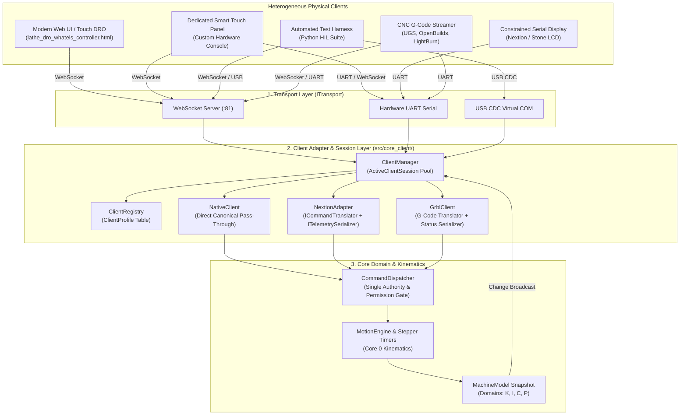
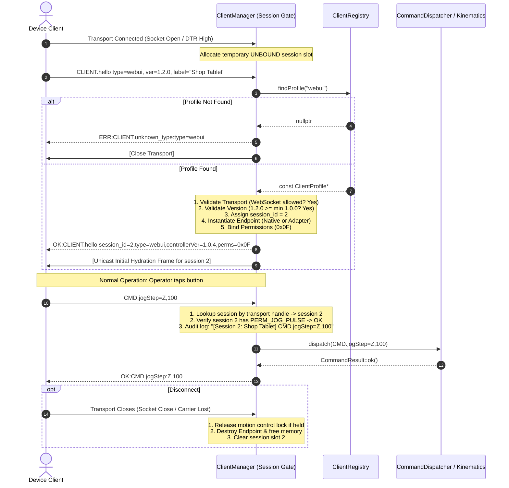

# whatELS Client Implementation Guide & Developer Reference

> **Status:** Working Draft / Architectural RFC & Developer Reference  
> **Master Architecture:** [`docs/clients/ELS_CLIENT_ARCHITECTURE.md`](./ELS_CLIENT_ARCHITECTURE.md)  
> **Target Audience:** Firmware engineers, UI developers, and hardware adapter authors building or integrating new operator interfaces for whatELS  
> **Location:** `docs/clients/CLIENT_IMPLEMENTATION_GUIDE.md`  
> **Date:** October 2026  

---

## 1. Purpose & Scope

This guide provides a comprehensive, step-by-step developer specification for creating and integrating a **new client type** into the whatELS modular controller architecture.

It serves two primary goals:
1. **Developer Reference:** Deliver a clear, end-to-end blueprint detailing every C++ interface, method contract, state change hook, and handshake requirement needed to implement a new client.
2. **Command Surface Authority:** For the complete dictionary of wire commands, parameters, permissions, and returns, refer directly to 👉 [`CANONICAL_COMMAND_REFERENCE.md`](../protocol/CANONICAL_COMMAND_REFERENCE.md).
3. **Architectural Gap Analysis:** Explicitly document existing ambiguities, interface divergences, and open implementation questions in the current codebase so they can be systematically addressed.

---

## 2. Core Architectural Philosophy

Before writing code for a new client, understand the four foundational tenets governing whatELS client interactions:



### 1. The Controller is the Sole Authority
The controller MCU owns all machine state, kinematics, and parameter validation. Connected clients are reactive observers: they transmit *operator intent* (`CMD.*`), and state flows outward via domain-namespaced telemetry (`K.*`, `I.*`, `C.*`, `P.*`).

### 2. Client Names are Concrete, Not Category Assumptions
The core does not use vague categories like "pendant" or "tablet" to guess capabilities. A client announces its specific product/application name (e.g. `webui`, `smarttouch`, `nextion_lcd`, `hil_harness`). The core looks up that name in its **Client Profile Registry** to look up its allowed transports, permission scopes, and optional translation adapter.

### 3. Native Baseline vs. Translation Adapters
* **Native Clients (`NativeClient`):** Speak the controller's native canonical grammar directly (`CMD.*`, `SETTINGS.*`). No translation layer sits between the transport and `CommandDispatcher`.
* **Foreign / Constrained Clients (`ClientEndpoint` + Adapters):** Cannot speak native commands (e.g. Nextion LCD sending raw component IDs, or GRBL senders streaming `G0 Z10`). They require a **Translation Layer** to synthesize canonical commands on ingress and decompose core telemetry on egress.

### 4. Authoritative Session Allocation
Clients provide a human-friendly label (`"Headstock Tablet"`), but the core **never** uses client-supplied strings as authoritative handles. The core allocates a collision-proof numeric **`session_id`** ($1, 2, 3\dots$) upon connection and tracks all subsequent commands, control locks, and teardowns against that handle.

---

## 3. Detailed Interface Reference

Implementing a client involves up to four core C++ interfaces located under `src/core_client/`.

### 3.1 Transport Interface: `ITransport`
The transport abstraction manages raw physical communication. It is completely agnostic to message syntax, commands, or kinematics.

```cpp
// src/core_client/transports/ITransport.h

namespace whatels {
namespace core_client {

enum TransportType : uint8_t {
    TRANSPORT_NONE      = 0,
    TRANSPORT_WEBSOCKET = 1 << 0,
    TRANSPORT_UART      = 1 << 1,
    TRANSPORT_USB_CDC   = 1 << 2,
    TRANSPORT_BLE       = 1 << 3   // Future
};

class ITransport {
public:
    virtual ~ITransport() = default;

    // Connection state
    virtual bool isConnected() const = 0;
    virtual TransportType getTransportType() const = 0;

    // Outbound transmission
    virtual bool sendText(const char* text) = 0;
    virtual bool sendBinary(const uint8_t* data, size_t length) = 0;

    // Lifecycle
    virtual void disconnect() = 0;
};

} // namespace core_client
} // namespace whatels
```

---

### 3.2 Inbound Translator Interface: `ICommandTranslator`
Used exclusively by **Foreign / Constrained Clients**. Translates alien wire events into canonical `CommandDispatcher` invocations. Native clients do not use this interface.

```cpp
// src/core_client/ICommandTranslator.h

namespace whatels {
namespace core_client {

class ICommandTranslator {
public:
    virtual ~ICommandTranslator() = default;

    /**
     * @brief Translates an inbound client-specific payload into canonical controller commands.
     * @param payload Raw payload received from transport.
     * @param length Byte length of payload.
     * @param reply Outbound string populated with translator-formatted response (e.g. Nextion cmd, GRBL "ok").
     * @return true if the event was recognized and dispatched; false otherwise.
     */
    virtual bool translateAndDispatch(const char* payload, size_t length, String* reply) = 0;

    /**
     * @brief Resets any multi-byte framing or staged input buffers on disconnect or error.
     */
    virtual void reset() {}
};

} // namespace core_client
} // namespace whatels
```

---

### 3.3 Outbound Serializer Interface: `ITelemetrySerializer`
Transforms the core's universal `MachineModel` into the specific format expected by a client.

```cpp
// src/core_client/ITelemetrySerializer.h

namespace whatels {
namespace core_client {

class ITelemetrySerializer {
public:
    virtual ~ITelemetrySerializer() = default;

    /**
     * @brief Serializes active machine model domains into wire text.
     * @param model Atomic snapshot of machine state (Kinematics, Intent, Cycle, Properties).
     * @param domainMask Bitmask of domains to include (DOMAIN_K, DOMAIN_I, DOMAIN_C, DOMAIN_P).
     * @return Formatted string ready for transport transmission.
     */
    virtual String serialize(const MachineModel& model, uint8_t domainMask) = 0;

    /**
     * @brief Checks if state has meaningfully changed for this client's presentation layer.
     * Avoids redundant transmissions and display flicker.
     */
    virtual bool hasChanged(const MachineModel& model) = 0;
};

} // namespace core_client
} // namespace whatels
```

---

### 3.4 Composite Endpoint: `ClientEndpoint`
The base class binding a transport, serializer, and optional translator into an active session pipeline:
$$\text{ClientEndpoint} = \text{Transport} + \text{Serializer} + \text{Translator}$$

```cpp
// src/core_client/ClientEndpoint.h

namespace whatels {
namespace core_client {

class ClientEndpoint {
protected:
    ITransport*           _transport;
    ITelemetrySerializer* _serializer;
    ICommandTranslator*   _translator;
    uint8_t               _activeDomainMask;
    uint8_t               _sessionId;

public:
    ClientEndpoint(ITransport* transport, 
                   ITelemetrySerializer* serializer, 
                   ICommandTranslator* translator = nullptr)
        : _transport(transport), _serializer(serializer), _translator(translator),
          _activeDomainMask(DOMAIN_ALL), _sessionId(0) {}

    virtual ~ClientEndpoint() = default;

    void setSessionId(uint8_t id) { _sessionId = id; }
    uint8_t getSessionId() const { return _sessionId; }

    void setSubscriptionMask(uint8_t mask) { _activeDomainMask = mask; }
    uint8_t getSubscriptionMask() const { return _activeDomainMask; }

    ITransport* getTransport() const { return _transport; }
    void setTransport(ITransport* transport) { _transport = transport; }

    // Ingress handling
    virtual bool handleIncoming(const char* payload, size_t length);

    // Egress telemetry broadcast
    virtual bool broadcast(const MachineModel& model, uint8_t domainMask = DOMAIN_ALL);
    virtual bool broadcastIfChanged(const MachineModel& model, uint8_t domainMask = DOMAIN_ALL);
};

} // namespace core_client
} // namespace whatels
```

---

### 3.5 Declarative Profile: `ClientProfile`
The static definition registered in the core that governs what a client type is allowed to do:

```cpp
// src/core_client/ClientProfile.h

namespace whatels {
namespace core_client {

enum ClientPermission : uint32_t {
    PERM_NONE           = 0,
    PERM_READ_TELEMETRY = 1 << 0,  // Can observe state, read positions & settings
    PERM_JOG_PULSE      = 1 << 1,  // Can execute manual step jogs & continuous jogs
    PERM_MOTION_START   = 1 << 2,  // Can engage feeds and start cutting cycles
    PERM_SETTINGS_WRITE = 1 << 3,  // Can modify persistent calibration & settings
    PERM_SIMULATION     = 1 << 4,  // Can inject fake RPM/encoder (CMD.simRpm, CMD.simEncoder)
    PERM_SYSTEM_RESET   = 1 << 5   // Can trigger reboot or factory defaults
};

typedef ClientEndpoint* (*EndpointFactory)(ITransport* transport);

struct ClientProfile {
    const char*     name;               // Client identifier (e.g. "webui", "smarttouch", "nextion_lcd")
    uint8_t         allowedTransports;  // Bitmask of allowed TransportType
    uint32_t        permissions;        // Bitmask of granted ClientPermission
    uint16_t        minProtocolVersion; // Minimum accepted version (e.g. 100 for v1.0.0)
    EndpointFactory createEndpoint;     // Factory: nullptr for default NativeClient, or custom adapter factory
};

} // namespace core_client
} // namespace whatels
```

---

### 3.6 Runtime Session: `ActiveClientSession`
The active connection record maintained in `ClientManager`'s active session table:

```cpp
// src/core_client/ActiveClientSession.h

namespace whatels {
namespace core_client {

struct ActiveClientSession {
    uint8_t              sessionId;          // Authoritative unique Core session ID (1..MAX_CLIENTS)
    bool                 active;             // Slot active flag
    const ClientProfile* profile;            // Pointer to registered ClientProfile
    String               clientLabel;        // Human-friendly label ("Headstock Tablet")
    uint16_t             clientVersion;      // Validated client version
    uint32_t             effectivePerms;     // Granted permission bitmask
    ITransport*          transport;          // Active transport instance
    ClientEndpoint*      endpoint;           // Bound endpoint instance
    bool                 holdsControlLock;   // Safe Monitor Lockout token
    uint32_t             connectTimestampMs; // Timestamp of connection establishment
};

} // namespace core_client
} // namespace whatels
```

---

## 4. Step-by-Step Implementation Guide

### Scenario A: Implementing a Native Client Type (e.g., `smarttouch`)

Native clients speak canonical whatELS ASCII grammar directly (`CMD.*`, `SETTINGS.*`). They require **zero translation code**.

#### Step 1: Define the Client Profile
In your client's definition file or in a centralized profiles registry (`src/core_client/profiles/SmartTouchProfile.h`):

```cpp
#include "core_client/ClientProfile.h"

namespace whatels {
namespace core_client {

const ClientProfile SMARTTOUCH_PROFILE = {
    .name               = "smarttouch",
    .allowedTransports  = TRANSPORT_UART | TRANSPORT_WEBSOCKET,
    .permissions        = PERM_READ_TELEMETRY | PERM_JOG_PULSE | PERM_MOTION_START | PERM_SETTINGS_WRITE,
    .minProtocolVersion = 100, // Requires protocol v1.0.0+
    .createEndpoint     = nullptr // Default NativeClient will be used
};

} // namespace core_client
} // namespace whatels
```

#### Step 2: Register with Core Registry
During controller initialization in `setup()`:
```cpp
whatels::core_client::ClientRegistry::instance().registerProfile(&SMARTTOUCH_PROFILE);
```

#### Step 3: Implement Client-Side Handshake in Hardware Firmware
When the `smarttouch` panel opens its UART or WebSocket connection to the controller, it must send:
```text
CLIENT.hello type=smarttouch,ver=1.0.0,label="Lathe Apron Console"
```
The controller validates the profile, allocates a `session_id`, and replies:
```text
OK:CLIENT.hello session_id=1,type=smarttouch,controllerVer=1.0.4,perms=0x0F
```
Followed immediately by the full machine state hydration frame:
```text
K.zDu=0|K.xDu=0|K.rpm=0|K.mode=50|K.on=0|...
```

---

### Scenario B: Implementing a Foreign / Constrained Translation Adapter (e.g., `nextion_lcd`)

Constrained screens (like Nextion serial LCDs) cannot speak native whatELS commands. You must write an **Adapter** that implements inbound translation and outbound serialization.

#### Step 1: Create the Translation Adapter Class
Under `src/core_client/clients/nextion/NextionAdapter.h`:

```cpp
#pragma once

#include "core_client/ClientEndpoint.h"
#include "core_client/ICommandTranslator.h"
#include "core_client/ITelemetrySerializer.h"

namespace whatels {
namespace core_client {

class NextionAdapter : public ClientEndpoint, 
                       public ICommandTranslator, 
                       public ITelemetrySerializer {
private:
    // Screen Diff Cache to avoid UART flooding and screen flicker
    int32_t  _lastZDu = 0x7FFFFFFF;
    int32_t  _lastXDu = 0x7FFFFFFF;
    uint16_t _lastRpm = 0xFFFF;
    uint8_t  _lastMode = 0xFF;

public:
    explicit NextionAdapter(ITransport* transport)
        : ClientEndpoint(transport, this, this) {}

    // --- ICommandTranslator: Decode Nextion Touches -> Canonical Commands ---
    bool translateAndDispatch(const char* payload, size_t length, String* reply) override {
        // Example: Nextion sends 0x65 0x00 0x04 0x01 (Page 0, Component 4 = [Face X Button])
        if (length >= 4 && (uint8_t)payload[0] == 0x65) {
            uint8_t pageId = payload[1];
            uint8_t compId = payload[2];

            if (pageId == 0 && compId == 4) {
                // Map discrete [Face X] button into Unified Gearbox Mode 50 with axis=X
                return CommandDispatcher::dispatch("CMD.startCycle=gearbox,axis=X,pitch=0.15", reply);
            }
            if (pageId == 0 && compId == 9) {
                // Map [STOP] button
                return CommandDispatcher::dispatch("CMD.stop", reply);
            }
        }
        return false;
    }

    // --- ITelemetrySerializer: Decompose MachineModel -> Nextion Text Strings ---
    String serialize(const MachineModel& model, uint8_t domainMask) override {
        String out = "";
        // Only emit commands for values that actually changed on screen
        if (model.kinematics.zDu != _lastZDu) {
            _lastZDu = model.kinematics.zDu;
            out += "t_z.txt=\"" + String(_lastZDu / 10000.0, 3) + "\"\xFF\xFF\xFF";
        }
        if (model.kinematics.rpm != _lastRpm) {
            _lastRpm = model.kinematics.rpm;
            out += "t_rpm.txt=\"" + String(_lastRpm) + "\"\xFF\xFF\xFF";
        }
        return out;
    }

    bool hasChanged(const MachineModel& model) override {
        return (model.kinematics.zDu != _lastZDu) || (model.kinematics.rpm != _lastRpm);
    }
};

} // namespace core_client
} // namespace whatels
```

#### Step 2: Define the Profile with Factory Function
```cpp
static ClientEndpoint* createNextionEndpoint(ITransport* transport) {
    return new NextionAdapter(transport);
}

const ClientProfile NEXTION_PROFILE = {
    .name               = "nextion_lcd",
    .allowedTransports  = TRANSPORT_UART,
    .permissions        = PERM_READ_TELEMETRY | PERM_JOG_PULSE | PERM_MOTION_START,
    .minProtocolVersion = 100,
    .createEndpoint     = createNextionEndpoint
};
```

---

## 5. Runtime Connection & Handshake Protocol

When a client connects over any transport (WebSocket, UART, USB CDC), it enters the following lifecycle:



### Handshake Wire Specifications

#### 1. Inbound Handshake (`CLIENT.hello`)
Must be the **first message** sent by a client after connecting:
```text
CLIENT.hello type=<profile_name>,ver=<version_str>,label="<friendly_label>"
```
* `type`: (Required) Registered profile identifier (e.g. `webui`, `smarttouch`, `hil_harness`, `nextion_lcd`).
* `ver`: (Required) Semantic version string (e.g. `1.2.0`).
* `label`: (Optional) User-friendly device label for audit logs and UI display (e.g. `"Carriage Console"`).

#### 2. Outbound Acknowledgement (`OK:CLIENT.hello`)
Controller returns the assigned session handle and granted permissions:
```text
OK:CLIENT.hello session_id=<id>,type=<profile_name>,controllerVer=<fw_version>,perms=<hex_mask>
```

#### 3. Handshake Rejection Codes
| Error Reply | Trigger Condition | Controller Action |
| :--- | :--- | :--- |
| `ERR:CLIENT.unknown_type:type=<name>` | Profile name not registered in core. | Disconnect transport immediately. |
| `ERR:CLIENT.transport_disallowed:type=<name>,transport=<t>` | Client attempting to connect on unpermitted medium (e.g. `webui` over raw UART). | Disconnect transport immediately. |
| `ERR:CLIENT.incompatible_version:min_required=<req>,received=<rec>` | Client version is older than `minProtocolVersion`. | Disconnect transport immediately. |

---

## 6. Transport Layer Mechanics & Stream Framing

When integrating a client, developers must understand how physical data moves through `ITransport`:

```
   [ Physical Medium ]          [ Transport Implementation ]          [ Core Session Gate ]
   WebSocket Socket     ──►    WebSocketTransport (Framed)     ──►    ClientManager::onClientMessage()
   UART RX RingBuffer   ──►    StreamTransport (Line Buffered) ──►    ClientManager::onClientMessage()
```

### 6.1 WebSocket Transport (`WebSocketTransport`)
* **Framing Guarantee:** The underlying `WebSocketsServer` protocol engine performs frame reconstruction. When `handleIncoming(payload, length)` is invoked, it is **guaranteed to contain an entire, complete text frame**.
* **Zero Custom Buffering:** Adapters running over WebSockets do not need to buffer partial chunks or look for line delimiters.

### 6.2 Stream Transports: UART Serial & USB CDC
* **Stream Fragmentation:** Raw UART hardware delivers bytes non-deterministically (e.g. a 20-character command may arrive as 4 bytes, then 12 bytes, then 4 bytes).
* **Framing Responsibility:** 
  * Transport implementations for stream media (such as `UartTransport`) must implement **Line Buffering**:
    1. Bytes are accumulated into a fixed stack or ring buffer until a newline (`\n` or `\r\n`) is encountered.
    2. The null-terminated line buffer is dispatched to `ClientManager::onClientMessage()`.
  * For binary protocols (such as Nextion with `0xFF 0xFF 0xFF` delimiters), the adapter's framing helper must buffer bytes until the 3-byte sentinel is found.

### 6.3 Outbound Transmission & Non-Blocking Sockets
* All `ITransport::sendText()` calls must be **non-blocking**.
* If a TCP/WebSocket buffer or UART TX ring buffer is full, the transport should drop non-critical telemetry frames rather than stalling the FreeRTOS thread. Critical command confirmations (`OK`, `ERR`) must take priority.

---

## 7. Machine State Model & Physical Units Reference

All controller telemetry and state synchronization centers on [`MachineModel`](../../src/core/MachineModel.h).

### 7.1 The Four State Domains
The controller splits state into 4 independent domains:

| Domain | Identifier | Scope & Key Fields |
| :--- | :--- | :--- |
| **Kinematics** | `DOMAIN_K` (`K.*`) | Real-time coordinates (`zDu`, `xDu`), spindle speed (`rpm`), position (`turns`, `angle`), active mode ID (`mode`), motion state (`isOn`, `estop`). |
| **Operator Intent** | `DOMAIN_I` (`I.*`) | Active target parameters: feed rate (`pitchDu`), TPI (`tpi`), taper ratio (`taperRatio`), target axis (`axis`), sync mode (`sync`). |
| **Cycle Progress** | `DOMAIN_C` (`C.*`) | Conversational cycle tracking: current pass (`passNumber`), total passes (`totalPasses`), cycle state. |
| **Static Properties** | `DOMAIN_P` (`P.*`) | Lathe physical calibration: leadscrew pitch (`leadscrewPitch`), software limits (`limits`), encoder resolution (`encoderPpr`). |

### 7.2 The Physical Unit Convention: Deci-Microns (`du`)

> [!IMPORTANT]
> **All linear dimensions inside whatELS firmware and telemetry are stored in deci-microns (`du`).**  
> An integer deci-micron is one-tenth of a micron ($0.1\ \mu\text{m} = 0.0001\text{ mm}$).

$$\mathbf{1.0\text{ mm} = 10,000\text{ du}} \qquad\qquad \mathbf{1.0\text{ in} = 254,000\text{ du}}$$

* **Linear Coordinates (`zDu`, `xDu`):** To convert `zDu` to millimeters for display: $\text{mm} = \frac{\text{zDu}}{10000.0}$.
* **Feed Pitch Metric (`dupr`):** Deci-microns per spindle revolution. A feed of $0.15\text{ mm/rev} = 1,500\text{ dupr}$.
* **Spindle Position (`turns`):** Fractional spindle rotations (float). $1.0\text{ turn} = 360^\circ$.
* **Spindle Angle (`angle`):** Spindle phase in degrees ($0.0^\circ \dots 359.9^\circ$).

---

## 8. Concurrency & Execution Best Practices (Do's and Don'ts)

whatELS operates on a dual-core ESP32-S3 microcontroller with strict real-time partitioning:
* **Core 0:** High-priority motion pulse generation, hardware timer ISRs, and encoder pulse counting.
* **Core 1:** FreeRTOS network tasks (`taskWiFi`), UART processing, client session management, and `CommandDispatcher`.

### Summary of Golden Rules

| Category | DO | DO NOT |
| :--- | :--- | :--- |
| **Command Routing** | **DO** route all client commands through `CommandDispatcher::dispatch()`. | **DO NOT** attempt direct cross-core mutation of kinematics registers or motor variables. |
| **Execution Timing** | **DO** ensure `translateAndDispatch()` executes in under $500\ \mu\text{s}$. | **DO NOT** use blocking delays (`delay()`, busy loops, synchronous file I/O). |
| **Heap Management** | **DO** use stack buffers (`char buf[128]`) or static scratchpads in high-frequency loops. | **DO NOT** use dynamic `String` concatenation in 50–100 Hz telemetry push paths (prevents heap fragmentation). |
| **Screen Updates** | **DO** maintain a Screen Diff Cache in display adapters (e.g. `NextionAdapter`) to push only modified fields. | **DO NOT** flood slow UART buses with full-screen telemetry refreshes when coordinates have not changed. |
| **Session Safety** | **DO** verify session permissions (`session.effectivePerms`) before dispatching restricted actions. | **DO NOT** allow operator consoles or spectator tablets to invoke simulation commands (`CMD.simRpm`). |

---

## 9. Architectural Gaps & Implementation Ambiguities

During the architectural audit, five significant implementation gaps and ambiguities were identified between existing code and this specification. 

> [!WARNING]
> Developers implementing new clients or refactoring `src/core_client/` should review these open items before modifying production code.

### Gap 1: Duplicate `ClientEndpoint.h` Headers (RESOLVED)
* **Status:** Resolved in `src/web/` refactor.
* **Resolution:** Removed the legacy duplicates `src/web/ClientEndpoint.h` and `src/web/CommandDispatcher.h`. The authoritative base class resides in `src/core_client/ClientEndpoint.h`, command dispatching in `src/core/CommandDispatcher.h`, and telemetry serialization implementations in `src/core_client/ClientSerializers.h`.

### Gap 2: `ClientManager` is Hardcoded to WebSockets Only
* **The Reality:** In `src/core_client/ClientManager.h`, the connection table is hardcoded to:
  ```cpp
  static constexpr size_t MAX_WS_CLIENTS = 4;
  ClientEndpoint*     _wsEndpoints[MAX_WS_CLIENTS];
  WebSocketTransport* _wsTransports[MAX_WS_CLIENTS];
  WebSocketsServer*   _server;
  ```
* **The Required Resolution:** Generalize `ClientManager` to manage an array of `ActiveClientSession` structs that hold an abstract `ITransport*` pointer. This allows UART Serial, USB CDC, and WebSockets to share the identical session manager.

### Gap 3: Missing C++ Implementation for `ClientRegistry` and `ClientProfile`
* **The Reality:** While documented in architecture specs, there is currently no C++ implementation of `ClientRegistry`, `ClientProfile`, or permission checking in `CommandDispatcher`.
* **The Required Resolution:** Implement `ClientProfile.h` and `ClientRegistry.h / .cpp` in `src/core_client/`. Update `CommandDispatcher` to check `session.effectivePerms` before executing restricted commands.

### Gap 4: Ambiguity in Outbound Telemetry Distribution
* **The Ambiguity:**
  * When state changes, does `ClientManager` pre-serialize a single universal telemetry string and push it to all matching sessions (efficient for multiple `webui` instances)?
  * Or does each `ClientEndpoint` serialize independently (required for `NextionAdapter` and custom domain masks)?
* **Proposed Resolution (Hybrid Model):**
  * Use **Channel-Shared Serialization** for native clients sharing the same domain mask.
  * Delegate to `endpoint->broadcastIfChanged(model)` for translation adapters with screen diff caches.

### Gap 5: Legacy Session Logic in `WebServerModule.cpp` (RESOLVED)
* **Status:** Resolved in `src/web/` refactor.
* **Resolution:** Stripped out legacy session arrays and manual command parsing from `src/web/WebServerModule.cpp`. `WebServerModule` now directly routes all incoming WebSocket frames cleanly to `ClientManager::handleWebSocketEvent(num, type, payload, length)`.

---

## 10. Checklist for Adding a New Client Type

Use this checklist when introducing a new client:

- [ ] **1. Define Client Name:** Choose a concise, concrete identifier (e.g. `smarttouch`, `mobile_dro`, `nextion_lcd`).
- [ ] **2. Determine Translation Requirement:**
  - Speaks native whatELS commands? $\rightarrow$ Native client (`createEndpoint = nullptr`).
  - Speaks foreign protocol or needs screen widget mapping? $\rightarrow$ Implement `ICommandTranslator` and `ITelemetrySerializer`.
- [ ] **3. Consult Command Catalog:** Review [`CANONICAL_COMMAND_REFERENCE.md`](../protocol/CANONICAL_COMMAND_REFERENCE.md) to verify required commands, parameters, and return payloads.
- [ ] **4. Define Permission Scope:** Select explicit permissions (`PERM_READ_TELEMETRY`, `PERM_JOG_PULSE`, `PERM_MOTION_START`, etc.). *Never grant `PERM_SIMULATION` to operator UIs.*
- [ ] **5. Select Allowed Transports:** Restrict transports (`TRANSPORT_WEBSOCKET`, `TRANSPORT_UART`, `TRANSPORT_USB_CDC`).
- [ ] **6. Create `ClientProfile`:** Declare static profile instance with minimum accepted version.
- [ ] **7. Register with `ClientRegistry`:** Add `ClientRegistry::registerProfile(&PROFILE)` to system startup.
- [ ] **8. Verify Handshake:** Ensure client hardware/software emits `CLIENT.hello` immediately upon opening the transport.
- [ ] **9. Verify Framing & Buffering:** If using UART, ensure the transport or adapter buffers bytes until delimiter before dispatching.
- [ ] **10. Test Safe Monitor Lockout:** Confirm secondary instances of your client enter safe monitoring when another session starts motion.

