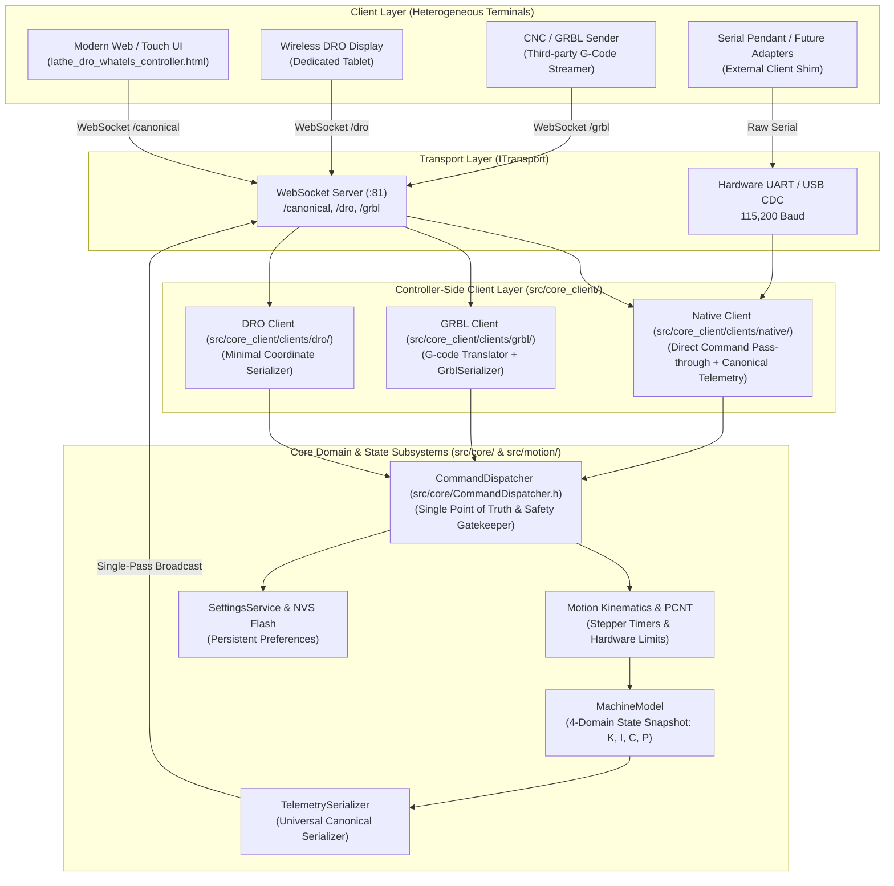
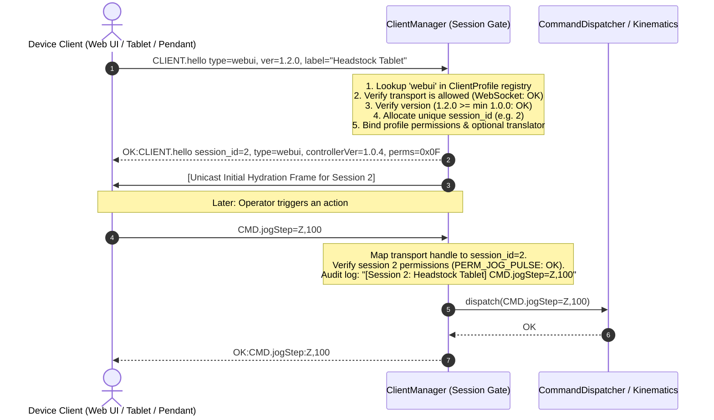

# whatELS Client Architecture & Protocol Specification

> **Status:** Authoritative Specification (Subsystems 5 & 6)  
> **Master Blueprint:** [`NANOELS_MASTER_ARCHITECTURE.md`](./NANOELS_MASTER_ARCHITECTURE.md)  
> **Target Version:** whatELS Modular Multi-Client Suite  
> **Author:** Antigravity & Emil  
> **Date:** October 13, 2026  
> **Location:** `docs/ELS_CLIENT_ARCHITECTURE.md`  
> **Referenced By:** `NANOELS_MASTER_ARCHITECTURE.md`, `ELS_DESIGN_NOTEBOOK.md`, `ELS_MODE_ARCHITECTURE.md`, `LATHE_MACHINE_PROFILE.md`, `ELS_PRESET_CATALOG.md`

---

## 1. Executive Summary & Core Role

The **whatELS Client Architecture** defines the structure, communication protocol, state synchronization, and presentation layer for all operator interfaces interacting with the whatELS motion controller. It serves as the authoritative deep-dive for **Subsystem 5 (Command Dispatcher & Transport)** and **Subsystem 6 (Human-Machine Interface Adapters)**.

For the system-wide 6-subsystem architecture, dual-core concurrency model, and full firmware file disposition, refer directly to the master blueprint: 👉 [`NANOELS_MASTER_ARCHITECTURE.md`](./NANOELS_MASTER_ARCHITECTURE.md).  
For the developer implementation walkthrough and interface reference, see: 👉 [`CLIENT_IMPLEMENTATION_GUIDE.md`](./CLIENT_IMPLEMENTATION_GUIDE.md).  
For the universal, language-agnostic Client SDK specification and transport contracts, see: 👉 [`sdk/CLIENT_SDK_SPECIFICATION.md`](./sdk/CLIENT_SDK_SPECIFICATION.md).

### Governing Architectural Tenets
1. **The Controller is the Sole Authority:**  
   Connected clients (Web UI, tablet DROs, pendants, secondary displays) are pure reactive observers. Mode execution and kinematics run deterministically on the controller MCU. The client transmits *operator intent* (`CMD.*`), and state flows outward via domain-namespaced telemetry.
2. **Strict Layer Decoupling (Transport vs. Translation vs. Core):**  
   Transport code (WebSocket, Serial) manages raw sockets and frame buffers only. A dedicated Translation Layer sanitizes and decodes client-specific protocols into canonical machine commands. The motion engine never touches transport artifacts.
3. **Preservation of Operator Intent (No Float Round-Trip Drift):**  
   The controller stores exact operator intent (e.g. `20 TPI`, `1:3.5 taper`, `1.5 mm pitch`) alongside canonical deci-micron values (`du`, `dupr`). This guarantees zero round-trip display drift (entering `20 TPI` will never return as `19.9998`).
4. **Presentation is Client-Local:**  
   Units (`mm`/`in`) and cross-slide display representation (`Ø Diameter`/`R Radius`) are entirely client-local presentation settings. Toggling units never transmits network packets to the MCU and never affects other connected clients.
5. **Zero-Build, 100% Offline Runtime & ROM Asset Embedding:**  
   The Web UI operates with zero npm build step or bundler dependencies. In production, assets are gzipped and embedded into firmware Flash ROM (`PROGMEM`) so firmware updates deliver UI updates simultaneously without touching the user's LittleFS filesystem. For rapid development, the controller supports serving hot-reloaded assets from LittleFS `/www/` or loaded directly via `file:///`.
6. **Zero-WiFi Control Plane Mandate (Wired Physical Bus for Motion):**  
   Executing real-time cutting cycles or emergency stops over wireless Wi-Fi in an industrial machine shop with heavy motor and VFD EMI noise introduces hazardous failure modes (packet drops, latency jitter, stalled cuts). The primary machine control plane between the operator console and the whatELS core is strictly wired over physical UART serial (`Serial1`) or on-chip memory. Wi-Fi/WebSocket transports are dedicated to supervisory observation, parameter configuration, and DRO telemetry.

---

## 2. System Topology & 3-Tier Layering



### Layer Responsibilities

#### 1. Transport Layer (`ITransport`)
* Manages network sockets and byte streams (ESP32 `WebSocketsServer` on port 81, USB CDC, hardware UART).
* Handles connection state, client registration, keep-alive heartbeats, and frame buffering.
* Completely agnostic to command syntax, motion state, or kinematics.

#### 2. Native Baseline Client vs. Alien Adapters
* **Native Baseline Client (Zero-Translation)**:
  - Native clients (such as the Touch DRO Web UI and Python HIL Test Suite) speak the controller's native command surface (`CMD.*`, `SETTINGS.*`, `?get`).
  - No protocol translation takes place. Commands pass directly into `CommandDispatcher`, and execution results are returned via universal canonical serialization.
* **Alien Adapters (`ICommandTranslator` & `ITelemetrySerializer`)**:
  - Translates foreign wire protocols (e.g. GRBL G-code streaming for CNC senders, or binary packets for dumb serial screens) into native `CommandDispatcher` invocations and maps responses back into the client's expected grammar (`ok`, `error:20`).

#### 3. Core State & Motion Engine (`CommandDispatcher`, `MachineModel`, `TelemetrySerializer`)
* `CommandDispatcher`: Dispatches validated commands directly to motion and settings subsystems. Single point of truth. Operates inside a defensive fault-contained sandbox and returns a strongly typed `CommandResult`.
* `MachineModel`: Captures atomic, tear-free snapshots across 4 independent domains: Kinematics (`K`), Intent (`I`), Cycle (`C`), and Properties (`P`).
* `TelemetrySerializer`: Universal core state exporter. Formats `MachineModel` domains into canonical ASCII key-value telemetry without tying the core to any specific client or transport.

---

## 3. Composable Client Endpoint Pipeline (C++ Specification)

To ensure that any client transport (WebSocket, REST HTTP, USB-UART serial pendant, or physical hardware HMI) can be integrated without modifying kinematic firmware, the system defines a composable client pipeline:

$$\text{ClientEndpoint} = \text{Transport} + \text{Serializer} + \text{Translator}$$

```
   Raw Wire (Bytes/Text)              Inbound Translation                   Core Controller
[ Physical I/O Channel ] ──(Inbound)──► [ ICommandTranslator ] ──(Dispatch)──► [ CommandDispatcher ]
           ▲                                                                           │
           │                                                                     (CommandResult)
           │                                                                           │
           └──────────────(Outbound)── [ Response Serializer ] ◄───────────────────────┘
                                       [ ITelemetrySerializer ] ◄──(Capture)── [ MachineModel ]
```

### C++ Interface Definitions

```cpp
// src/core/CommandDispatcher.h

enum class CommandStatus : uint8_t {
    OK = 0,            // Command recognized and executed successfully
    FAILED,            // Command recognized, but rejected or failed
    UNRECOGNIZED       // Command was not recognized in any routing table
};

struct CommandResult {
    CommandStatus status;
    const char*   command;     // Canonical command name (e.g. "stop", "axisZero")
    String        payload;     // Detail: error reason on failure, data/ack on success
    uint32_t      errorCode;   // Structured error code (0 = NONE)

    static CommandResult ok(const char* cmd, const String& data = "") {
        return { CommandStatus::OK, cmd, data, 0 };
    }
    static CommandResult failed(const char* cmd, const String& reason, uint32_t code = 0) {
        return { CommandStatus::FAILED, cmd, reason, code };
    }
    static CommandResult unrecognized(const char* cmd = "") {
        return { CommandStatus::UNRECOGNIZED, cmd, "", 0 };
    }

    bool isOk() const { return status == CommandStatus::OK; }
    bool isHandled() const { return status != CommandStatus::UNRECOGNIZED; }
};

class ITransport {
public:
    virtual ~ITransport() = default;
    virtual bool isConnected() const = 0;
    virtual bool sendText(const char* text) = 0;
    virtual bool sendBytes(const uint8_t* buffer, size_t length) = 0;
};

class ICommandTranslator {
public:
    virtual ~ICommandTranslator() = default;
    // Decodes raw client wire bytes/strings into canonical dispatcher actions
    virtual CommandResult translateInbound(const char* payload, size_t length) = 0;
    // Serializes domain CommandResult into client-specific response frame
    virtual String serializeResponse(const CommandResult& result) = 0;
};

class ITelemetrySerializer {
public:
    virtual ~ITelemetrySerializer() = default;
    // Serializes domain state snapshots into client-specific wire frames
    virtual size_t serialize(const MachineModel& model, uint8_t domainMask, char* outBuf, size_t maxLen) = 0;
};

class ClientEndpoint {
public:
    ClientEndpoint(ITransport& transport, ICommandTranslator& translator, ITelemetrySerializer& serializer)
        : transport_(transport), translator_(translator), serializer_(serializer) {}

    // Synchronous Inbound Command Execution & Guaranteed Response Delivery
    void onInboundData(const char* data, size_t len) {
        CommandResult result = translator_.translateInbound(data, len);
        String response = translator_.serializeResponse(result);
        if (response.length() > 0 && transport_.isConnected()) {
            transport_.sendText(response.c_str());
        }
    }

    // Outbound Telemetry Broadcast
    void onStateChanged(const MachineModel& model, uint8_t domainMask) {
        if (!transport_.isConnected()) return;
        char buffer[256];
        size_t written = serializer_.serialize(model, domainMask, buffer, sizeof(buffer));
        if (written > 0) {
            transport_.sendText(buffer);
        }
    }

private:
    ITransport& transport_;
    ICommandTranslator& translator_;
    ITelemetrySerializer& serializer_;
};
```

### 3.1 Heterogeneous Channels & URL-Path Routing
When multiple clients connect via WebSockets, they may require different data formats. Routing is negotiated cleanly during HTTP upgrade via the request path:

| URL Path | Channel Type | Serializer Used | Location & Role | Target Client |
| :--- | :--- | :--- | :--- | :--- |
| `ws://<ip>:81/` or `/canonical` | `CHANNEL_CANONICAL` | **`TelemetrySerializer`** (`K.*`, `I.*`, `C.*`, `P.*`) | `src/core/TelemetrySerializer.h` (Universal Core Serializer) | Rich Web UI / Multi-Axis HMI / Native Display |
| `ws://<ip>:81/grbl` | `CHANNEL_GRBL` | `GrblSerializer` (`<Idle\|WPos:...\|FS:...>`) | `src/core_client/ClientSerializers.h` (Third-Party G-Code Serializer) | CNC Senders (UGS, CNCjs, OpenBuilds) |
| `ws://<ip>:81/dro` | `CHANNEL_DRO` | `DroSerializer` (`K.zDu`, `K.xDu`, `K.rpm`) | `src/core_client/ClientSerializers.h` (Minimal Coordinates Serializer) | Minimal Wireless DRO Readouts |

- **Zero Runtime Overhead**: The channel is assigned **once** during the HTTP upgrade handshake. Runtime packets require no subscription parsing.
- **Active Channel Bitmask (`activeChannelMask`)**: The controller tracks which channels have active listeners. Formats with zero connected listeners are **never serialized**, burning zero CPU cycles.
- **Single-Pass Universal Serialization**: For channels with multiple listeners (e.g., two tablets connected to `/canonical`), `TelemetrySerializer` formats the state snapshot **exactly once** per change event. The identical output string is pushed to all matching client sockets without redundant CPU overhead or heap allocations.

### 3.2 Unicast Request-Response vs. Channel Broadcast Separation
1. **Unicast Request-Response (1-to-1)**:
   - Queries (`?get=...`, `?sysinfo`), Settings reads (`SETTINGS.get=...`), and command confirmations (`OK`, error messages) are sent **unicast** (`sendTXT(clientId)`) exclusively to the requesting socket.
   - Prevents network amplification ($O(N^2)$ traffic) when multiple displays are active.
   - New connections receive an immediate unicast hydration frame without disturbing existing screens.
2. **Channel Broadcast (1-to-Many)**:
   - When machine state changes, telemetry is serialized once per active channel and pushed to matching sockets.

### 3.3 Smart Clients vs. Dumb Displays (Stateful Presenters)
The client model accommodates both intelligent and protocol-constrained clients:
* **Smart Clients (Web UI / Alpine Reactive Store)**:
  - The client runs its own reactive state engine on its local CPU (browser).
  - The controller's serializer is thin and stateless: it emits raw canonical data (`K.*`, `I.*`). The client formats units, diameters, and DOM elements locally.
* **Dumb Displays (Physical Nextion LCD / Serial Pendants)**:
  - Nextion hardware has no domain logic; it only receives widget text strings (`t0.txt="-18.42"`) and emits component touch IDs (Page 1, Component 4).
  - Its `ClientEndpoint` acts as a **Stateful Presenter / Transformer**:
    1. **Diff Cache**: Stores previously rendered strings, active page ID, and widget colors to eliminate redundant UART transmissions and screen flicker.
    2. **Component Mapping**: Maps raw touch events into canonical `CommandDispatcher` actions.
    3. **Quirk Isolation**: Nextion-specific hashing and delta-rendering reside strictly inside the Nextion adapter, keeping core firmware clean.

### 3.4 Multi-Client Idle Decoupling & Atomic Cycle Inception
A core tenet of the multi-client architecture is that the **Core Motion Engine does not track or enforce conversational setup modes while the lathe is stationary and idle (`isOn == false`)**:
1. **Independent Idle Drafting (Zero Screen Hijacking):**
   - While idle, conversational wizards, modal cards, and mode selectors in client UIs are strictly **independent local drafting environments**.
   - Operator A configuring a Threading cycle on a tablet and Operator B adjusting a Gearbox feed on a phone do not fight over MCU registers, nor do their actions forcefully switch each other's active screens.
2. **Atomic Cycle Inception:**
   - To engage physical motion, the core requires a fully qualified command specifying the target mode and all mandatory parameters (e.g. `CMD.startCycle=threading,pitch=1.5,passes=6` or atomic `CMD.mode=<mode>\nCMD.on=1\n`).
   - The core validates all parameters via `IELSMode::validateParams()` before transitioning from `IDLE` to `RUNNING`.
3. **Role of Client Translation Layers (Adapters):**
   - **Rich Clients (Web UI / Tablets):** Gather inputs locally in conversational wizards, perform client-side math and validation, and dispatch the fully qualified command upon tapping `START FEED` / `START CYCLE`.
   - **Constrained / Simple Clients (Nextion LCD / Pendants):** Rely on their dedicated ESP32 adapter / translation layer (`NextionAdapter`) to buffer incremental button presses into a staged session struct. When the operator hits the physical green button, the translation layer synthesizes the validated start command on the client's behalf.
4. **Change Broadcast on Motion Inception:**
   - The controller only broadcasts mode transitions (`K.mode=<modeId>`, `K.on=1`) when physical stepping actually begins (`RUNNING`). At that point, all connected clients reflect active motion or enter Safe Monitor Lockout.

### 3.5 Client Profile Registry & Capability Governance (`ClientProfile`)
To prevent hardcoded assumptions about device capabilities while maintaining strict safety boundaries, the controller core maintains a **Client Profile Registry**. 

Device clients do not infer capabilities from arbitrary labels. Instead, each concrete client product or interface (`webui`, `smarttouch`, `hil_harness`, `nextion_lcd`) is registered in firmware with explicit transport rules, permission scopes, and an optional translation layer.

```cpp
// src/core_client/ClientProfile.h

enum TransportType : uint8_t {
    TRANSPORT_NONE      = 0,
    TRANSPORT_WEBSOCKET = 1 << 0,
    TRANSPORT_UART      = 1 << 1,
    TRANSPORT_USB_CDC   = 1 << 2
};

enum ClientPermission : uint32_t {
    PERM_NONE           = 0,
    PERM_READ_TELEMETRY = 1 << 0,  // Can observe state, read positions & settings
    PERM_JOG_PULSE      = 1 << 1,  // Can execute manual step jogs & continuous jogs
    PERM_MOTION_START   = 1 << 2,  // Can engage feeds and start cutting cycles
    PERM_SETTINGS_WRITE = 1 << 3,  // Can modify persistent calibration & settings
    PERM_SIMULATION     = 1 << 4,  // Can inject fake RPM & encoder steps (CMD.simRpm, CMD.simEncoder)
    PERM_SYSTEM_RESET   = 1 << 5   // Can trigger reboot or factory defaults
};

typedef ICommandTranslator* (*TranslationFactory)(ITransport* transport);

struct ClientProfile {
    const char*        name;               // Concrete client identifier (e.g. "webui", "smarttouch", "hil_harness")
    uint8_t            allowedTransports;  // Bitmask of TransportType permitted for this client
    uint32_t           permissions;        // Bitmask of ClientPermission granted to this client
    uint16_t           minProtocolVersion; // Minimum accepted protocol version (e.g. 100 for v1.0.0)
    TranslationFactory createTranslator;   // nullptr if Native (zero-translation), or factory for adapter
};
```

#### Built-in Core Profiles Example:
| Profile Name | Allowed Transports | Translation Layer | Permissions | Role & Safety Boundary |
| :--- | :--- | :--- | :--- | :--- |
| **`webui`** | WebSocket | `nullptr` (Native) | `READ_TELEMETRY`, `JOG_PULSE`, `MOTION_START`, `SETTINGS_WRITE` | Operator Touch UI. *Strictly forbidden from spindle simulation.* |
| **`smarttouch`** | UART, WebSocket | `nullptr` (Native) | `READ_TELEMETRY`, `JOG_PULSE`, `MOTION_START`, `SETTINGS_WRITE` | Hardware lathe console. Direct native control. |
| **`hil_harness`** | WebSocket, USB CDC | `nullptr` (Native) | `READ_TELEMETRY`, `JOG_PULSE`, `MOTION_START`, `SETTINGS_WRITE`, `SIMULATION`, `SYSTEM_RESET` | Automated CI test harness & diagnostics. Full root authority. |
| **`nextion_lcd`** | UART | `NextionAdapter` | `READ_TELEMETRY`, `JOG_PULSE`, `MOTION_START` | Constrained hardware screen. Requires translation presenter. |
| **`spectator_dro`**| WebSocket | `nullptr` (Native) | `READ_TELEMETRY` | Read-only remote DRO display. *Motion commands rejected.* |

#### Command Permission Gatekeeper:
When any command arrives via `ClientEndpoint::handleIncoming()`, the endpoint verifies the calling session's granted permissions before dispatching into `CommandDispatcher`:
$$\text{if } (\text{commandRequiresPerm}(cmd) \ \& \sim\text{session.effectivePerms}) \implies \mathbf{ERR:CMD.permission\_denied}$$
This ensures an unauthorized Web UI or remote tablet can never inject fake RPM simulation (`CMD.simRpm`) while a real machine spindle is stationary.

---

### 3.6 Inbound Handshake & Authoritative Session Management (`ActiveClientSession`)
When a connection is established over any transport, the device client must announce its identity. 

#### Client-Provided Information vs. Core-Assigned Authority
* **Client Announces (Informational):** The client provides its client type, build/protocol version, and an optional human-readable friendly label (e.g. `"Headstock Tablet"`).
* **Core Assigns (Authoritative):** The client **cannot** self-assign a unique ID because multiple devices running the same software would collide. The core allocates an authoritative, unique **`session_id`** from its active connection pool.



#### Handshake Wire Grammar:
1. **Inbound Client Hello:**
   ```text
   CLIENT.hello type=<profile_name>,ver=<version_string>,label="<friendly_label>"
   ```
2. **Outbound Controller Acknowledgement:**
   ```text
   OK:CLIENT.hello session_id=<uint8>,type=<profile_name>,controllerVer=<version_string>,perms=<hex_mask>
   ```
3. **Rejection Errors:**
   * `ERR:CLIENT.unknown_type:type=<name>` — Profile not registered in core.
   * `ERR:CLIENT.transport_disallowed:type=<name>,transport=<type>` — Profile not permitted on this physical medium.
   * `ERR:CLIENT.incompatible_version:min_required=<min_ver>,received=<received_ver>` — Client is outdated.

#### Session Lifecycle & Active Table:
```cpp
// src/core_client/ActiveClientSession.h

struct ActiveClientSession {
    uint8_t              sessionId;          // Authoritative unique Core session ID
    const ClientProfile* profile;            // Points to static profile ("webui", "smarttouch")
    String               clientLabel;        // Human-friendly name ("Headstock Tablet")
    uint16_t             clientVersion;      // Validated client version
    uint32_t             effectivePerms;     // Granted permission bitmask
    ITransport*          transport;          // Underlying physical transport handle
    ClientEndpoint*      endpoint;           // Bound endpoint (Native or Translation Adapter)
    bool                 holdsControlLock;   // Safe Monitor Lockout token
    uint32_t             connectTimestampMs; // Session creation time
};
```
* **Request Association:** In connection-oriented transports (WebSocket client index, dedicated UART port handle), incoming bytes immediately index to the corresponding `ActiveClientSession`.
* **Safe Monitor Lockout Exclusivity:** When an active session initiates a cutting cycle (`CMD.startCycle` / `CMD.on=1`), that session acquires `holdsControlLock = true`. Any motion commands from secondary sessions are rejected until the cycle finishes or E-Stop is triggered.
* **Disconnect Cleanup:** When the transport closes, `ClientManager` tears down the `ActiveClientSession`, releases any control locks held, and logs session closure.

---

### 3.7 Mode Decomposition & Synthesis in Translation Layers
A central responsibility of the Translation Layer is bridging modern, composite Core Motion Modes with constrained or legacy client interfaces.

```
       [ Constrained / Legacy Hardware ]               [ Translation Layer ]                 [ Controller Core ]
(Nextion Screen / Dedicated Pushbutton Panel)            (NextionAdapter)                    (MotionEngine)

          [ Button: Feed Z ]           ──(Touch)──►   Map to Mode 50 (Gearbox)   ──(Dispatch)──►  Execute Unified
          [ Button: Face X ]           ──(Touch)──►   with axis=Z or axis=X                       Gearbox Mode 50
          [ Button: Taper/Cone ]       ──(Touch)──►   with angle/taper params

          [ Widget: Z Pos  ]           ◄──(Render)─   Decompose Mode 50 Telemetry ◄──(Snapshot)─  Broadcast Universal
          [ Widget: X Pos  ]           ◄──(Render)─   into individual page widgets                MachineModel State
```

1. **Unified Core, Fragmented Views:**
   * The core implements **Mode 50: Unified Electronic Gearbox**, unifying Z-longitudinal feed, X-facing feed, and dual-axis taper into a single kinematic cycle.
   * Modern clients (`webui`, `smarttouch`) interact with Mode 50 natively, exposing a single multi-axis card with axis selection and taper angles.
   * Constrained hardware (e.g. Nextion LCD) has legacy firmware pages with hardcoded, discrete buttons: `[Feed Z]`, `[Face X]`, `[Cone]`.
2. **Translation Synthesis & Decomposition:**
   * **Inbound Synthesis:** The `NextionAdapter` listens for the `[Face X]` touch event, constructs the canonical command `CMD.startCycle=gearbox,axis=X,pitch=0.15`, and dispatches it into `CommandDispatcher`.
   * **Outbound Decomposition:** When Mode 50 is running, the adapter decomposes the single unified state into the specific text strings expected by Nextion widgets (`t_feed_x.txt="0.150"`).
3. **Hardware Profile Awareness:**
   * The core dynamically reports available modes based on active lathe hardware capabilities (`MODE.discover`).
   * If the machine profile has only a Z leadscrew motor (`MOTOR_Z` set, `MOTOR_X` absent), the controller omits 2-axis modes (Facing, Spherical, Taper).
   * Translation adapters use this discovery data to disable or gray out buttons on physical panels automatically.

---

## 4. Change-Driven Status Dispatch & Immutable `StatusSnapshot`

### 4.1 Zero-Polling Execution Invariant
* Core status updates are **strictly change-driven**; they are never generated by fixed periodic polling timers.
* The motion engine triggers status dispatch **only when machine properties mutate** (step pulses emitted, spindle pulses accumulated, mode changed, or limits modified).
* When the lathe is stationary and idle, **zero status packets are generated or pushed**, preserving radio bandwidth and CPU cycles.

### 4.2 Temporal Isolation & Value Semantics
On dual-core ESP32 systems, high-priority real-time motion control (stepper pulse timers, encoder ISRs on Core 0) runs asynchronously with lower-priority client communication tasks (FreeRTOS network/UART tasks on Core 1). Passing floating pointers or references to a mutable model results in temporal tearing.

The Core captures an immutable `StatusSnapshot` struct (~64 bytes) frozen in time, paired with a 32-bit `changedFields` bitmask:

```cpp
// src/core/StatusSnapshot.h

enum StatusField : uint32_t {
    FIELD_NONE        = 0,
    FIELD_POS_Z       = 1 << 0,
    FIELD_POS_X       = 1 << 1,
    FIELD_POS_Y       = 1 << 2,
    FIELD_LIMITS_Z    = 1 << 3,
    FIELD_LIMITS_X    = 1 << 4,
    FIELD_SPINDLE_RPM = 1 << 5,
    FIELD_SPINDLE_POS = 1 << 6,  // angle & turns
    FIELD_MOTION_MODE = 1 << 7,
    FIELD_MOTION_SYNC = 1 << 8,  // on/off
    FIELD_ESTOP       = 1 << 9,
    FIELD_FEED_RATE   = 1 << 10,
    FIELD_ALL         = 0xFFFFFFFF
};

struct StatusSnapshot {
    uint32_t timestamp;
    uint32_t changedFields; // Bitmask of which fields mutated in this event

    // Authoritative Canonical Kinematics at the instant of trigger
    int32_t  zDu;
    int32_t  xDu;
    int32_t  zLeftDu;
    int32_t  zRightDu;
    int32_t  xUpDu;
    int32_t  xDownDu;
    uint16_t rpm;
    float    turns;
    float    angle;
    uint8_t  mode;
    bool     isOn;
    bool     estop;
    int32_t  dupr;
};

class ClientInterface {
public:
    virtual ~ClientInterface() = default;
    virtual void onStatusUpdate(const StatusSnapshot& snapshot) = 0;
};
```

### 4.3 Decentralized Observer Filtering
The Core motion engine broadcasts the immutable snapshot to all registered clients without maintaining client-specific filters. Each client implementation evaluates `snapshot.changedFields` against its active interest mask in a single CPU cycle:

```cpp
void NextionClient::onStatusUpdate(const StatusSnapshot& snapshot) {
    // 1. Check if any fields visible on the active Nextion page mutated
    if (!(snapshot.changedFields & currentPageMask_)) {
        return; // Zero UART transmission
    }

    // 2. Local delta comparison to avoid redundant text draw
    if ((snapshot.changedFields & FIELD_POS_X) && snapshot.xDu != lastSnapshot_.xDu) {
        int32_t displayVal = isDiameterMode_ ? (snapshot.xDu * 2) : snapshot.xDu;
        renderCoordinate("t1", displayVal);
    }

    lastSnapshot_ = snapshot;
}
```

---

## 5. Generic Client Authoring Guide & Invariants

Every client implementation (Web UI, tablet DRO, physical serial pendant, or embedded display) must adhere to five universal architectural invariants:

### 5.1 Presentation is Client-Local (Zero Network Math)
* **Canonical Radius Invariant:** The core motion controller operates strictly in canonical radius (`xDu`). Clients commanding positions or limits in Diameter mode must convert to radius before transmission (`xDu = diameterDu / 2`).
* **Unit System Decoupling:** Toggling units between Metric (`mm`) and Imperial (`in`) must never transmit wire packets or mutate controller state. Conversion is performed strictly at render time.
* **Tearing & Decimal Drift:** Clients must never backward-calculate operator setpoints (such as TPI from a floating-point pitch or taper ratio from an angle). Always read the authoritative Intent domain (`I.*`).

### 5.2 Universal Emergency Stop & Feed Hold Access
* Regardless of the client's internal page hierarchy, menu depth, or active modal dialog, **the operator's tactile or visual path to Emergency Stop (`CMD.on=0` / `CMD.stop=1`) must remain 100% unobstructed at all times**.
* Full-screen dialogs, warnings, or toasts must never occlude the stop control.

### 5.3 Communication Heartbeats & Safety Watchdogs
* When commanding continuous motion (e.g. `CMD.jogHold=<axis>,<dir>`), the client must emit periodic heartbeats ($\le 250\text{ ms}$).
* If network or serial communication drops for $>500\text{ ms}$, the controller automatically decelerates all stepping to a safe stop.

### 5.4 Decentralized Filtering & Bandwidth Conservation
* Clients must inspect `snapshot.changedFields` or domain dirty masks before processing or re-rendering.
* Clients on constrained serial buses (e.g. Nextion LCD on UART) must filter updates against the active display page to prevent buffer congestion.

### 5.5 Architectural Hook: Controller-Backed Client Properties (Stateless Clients)
* Low-cost or stateless clients (e.g., bare microcontrollers without flash, or ephemeral browser sessions) may persist client-side preferences on the controller MCU via namespaced keys:
  - `client.global.<key>`: Preferences shared across all operator terminals (e.g. default startup units).
  - `client.<clientId>.<key>`: Private client preferences (e.g. theme, brightness, screen layout).
* The controller treats these keys as opaque byte storage in NVS flash and never consumes them for motion kinematics.

### 5.6 Industrial Shop-Floor EMI & Transient Network Hardening
Machine shop environments feature high electrical interference (VFD spindle drives, contactor arcing, servo switching), leading to occasional 2.4 GHz packet drops or beacon timeouts:

1. **Transient Disconnect Debounce (2.5 seconds)**:
   - When `WiFi.status() != WL_CONNECTED`, the controller does not immediately tear down connections or trigger a reconnection storm.
   - It debounces for 2,500 ms. If the AP beacon recovers during this window, normal streaming resumes without dropping TCP sockets or disrupting operator UI views.
2. **Exponential Backoff Reconnect Loop (3s $\rightarrow$ 30s)**:
   - If AP connectivity is genuinely lost, the controller initiates a background reconnection sequence.
   - Initial retry occurs after 3 seconds, doubling on subsequent failures (6s $\rightarrow$ 12s $\rightarrow$ 24s $\rightarrow$ 30s maximum cap) to prevent radio bus saturation and excessive CPU consumption.
3. **Physical Display Status Integration (Nextion LCD)**:
   - During reconnection, the controller publishes countdown telemetry to physical displays (`t3.txt="WiFi retry (Xs)"`).
   - Hardware operators at the lathe are immediately informed that remote web clients are in reconnect state.
   - Once reconnected, `t3.txt` is updated with `"See <ip>"`, and remote Web UIs reconnect and receive a fresh hydration frame automatically.

---

## 6. Multi-Domain State Protocol (`MachineModel`)

> **Authoritative Specification:** Complete C++ struct definitions, bitmask flags (`DomainFlags`), and temporal snapshot mechanics are specified authoritatively in [`ELS_CORE_STATE_MODEL.md`](./ELS_CORE_STATE_MODEL.md).

State synchronization between controller and clients is partitioned into four independent, cohesive domains:

```
+-------------------------------------------------------------------------+
|                              MachineModel                               |
+-------------------+-------------------+----------------+----------------+
|    Kinematics     |      Intent       |     Cycle      |   Properties   |
|   (Domain 'K')    |   (Domain 'I')    |  (Domain 'C')  |  (Domain 'P')  |
|     Bit: 0x01     |     Bit: 0x02     |   Bit: 0x04    |   Bit: 0x08    |
+-------------------+-------------------+----------------+----------------+
| zDu, xDu           | thFmt, thPitch    | passes         | measure        |
| zLeftDu, zRightDu | dupr              | opIdx (curr)   | dia, abs       |
| xUpDu, xDownDu    | tpMode, tpVal     | setupIdx       | zDro, xDro     |
| rpm, turns, angle | coneRatio         | starts         | screwZDu       |
| mode, on, estop   | feedStepDu        |                | screwXDu       |
| zDis, xDis        | jogStepDu         |                | motorStepsZ/X  |
| dupr, nextDupr    | feedRev           |                | encoderPpr     |
+-------------------+-------------------+----------------+----------------+
```

### 6.1 Wire Telemetry Format (Line-Oriented Stream)

To minimize packet overhead and eliminate complex JSON parsers on embedded microcontrollers, telemetry streams in human-readable, line-oriented key-value packets:

```text
K.zDu=125400
K.xDu=-45200
K.rpm=620
K.isOn=1
I.thPitch=1.5
C.opIdx=3
C.passes=6
```

#### Multi-Domain Pull Hydration (`?get=` or `CMD.get=`)
When a client connects or refreshes, it requests an atomic snapshot of required domains in a single command:
```text
CMD.get=K,I,C,P\n
```
The controller returns an atomic snapshot captured at instant $t_0$, completely eliminating torn-frame read hazards.

---

## 7. Client-Side Presentation Decoupling

A cornerstone of this architecture is that **display presentation is strictly client-local**:

### 7.1 Coordinate Units (`measure`: Metric `mm` vs. Imperial `in`)
* **Core Controller Invariant:** Physical motor steps and positions are tracked exclusively in **deci-microns** ($10{,}000\text{ du} = 1.0\text{ mm}$).
* **Client Translation:**
  * When in Metric mode: `displayZ = zDu / 10000.0`
  * When in Imperial mode: `displayZ = zDu / 254000.0`
* Tapping the unit toggle chip in the UI alters local presentation state. **No network packets are dispatched.**

### 7.2 Cross-Slide Representation (`dia`: Diameter `Ø` vs. Radius `R`)
* Physical leadscrew movement is always radial ($1.0\text{ mm}$ cross-slide movement $= 1.0\text{ mm}$ change in radius).
* When in Diameter Mode (`dia == true`), the client simply doubles the radial coordinate for display:
  `displayX = (xDu * 2) / 10000.0`
* Workpiece drawing diameters can be dialed directly on screen without mutating internal motion math.

### 7.3 Live Spindle Cutting Speed ($SMM$ / $SFM$)
* Spindle displays cycle through `RPM` $\rightarrow$ `TURNS` $\rightarrow$ `ANGLE (°)` $\rightarrow$ `SURFACE SPEED`.
* Surface cutting speed is computed purely on the client at render time from live $X$ diameter and spindle RPM:
  $$\text{SMM (m/min)} = \frac{\pi \times \text{Dia}_{\text{mm}} \times \text{RPM}}{1000.0}$$
  $$\text{SFM (ft/min)} = \frac{\pi \times \text{Dia}_{\text{in}} \times \text{RPM}}{12.0}$$

---

## 8. Semantic Operator Intent Protocol

To prevent machine crashes caused by mismatched sign conventions (e.g. front toolpost vs. rear toolpost, right-hand vs. left-hand leadscrews), clients never send raw coordinate increments. Instead, clients command **Operator Semantic Intent**:

```text
CMD.jogHold=X,INFEED       // Move tool inward into cut / towards spindle centerline
CMD.jogHold=X,RETRACT      // Move tool outward away from cut / towards operator
CMD.jogHold=Z,CHUCK        // Feed carriage left toward chuck
CMD.jogHold=Z,TAIL         // Feed carriage right toward tailstock
CMD.jogRelease=<axis>      // Operator released jog button
CMD.jogStep=<axis>,<dir>   // Discrete 1-step increment in semantic direction
```

---

## 9. UI Interaction Mapping & Client Ledger Reference

Because different physical clients (Web touchscreens, Nextion LCDs, wireless pendants) have different input capabilities, button layouts, and touch timings, **each client maintains its own interaction mapping and ledger**.

* For the canonical reference implementation of the Modern Web / Touch DRO interface, see:
  👉 **[`clients/web_ui/OVERVIEW.md`](./clients/web_ui/OVERVIEW.md)**  
  👉 **[`clients/web_ui/INTERACTION_LEDGER.md`](./clients/web_ui/INTERACTION_LEDGER.md)** (Complete 40-row interaction-to-wire ledger)

---

## 10. Canonical Protocol Command Reference (`CMD.*` & `SETTINGS.*`)

> **Architectural Standard (ADR 0002):** The core controller command surface is strictly **Rich-Client First & Atomic**. Clients maintain their own view/form state locally and dispatch complete, atomic motion intent. Fragmented modal setters are deprecated and quarantined in a transitional ingress adapter.

### 10.1 Canonical Rich Client Command Set (Core Surface)

* `CMD.startFeed=axis:<axis>,sync:<sync>,feed:<feedRate>,dir:<dir>,[dist:<dist>]`: Atomically initiates feed motion via Key-Value pairs (or legacy positional CSV `CMD.startFeed=<axis>,<sync>,<feedRate>,<dir>,[dist]`):
  - Values containing special characters (`:`, `,`) may be enclosed in double quotes (e.g. `key:"value"`).
  - `axis`: `'Z'`, `'X'`, or `'ZX'`
  - `sync`: `'sync'` (or `1`) for spindle-synchronized ($\text{mm/rev}$ / $\text{in/rev}$), `'async'` (or `0`) for time-based velocity ($\text{mm/min}$ / $\text{in/min}$)
  - `feed`: strictly positive magnitude ($F > 0$, float mm or integer du)
  - `dir`: Cartesian polarity (`-1` for $-Z$ chuck / $-X$ centerline, `+1` for $+Z$ tailstock / $+X$ retract). The Ingress Translation Layer also accepts lathe operator semantics (`CHUCK`/`TAIL` for $Z$; `CENTER`/`RETRACT` or `IN`/`OUT` for $X$). `FWD`/`REV` are strictly banned for feed motion (reserved exclusively for spindle rotation).
  - `dist`: optional stroke distance in mm or du (or `-1` for continuous feed to soft limit)
* `CMD.stop` or `CMD.on=0`: Immediately stops all active motion with controlled deceleration.
* `CMD.feedNudge=<+1|-1>`: Nudges live in-cut feed rate under chip load without halting motion.

#### Manual Jogging & Positioning
* `CMD.jogHold=<axis>,<dir>`: Starts continuous manual jog along `<axis>` (`Z` or `X`) in semantic direction (`CHUCK`, `TAIL`, `INFEED`, `RETRACT`, `-1`, `+1`).
* `CMD.jogRelease=<axis>`: Stops manual jog along `<axis>` (or all axes if omitted).
* `CMD.jogStep=<axis>,<dir>`: Executes a discrete single-step move of `moveStep` deci-microns in `<dir>`.
* `CMD.jogStepDu=<du>`: Sets single-step increment size in deci-microns (e.g. `100` = $0.01\text{ mm}$).

#### Coordinates & Universal Travel Limits
* `CMD.axisZero=<axis>`: Zeroes machine coordinate origin for `<axis>` (`Z`, `X`, `Y`).
* `CMD.axisPosDu=<axis>,<posDu>`: Sets absolute DRO position coordinate for `<axis>`.
* `CMD.axisLimitDu=<axis>,<L|R>,<du>`: Programs software travel limit boundary for `<axis>`.
* `CMD.axisClearLimit=<axis>,<L|R>`: Clears specified travel limit register.

### 10.2 Settings, Telemetry & Hydration
* `SETTINGS.get` / `SETTINGS.get=*`: Returns all persistent machine and operational settings.
* `SETTINGS.get=<key>`: Returns specific setting value.
* `SETTINGS.set=<key>,<value>`: Mutates setting, updates fast in-memory cache, persists to NVS flash, and triggers status broadcast.
  - Keys: `abs`, `zDro`, `xdro`, `measure`, `feedStepDu`, `deadbandAngle`, `deadbandTurns`, `screwZDu`, `screwXDu`, `motorStepsZ`, `motorStepsX`, `encoderPpr`.
* `?sysinfo`: Returns firmware build version, chip architecture, flash size, and feature capabilities (`SYSINFO.features=spindleSim`).
* `?state` / `?get=ALL`: Returns complete multi-domain telemetry frame (`K` Kinematics, `I` Identity, `S` Spindle, `T` Threading, `L` Limits, `O` Operations).
* `CMD.get=K,I,C,P`: Atomic snapshot hydration across requested domains.

### 10.3 Decommissioned Legacy Commands & Deprecated Modal Staging

> [!CAUTION]
> `CMD.on=1` is **fully decommissioned and removed** from the firmware `CommandDispatcher`. All physical motion invocations strictly require atomic `CMD.startFeed=...` or `CMD.startCycle=...`. Drip-fed parameter staging followed by naked `CMD.on=1` will return `ERR:Unrecognized command`.

| Decommissioned / Deprecated Command | Legacy Purpose | Replacement / Modern Equivalent | Status |
| :--- | :--- | :--- | :--- |
| `CMD.on=1` | Staged feed start | Use atomic `CMD.startFeed=...` | **Decommissioned & Removed** |
| `CMD.gearAxis=<axis>` | Modal axis selection | Pass axis in `CMD.startFeed` | Modal Setter Only (Idle) |
| `CMD.gearSync=<sync>` | Modal sync toggle | Pass sync in `CMD.startFeed` | Modal Setter Only (Idle) |
| `CMD.gearDir=<dir>` | Modal direction toggle | Pass dir in `CMD.startFeed` | Modal Setter Only (Idle) |
| `CMD.feedMm=<mm>` | Modal feedrate staging | Pass rate in `CMD.startFeed` | Modal Setter Only (Idle) |
| `CMD.feedDupr=<du>` | Modal pitch staging | Pass rate in `CMD.startFeed` | Modal Setter Only (Idle) |
| `CMD.feedRev` | Pitch sign flip | Pass dir in `CMD.startFeed` | Deprecated |
| `@pitch:<val>`, `@feed:<val>` | Monolithic string injection | Use `CMD.startFeed` or `SETTINGS.set` | Deprecated |
| `CMD.mode=<modeId>` (idle) | Setting idle tab in core | Client owns view state; core is `IDLE` | Transitional |

### 10.4 Subsystem 5 Command Dispatcher Architecture: Single-Gate Router & Axis-Aware Safety

To prevent security bypasses, race conditions, and code duplication across command handlers, `CommandDispatcher` (`src/core/CommandDispatcher.cpp`) is structured as a **Single-Gate Command Router**:

```
Client Payload (e.g. "CMD.jogStep=X,TAIL\n")
       │
       ▼
┌────────────────────────────────────────────────────────┐
│ 1. Tokenizer                                           │
│    Splits string into commandName ("jogStep")          │
│    and clean arguments ("X,TAIL")                      │
└──────────────────────┬─────────────────────────────────┘
                       │
                       ▼
┌────────────────────────────────────────────────────────┐
│ 2. Command Route Lookup (COMMAND_ROUTES table)         │
│    Matches name -> CommandRoute { name, CommandId, fn }│
│    Extracts target AxisId from arguments               │
└──────────────────────┬─────────────────────────────────┘
                       │
                       ▼
┌────────────────────────────────────────────────────────┐
│ 3. THE SINGLE GATE (In-Motion Safety Gatekeeper)       │
│    if (route.id != CommandId::CMD_NONE) {              │
│      if (!active->canExecuteCommand(route.id,          │
│                                     active->getState(),│
│                                     targetAxis)) {     │
│        return "ERR:Command locked during active motion"│
│      }                                                 │
│    }                                                   │
└──────────────────────┬─────────────────────────────────┘
                       │
                       ▼ (Permitted)
┌────────────────────────────────────────────────────────┐
│ 4. Dedicated Handler Execution (e.g. handleJogStep)    │
│    Zero safety boilerplate inside handlers             │
│    Posts motion packets to Core 1 via m_cmdQueue       │
└────────────────────────────────────────────────────────┘
```

#### Key Architectural Properties:
1. **Pure Command Names & Automated Parsing:**
   The routing table stores pure command identifiers without hardcoded `=` delimiters. Handlers receive clean, pre-trimmed argument strings with zero magic character offsets.
2. **Centralized Gatekeeping (`[SAFE-01]`):**
   No modifying command can execute unless it explicitly clears `active->canExecuteCommand(CommandId, ModeState, AxisId)`. Handlers contain only business logic, making accidental safety omissions impossible.
3. **Axis-Aware Policy (Lathe Infeed Ergonomics):**
   `IELSMode::canExecuteCommand` takes `AxisId targetAxis`. In `UnifiedGearboxMode`, when longitudinal carriage feed is active on $Z$, manual jogging on the idle cross-slide ($X$) is **explicitly permitted** so the machinist can adjust depth of cut or back off. Jogging the active feed axis ($Z$) remains strictly locked out.
4. **Inter-Core Queueing (Core 0 $\to$ Core 1):**
   All motion initiation (`CMD.startFeed`, `CMD.jogStep`, `CMD.jogHold`, `CMD.jogRelease`, `CMD.stop`) dispatches via FreeRTOS `m_cmdQueue` using `MotionCommandPacket`. Direct cross-core mutations of kinematic registers from `taskWiFi` are strictly prohibited.
5. **Kinematic State Invariants (Layer 2):**
   `MotionEngine` enforces hardware invariants independently of policy: if an axis is physically moving (`m_isMoving[axis] == true`), any new conflicting move on that axis is rejected (`return false`).

---

## 11. Summary & Cross-References

This specification establishes:
* **True reactive decoupling**: Presentation changes remain on the client; physical control is authoritative on the MCU.
* **Deterministic protocol**: Line-oriented, typed domain telemetry completely eliminates floating-point round-trip drift.
* **Maximum shop safety**: Semantic operator directions and hardware heartbeats prevent tool crashes.

### Related Architecture Documents:
* **Core State Model & Domains:** [`ELS_CORE_STATE_MODEL.md`](./ELS_CORE_STATE_MODEL.md)
* **Physical Lathe Hardware & Presets:** [`LATHE_MACHINE_PROFILE.md`](./LATHE_MACHINE_PROFILE.md)
* **Mode Lifecycle & Inheritance:** [`ELS_MODE_ARCHITECTURE.md`](./ELS_MODE_ARCHITECTURE.md)
* **UI Design Decisions & Ergonomics:** [`ELS_DESIGN_NOTEBOOK.md`](./ELS_DESIGN_NOTEBOOK.md)

### Client Reference Implementations:
* **Modern Web UI / Touch DRO:** [`clients/web_ui/OVERVIEW.md`](./clients/web_ui/OVERVIEW.md)
* **Web UI Interaction Ledger:** [`clients/web_ui/INTERACTION_LEDGER.md`](./clients/web_ui/INTERACTION_LEDGER.md)

