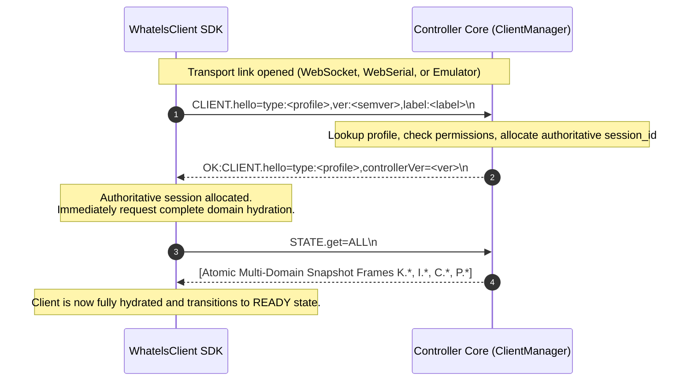

# whatELS Client SDK Specification & Universal Protocol Contracts

> **Status:** Authoritative Specification  
> **Master Architecture:** [`docs/clients/ELS_CLIENT_ARCHITECTURE.md`](../ELS_CLIENT_ARCHITECTURE.md)  
> **Target Audience:** Authors of client libraries (JavaScript, C++, Python, Rust) interfacing with the whatELS motion controller  
> **Location:** `docs/clients/sdk/CLIENT_SDK_SPECIFICATION.md`  
> **Companion ADRs:** [`ADR 0003`](../../adr/0003-command-result-and-baseline-client-architecture.md), [`ADR 0004`](../../adr/0004-pluggable-transports-and-webserial.md)  
> **Date:** October 26, 2026  

---

## 1. Executive Summary & Purpose

The **whatELS Client SDK Specification** defines the universal, language-agnostic contracts, interfaces, session lifecycles, and safety watchdogs that any whatELS Client SDK must implement. 

By formalizing these contracts independently of programming language or UI frameworks, this specification guarantees that:
1. **Multi-Language Interoperability:** A Web UI written in JavaScript (`clients/sdk/js/`), a physical hardware pendant written in C++ (`clients/sdk/cpp/`), and an automated HIL test harness written in Python (`clients/sdk/python/`) interact with the motion controller identically.
2. **Strict Dumb-Client Invariant:** The SDK acts purely as a transport router, typed intent dispatcher, and state deserializer. It performs **zero** kinematic calculations, soft-limit clamping, or unit conversions.
3. **Deterministic Safety:** Safety-critical behaviors (such as continuous jog heartbeats, teardown on disconnect, and atomic state hydration) are enforced at the SDK boundary rather than left to ad-hoc UI implementations.

---

## 2. System Topology & Three-Tier Layering

Any application communicating with whatELS must adhere to the 3-tier client pipeline:

```
┌────────────────────────────────────────────────────────────────────────┐
│ Tier 3: Presentation & View Models (Application Specific)              │
│ - HTML5 / Alpine.js Touch DRO, C++ LVGL Screen, CLI Terminal, etc.     │
│ - Converts canonical deci-microns (du) to localized units (mm / in)    │
│ - Zero direct socket or serial manipulation                            │
└───────────────────────────────────┬────────────────────────────────────┘
                                    │ Method Invocations & Domain Events
                                    ▼
┌────────────────────────────────────────────────────────────────────────┐
│ Tier 2: Controller Protocol SDK (WhatelsClient)                        │
│ - Abstract command surface (startFeed, stop, jogHold, axisZero, etc.)  │
│ - Request-response correlation (OK:CMD... vs ERR:...)                  │
│ - 200ms Safety Heartbeat Watchdog for continuous jogs                  │
│ - Line-oriented telemetry parser (Domains: K, I, C, P)                 │
└───────────────────────────────────┬────────────────────────────────────┘
                                    │ send(line) & onLine(callback)
                                    ▼
┌────────────────────────────────────────────────────────────────────────┐
│ Tier 1: Pluggable Transports (ClientTransport)                         │
│ - Abstract I/O driver contract (connect, disconnect, send, isConnected)│
│ - Concrete Drivers: WebSocketTransport, WebSerialTransport, Emulator  │
│ - Enforces strict line-delimited UTF-8 ASCII framing (\n)              │
└────────────────────────────────────────────────────────────────────────┘
```

### 2.1 Universal Type Definitions (IDL)

To eliminate any ambiguity across different programming languages (JavaScript, C++, Python, Rust), the canonical types, parameter structures, domain snapshots, and events are formally defined in TypeScript IDL (and mirrored in [`clients/sdk/js/whatels-client.d.ts`](../../../clients/sdk/js/whatels-client.d.ts)):

```typescript
export type Axis = 'Z' | 'X' | 'ZX';
export type SemanticDirZ = 'CHUCK' | 'TAIL' | 'LEFT' | 'RIGHT';
export type SemanticDirX = 'INFEED' | 'RETRACT' | 'CENTER' | 'IN' | 'UP' | 'OUT' | 'DOWN';
export type SemanticDirection = SemanticDirZ | SemanticDirX | -1 | 1;
export type LimitSide = 'LEFT' | 'RIGHT' | 'UP' | 'DOWN' | 'MIN' | 'MAX';
export type TransportStatus = 'disconnected' | 'connecting' | 'connected';

export interface StartFeedParams {
  axis: Axis;
  sync: 0 | 1;
  feed: number;                    // strictly positive integer: dupr (sync:1) or du/min (sync:0)
  dir: -1 | 1 | SemanticDirection;
  dist?: number;                   // integer deci-microns, default 0 (continuous feed)
}

export interface ClientHelloParams {
  clientType?: string;             // e.g. 'webui', 'smarttouch', 'hil_harness'
  clientVer?: string;              // semver, e.g. '1.0.0'
  label?: string;                  // human-readable device name, e.g. 'Headstock Tablet'
}

export interface KinematicsDomain {
  zDu: number;                     // deci-microns (10,000 du = 1.0 mm)
  xDu: number;                     // deci-microns (radius)
  rpm: number;                     // spindle RPM
  turns: number;                   // spindle turns counter
  angle: number;                   // spindle angle 0..359.9°
  mode: number;                    // active mode ID (0: GEAR, 50: GEARBOX, etc.)
  isOn: boolean;                   // true if motion is physically active
  estop: boolean;                  // true if emergency stop is triggered
  perms: number;                   // live in-motion permission bitmask
  zLeftDu: number | null;          // Z chuck travel limit (du)
  zRightDu: number | null;         // Z tailstock travel limit (du)
  xUpDu: number | null;            // X infeed travel limit (du)
  xDownDu: number | null;          // X retract travel limit (du)
  zDis: boolean;                   // true if Z limit contacted
  xDis: boolean;                   // true if X limit contacted
  dupr: number;                    // live feed rate in deci-microns per rev
  nextDupr: number;                // queued feed rate
}

export interface IntentDomain {
  thPitch: number;                 // operator entered pitch (mm or TPI)
  thFmt: 0 | 1 | 2;                // 0: Metric mm, 1: Imperial TPI, 2: Imperial Inch
  tpVal: number;                   // operator entered taper value
  tpMode: 0 | 1 | 2;               // 0: Ratio 1:K, 1: Angle °, 2: Preset
  coneRatio: number;               // kinematic X/Z ratio
  feedStepDu: number;              // discrete feed step size (du)
  jogStepDu: number;               // discrete jog step size (du)
  feedRev: boolean;                // pitch direction reversed
}

export interface CycleDomain {
  passes: number;                  // total cycle pass count
  opIdx: number;                   // current pass or cycle step index
  setupIdx: number;                // wizard step index
  starts: number;                  // multi-start thread count
}

export interface PropertiesDomain {
  measure: 0 | 1;                  // 0: Metric (mm), 1: Imperial (in)
  dia: boolean;                    // true: Diameter mode, false: Radius mode
  abs: boolean;                    // true: Absolute mode, false: Incremental
  zDro: boolean;                   // true: Physical scale DRO active
  xDro: boolean;                   // true: Physical scale DRO active
  screwZDu: number;                // leadscrew pitch in deci-microns
  screwXDu: number;                // cross-slide pitch in deci-microns
  motorStepsZ: number;             // motor steps per rev
  motorStepsX: number;             // motor steps per rev
  encoderPpr: number;              // spindle encoder pulses per rev
}

export interface MachineSnapshot {
  kinematics: KinematicsDomain;
  intent: IntentDomain;
  cycle: CycleDomain;
  properties: PropertiesDomain;
}

export interface SnapshotEventDetail {
  domainMask: number;              // 0x01 (K), 0x02 (I), 0x04 (C), 0x08 (P)
  snapshot: MachineSnapshot;
}

export interface ConnectionEventDetail {
  connected: boolean;
  sessionId: number | null;
  status: TransportStatus;
}
```

---

## 3. Universal Protocol Contracts

### 3.1 Contract 1: Pluggable Transport (`ClientTransport`)

A `ClientTransport` is a lightweight, protocol-agnostic driver responsible solely for raw bidirectional streaming over a physical or virtual communication medium.

#### Interface Contract:
* `connect(config: TransportConfig): Promise<void>`: Establishes the physical link. Resolves on success; rejects with structured error on failure.
* `disconnect(): Promise<void>`: Gracefully terminates the physical link and releases system resources (sockets, serial port locks).
* `isConnected(): boolean`: Returns `true` if the underlying link is actively open and writable.
* `send(line: string): Promise<void>`: Transmits an outbound string. The transport must guarantee that outbound strings terminate with a single newline (`\n`).
* **Event Callbacks / Hooks**:
  - `onLine(callback: (line: string) => void)`: Invoked once per complete, unchunked inbound text line.
  - `onStatusChange(callback: (status: TransportStatus) => void)`: Emits connection status transitions (`'disconnected'`, `'connecting'`, `'connected'`).
  - `onError(callback: (error: Error) => void)`: Emits transport-level faults (socket reset, serial unplugged).

#### Stream Framing Invariant:
All transports must enforce **newline-delimited (`\n`) UTF-8 ASCII text streaming**. Transports operating over raw byte streams (such as WebSerial, USB CDC, or hardware UART) must implement an internal line-buffering pipeline that accumulates bytes and emits complete lines without carriage returns (`\r`).

---

### 3.2 Contract 2: Session Lifecycle & Handshake

Upon establishing a physical transport connection, the SDK must immediately execute the two-stage initialization handshake:



1. **Client Identification (`CLIENT.hello`)**:
   - SDK emits: `CLIENT.hello=type:<profile_name>,ver:<version_string>,label:<friendly_label>\n`
   - Example: `CLIENT.hello=type:webui,ver:1.0.0,label:LatheTouchDRO\n`
2. **Controller Acknowledgement**:
   - Controller returns: `OK:CLIENT.hello=type:<profile_name>,controllerVer=<ver>\n`
3. **Immediate Hydration (`STATE.get=ALL`)**:
   - To eliminate split-brain initialization and display races, the SDK must immediately request a complete atomic snapshot of all domains.

---

### 3.3 Contract 3: Command Surface & Response Matching

The SDK provides a strongly-typed, Promise-returning method for every canonical command defined in `docs/protocol/CANONICAL_COMMAND_REFERENCE.md`.

#### Standard Command Method Surface:
| Method Signature | Canonical Wire Format | Response Expected |
| :--- | :--- | :--- |
| `startFeed({ axis, sync, feed, dir, dist })` | `CMD.startFeed=axis:<axis>,sync:<0\|1>,feed:<val>,dir:<dir>[,dist:<val>]\n` | `OK:CMD.startFeed` |
| `stop()` | `CMD.stop\n` | `OK:CMD.stop` |
| `jogHold(axis, dir)` | `CMD.jogHold=<axis>,<CHUCK\|TAIL\|INFEED\|RETRACT>\n` | `OK:CMD.jogHold` |
| `jogRelease(axis)` | `CMD.jogRelease=<axis>\n` | `OK:CMD.jogRelease` |
| `jogStep(axis, distDu)` | `CMD.jogStep=<axis>,<signed_du>\n` | `OK:CMD.jogStep` |
| `axisZero(axis)` | `CMD.axisZero=<axis>\n` | `OK:CMD.axisZero` |
| `axisPosDu(axis, posDu)` | `CMD.axisPosDu=<axis>,<posDu>\n` | `OK:CMD.axisPosDu` |
| `axisLimitDu(axis, side, du)` | `CMD.axisLimitDu=<axis>,<LEFT\|RIGHT\|UP\|DOWN>,<du>\n` | `OK:CMD.axisLimitDu` |
| `axisClearLimit(axis, side)` | `CMD.axisClearLimit=<axis>,<LEFT\|RIGHT\|UP\|DOWN>\n` | `OK:CMD.axisClearLimit` |
| `getSetting(key)` | `SETTINGS.get=<key>\n` | `OK:SETTINGS.get=<key>:<val>` |
| `setSetting(key, val)` | `SETTINGS.set=<key>:<val>\n` | `OK:SETTINGS.set` |

#### Request-Response Correlation & Timeouts:
1. When a command method is called, the SDK dispatches the line and registers an internal pending transaction.
2. The transaction listens for matching inbound lines:
   - Success: `OK:CMD.<name>` or `OK:SETTINGS.<name>` $\to$ resolves Promise.
   - Failure: `ERR:<reason>` or `ERR:CMD.<name>:<reason>` $\to$ rejects Promise with structured `ControllerError`.
3. **Timeout Watchdog**: Every pending command transaction must enforce a configurable timeout (default: `3,000 ms`). If no response is received before timeout, the Promise rejects with `CommandTimeoutError`.

---

### 3.4 Contract 4: Continuous Motion Watchdogs & Teardown

To protect operator safety and lathe machinery against communication failure during continuous jogging:

1. **Active Heartbeat Watchdog ($\le 200\text{ ms}$)**:
   - When `jogHold` is called, the SDK transmits the initial `CMD.jogHold=...` line and starts an internal periodic timer firing every **200 ms**.
   - Each tick resends the continuous jog heartbeat line.
   - If communication drops for $>500\text{ ms}$, the controller motion engine automatically decelerates all stepping to a safe stop.
2. **Explicit Jog Release**:
   - Calling `jogRelease(axis)` or `stop()` unconditionally halts the heartbeat timer and transmits `CMD.jogRelease=<axis>\n`.
3. **Unconditional Disconnect Teardown**:
   - If the underlying transport disconnects, throws an error, or the operator switches backends:
     1. All active jog heartbeat timers are cancelled immediately.
     2. All pending command Promises are rejected with `TransportDisconnectedError`.
     3. The internal connection state resets to `'disconnected'`.

---

### 3.5 Contract 5: Telemetry Ingestion & State Distribution

The SDK includes a line-oriented parser that converts incoming ASCII telemetry lines into immutable, strongly-typed domain snapshots.

#### Domain Namespace Structure:
* **Domain `K` (Kinematics)**: `K.zDu`, `K.xDu`, `K.rpm`, `K.turns`, `K.angle`, `K.mode`, `K.isOn`, `K.estop`, `K.perms`
* **Domain `I` (Intent)**: `I.thPitch`, `I.thFmt`, `I.tpVal`, `I.tpMode`, `I.coneRatio`, `I.feedStepDu`, `I.jogStepDu`
* **Domain `C` (Cycle)**: `C.passes`, `C.opIdx`, `C.setupIdx`, `C.starts`
* **Domain `P` (Properties)**: `P.measure`, `P.dia`, `P.abs`, `P.zDro`, `P.xDro`, `P.screwZDu`, `P.motorStepsZ`

#### Diagnostic & Log Multiplexing:
Lines beginning with `#` or diagnostic log tags (`[I]`, `[W]`, `[E]`, `ESP-ROM:`) are identified as non-telemetry comments. The SDK routes these lines to a dedicated `on('log', line => ...)` event, completely bypassing state parsing.

---

## 4. Concrete Transport Requirements

### 4.1 `WebSocketTransport`
* **URL Negotiation**: Connects to `ws://<host>:<port>/canonical` (default port: 81).
* **Exponential Backoff Reconnect**: On unexpected socket closure, retry connection at progressive intervals: $1\text{s} \to 2\text{s} \to 4\text{s} \to 8\text{s} \to 15\text{s}$ (capped).
* **Ping / Keepalive**: Utilizes standard WebSocket protocol ping/pong.

### 4.2 `WebSerialTransport`
* **API Foundation**: Utilizes the W3C WebSerial API (`navigator.serial`).
* **User-Gesture Security**: The initial port grant requires an explicit user gesture (`navigator.serial.requestPort()`).
* **Silent Auto-Reconnect**: Subsequent connections query `navigator.serial.getPorts()`. If a granted port exists, the transport opens it automatically.
* **Baud & Line Decoding**: Default baud `115,200` (8-N-1). Decodes bytes via `TextDecoderStream` and breaks frames via a newline `TransformStream`.

### 4.3 `EmulatorTransport`
* **In-Memory Loopback**: Directly binds to the in-browser physics and firmware emulator (`window.WhatelsEmulator`). Zero network or serial hardware required.

---

## 5. Concrete Reference Interfaces & Declarations

### 5.1 JavaScript Reference Implementation (`clients/sdk/js/`)

#### 5.1.1 `ClientTransport` (`transports/client-transport.js`)
```javascript
export class ClientTransport extends EventTarget {
  constructor() {
    super();
    this.status = 'disconnected'; // 'disconnected' | 'connecting' | 'connected'
  }

  async connect(config = {}) {
    throw new Error('connect() must be implemented by subclass');
  }

  async disconnect() {
    throw new Error('disconnect() must be implemented by subclass');
  }

  isConnected() {
    return this.status === 'connected';
  }

  async send(line) {
    throw new Error('send() must be implemented by subclass');
  }

  _emitLine(line) {
    this.dispatchEvent(new CustomEvent('line', { detail: line }));
  }

  _emitStatus(status, details = {}) {
    this.status = status;
    this.dispatchEvent(new CustomEvent('status', { detail: { status, ...details } }));
  }

  _emitError(error) {
    this.dispatchEvent(new CustomEvent('error', { detail: error }));
  }
}
```

#### 5.1.2 `WebSerialTransport` (`transports/webserial-transport.js`)
```javascript
import { ClientTransport } from './client-transport.js';

export class WebSerialTransport extends ClientTransport {
  constructor(options = {}) {
    super();
    this.baudRate = options.baudRate || 115200;
    this.port = null;
    this.reader = null;
    this.writer = null;
  }

  /**
   * Two-stage connection flow:
   * 1. If config.promptUser is true, calls navigator.serial.requestPort().
   * 2. If false, queries navigator.serial.getPorts() for pre-authorized devices.
   */
  async connect(config = {}) { ... }
  async disconnect() { ... }
  async send(line) { ... }
}
```

#### 5.1.3 `WhatelsClient` SDK (`whatels-client.js`)
```javascript
export class WhatelsClient extends EventTarget {
  constructor(transport, options = {}) {
    super();
    this.transport = transport;
    this.clientType = options.clientType || 'webui';
    this.clientVer = options.clientVer || '1.0.0';
    this.label = options.label || 'Web UI Touch DRO';
    this.timeoutMs = options.timeoutMs || 3000;
    this.sessionId = null;
    this.perms = 0;
  }

  // Lifecycle
  async connect() { ... }
  async disconnect() { ... }
  setTransport(transport) { ... }

  // Strongly-Typed Commands
  async startFeed({ axis, sync, feed, dir, dist = 0 }) { ... }
  async stop() { ... }
  async jogHold(axis, dir) { ... }
  async jogRelease(axis) { ... }
  async jogStep(axis, distDu) { ... }
  async axisZero(axis) { ... }
  async axisPosDu(axis, posDu) { ... }
  async axisLimitDu(axis, side, du) { ... }
  async axisClearLimit(axis, side) { ... }
  async getSetting(key) { ... }
  async setSetting(key, value) { ... }

  // Outbound Events Emitted:
  // 'snapshot'   -> { domainMask, snapshot: { kinematics, intent, cycle, properties } }
  // 'connection' -> { connected: boolean, sessionId: number, status: string }
  // 'log'        -> string (multiplexed '#' comment line)
  // 'error'      -> Error
}
```

### 5.2 Controller C++ Reference (`src/core_client/`)

#### 5.2.1 `SerialTransport.h`
```cpp
#pragma once

#include "core_client/transports/ITransport.h"
#include <Stream.h>

namespace whatels {
namespace core_client {

class SerialTransport : public ITransport {
public:
  explicit SerialTransport(Stream* stream = nullptr)
    : _stream(stream), _bufIdx(0) {}

  void setStream(Stream* stream) { _stream = stream; }
  Stream* getStream() const { return _stream; }

  bool isConnected() const override { return _stream != nullptr; }

  bool sendText(const char* text) override {
    if (!_stream || !text) return false;
    return _stream->print(text) > 0;
  }

  bool sendBytes(const uint8_t* buffer, size_t length) override {
    if (!_stream || !buffer || length == 0) return false;
    return _stream->write(buffer, length) == length;
  }

  void pollRx(class ClientEndpoint* endpoint);

private:
  Stream* _stream;
  char    _lineBuf[256];
  size_t  _bufIdx;
};

} // namespace core_client
} // namespace whatels
```

---

## 6. Compliance Checklist for SDK Implementations

Every language implementation (`clients/sdk/js/`, `clients/sdk/cpp/`, `clients/sdk/python/`) must pass this verification matrix before being certified:

- [ ] **Zero Kinematics**: Contains no step math, ratio calculations, or lead-angle formulas.
- [ ] **Pure Deci-microns**: Stores and transmits positions strictly in integer `du` ($10{,}000\text{ du} = 1\text{ mm}$).
- [ ] **Strict Line Framing**: All emitted packets end with `\n`. Inbound lines are correctly assembled across arbitrary chunk boundaries.
- [ ] **Authoritative Handshake**: Issues `CLIENT.hello` immediately on open, followed by `STATE.get=ALL`.
- [ ] **Heartbeat Safety**: Periodic $\le 200\text{ ms}$ jog heartbeat loop active during `jogHold`; unconditionally aborted on stop or disconnect.
- [ ] **Diagnostic Immunity**: Gracefully ignores and emits `#` log comments without throwing syntax errors.

