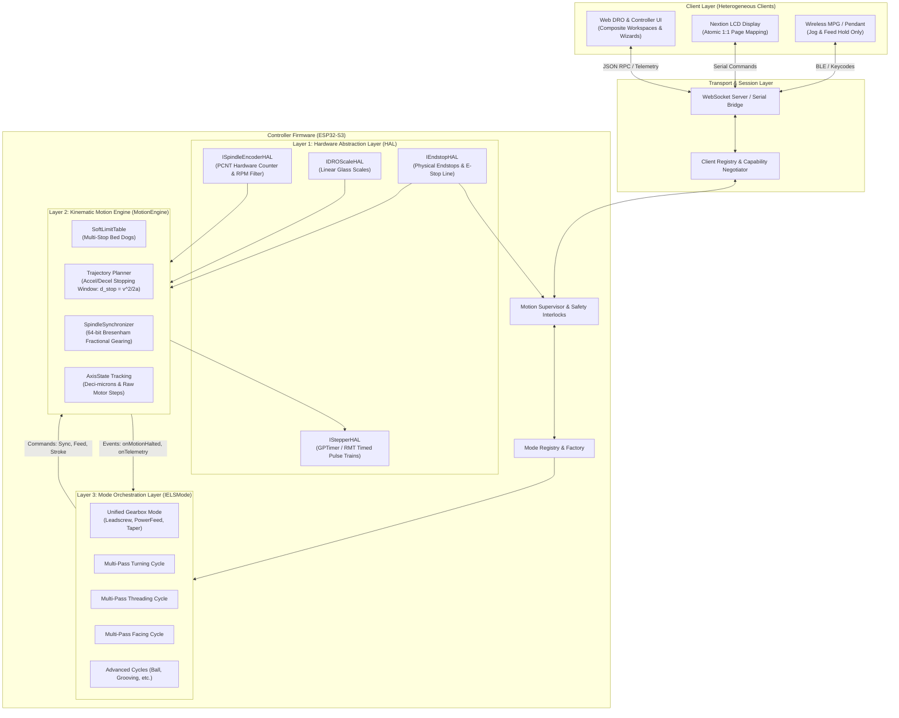
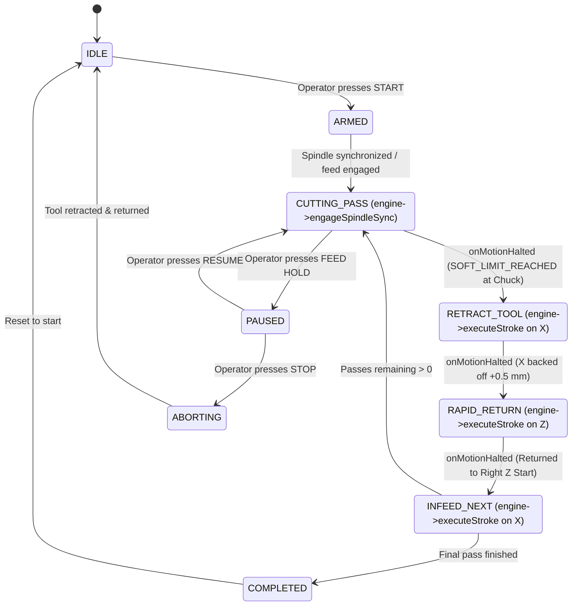
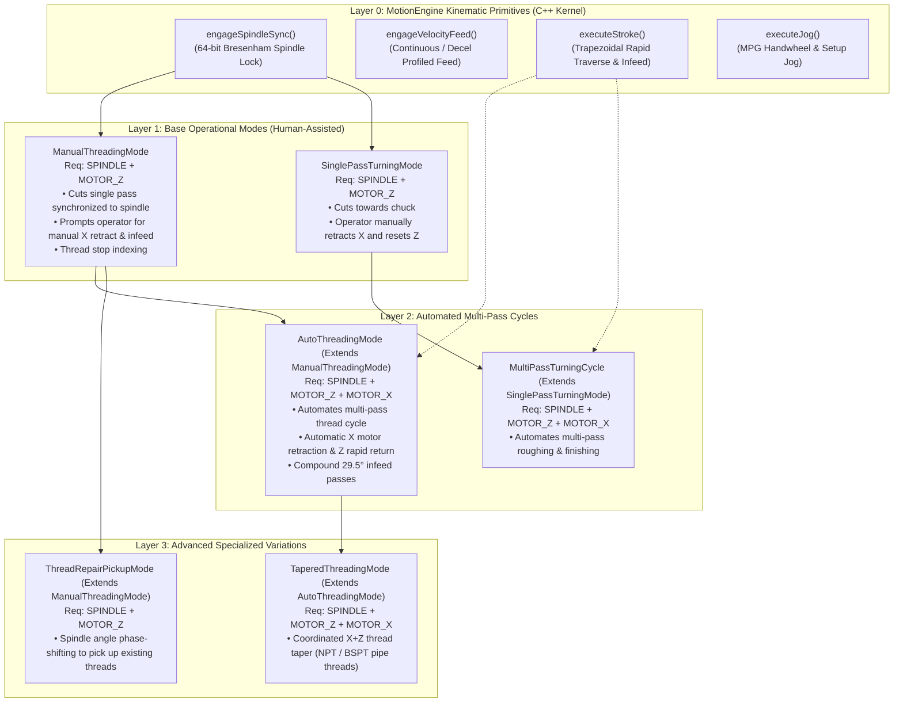
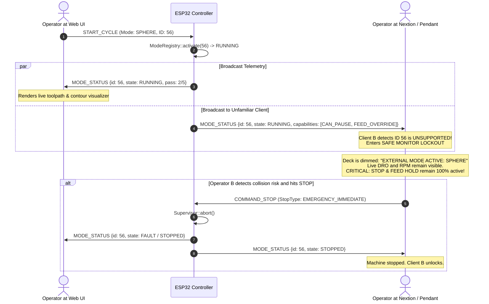
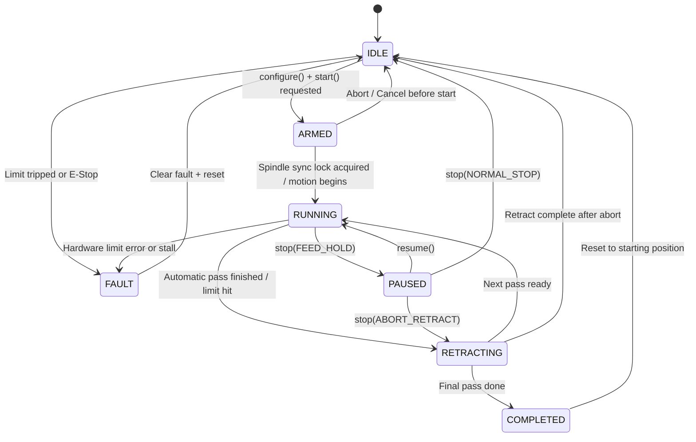

# whatELS Generalized Mode Architecture Specification

> **Status:** Draft / Proposal for Review  
> **Target Version:** whatELS Modular Architecture (Firmware & Multi-Client Suite)  
> **Author:** Antigravity & Emil  
> **Date:** October 7, 2026  
> **Location:** `docs/modes/ELS_MODE_ARCHITECTURE.md`
> **Related Architecture Documents:** [`ELS_CORE_STATE_MODEL.md`](../state/ELS_CORE_STATE_MODEL.md), [`LATHE_MACHINE_PROFILE.md`](../machine/LATHE_MACHINE_PROFILE.md), [`ELS_CLIENT_ARCHITECTURE.md`](../clients/ELS_CLIENT_ARCHITECTURE.md), [`ELS_DESIGN_NOTEBOOK.md`](../archive/ELS_DESIGN_NOTEBOOK.md)

---

## 1. Executive Summary & Problem Statement

### 1.1 Background & Motivation
In the original NanoELS H5 implementation, operating modes (`MODE_NORMAL` / `gear`, `MODE_XGEAR`, `MODE_ASYNC`, `MODE_CONE`, `MODE_TURN`, `MODE_FACE`, `MODE_CUT`, `MODE_THREAD`, etc.) were tightly coupled to individual Nextion display pages and ad-hoc global variables in `h5.ino` and `Motion.cpp`. 

While this 1:1 screen-to-mode mapping worked for a dedicated serial LCD, it breaks down as the system evolves:
1. **Divergent Operator Workflows:** Modern operator interfaces (such as our Web DRO/Controller suite) naturally consolidate related functions (e.g., electronic leadscrew gearing, cross-slide gearing, async continuous feed, and diagonal/cone feed) into a unified **Electronic Gearbox** workspace.
2. **Duplicated Control Loops & State Machines:** Multi-pass cutting cycles (turning, facing, threading) re-implemented their own axis movement, infeed sequencing, limit handling, and telemetry formatting with subtle differences.
3. **Multi-Client Race Conditions & Fragility:** Multiple heterogeneous client terminals (e.g., a physical machine-mounted Nextion LCD, a dedicated 10" tablet Web DRO, and a remote desktop monitor) can connect simultaneously. Without a structured mode contract and capability negotiation, activating a mode on one client risks corrupting state, generating contradictory commands, or crashing axes.

### 1.2 Core Architectural Principles
To solve these challenges, this architecture establishes eight governing tenets:

1. **Controller Authority & Autonomous Orchestration:**  
   Motion execution, pass sequencing, and limit stops are strictly executed and orchestrated on the **controller MCU**. The client never streams real-time micro-coordinates over a network; it commands parametric cycles. If a client disconnects or lags, machine safety and execution determinism remain unaffected.
2. **Kinematic Core Primitives vs. Mode Orchestration:**  
   The motion subsystem provides deterministic, acceleration-profiled kinematic motion primitives (`engageSpindleSync`, `engageVelocityFeed`, `executeStroke`, `executeJog`) inside the authoritative **Motion Engine (Layer 2)**. Higher-level machining cycles (**Operating Modes, Layer 3**) orchestrate these primitives according to operator intent and canned cycle workflows rather than reinventing motor step math or implementing low-level timer ISRs.
3. **Uniform Interface Contract:**  
   Every operating mode implements an identical lifecycle, telemetry, and control interface (`IELSMode`). Modes are pure orchestrators that listen to motion events (`IMotionEventListener`) and command `MotionEngine`.
4. **Client Capability Handshake & Filtering:**  
   Clients register which modes they support. Simple clients can include/exclude modes, and the controller filters available operations accordingly.
5. **Universal Safety Invariant:**  
   Even if a client does not understand an active mode running on the machine, **Emergency Stop and Feed Hold authority is universally active on all clients at all times**.
6. **Mode-Agnostic Extensibility (Open-Closed Principle):**  
   The core motion loop and supervisory engine interact exclusively through abstract interfaces (`IELSMode`, `ModeRegistry`). Adding new modes in the future (e.g. Spheres, Broaching, Knurling, Thread Repair) is strictly additive—zero modifications required to `main.cpp`, command routers, or supervisory logic.
7. **In-Motion Safety Contract & Running Lockout:**  
   A mode is not just a kinematic calculator; it is an authoritative runtime contract. Each mode explicitly declares what live operations (`LivePermissionFlags`) are permitted during active motion (e.g., live chip-load feed trim vs. strictly forbidden axis swaps or pitch rewrites), and the controller acts as an impenetrable gatekeeper rejecting invalid commands.
8. **Core-First Architecture:**  
   The ESP32 controller firmware motion engine is the single authoritative source of truth. UI clients (Web DRO, Nextion) consume canonical modes and permissions; legacy display idiosyncrasies are isolated to client adapters without compromising the core.


---

## 2. System Architecture & Component Hierarchy



---

## 3. Data Structures & Core Interfaces

### 3.1 Identifiers, Types, and Enumerations

```cpp
// Unique identifier for each mode
typedef uint16_t ModeId;

namespace ModeIds {
    constexpr ModeId NONE         = 0;

    // Operational Modes (50 - 99)
    constexpr ModeId GEARBOX      = 50; // Unified Gearbox: Leadscrew, Cross-feed, Async feed, Taper
    constexpr ModeId TURNING      = 51; // Multi-pass turning cycle
    constexpr ModeId FACING       = 52; // Multi-pass facing cycle
    constexpr ModeId THREADING    = 53; // Multi-pass threading cycle
    constexpr ModeId CUTOFF       = 54; // Parting / cutoff cycle
    constexpr ModeId SLOTTING     = 55; // Spindle-locked broaching / slotting
    constexpr ModeId SPHERE       = 56; // Parametric contouring
    constexpr ModeId CONE         = 57; // Planned (#10) multi-pass taper cycle (continuous ZX taper lives in GEARBOX=50)
}

// Mode Execution Status State Machine
enum class ModeState : uint8_t {
    IDLE = 0,         // Ready, waiting for operator start
    ARMED,            // Waiting for spindle sync index / trigger
    RUNNING,          // Actively stepping motor(s)
    PAUSED,           // Feed hold active; axes decelerated to stop
    RETRACTING,       // Executing automatic clearance move
    COMPLETED,        // Cycle completed successfully
    FAULT             // Limit switch tripped, stall detected, or e-stop
};

// Mode Classification
enum class ModeCategory : uint8_t {
    PRIMITIVE = 0,    // Direct hardware stepper/encoder kernel
    COMPOSITE,        // Orchestrates one or more sub-modes
    UTILITY           // Setup, calibration, test
};

// Runtime permission flags governing what live interventions are permitted during active motion
enum LivePermissionFlags : uint32_t {
    PERM_NONE               = 0,
    PERM_FEED_HOLD          = 1 << 0,  // Supports Feed Hold (pause with sync and position retained)
    PERM_LIVE_FEED_TRIM     = 1 << 1,  // Supports runtime feedrate/pitch nudge ([−] / [+]) under chip load
    PERM_LIVE_STEP_CYCLE    = 1 << 2,  // Supports cycling feed step increment (e.g. 0.01 -> 0.05mm) while running
    PERM_LIVE_RPM_OVERRIDE  = 1 << 3,  // Supports VFD / spindle RPM adjustment while running
    PERM_PAUSE_MANUAL_JOG   = 1 << 4,  // Allows operator manual jog during pause (e.g., to inspect tool or clear chips)
    PERM_LIVE_LIMIT_TRIM    = 1 << 5,  // Supports dynamic limit adjustment during operation
    PERM_MULTI_PASS_TELEMETRY = 1 << 6 // Exposes pass count / cut depth progress telemetry
};

// Canonical Controller Command Identifiers for In-Motion Safety Validation
enum class CommandId : uint8_t {
    CMD_STOP = 0,             // Normal deceleration stop (universally permitted)
    CMD_ESTOP,                // Immediate emergency stop (universally permitted)
    CMD_RUN,                  // Engage / start motion
    CMD_FEED_HOLD,            // Temporary pause / feed hold
    CMD_FEED_RESUME,          // Resume from feed hold
    CMD_FEED_NUDGE,           // Live feed trim ([−] / [+])
    CMD_STEP_CYCLE,           // Cycle feed step size
    CMD_RPM_OVERRIDE,         // VFD spindle override
    CMD_SET_PARAM,            // Generic parameter write
    CMD_SET_AXIS,             // Switch active motion axis
    CMD_SET_SYNC,             // Switch between spindle sync and async velocity
    CMD_SET_DIR,              // Flip motion travel direction
    CMD_SET_PITCH,            // Major pitch / lead re-specification
    CMD_SET_LIMIT,            // Adjust axis limit stops
    CMD_ZERO_AXIS,            // Zero out DRO coordinate
    CMD_SWITCH_MODE           // Change operating mode
};

// Stop actions
enum class StopType : uint8_t {
    NORMAL_STOP = 0,      // Decelerate and stop in place
    FEED_HOLD,            // Temporary pause, maintain synchronized index
    ABORT_RETRACT,        // Pull tool out along clearance vector, then stop
    EMERGENCY_IMMEDIATE   // Kill step pulses immediately (hard stop)
};
```

---

### 3.2 Parameter Manifest & Introspection Schema

To enable clients to validate inputs and dynamically discover and configure modes without hardcoded firmware schemas, each mode defines a **Parameter Descriptor**:

```cpp
enum class ParamType : uint8_t {
    INT32 = 0,
    FLOAT,
    BOOL,
    ENUM,
    STRING
};

// Visibility and substitution policy for modes in the UI
enum class VisibilityPolicy : uint8_t {
    ALWAYS_VISIBLE = 0,    // Always show in menus if hardware requirements are met
    PREFER_EXTENDED,       // Show extended mode by default, but allow accessing base mode via toggle/sub-option
    HIDE_IF_EXTENDED       // Completely hide base mode if an extended descendant is active/available
};

struct ParamDescriptor {
    const char* key;        // Machine key, e.g. "axis", "pitch_mm", "taper_ratio"
    const char* label;      // Human readable label
    ParamType type;
    const char* unit;       // "mm", "mm/rev", "deg", "TPI", "steps"
    float defaultVal;
    float minVal;
    float maxVal;
    float stepVal;
    const char* options;    // Comma-separated enum options, e.g. "Z,X,ZX"
};

struct ModeManifest {
    ModeId            id;                     // Unique Mode ID (e.g. ModeIds::GEARBOX)
    ModeId            baseModeId;             // Ancestor / Base Mode ID (or ModeIds::NONE)
    const char*       slug;                   // Machine slug ("gearbox", "thread_auto")
    const char*       name;                   // Display name ("Electronic Gearbox")
    const char*       family;                 // Family group ("GEARBOX", "THREADING")
    ModeCategory      category;               // PRIMITIVE, COMPOSITE, or UTILITY
    uint32_t          livePermissions;        // Bitmask of LivePermissionFlags allowed when running
    uint32_t          requiredHardwareCaps;   // Bitmask of required LatheCapabilityFlags
    VisibilityPolicy  visibility;             // How it surfaces relative to base mode
    uint8_t           paramCount;
    const ParamDescriptor* params;
};
```

#### JSON Representation of Mode Manifest (Over WebSocket):
```json
{
  "id": 50,
  "base_mode_id": 0,
  "slug": "gearbox",
  "name": "Electronic Gearbox",
  "family": "GEARBOX",
  "category": "COMPOSITE",
  "live_permissions": ["FEED_HOLD", "LIVE_FEED_TRIM", "LIVE_STEP_CYCLE", "LIVE_RPM_OVERRIDE"],
  "required_hardware": ["SPINDLE_ENCODER", "MOTOR_Z"],
  "visibility": "ALWAYS_VISIBLE",
  "params": [
    {
      "key": "axis",
      "label": "Active Feed Axis",
      "type": "enum",
      "options": "Z,X,ZX",
      "default": "Z"
    },
    {
      "key": "sync",
      "label": "Spindle Synchronized",
      "type": "bool",
      "default": true
    },
    {
      "key": "pitch_mm",
      "label": "Feedrate / Pitch",
      "type": "float",
      "unit": "mm",
      "default": 0.10,
      "min": 0.001,
      "max": 10.0,
      "step": 0.01
    }
  ]
}
```

---

### 3.3 The Core Interface: `IELSMode`

Every mode in the controller implements this abstract, mode-agnostic interface. Adding a new mode in the future requires implementing this interface and registering the instance with `ModeRegistry`—**zero alterations to the core motion loop, state machine, or command dispatcher**:

```cpp
class TelemetryWriter; // Forward declaration for streaming telemetry buffer
class MotionEngine;    // Forward declaration for Layer 2 Kinematic Engine

class IELSMode : public IMotionEventListener {
public:
    virtual ~IELSMode() = default;

    // --- 1. Introspection & Metadata ---
    virtual const ModeManifest& getManifest() const = 0;
    virtual ModeId getId() const = 0;
    virtual const char* getSlug() const = 0;
    virtual const char* getName() const = 0;
    virtual ModeCategory getCategory() const = 0;
    virtual uint32_t getRequiredHardware() const = 0;

    // --- 2. Mode-Agnostic Parameter Interface ---
    virtual bool setParam(const char* key, float value) = 0;
    virtual bool setParam(const char* key, const char* strValue) = 0;
    virtual bool getParam(const char* key, float& outVal) const = 0;
    virtual bool validateParams(char* errBuf, size_t errBufLen) const = 0;

    // --- 3. Lifecycle & Engine Binding ---
    // Injects the authoritative MotionEngine pointer upon activation
    virtual void onEnter(MotionEngine* engine) = 0;
    
    // Called when another mode is selected or when controller resets
    virtual void onExit() = 0;

    // --- 4. Execution State Machine Control ---
    virtual bool start() = 0;
    virtual void stop(StopType stopType) = 0;
    virtual bool pause() = 0;
    virtual bool resume() = 0;

    virtual ModeState getState() const = 0;
    virtual bool isRunning() const = 0;

    // --- 5. In-Motion Safety Contract & Gatekeeper ---
    virtual uint32_t getLivePermissions() const = 0;
    
    // Evaluates whether an incoming command is permitted in the current execution state
    // Default-deny: only IDLE/COMPLETED permit configuration; active states strictly whitelist live commands
    virtual bool canExecuteCommand(CommandId cmd, ModeState state) const {
        // 1. Stop and E-Stop are inviolable and universally permitted in ALL states
        if (cmd == CommandId::CMD_STOP || cmd == CommandId::CMD_ESTOP) return true;

        // 2. Full configuration is ONLY permitted when stationary in IDLE or COMPLETED
        if (state == ModeState::IDLE || state == ModeState::COMPLETED) return true;

        // 3. During active cutting (RUNNING) or waiting for sync trigger (ARMED)
        if (state == ModeState::RUNNING || state == ModeState::ARMED) {
            if (cmd == CommandId::CMD_FEED_HOLD)    return (getLivePermissions() & PERM_FEED_HOLD) != 0;
            if (cmd == CommandId::CMD_FEED_NUDGE)   return (getLivePermissions() & PERM_LIVE_FEED_TRIM) != 0;
            if (cmd == CommandId::CMD_STEP_CYCLE)   return (getLivePermissions() & PERM_LIVE_STEP_CYCLE) != 0;
            if (cmd == CommandId::CMD_RPM_OVERRIDE) return (getLivePermissions() & PERM_LIVE_RPM_OVERRIDE) != 0;
            return false; // Lock out all other commands
        }

        // 4. During Feed Hold (PAUSED)
        if (state == ModeState::PAUSED) {
            if (cmd == CommandId::CMD_FEED_RESUME)  return true;
            if (cmd == CommandId::CMD_FEED_NUDGE)   return (getLivePermissions() & PERM_LIVE_FEED_TRIM) != 0;
            return false;
        }

        // 5. During RETRACTING or FAULT: strictly reject all non-stop commands
        return false;
    }

    // --- 6. Motion Event Callbacks (from IMotionEventListener) ---
    // Dispatched by MotionEngine when motion completes, hits a limit, or faults
    virtual void onMotionHalted(
        AxisId axis,
        MotionHaltReason reason,
        int32_t haltedPosSteps,
        int32_t haltedCoordDu,
        const SoftLimit* triggeredLimit) override = 0;

    virtual void onSpindleSyncAcquired(AxisId axis) override {}

    // --- 7. Telemetry & Progress Serialization ---
    virtual void writeTelemetry(TelemetryWriter& writer) const = 0;
};
```

---

### 3.4 In-Motion Safety Contract & Operational Permissions Matrix

In a lathe controller, safety depends on strictly governing what an operator or client is allowed to modify while axes are cutting under chip load. The following matrix governs command validity:

| Command / Operation | Electronic Gearbox (`GEARBOX`) | Threading Cycle (`THREADING`) | Turning Cycle (`TURNING`) | Facing Cycle (`FACING`) | Cutoff / Parting (`CUTOFF`) | Slotting / Keyway (`SLOTTING`) |
| :--- | :--- | :--- | :--- | :--- | :--- | :--- |
| **Emergency Stop (`CMD_ESTOP`)** | ✅ **Universal** | ✅ **Universal** | ✅ **Universal** | ✅ **Universal** | ✅ **Universal** | ✅ **Universal** |
| **Normal Stop (`CMD_STOP`)** | ✅ Permitted | ✅ Permitted (Abort) | ✅ Permitted (Abort) | ✅ Permitted (Abort) | ✅ Permitted (Abort) | ✅ Permitted (Abort) |
| **Feed Hold / Pause (`CMD_FEED_HOLD`)** | ✅ Permitted | ✅ Permitted (End of pass) | ✅ Permitted | ✅ Permitted | ✅ Permitted | ✅ Permitted |
| **Feed Rate Nudge (`CMD_FEED_NUDGE`)** | ✅ **Permitted** (Live chip trim) | ❌ **Locked** (Destroys pitch) | ✅ **Permitted** (Roughing feed) | ✅ **Permitted** (Roughing feed) | ✅ **Permitted** (Plunge trim) | ❌ **Locked** (Stroke rate fixed) |
| **Cycle Feed Step (`CMD_STEP_CYCLE`)** | ✅ **Permitted** | ❌ **Locked** | ✅ **Permitted** | ✅ **Permitted** | ✅ **Permitted** | ❌ **Locked** |
| **Spindle RPM Override (`CMD_RPM_OVERRIDE`)**| ✅ Permitted | ⚠️ Permitted (Within sync) | ✅ Permitted | ✅ Permitted | ✅ Permitted | ❌ Locked (Spindle locked) |
| **Manual Jog in Pause (`CMD_PAUSE_JOG`)** | ❌ **Locked** | ❌ **Locked** (Loses phase) | ✅ **Permitted** (Clear chips) | ✅ **Permitted** (Clear chips) | ❌ **Locked** | ❌ **Locked** |
| **Switch Active Axis (`CMD_SET_AXIS`)** | ❌ **Locked** | ❌ **Locked** | ❌ **Locked** | ❌ **Locked** | ❌ **Locked** | ❌ **Locked** |
| **Toggle Sync Type (`CMD_SET_SYNC`)** | ❌ **Locked** | ❌ **Locked** | ❌ **Locked** | ❌ **Locked** | ❌ **Locked** | ❌ **Locked** |
| **Reverse Feed Direction (`CMD_SET_DIR`)**| ❌ **Locked** | ❌ **Locked** | ❌ **Locked** | ❌ **Locked** | ❌ **Locked** | ❌ **Locked** |
| **Rewrite Pitch / Limits (`CMD_SET_PITCH`)**| ❌ **Locked** | ❌ **Locked** | ❌ **Locked** | ❌ **Locked** | ❌ **Locked** | ❌ **Locked** |
| **Switch Operating Mode (`CMD_SWITCH_MODE`)**| ❌ **Locked** | ❌ **Locked** | ❌ **Locked** | ❌ **Locked** | ❌ **Locked** | ❌ **Locked** |
| **Zero Coordinate (`CMD_ZERO_AXIS`)** | ❌ **Locked** | ❌ **Locked** | ❌ **Locked** | ❌ **Locked** | ❌ **Locked** | ❌ **Locked** |

> **Safety Invariant:** All command attempts marked as **Locked** are rejected by `canExecuteCommand()` at the controller dispatch boundary with `ERR_COMMAND_LOCKED_DURING_MOTION`. Telemetry continuously broadcasts `K.perms` so client UIs dynamically lock or dim interactive controls.


---

## 4. The Orchestration Pattern: Composing Modes on the Controller

The most critical innovation of this architecture is **Controller-Side Orchestration**. Instead of a monolithic mode attempting to handle every edge case, complex cycles simply instantiate and control child primitive modes through their standard `IELSMode` interface.

### 4.1 `GearboxMode` (Electronic Gearbox Workspace)

The **Electronic Gearbox Mode** (`ModeIds::GEARBOX`, slug `"gearbox"`) is a single, cohesive Operational Mode (Subsystem 4). It unifies longitudinal leadscrew feeds, transverse cross-feeds, coordinated tapers, and motorized velocity traverses under one roof.

#### 4.1.1 Architectural Tenets of the Gearbox Mode

1. **Kinematic Functions Instead of Pseudo-Modes:**
   Time-based velocity stepping and spindle-geared stepping are **Kinematic Kernel Functions** (Subsystem 2), not separate `IELSMode` classes. `GearboxMode` simply invokes the appropriate kinematic function based on its configuration:
   - When `sync == true`: Slaves motor steps to the spindle encoder (`stepSynchronized`).
   - When `sync == false`: Slaves motor steps to the high-resolution hardware clock timer (`stepVelocity`).
2. **"Feed is Feed" (G94 / G95 Standard):**
   Feed rate magnitude is always positive ($F > 0$). The physical unit is naturally and intuitively defined by the active synchronization context:
   - In **Synchronized Mode (`sync == true`)**: Feed per Spindle Revolution ($\text{mm/rev}$ or $\text{in/rev}$, canonical $\text{dupr}$).
   - In **Asynchronous Mode (`sync == false`)**: Feed per Minute ($\text{mm/min}$ or $\text{in/min}$, canonical $\text{du/min}$).
3. **Cartesian Coordinate Direction (-1 / +1):**
   Direction is an explicit Cartesian coordinate sign, eliminating the ambiguity of terms like "forward" and "reverse":
   - **Negative (`-1`)**: Decreasing coordinate ($\Delta \text{pos} < 0$, towards $-Z$ chuck or $-X$ centerline).
   - **Positive (`+1`)**: Increasing coordinate ($\Delta \text{pos} > 0$, towards $+Z$ tailstock or $+X$ retract).
   The ingress translation layer accepts operator semantic aliases (`CHUCK`/`TAIL` for $Z$, `CENTER`/`RETRACT` or `IN`/`OUT` for $X$) and immediately normalizes them to `-1` or `+1`. The core motion engine operates strictly on pure coordinate signs (`-1`, `+1`). `FWD` and `REV` are strictly banned for axis motion (reserved exclusively for spindle rotation).
4. **Universal Soft Limits & Target Distances:**
   Soft limits (`leftStop`, `rightStop`) are universal machine envelopes enforced in the Kinematic Kernel for all motion. When an optional `distance` is commanded:
   - **Finite move**: Targets $P_{\text{target}} = P_0 + (\text{dir} \times \text{distance})$, clamped by the soft limit.
   - **Continuous move (`distance == -1`)**: Targets the active soft limit itself.
   Because the destination is known, the kinematic engine plans clean deceleration ramps ($d = v^2 / 2a$), smoothly gliding to a stop with zero mechanical shock.

#### 4.1.2 Gearbox Mode Parameter Contract (`GEARBOX = 50`)

All `CMD.startFeed` parameters conform strictly to [`CANONICAL_COMMAND_REFERENCE.md §2.1`](../protocol/CANONICAL_COMMAND_REFERENCE.md#cmdstartfeed) (integer deci-microns `du` / `dupr` / `du/min`, binary `0`/`1` flags, zero floating-point decimals on the wire):

| Parameter Key | Type | Unit | Default | Valid Range / Options | Wire Parameter (`CMD.startFeed`) | Description & Execution Semantics |
| :--- | :--- | :--- | :--- | :--- | :--- | :--- |
| `axis` | `ENUM` | — | *Mandatory* | `"Z"`, `"X"`, `"ZX"` | `axis:<Z\|X\|ZX>` | Active motion axis. `"Z"` (carriage), `"X"` (cross-slide), `"ZX"` (continuous coupled taper). |
| `sync` | `BOOL` | — | `1` | `1` (sync), `0` (async) | `sync:<0\|1>` | Synchronization source. `1`: Spindle encoder (`dupr`); `0`: Hardware velocity clock (`du/min`). |
| `dir` | `INT8` | sign | *Mandatory* | `-1`, `+1` | `dir:<dir>` | Primary axis Cartesian direction. Ingress accepts `CHUCK`/`TAIL` ($Z$) and `CENTER`/`RETRACT`/`IN`/`OUT` ($X$) aliases; `FWD`/`REV` forbidden. |
| `feed` | `INT32` | canonical | *Mandatory* | `> 0` (`dupr` or `du/min`) | `feed:<val>` | Feed rate magnitude ($F > 0$). Integer `dupr` when `sync:1`; integer `du/min` when `sync:0`. |
| `dist` | `INT32` | `du` | `-1` | `-1` or `> 0` | `dist:<du>` | Target travel distance in integer `du`. `-1` = continuous feed to active soft limit. |
| `xdir` | `ENUM` | sign | *Mandatory if `ZX`* | `-1`, `+1` | `xdir:<dir>` | Secondary $X$-axis Cartesian direction (`CENTER`/`IN`/`-` $\to -1$, `RETRACT`/`OUT`/`+` $\to +1$). Mandatory when `axis:ZX`; rejected on `Z`/`X`. |
| `taper` | `INT32` | `du / 10000 du` | *Mandatory if `ZX`* | `> 0` | `taper:<du>` | Radial $X$ travel in integer `du` per $10{,}000\text{ du}$ ($1.0\text{ mm}$) of axial $Z$ travel. Mandatory when `axis:ZX`; rejected on `Z`/`X`. |

#### 4.1.3 Atomic Command Invocation (`CMD.startFeed` / `CMD.stop`)

Motion is engaged atomically in a single frame with zero modal parameter staging on the controller:
```text
CMD.startFeed=axis:<Z|X|ZX>,feed:<int>,dir:<dir>[,sync:<0|1>][,dist:<int>][,xdir:<dir>,taper:<int>]
```
* Example (Sync Z): `CMD.startFeed=axis:Z,feed:1500,dir:CHUCK,sync:1` $\to$ Feed $Z$ toward chuck at $0.15\text{ mm/rev}$ continuously (`dist:-1`).
* Example (Async Z): `CMD.startFeed=axis:Z,feed:1500000,dir:CHUCK,sync:0,dist:250000` $\to$ Feed $Z$ toward chuck at $150\text{ mm/min}$ for $25.0\text{ mm}$ with planned decel.
* Example (Continuous ZX Taper): `CMD.startFeed=axis:ZX,feed:10000,dir:CHUCK,xdir:RETRACT,taper:1000,sync:1` $\to$ Feed $Z$ at $1.0\text{ mm/rev}$ while retracting $X$ at $0.1000$ radial slope.
* Stop / Hold: `CMD.stop` (halts motion and returns to `IDLE`), `CMD.hold` (feed hold), `CMD.resume` (resume from hold).

#### 4.1.3 MotionEngine Integration Implementation:
```cpp
class UnifiedGearboxMode : public IELSMode {
private:
    MotionEngine*    m_engine = nullptr;
    ModeState        m_state = ModeState::IDLE;
    AxisId           m_activeAxis = AXIS_Z;
    int8_t           m_direction = -1; // -1 = Chuck / Centerline, +1 = Tailstock / Retract
    bool             m_isSync = true;
    int32_t          m_feedPitchDupr = 1000;    // 0.10 mm/rev in sync
    int32_t          m_feedRateDuMin = 1000000; // 100 mm/min in async
    int32_t          m_strokeDistDu = -1;       // -1 = continuous until stopped or soft limit reached
    float            m_taperRatio = 0.050f;

public:
    const ModeManifest& getManifest() const override;
    ModeId getId() const override { return ModeIds::GEARBOX; }
    const char* getSlug() const override { return "gearbox"; }
    const char* getName() const override { return "Electronic Gearbox"; }
    ModeCategory getCategory() const override { return ModeCategory::COMPOSITE; }
    uint32_t getRequiredHardware() const override { return CAP_SPINDLE_ENCODER | CAP_MOTOR_Z; }
    uint32_t getLivePermissions() const override {
        return PERM_FEED_HOLD | PERM_LIVE_FEED_TRIM | PERM_LIVE_STEP_CYCLE | PERM_LIVE_RPM_OVERRIDE;
    }

    void onEnter(MotionEngine* engine) override {
        m_engine = engine;
        m_state = ModeState::IDLE;
    }

    void onExit() override {
        if (m_engine) m_engine->stopAll(false);
        m_state = ModeState::IDLE;
    }

    bool setParam(const char* key, float value) override;
    bool setParam(const char* key, const char* strValue) override;

    bool start() override {
        if (!m_engine) return false;
        if (m_isSync) {
            SpindleSyncParams params{m_activeAxis, m_direction, m_feedPitchDupr, 2500000, true, false, m_strokeDistDu};
            if (m_engine->engageSpindleSync(params)) {
                m_state = ModeState::RUNNING;
                return true;
            }
        } else {
            VelocityFeedParams params{m_activeAxis, m_direction, m_feedRateDuMin, 0.0f, true, m_strokeDistDu};
            if (m_engine->engageVelocityFeed(params)) {
                m_state = ModeState::RUNNING;
                return true;
            }
        }
        return false;
    }

    void stop(StopType type) override {
        if (!m_engine) return;
        m_engine->stop(m_activeAxis, type == StopType::EMERGENCY_IMMEDIATE);
        m_state = (type == StopType::FEED_HOLD) ? ModeState::PAUSED : ModeState::IDLE;
    }

    bool pause() override {
        stop(StopType::FEED_HOLD);
        return true;
    }

    bool resume() override {
        return start();
    }

    // Motion Event Callbacks:
    void onMotionHalted(
        AxisId axis,
        MotionHaltReason reason,
        int32_t haltedPosSteps,
        int32_t haltedCoordDu,
        const SoftLimit* triggeredLimit) override {
        m_state = (reason == MotionHaltReason::FEED_HOLD) ? ModeState::PAUSED : ModeState::IDLE;
    }

    void writeTelemetry(TelemetryWriter& writer) const override;
};
```

---

### 4.2 Example: Multi-Pass `TurningCycleMode`

Consider a multi-pass turning cycle. A naive implementation attempts to handle stepper acceleration, limit checks, retraction, and rapid returns in one messy loop. 

With the **Orchestrated Mode Architecture**, `TurningCycleMode` is a simple finite state machine (FSM) that commands the `MotionEngine` sequentially:



#### Why this is superior:
1. **Zero Duplicated Math:** The turning cycle contains zero stepper timing, ISRs, or acceleration math. It commands `engageSpindleSync()` for cutting passes and `executeStroke()` for tool retract and rapid returns.
2. **Deterministic Stopping & Soft Limits:** When approaching the chuck shoulder stop, `MotionEngine` automatically handles deceleration window lookahead ($d_{\text{stop}} = v_i^2 / 2a$), landing on the exact step coordinate without mechanical shock.
3. **Firmware Integrity:** Even if a web browser controlling the lathe crashes or disconnects, the cycle completes safely inside the MCU.

---

## 5. Lathe Machine Configuration & Multi-Layer Mode Inheritance

Lathe operators build, upgrade, and configure their electronic leadscrew machines in progressive stages. A user may begin with only a Z-axis leadscrew stepper and a spindle encoder (manual cross-slide), later add glass optical DRO scales, and eventually install an X-axis stepper motor for full 2-axis CNC automation.

To support this physical reality cleanly, the architecture defines:
1. A canonical **Machine Configuration Profile** (`LatheConfiguration`), specified authoritatively in [`LATHE_MACHINE_PROFILE.md`](../machine/LATHE_MACHINE_PROFILE.md).
2. A **Code-Inferred Mode Inheritance & Specialization Hierarchy** where modes extend and compose earlier modes without duplicating code, while preserving the operator's ability to choose manual control even on fully automated machines.
3. A **Client Translation Layer** with full authority to reshape or break this hierarchy for optimal touch UI ergonomics.

---

### 5.1 Machine Profile & Capability Flags (`LatheConfiguration`)

The machine's physical reality (axis motors, DRO scales, leadscrew pitches, travel limits, spindle encoder PPR, and physical bed/chuck dimensions) is maintained in `LatheConfiguration`.

> **Authoritative Specification:** See [`LATHE_MACHINE_PROFILE.md`](../machine/LATHE_MACHINE_PROFILE.md) for full struct definitions, coordinate reference frames, bitmask flags, and standard workshop presets (Mini Lathe $7\times14$, Benchtop $10\times22$, Large Toolroom $14\times40$).

Summary of core flags used by the mode registry:
```cpp
// Hardware capabilities bitmask (from LATHE_MACHINE_PROFILE.md)
enum LatheCapabilityFlags : uint32_t {
    CAP_NONE            = 0,
    CAP_SPINDLE_ENCODER = 1 << 0, // Spindle quadrature pulse encoder
    CAP_SPINDLE_INDEX   = 1 << 1, // Single-pulse-per-rev index sensor
    CAP_SPINDLE_VFD     = 1 << 2, // VFD speed/direction control
    CAP_MOTOR_Z         = 1 << 3, // Z leadscrew motor installed
    CAP_MOTOR_X         = 1 << 4, // X cross-slide motor installed
    CAP_DRO_Z           = 1 << 6, // Optical linear scale on Z
    CAP_DRO_X           = 1 << 7, // Optical linear scale on X
    CAP_LIMIT_SWITCH_Z  = 1 << 9, // Hardware limit switches on Z
    CAP_LIMIT_SWITCH_X  = 1 << 10 // Hardware limit switches on X
};
```

---

### 5.2 Inferring Mode Hierarchy Directly from Code (`extends` / `BaseMode`)

Instead of maintaining brittle, disconnected configuration tables with manual parent IDs (`.baseModeId = 52`), the **hierarchy and mode families are inferred directly from the code structure**:

#### In JavaScript (Prototype, Simulator & UI):
```javascript
class BaseELSMode {
  static modeId = 'base';
}

// Layer 1: Base Operational Mode
class ManualThreadingMode extends BaseELSMode {
  static modeId = 'thread_manual';
  static requiredCaps = ['SPINDLE_ENCODER', 'MOTOR_Z'];
}

// Layer 2: Automated Multi-Pass Cycle (Extends Layer 1)
class AutoThreadingMode extends ManualThreadingMode {
  static modeId = 'thread_auto';
  static requiredCaps = ['SPINDLE_ENCODER', 'MOTOR_Z', 'MOTOR_X'];
}

// Layer 3: Advanced Specialized Variation (Extends Layer 2)
class TaperThreadingMode extends AutoThreadingMode {
  static modeId = 'thread_taper';
  static requiredCaps = ['SPINDLE_ENCODER', 'MOTOR_Z', 'MOTOR_X'];
}
```

The registry automatically inspects the prototype chain:
```javascript
// Automatically discovers ancestry via standard language reflection:
const baseClass = Object.getPrototypeOf(AutoThreadingMode);
const baseModeId = baseClass.modeId; // => 'thread_manual' automatically!
const isThreading = activeMode instanceof ManualThreadingMode; // true for all variants!
```

#### In C++ (ESP32 Controller Firmware):
Using standard type aliases or lightweight template traits, the hierarchy is compiled with zero runtime overhead:
```cpp
class ManualThreadingMode : public IELSMode {
public:
    using BaseMode = IELSMode;
    ModeId getId() const override { return ModeIds::THREAD_MANUAL; }
    uint32_t getRequiredHardware() const override { return CAP_SPINDLE_ENCODER | CAP_MOTOR_Z; }
};

class AutoThreadingMode : public ManualThreadingMode {
public:
    using BaseMode = ManualThreadingMode; // Declares parent type once
    ModeId getId() const override { return ModeIds::THREAD_AUTO; }
    uint32_t getRequiredHardware() const override { 
        return BaseMode::getRequiredHardware() | CAP_MOTOR_X; 
    }
};
```

When registering `AutoThreadingMode`, the registry inspects `AutoThreadingMode::BaseMode` and **automatically wires the parent link** into the mode graph.

---

### 5.3 The 4-Layer Mode Specialization Tree

Modes naturally organize into four distinct functional layers:



---

### 5.4 Two Hierarchy Resolution Behaviors: Replacement vs. Variant Addition

When the controller examines registered modes against `LatheConfiguration.capabilities`, it resolves modes in one of two distinct ways:

#### Case A: Replacing "Earlier" Modes (Superseding / Replacement)
* **Concept:** An extended mode completely replaces its predecessor because it is simply a superior implementation when hardware exists.
* **Example:** An advanced multi-axis S-curve rapid traverse algorithm replaces a primitive single-axis linear stepper generator.
* **Behavior:** If the lathe possesses the required hardware, the earlier mode is hidden/superseded. If the hardware is missing, the system gracefully degrades back to the earlier mode.

#### Case B: Adding a Variety "On Top Of" Earlier Modes (Variant / Menu Sibling)
* **Concept:** An extended mode introduces a new capability, but the earlier mode is still fundamentally useful in its own right.
* **Machinist Reality:** Even on a fully automated 2-axis CNC lathe, an experienced machinist frequently **wants manual control**:
  - Repairing an existing damaged thread or chasing threads where automated infeed could cross-thread.
  - Delicate materials where the operator wants to feel the cut and check thread wires between passes.
* **Behavior:**
  - **On a 1-Axis Lathe (Z motor only, manual X):** `AutoThreadingMode` fails hardware requirements (`CAP_MOTOR_X` missing). The system prunes it, and the operator sees **"THREADING [MANUAL-ASSISTED]"**.
  - **On a 2-Axis Lathe (Z and X motors):** Both modes satisfy hardware requirements. Both are registered! The UI presents a segmented selector:  
    `[ Full-Auto | Manual-Assisted | Tapered NPT ]`  
    The operator can freely switch between autonomous multi-pass execution and manual touch-up.

---

### 5.5 Client Translation Layer: Reshaping & Breaking Hierarchy for Presentation

While the controller’s code-inferred hierarchy represents **mechanical and kinematic truth**, the **Client Translation Layer** (e.g. `whatels-service.js` or UI view managers) has full authority to **reshape, recombine, or alias that hierarchy** for optimal user experience:

1. **Recombining Unrelated Classes into Unified Workspaces:**
   - In the controller, `GearZMode` (spindle sync), `AsyncMode` (velocity timed), and `ConeMode` (linear vector interpolation) inherit from completely different kinematic kernels.
   - The Web UI groups all three under the single **Electronic Gearbox** workspace, letting the operator switch between leadscrew, continuous feed, and diagonal feeds with one tap.
2. **Promoting Deep Variants to Top-Level Actions:**
   - In the controller, `TaperThreadingMode` is 3 layers deep in the inheritance tree (`IELSMode` $\to$ `ManualThreading` $\to$ `AutoThreading` $\to$ `TaperThreading`).
   - If a workshop primarily turns plumbing fittings, the client translation layer can promote **"NPT Pipe Threading"** to a prominent top-level quick-action button on the dashboard without altering the controller's internal inheritance tree.
3. **Form-Factor Adaptation:**
   - A 5" wireless pendant display can prune deep variants to maintain huge touch targets.
   - A 12" widescreen tablet displays the full family tree with interactive 3D toolpath previews.

**Safety Guarantee:** Regardless of how the client reshapes presentation, execution commands dispatched to the controller always reference explicit, valid `ModeId`s that the MCU validates against `LatheConfiguration` before arming.

---

### 5.6 Visualizer & DRO Integration

Because `LatheConfiguration` is shared across controller and client:
1. **Scaled Digital Twin:** The visualizer reads `bedLengthMm`, `maxSwingDiameterMm`, and `chuckDiameterMm` to render the lathe bed, chuck, workpiece, and toolpost to true physical scale.
2. **Adaptive Toolpath Feedback:**
   - If `xAxis.hasMotor == true`: Renders the full multi-pass toolpath envelope including rapid clearance retracts and compound infeed angles.
   - If `xAxis.hasMotor == false`: Renders a prominent **Manual Handwheel Indicator** on the cross-slide and highlights the target dial position / DRO zero-target indicator for the operator.

---

## 6. Multi-Client Capability Filtering & Safety Lockout

### 6.1 The Multi-Client Challenge & Mode Inception Contract
A machine tool setup may feature:
- A **Dedicated Web UI / Tablet** featuring advanced wizards (Turning, Threading, Taper, Gearbox).
- A **Nextion Serial Panel** on the headstock with legacy single-purpose screens.
- A **Wireless Pendant / Jog Handwheel** with basic mode selectors and emergency controls.

#### Core Idle Indifference vs. Atomic Mode Inception:
1. **Core Idle Indifference:** While the lathe is stationary (`isOn == false`), the Core Motion Engine does not enforce or require global conversational mode alignment across clients. Each client owns its local authoring view (wizards, modals, setup cards).
2. **Explicit Complete Parameter Delivery:** To engage motion, the core requires an atomic start command providing the target mode identifier and all necessary kinematic parameters. The core validates this complete bundle via `validateParams()` before engaging stepper pulses.
3. **Decoupled Client Adapters:**
   - **Rich Clients (Web UI):** Manage conversational input drafting on the client device and emit the validated start command atomically upon `START`.
   - **Constrained Clients (Nextion LCD):** An on-board Translation Layer / Adapter buffers single-key inputs and synthesizes the fully qualified command when the operator triggers physical motion.
4. **Broadcast on Inception:** Only when physical motion begins (`RUNNING`) does the controller broadcast active mode ownership, transitioning observing clients to active tracking or Safe Monitor Lockout.

### 6.2 Client Registration Handshake & Session Mode Ownership

All transport connection mechanics, client identity announcements, permissions, and session management are authoritatively defined in **[`ELS_CLIENT_ARCHITECTURE.md §3.5–§3.6`](../clients/ELS_CLIENT_ARCHITECTURE.md#35-client-profile-registry--capability-governance-clientprofile)**.

From the Mode Engine's perspective, the registration handshake establishes:
1. **Authoritative Session ID (`session_id`):** The core assigns a unique numeric handle to each connected client session.
2. **Permission Verification:** Only sessions with `PERM_MOTION_START` can command mode inception.
3. **Safe Monitor Lockout (Motion Ownership):**
   * When an active session commands motion inception (`CMD.startFeed` or `CMD.startCycle`), that session claims **exclusive execution ownership** of the running mode.
   * All secondary sessions immediately transition to **Safe Monitor Lockout**: they receive live telemetry updates (`K.*`, `I.*`) and retain emergency stop authority (`CMD.stop`), but any commands attempting to modify parameters or initiate secondary motion are rejected (`ERR:control_locked:active_session=<id>`).
4. **Adapter Mode Synthesis & Decomposition:**
   * For constrained clients (e.g. Nextion LCD), the Translation Layer decomposes composite modes (such as Unified Gearbox Mode 50) into discrete button views and synthesizes canonical mode commands. Refer to [`ELS_CLIENT_ARCHITECTURE.md §3.7`](../clients/ELS_CLIENT_ARCHITECTURE.md#37-mode-decomposition--synthesis-in-translation-layers).

---

### 6.3 Mode Discovery & Capability Negotiation Protocol (`PROPERTIES.modes`)

To enable clients to dynamically query available modes, discover parameter schemas, and evaluate hardware requirements against different machine configurations, the controller implements the **`PROPERTIES.modes`** query protocol (matching our established `SETTINGS.schema` and `PROPERTIES.profiles` patterns, replacing legacy `MODE.discover`).

#### Supported Discovery Query Forms:
1. **Active Machine Profile Filter (Default):**
   ```text
   PROPERTIES.modes
   ```
   *Behavior:* Returns only modes whose `requiredHardwareCaps` bitmask is a subset of the currently active lathe profile (`activeMachineProfile.capabilities`). Unavailable modes (e.g., automated 2-axis cycles on a 1-axis lathe) are cleanly omitted.

2. **Future Parameterized Evaluation (Planned):**
   *Note:* All queries must strictly adhere to the single-`=` colon-separated key-value grammar (zero `?` characters on the wire). Future parameterized filters (`PROPERTIES.modes=profile:<slug>`, `PROPERTIES.modes=caps:<hex>`, `PROPERTIES.modes=all:1`) are reserved for upcoming capability simulation wizards.

#### Discovery JSON Response Payload:
```json
{
  "active_profile": "pm_1022v",
  "active_capabilities": "0x0000001B",
  "active_mode": "gearbox",
  "modes": [
    {
      "id": 50,
      "slug": "gearbox",
      "name": "Electronic Gearbox",
      "category": "COMPOSITE",
      "required_hardware": ["SPINDLE_ENCODER", "MOTOR_Z"],
      "live_permissions": ["FEED_HOLD", "LIVE_FEED_TRIM", "LIVE_STEP_CYCLE", "LIVE_RPM_OVERRIDE"],
      "params": [
        { "key": "axis", "type": "enum", "options": ["Z", "X", "ZX"], "default": "Z" },
        { "key": "sync", "type": "bool", "default": true },
        { "key": "pitch_mm", "type": "float", "unit": "mm", "min": 0.001, "max": 10.0, "default": 0.10 }
      ]
    },
    {
      "id": 53,
      "slug": "threading",
      "name": "Threading Cycle",
      "category": "COMPOSITE",
      "required_hardware": ["SPINDLE_ENCODER", "MOTOR_Z"],
      "live_permissions": ["FEED_HOLD"],
      "params": [
        { "key": "pitch", "type": "float", "unit": "mm", "default": 1.5 },
        { "key": "tpi", "type": "float", "unit": "TPI", "default": 16.0 },
        { "key": "passes", "type": "int", "default": 6 }
      ]
    }
  ]
}
```

---

### 6.4 The Universal Safety Lockout Protocol

What happens if Client A triggers an advanced cycle (e.g., `ModeId: 56 - SPHERE`) that Client B (an older physical panel) does not know how to render or control?



### 6.5 The 3 Client Capability Tiers

| Tier | Condition | Operator Experience |
|---|---|---|
| **Tier 1: Native Custom UI** | Client has a dedicated UI template for the active mode. | Full custom cockpit: custom dials, toolpath canvas, presets, and direct parameter tuning. |
| **Tier 2: Dynamic Schema UI** | Client does not have a bespoke template, but can parse the JSON manifest. | Dynamically generates standard numeric inputs, start/stop buttons, and progress bars. |
| **Tier 3: Safe Monitor Lockout** | Client cannot render the mode or it was started remotely by another terminal. | Controls lock to prevent accidental conflicts. Live DRO and Spindle RPM continue to stream. **STOP and FEED HOLD buttons remain fully active**. |

---

## 7. Coexistence Case Study: Nextion Display $\leftrightarrow$ Web UI

A central requirement is maintaining compatibility with the Nextion LCD without degrading the Web UI.

### 7.1 The Mapping Contract
- The **Nextion screen** has discrete hardware pages: `page_gear`, `page_xgear`, `page_async`, `page_cone`.
- The **Web UI** has a unified **Gearbox** workspace that presents these as sub-selectors with real-time DRO and pitch selectors.

#### Bidirectional Synchronization Flow:

```
┌─────────────────────────────────────────────────────────────────┐
│                        CONTROLLER CORE                          │
│                                                                 │
│   UnifiedGearboxMode (ModeId: 50)                               │
│     ├── Active Primitive: PRIM_CONE (ModeId: 14)                │
│     └── Status: RUNNING                                         │
└───────────────▲─────────────────────────────────▲───────────────┘
                │                                 │
     Telemetry & State Updates        Telemetry & State Updates
                │                                 │
                ▼                                 ▼
┌───────────────────────────────┐ ┌───────────────────────────────┐
│         WEB UI CLIENT         │ │      NEXTION LCD CLIENT       │
│                               │ │                               │
│ • Detects ModeId 50 (Gearbox) │ │ • Protocol adapter inspects   │
│ • Highlights GEARBOX nav tab  │ │   active primitive (ModeId 14)│
│ • Selects 'Cone / Taper' view │ │ • Sends command:              │
│ • Visualizer renders angle    │ │   `page page_cone`            │
│ • Shows Pitch & Ratio inputs  │ │ • Updates cone pitch text     │
└───────────────────────────────┘ └───────────────────────────────┘
```

1. **Operator uses Nextion:** Taps `page_cone` and sets pitch $\to$ Controller sets `UnifiedGearboxMode.setSubMode(PRIM_CONE)` $\to$ Web UI receives state broadcast and automatically switches its Gearbox tab to "Cone/Taper".
2. **Operator uses Web UI:** Clicks "Cross-Slide (X)" $\to$ Controller sets `UnifiedGearboxMode.setSubMode(PRIM_GEAR_X)` $\to$ Controller bridge sends `page page_xgear` to Nextion $\to$ Nextion screen updates to show X-gear controls.

Neither display conflicts with the other; both represent views into the same underlying controller state machine.

---

## 8. Mode Lifecycle State Machine

Each mode adheres to a strict state machine to prevent illegal transitions (such as starting while an E-stop is tripped or swapping pitch parameters mid-step):



---

## 9. Implementation Roadmap (Core-First Architecture)

To ensure machine execution determinism and establish the controller as the single source of truth, implementation proceeds strictly from the **Controller Motion Core outward**:

### Phase 1: Controller Firmware C++ Core (`src/motion/`)
- [ ] **Slice 1.1: Hardware Abstraction Layer (HAL):**
  - Implement `IStepperHAL`, `ISpindleEncoderHAL` (PCNT), `IDROScaleHAL`, and `IEndstopHAL` in `src/motion/hal/`.
  - Concrete drivers: `Esp32StepperHAL` (timed pulse trains) and `Esp32EncoderHAL` (hardware PCNT quadrature counting).
- [ ] **Slice 1.2: Kinematic Motion Engine & Soft Limit Table:**
  - Implement `AxisState` (deci-micron $\leftrightarrow$ motor step conversions, backlash compensation) and `SoftLimitTable` (multi-stop electronic bed dogs) in `src/motion/kernel/`.
  - Implement `TrajectoryPlanner` (accel/decel stopping window lookahead $d_{\text{stop}} = v_i^2 / 2a$) and `SpindleSynchronizer` (64-bit Bresenham fractional accumulator).
  - Implement `MotionEngine` orchestrating Layer 1 HAL peripherals with Layer 2 kinematics.
- [ ] **Slice 1.3: Mode Integration Contract & Interfaces:**
  - Implement `IMotionEventListener` and updated `IELSMode.h` receiving injected `MotionEngine*`.
  - Implement lock-free `TelemetryMailbox` seqlock and inter-core command queues (`CONCURRENCY_AND_TIMING.md`).
- [ ] **Slice 1.4: UnifiedGearboxMode & Mode Registry:**
  - Implement `UnifiedGearboxMode` orchestrating leadscrew feed, cross-feed, async velocity feed, and tapers via `MotionEngine`.
  - Implement `ModeRegistry` managing static mode instances, active mode pointer, and lifecycle transitions.
- [ ] **Slice 1.5: Command Dispatcher & Telemetry Integration:**
  - Implement `PROPERTIES.modes` with capability filtering against `activeMachineProfile.capabilities`.
  - Wire canonical commands (`CMD.startFeed`, `CMD.stop`, `CMD.hold`, `CMD.resume`) in `StandardCommandParser.cpp` / `CoreCommandService.cpp`.
  - Broadcast `K.perms` and lock-free telemetry snapshots over WebSocket.

### Phase 2: Web UI Client Integration (`clients/web_ui/`)
- [ ] Update `lathe-controller.js` to natively command `mode: 'GEARBOX'` with axis/sync parameters directly to the controller, removing the client-side emulation mapping.
- [ ] Bind dynamic UI control locking/dimming directly to `K.perms` received from the controller.
- [ ] Wire `PROPERTIES.modes` so the UI dynamically renders available workspaces based on active machine capabilities.
- [ ] Test multi-client interaction with concurrent live DRO feedback.

### Phase 3: Nextion Client Migration (External Protocol Adapter)
- [ ] Implement an external protocol adapter mapping Nextion screen pages (`page_gear`, `page_xgear`, `page_async`, `page_cone`) to canonical controller commands (`CMD.startFeed`, `CMD.stop`) without touching the core firmware.
- [ ] Map Nextion touch events to standard `CommandId` dispatches.


---

## 10. Conclusion & Feedback Notes
This architecture establishes:
- **Rock-solid determinism** by keeping motion execution and cycle orchestration on the MCU.
- **Adaptive hardware scalability** via `LatheConfiguration` and graceful multi-layer fallback.
- **Maximum operator flexibility** by keeping manual modes first-class options even on fully automated 2-axis machines.
- **Uncompromised shop safety** through capability registration, universal emergency stop authority, and graceful remote lockout.
- **Limitless future extensibility** for any advanced multi-axis cycle without risking existing features.
