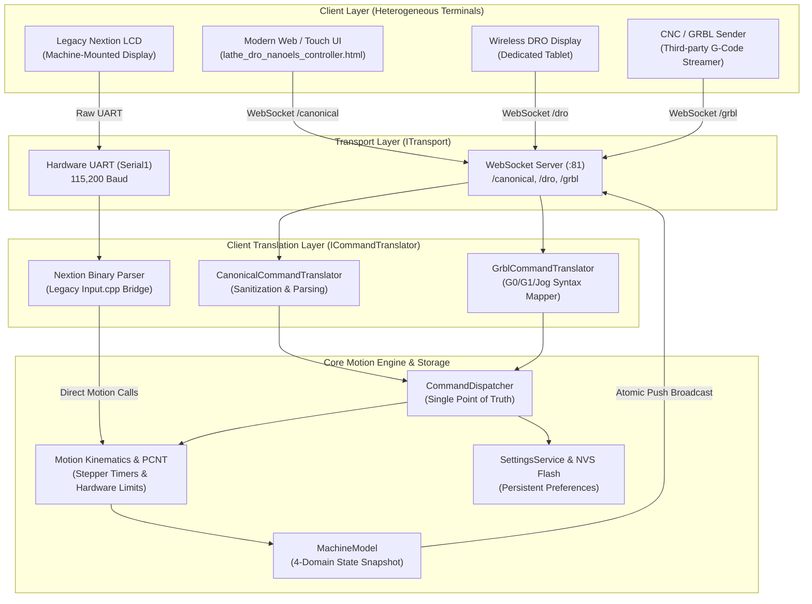

# NanoELS Client Architecture & Protocol Specification

> **Status:** Authoritative Specification  
> **Target Version:** NanoELS H5 Modular Multi-Client Suite  
> **Author:** Antigravity & Emil  
> **Date:** October 7, 2026  
> **Location:** `c:/Users/Emil/Documents/Code/nanoels/h5/UI_redesign/docs/ELS_CLIENT_ARCHITECTURE.md`  
> **Referenced By:** `ELS_DESIGN_NOTEBOOK.md`, `ELS_MODE_ARCHITECTURE.md`, `LATHE_MACHINE_PROFILE.md`

---

## 1. Executive Summary & Design Principles

The **NanoELS Client Architecture** defines the structure, communication protocol, state synchronization, and presentation layer for all operator interfaces interacting with the NanoELS motion controller.

### Governing Architectural Tenets
1. **The Controller is the Sole Authority:**  
   Connected clients (Web UI, tablet DROs, pendants, secondary displays) are pure reactive observers. Mode execution and kinematics run deterministically on the controller MCU. The client transmits *operator intent* (`CMD.*`), and state flows outward via domain-namespaced telemetry.
2. **Strict Layer Decoupling (Transport vs. Translation vs. Core):**  
   Transport code (WebSocket, Serial) manages raw sockets and frame buffers only. A dedicated Translation Layer sanitizes and decodes client-specific protocols into canonical machine commands. The motion engine never touches transport artifacts.
3. **Preservation of Operator Intent (No Float Round-Trip Drift):**  
   The controller stores exact operator intent (e.g. `20 TPI`, `1:3.5 taper`, `1.5 mm pitch`) alongside canonical deci-micron values (`du`, `dupr`). This guarantees zero round-trip display drift (entering `20 TPI` will never return as `19.9998`).
4. **Presentation is Client-Local:**  
   Units (`mm`/`in`) and cross-slide display representation (`Ø Diameter`/`R Radius`) are entirely client-local presentation settings. Toggling units never transmits network packets to the MCU and never affects other connected clients.
5. **Zero-Build, 100% Offline Runtime:**  
   The Web UI operates with zero npm build step or bundler dependencies. It can be served from ESP32 LittleFS, an external companion server, or loaded directly via `file:///`.

---

## 2. System Topology & 3-Tier Layering



### Layer Responsibilities

#### 1. Transport Layer (`ITransport`)
* Manages network sockets and byte streams (ESP32 `WebSocketsServer` on port 81, hardware `Serial1` UART).
* Handles connection state, client registration, keep-alive heartbeats, and frame buffering.
* Completely agnostic to command syntax, motion state, or kinematics.

#### 2. Client Translation Layer (`ICommandTranslator`)
* Sanitizes incoming client commands: strips whitespace and line endings (`\r`, `\n`), enforces `char[256]` bounds, and checks syntax.
* Decodes client-specific framing into internal canonical calls (`CMD.*`, `SETTINGS.*`).
* Translates outgoing `MachineModel` domain snapshots into the wire format expected by the client.

#### 3. Core Motion Dispatcher (`CommandDispatcher`)
* Dispatches validated commands directly to hardware sub-systems (`Axis`, `Motion`, `SettingsService`).
* Single point of truth for all machine state modifications.

---

## 3. Web UI Frontend Architecture & Module Structure

The client codebase is decomposed into cohesive, decoupled ES modules:

```
UI_redesign/prototype/
├── lathe_dro_nanoels_controller.html  # Declarative HTML5 markup (Alpine directives)
├── alpine.min.js                      # Alpine.js v3.17.4 local offline runtime
├── lathe-controller.css               # Design system tokens, styles, layout
├── nanoels-service.js                 # Transport service, lifecycle & backend selector
├── nanoels-state.js                   # Alpine.store('machine') 4-domain reactive model
├── nanoels-presets.js                 # Standard thread tables (Metric/TPI) & taper angles
├── nanoels-formatters.js              # Pure render-time formatters (du -> human strings)
├── lathe-controller.js                # Modal dialog controllers, keypad & wizard logic
├── nanoels-emulator.js                # Full offline physics/kinematics simulator
└── dev/
    ├── lathe-viz.js                   # Digital twin SVG canvas visualizer engine
    └── lathe-viz-profiles.js          # Declarative machine geometry profile library
```

### Module Responsibilities:

| File | Purpose | Key Responsibilities |
| :--- | :--- | :--- |
| **`nanoels-service.js`** | **Transport & Network Abstraction** | Manages WebSocket connections, automatic reconnection with exponential backoff, backend switching (`mock` vs `bridge` vs `live`), and command queuing. |
| **`nanoels-state.js`** | **Authoritative Reactive Store** | Implements `Alpine.store('machine')`. Ingests line-oriented domain telemetry, handles client-local presentation state, and triggers reactive UI updates with zero DOM thrashing. |
| **`nanoels-formatters.js`** | **Pure Presentation Math** | Pure functions that format deci-microns into localized strings (`duToMm`, `duToInch`, `formatFeed`, `formatSurfaceSpeed`). Zero state mutations. |
| **`nanoels-presets.js`** | **Machining Knowledge Base** | Complete lookup tables for standard threads (Metric standard/fine, UNC, UNF, UNEF, Pipe NPT/BSPT) and standard machine tapers (Morse, Brown & Sharpe, R8, ISO). |
| **`nanoels-emulator.js`** | **Offline Physics Simulator** | Full software model of the ESP32 motion controller. Emulates stepper timing, encoder ticks, soft limits, and tool kinematics for offline browser testing. |
| **`lathe-viz.js`** | **Digital Twin Visualizer** | Passive reactive SVG renderer that ingests canonical coordinates and draws the lathe bed, carriage, toolpost, and workpiece to true physical scale. |

---

## 4. Multi-Domain State Protocol (`MachineModel`)

State synchronization between controller and clients is partitioned into four independent, cohesive domains:

```
+-------------------------------------------------------------------------+
|                              MachineModel                               |
+-------------------+-------------------+----------------+----------------+
|    Kinematics     |      Intent       |     Cycle      |   Properties   |
|   (Domain 'K')    |   (Domain 'I')    |  (Domain 'C')  |  (Domain 'P')  |
|     Bit: 0x01     |     Bit: 0x02     |   Bit: 0x04    |   Bit: 0x08    |
+-------------------+-------------------+----------------+----------------+
| zDu, xDu, yDu     | thFmt, thPitch    | passes         | measure        |
| zLeftDu, zRightDu | dupr              | opIdx (curr)   | dia, abs       |
| xUpDu, xDownDu    | tpMode, tpVal     | setupIdx       | zDro, xDro     |
| rpm, turns, angle | coneRatio         | starts         | screwZDu       |
| mode, on, estop   | feedStepDu        |                | screwXDu       |
| zDis, xDis, yDis  | jogStepDu         |                | motorStepsZ/X  |
| dupr, nextDupr    | feedRev           |                | encoderPpr     |
+-------------------+-------------------+----------------+----------------+
```

### Domain Definitions

1. **Domain 'K' (Kinematics — High Frequency: 20–50 Hz):**
   * Live physical positions in canonical deci-microns: `zDu`, `xDu`, `yDu`.
   * Active soft limit registers: `zLeftDu`, `zRightDu`, `xUpDu`, `xDownDu`.
   * Live spindle dynamics: `rpm`, `turns`, `angle` ($0.0^\circ$–$359.9^\circ$).
   * Discrete execution state: `mode` (active mode ID), `isOn` (motion active), `estop`.
2. **Domain 'I' (Operator Intent — On Mutation):**
   * Exact operator typed setpoints: `thFmt` (0: mm, 1: TPI, 2: Inch), `thPitch` (e.g. `20.0`).
   * Taper parameters: `tpMode` (Ratio, Angle, Preset), `tpVal`, `coneRatio`.
   * Gearing & jog increments: `feedStepDu`, `jogStepDu`, `feedRev`.
3. **Domain 'C' (Cycle Progress — On Pass / Step):**
   * Multi-pass cycle tracking: `passes` (total passes), `opIdx` (current pass index), `setupIdx`.
4. **Domain 'P' (Machine Properties — On Connect / Setup):**
   * Hardware kinematics configuration: `screwZDu`, `screwXDu`, `motorStepsZ`, `encoderPpr`.
   * Hardware DRO attachment flags: `zDro`, `xDro`.

### 4.1 Wire Telemetry Format (Line-Oriented Stream)

To minimize packet overhead and eliminate complex JSON parsers on embedded microcontrollers, telemetry streams in human-readable, line-oriented key-value packets:

```text
K.zDu=125400
K.xDu=-45200
K.rpm=620
K.isOn=1
I.thPitch=1.5
C.opIdx=3
C.passes=6
```

#### Multi-Domain Pull Hydration (`?get=` or `CMD.get=`)
When a client connects or refreshes, it requests an atomic snapshot of required domains in a single command:
```text
CMD.get=K,I,C,P\n
```
The controller returns an atomic snapshot captured at instant $t_0$, completely eliminating torn-frame read hazards.

---

## 5. Client-Side Presentation Decoupling

A cornerstone of this architecture is that **display presentation is strictly client-local**:

### 5.1 Coordinate Units (`measure`: Metric `mm` vs. Imperial `in`)
* **Core Controller Invariant:** Physical motor steps and positions are tracked exclusively in **deci-microns** ($10{,}000\text{ du} = 1.0\text{ mm}$).
* **Client Translation:**
  * When in Metric mode: `displayZ = zDu / 10000.0`
  * When in Imperial mode: `displayZ = zDu / 254000.0`
* Tapping the unit toggle chip in the UI alters `$store.machine.measure` locally. **No network packets are dispatched.**

### 5.2 Cross-Slide Representation (`dia`: Diameter `Ø` vs. Radius `R`)
* Physical leadscrew movement is always radial ($1.0\text{ mm}$ cross-slide movement $= 1.0\text{ mm}$ change in radius).
* When in Diameter Mode (`dia == true`), the client simply doubles the radial coordinate for display:
  `displayX = (xDu * 2) / 10000.0`
* Workpiece drawing diameters can be dialed directly on screen without mutating internal motion math.

### 5.3 Live Spindle Cutting Speed ($SMM$ / $SFM$)
* Tapping the spindle display cycles through `RPM` $\rightarrow$ `TURNS` $\rightarrow$ `ANGLE (°)` $\rightarrow$ `SURFACE SPEED`.
* Surface cutting speed is computed purely on the client at render time from live $X$ diameter and spindle RPM:
  $$\text{SMM (m/min)} = \frac{\pi \times \text{Dia}_{\text{mm}} \times \text{RPM}}{1000.0}$$
  $$\text{SFM (ft/min)} = \frac{\pi \times \text{Dia}_{\text{in}} \times \text{RPM}}{12.0}$$

---

## 6. Semantic Operator Intent Protocol

To prevent machine crashes caused by mismatched sign conventions (e.g. front toolpost vs. rear toolpost, right-hand vs. left-hand leadscrews), clients never send raw coordinate increments. Instead, clients command **Operator Semantic Intent**:

```text
CMD.jogHold=X,INFEED       // Move tool inward into cut / towards spindle centerline
CMD.jogHold=X,RETRACT      // Move tool outward away from cut / towards operator
CMD.jogHold=Z,CHUCK        // Feed carriage left toward chuck
CMD.jogHold=Z,TAIL         // Feed carriage right toward tailstock
CMD.jogRelease=<axis>      // Operator released jog button
CMD.jogStep=<axis>,<dir>   // Discrete 1-step increment in semantic direction
```

### Safety Watchdog (Heartbeat Failsafe)
For continuous jogging (`CMD.jogHold`), the client sends periodic heartbeats. If communication drops for $>500\text{ ms}$, the controller automatically decelerates the axis to a stop.

---

## 7. Interaction to Wire Command Ledger

The following ledger maps every primary user interaction on the Web UI to its Alpine trigger, JavaScript client method, wire command, and controller kinematic effect:

| UI Control / Action | Event Trigger | JS Method (`nanoels-service.js`) | Wire Command | Controller Effect |
| :--- | :--- | :--- | :--- | :--- |
| **Jog Z toward Chuck (Tap)** | `@click` (<300ms) | `jogStep('Z', 'CHUCK')` | `CMD.jogStep=Z,CHUCK\n` | Moves carriage left by 1 step increment. |
| **Jog Z toward Tailstock (Tap)** | `@click` (<300ms) | `jogStep('Z', 'TAIL')` | `CMD.jogStep=Z,TAIL\n` | Moves carriage right by 1 step increment. |
| **Jog X Infeed (Tap)** | `@click` (<300ms) | `jogStep('X', 'INFEED')` | `CMD.jogStep=X,INFEED\n` | Moves cross-slide inward toward center by 1 step. |
| **Jog X Retract (Tap)** | `@click` (<300ms) | `jogStep('X', 'RETRACT')` | `CMD.jogStep=X,RETRACT\n` | Moves cross-slide outward by 1 step. |
| **Jog Hold (Continuous)** | `pointerdown` (≥300ms) | `jog(axis, dir, true)` | `CMD.jogHold=<axis>,<dir>\n` | Engages continuous velocity jog until released. |
| **Jog Release** | `pointerup` / `cancel` | `jog(axis, dir, false)` | `CMD.jogRelease=<axis>\n` | Decelerates axis smoothly to complete stop. |
| **Zero Z Axis** | Tap `DRO Z0` button | `zeroAxis('Z')` | `CMD.axisZero=Z\n` | Sets current carriage coordinate to $Z=0.000$. |
| **Zero X Axis** | Tap `DRO X0` button | `zeroAxis('X')` | `CMD.axisZero=X\n` | Sets current cross-slide coordinate to $X=0.000$. |
| **Set Z Left Limit** | Tap `|←` Limit chip | `setLimit('Z', 'LEFT', val)` | `CMD.limit=Z,LEFT,<val>\n` | Sets $Z$ carriage chuck-side limit in deci-microns. |
| **Set Z Right Limit** | Tap `→|` Limit chip | `setLimit('Z', 'RIGHT', val)`| `CMD.limit=Z,RIGHT,<val>\n`| Sets $Z$ carriage tailstock-side limit. |
| **Start Motion** | Tap `START FEED / CYCLE` | `startMotion()` | `CMD.start=1\n` | Validates limits and arms active mode motion. |
| **Emergency Stop / Hold** | Tap `STOP` button | `stopMotion()` | `CMD.stop=1\n` | Immediately halts all stepping and sets `isOn=0`. |
| **Change Pitch** | Tap Pitch selector | `setPitch(val)` | `CMD.pitch=<val>\n` | Sets electronic leadscrew pitch / feedrate. |
| **Change Mode** | Tap Mode Menu card | `setMode(modeId)` | `CMD.mode=<modeId>\n` | Transitions controller to requested ModeId. |

---

## 8. Summary & Cross-References

This specification establishes:
* **True reactive decoupling**: Presentation changes remain on the client; physical control is authoritative on the MCU.
* **Deterministic protocol**: Line-oriented, typed domain telemetry completely eliminates floating-point round-trip drift.
* **Maximum shop safety**: Semantic operator directions and hardware heartbeats prevent tool crashes.

### Related Documents:
* **Physical Hardware & Presets:** [`LATHE_MACHINE_PROFILE.md`](./LATHE_MACHINE_PROFILE.md)
* **Mode Lifecycle & Inheritance:** [`ELS_MODE_ARCHITECTURE.md`](./ELS_MODE_ARCHITECTURE.md)
* **UI Design Decisions & Ergonomics:** [`ELS_DESIGN_NOTEBOOK.md`](./ELS_DESIGN_NOTEBOOK.md)
