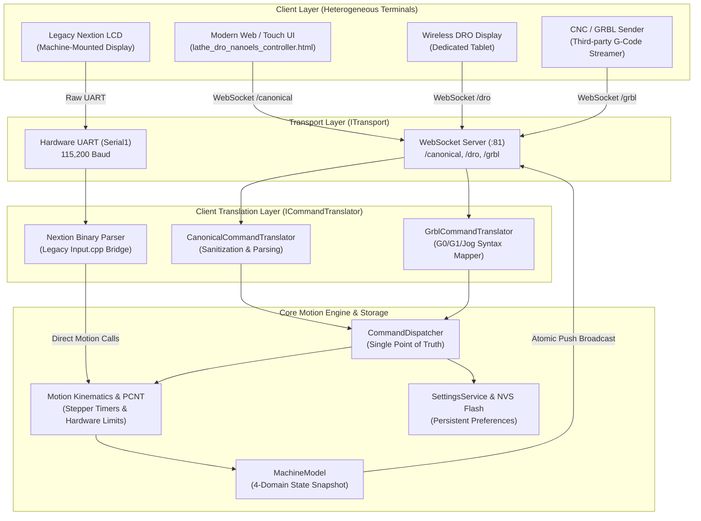

# NanoELS Client Architecture & Protocol Specification

> **Status:** Authoritative Specification  
> **Target Version:** NanoELS H5 Modular Multi-Client Suite  
> **Author:** Antigravity & Emil  
> **Date:** October 7, 2026  
> **Location:** `c:/Users/Emil/Documents/Code/nanoels/h5/UI_redesign/docs/ELS_CLIENT_ARCHITECTURE.md`  
> **Referenced By:** `ELS_DESIGN_NOTEBOOK.md`, `ELS_MODE_ARCHITECTURE.md`, `LATHE_MACHINE_PROFILE.md`

---

## 1. Executive Summary & Design Principles

The **NanoELS Client Architecture** defines the structure, communication protocol, state synchronization, and presentation layer for all operator interfaces interacting with the NanoELS motion controller.

### Governing Architectural Tenets
1. **The Controller is the Sole Authority:**  
   Connected clients (Web UI, tablet DROs, pendants, secondary displays) are pure reactive observers. Mode execution and kinematics run deterministically on the controller MCU. The client transmits *operator intent* (`CMD.*`), and state flows outward via domain-namespaced telemetry.
2. **Strict Layer Decoupling (Transport vs. Translation vs. Core):**  
   Transport code (WebSocket, Serial) manages raw sockets and frame buffers only. A dedicated Translation Layer sanitizes and decodes client-specific protocols into canonical machine commands. The motion engine never touches transport artifacts.
3. **Preservation of Operator Intent (No Float Round-Trip Drift):**  
   The controller stores exact operator intent (e.g. `20 TPI`, `1:3.5 taper`, `1.5 mm pitch`) alongside canonical deci-micron values (`du`, `dupr`). This guarantees zero round-trip display drift (entering `20 TPI` will never return as `19.9998`).
4. **Presentation is Client-Local:**  
   Units (`mm`/`in`) and cross-slide display representation (`Ø Diameter`/`R Radius`) are entirely client-local presentation settings. Toggling units never transmits network packets to the MCU and never affects other connected clients.
5. **Zero-Build, 100% Offline Runtime:**  
   The Web UI operates with zero npm build step or bundler dependencies. It can be served from ESP32 LittleFS, an external companion server, or loaded directly via `file:///`.

---

## 2. System Topology & 3-Tier Layering



### Layer Responsibilities

#### 1. Transport Layer (`ITransport`)
* Manages network sockets and byte streams (ESP32 `WebSocketsServer` on port 81, hardware `Serial1` UART).
* Handles connection state, client registration, keep-alive heartbeats, and frame buffering.
* Completely agnostic to command syntax, motion state, or kinematics.

#### 2. Client Translation Layer (`ICommandTranslator`)
* Sanitizes incoming client commands: strips whitespace and line endings (`\r`, `\n`), enforces `char[256]` bounds, and checks syntax.
* Decodes client-specific framing into internal canonical calls (`CMD.*`, `SETTINGS.*`).
* Translates outgoing `MachineModel` domain snapshots into the wire format expected by the client.

#### 3. Core Motion Dispatcher (`CommandDispatcher`)
* Dispatches validated commands directly to hardware sub-systems (`Axis`, `Motion`, `SettingsService`).
* Single point of truth for all machine state modifications.

---

## 3. Composable Client Endpoint Pipeline (C++ Specification)

To ensure that any future client transport (Nextion v2 UART driver, USB-UART serial pendant, Bluetooth Low Energy, or CAN/Modbus bus) can be integrated without modifying kinematic firmware, the system defines a composable client pipeline:

$$\text{ClientEndpoint} = \text{Transport} + \text{Serializer} + \text{Translator}$$

```
   Raw Wire (Bytes/Text)              Inbound Translation                   Core Controller
[ Physical I/O Channel ] ──(Inbound)──► [ ICommandTranslator ] ──(Dispatch)──► [ Motion / Model ]
           ▲                                                                           │
           │                                                                           │
           └──────────────(Outbound)── [ ITelemetrySerializer ] ◄──(Capture)───────────┘
```

### C++ Interface Definitions

```cpp
// include/ClientEndpoint.h

class ITransport {
public:
    virtual ~ITransport() = default;
    virtual bool isConnected() const = 0;
    virtual bool sendText(const char* text) = 0;
    virtual bool sendBytes(const uint8_t* buffer, size_t length) = 0;
};

class ICommandTranslator {
public:
    virtual ~ICommandTranslator() = default;
    // Decodes raw client wire bytes/strings into canonical dispatcher actions
    virtual bool translateInbound(const char* payload, size_t length, CommandDispatcher& dispatcher) = 0;
};

class ITelemetrySerializer {
public:
    virtual ~ITelemetrySerializer() = default;
    // Serializes domain state snapshots into client-specific wire frames
    virtual size_t serialize(const MachineModel& model, uint8_t domainMask, char* outBuf, size_t maxLen) = 0;
};

class ClientEndpoint {
public:
    ClientEndpoint(ITransport& transport, ICommandTranslator& translator, ITelemetrySerializer& serializer)
        : transport_(transport), translator_(translator), serializer_(serializer) {}

    void onInboundData(const char* data, size_t len) {
        translator_.translateInbound(data, len, CommandDispatcher::instance());
    }

    void onStateChanged(const MachineModel& model, uint8_t domainMask) {
        if (!transport_.isConnected()) return;
        char buffer[256];
        size_t written = serializer_.serialize(model, domainMask, buffer, sizeof(buffer));
        if (written > 0) {
            transport_.sendText(buffer);
        }
    }

private:
    ITransport& transport_;
    ICommandTranslator& translator_;
    ITelemetrySerializer& serializer_;
};
```

---

## 4. Change-Driven Status Dispatch & Immutable `StatusSnapshot`

### 4.1 Zero-Polling Execution Invariant
* Core status updates are **strictly change-driven**; they are never generated by fixed periodic polling timers.
* The motion engine triggers status dispatch **only when machine properties mutate** (step pulses emitted, spindle pulses accumulated, mode changed, or limits modified).
* When the lathe is stationary and idle, **zero status packets are generated or pushed**, preserving radio bandwidth and CPU cycles.

### 4.2 Temporal Isolation & Value Semantics
On dual-core ESP32 systems, high-priority real-time motion control (stepper pulse timers, encoder ISRs on Core 0) runs asynchronously with lower-priority client communication tasks (FreeRTOS network/UART tasks on Core 1). Passing floating pointers or references to a mutable model results in temporal tearing.

The Core captures an immutable `StatusSnapshot` struct (~64 bytes) frozen in time, paired with a 32-bit `changedFields` bitmask:

```cpp
// include/StatusSnapshot.h

enum StatusField : uint32_t {
    FIELD_NONE        = 0,
    FIELD_POS_Z       = 1 << 0,
    FIELD_POS_X       = 1 << 1,
    FIELD_POS_Y       = 1 << 2,
    FIELD_LIMITS_Z    = 1 << 3,
    FIELD_LIMITS_X    = 1 << 4,
    FIELD_SPINDLE_RPM = 1 << 5,
    FIELD_SPINDLE_POS = 1 << 6,  // angle & turns
    FIELD_MOTION_MODE = 1 << 7,
    FIELD_MOTION_SYNC = 1 << 8,  // on/off
    FIELD_ESTOP       = 1 << 9,
    FIELD_FEED_RATE   = 1 << 10,
    FIELD_ALL         = 0xFFFFFFFF
};

struct StatusSnapshot {
    uint32_t timestamp;
    uint32_t changedFields; // Bitmask of which fields mutated in this event

    // Authoritative Canonical Kinematics at the instant of trigger
    int32_t  zDu;
    int32_t  xDu;
    int32_t  yDu;
    int32_t  zLeftDu;
    int32_t  zRightDu;
    int32_t  xUpDu;
    int32_t  xDownDu;
    uint16_t rpm;
    float    turns;
    float    angle;
    uint8_t  mode;
    bool     isOn;
    bool     estop;
    int32_t  dupr;
};

class ClientInterface {
public:
    virtual ~ClientInterface() = default;
    virtual void onStatusUpdate(const StatusSnapshot& snapshot) = 0;
};
```

### 4.3 Decentralized Observer Filtering
The Core motion engine broadcasts the immutable snapshot to all registered clients without maintaining client-specific filters. Each client implementation evaluates `snapshot.changedFields` against its active interest mask in a single CPU cycle:

```cpp
void NextionClient::onStatusUpdate(const StatusSnapshot& snapshot) {
    // 1. Check if any fields visible on the active Nextion page mutated
    if (!(snapshot.changedFields & currentPageMask_)) {
        return; // Zero UART transmission
    }

    // 2. Local delta comparison to avoid redundant text draw
    if ((snapshot.changedFields & FIELD_POS_X) && snapshot.xDu != lastSnapshot_.xDu) {
        int32_t displayVal = isDiameterMode_ ? (snapshot.xDu * 2) : snapshot.xDu;
        renderCoordinate("t1", displayVal);
    }

    lastSnapshot_ = snapshot;
}
```

---

## 5. Web UI Frontend Architecture & Module Structure

The client codebase is decomposed into cohesive, decoupled ES modules:

```
UI_redesign/prototype/
├── lathe_dro_nanoels_controller.html  # Declarative HTML5 markup (Alpine directives)
├── alpine.min.js                      # Alpine.js v3.17.4 local offline runtime
├── lathe-controller.css               # Design system tokens, styles, layout
├── nanoels-service.js                 # Transport service, lifecycle & backend selector
├── nanoels-state.js                   # Alpine.store('machine') 4-domain reactive model
├── nanoels-presets.js                 # Standard thread tables (Metric/TPI) & taper angles
├── nanoels-formatters.js              # Pure render-time formatters (du -> human strings)
├── lathe-controller.js                # Modal dialog controllers, keypad & wizard logic
├── nanoels-emulator.js                # Full offline physics/kinematics simulator
└── dev/
    ├── lathe-viz.js                   # Digital twin SVG canvas visualizer engine
    └── lathe-viz-profiles.js          # Declarative machine geometry profile library
```

### Module Responsibilities:

| File | Purpose | Key Responsibilities |
| :--- | :--- | :--- |
| **`nanoels-service.js`** | **Transport & Network Abstraction** | Manages WebSocket connections, automatic reconnection with exponential backoff, backend switching (`mock` vs `bridge` vs `live`), and command queuing. |
| **`nanoels-state.js`** | **Authoritative Reactive Store** | Implements `Alpine.store('machine')`. Ingests line-oriented domain telemetry, handles client-local presentation state, and triggers reactive UI updates with zero DOM thrashing. |
| **`nanoels-formatters.js`** | **Pure Presentation Math** | Pure functions that format deci-microns into localized strings (`duToMm`, `duToInch`, `formatFeed`, `formatSurfaceSpeed`). Zero state mutations. |
| **`nanoels-presets.js`** | **Machining Knowledge Base** | Complete lookup tables for standard threads (Metric standard/fine, UNC, UNF, UNEF, Pipe NPT/BSPT) and standard machine tapers (Morse, Brown & Sharpe, R8, ISO). |
| **`nanoels-emulator.js`** | **Offline Physics Simulator** | Full software model of the ESP32 motion controller. Emulates stepper timing, encoder ticks, soft limits, and tool kinematics for offline browser testing. |
| **`lathe-viz.js`** | **Digital Twin Visualizer** | Passive reactive SVG renderer that ingests canonical coordinates and draws the lathe bed, carriage, toolpost, and workpiece to true physical scale. |

---

## 6. Multi-Domain State Protocol (`MachineModel`)

State synchronization between controller and clients is partitioned into four independent, cohesive domains:

```
+-------------------------------------------------------------------------+
|                              MachineModel                               |
+-------------------+-------------------+----------------+----------------+
|    Kinematics     |      Intent       |     Cycle      |   Properties   |
|   (Domain 'K')    |   (Domain 'I')    |  (Domain 'C')  |  (Domain 'P')  |
|     Bit: 0x01     |     Bit: 0x02     |   Bit: 0x04    |   Bit: 0x08    |
+-------------------+-------------------+----------------+----------------+
| zDu, xDu, yDu     | thFmt, thPitch    | passes         | measure        |
| zLeftDu, zRightDu | dupr              | opIdx (curr)   | dia, abs       |
| xUpDu, xDownDu    | tpMode, tpVal     | setupIdx       | zDro, xDro     |
| rpm, turns, angle | coneRatio         | starts         | screwZDu       |
| mode, on, estop   | feedStepDu        |                | screwXDu       |
| zDis, xDis, yDis  | jogStepDu         |                | motorStepsZ/X  |
| dupr, nextDupr    | feedRev           |                | encoderPpr     |
+-------------------+-------------------+----------------+----------------+
```

### Domain Definitions

1. **Domain 'K' (Kinematics — High Frequency: 20–50 Hz):**
   * Live physical positions in canonical deci-microns: `zDu`, `xDu`, `yDu`.
   * Active soft limit registers: `zLeftDu`, `zRightDu`, `xUpDu`, `xDownDu`.
   * Live spindle dynamics: `rpm`, `turns`, `angle` ($0.0^\circ$–$359.9^\circ$).
   * Discrete execution state: `mode` (active mode ID), `isOn` (motion active), `estop`.
2. **Domain 'I' (Operator Intent — On Mutation):**
   * Exact operator typed setpoints: `thFmt` (0: mm, 1: TPI, 2: Inch), `thPitch` (e.g. `20.0`).
   * Taper parameters: `tpMode` (Ratio, Angle, Preset), `tpVal`, `coneRatio`.
   * Gearing & jog increments: `feedStepDu`, `jogStepDu`, `feedRev`.
3. **Domain 'C' (Cycle Progress — On Pass / Step):**
   * Multi-pass cycle tracking: `passes` (total passes), `opIdx` (current pass index), `setupIdx`.
4. **Domain 'P' (Machine Properties — On Connect / Setup):**
   * Hardware kinematics configuration: `screwZDu`, `screwXDu`, `motorStepsZ`, `encoderPpr`.
   * Hardware DRO attachment flags: `zDro`, `xDro`.

### 6.1 Wire Telemetry Format (Line-Oriented Stream)

To minimize packet overhead and eliminate complex JSON parsers on embedded microcontrollers, telemetry streams in human-readable, line-oriented key-value packets:

```text
K.zDu=125400
K.xDu=-45200
K.rpm=620
K.isOn=1
I.thPitch=1.5
C.opIdx=3
C.passes=6
```

#### Multi-Domain Pull Hydration (`?get=` or `CMD.get=`)
When a client connects or refreshes, it requests an atomic snapshot of required domains in a single command:
```text
CMD.get=K,I,C,P\n
```
The controller returns an atomic snapshot captured at instant $t_0$, completely eliminating torn-frame read hazards.

---

## 7. Client-Side Presentation Decoupling

A cornerstone of this architecture is that **display presentation is strictly client-local**:

### 7.1 Coordinate Units (`measure`: Metric `mm` vs. Imperial `in`)
* **Core Controller Invariant:** Physical motor steps and positions are tracked exclusively in **deci-microns** ($10{,}000\text{ du} = 1.0\text{ mm}$).
* **Client Translation:**
  * When in Metric mode: `displayZ = zDu / 10000.0`
  * When in Imperial mode: `displayZ = zDu / 254000.0`
* Tapping the unit toggle chip in the UI alters `$store.machine.measure` locally. **No network packets are dispatched.**

### 7.2 Cross-Slide Representation (`dia`: Diameter `Ø` vs. Radius `R`)
* Physical leadscrew movement is always radial ($1.0\text{ mm}$ cross-slide movement $= 1.0\text{ mm}$ change in radius).
* When in Diameter Mode (`dia == true`), the client simply doubles the radial coordinate for display:
  `displayX = (xDu * 2) / 10000.0`
* Workpiece drawing diameters can be dialed directly on screen without mutating internal motion math.

### 7.3 Live Spindle Cutting Speed ($SMM$ / $SFM$)
* Tapping the spindle display cycles through `RPM` $\rightarrow$ `TURNS` $\rightarrow$ `ANGLE (°)` $\rightarrow$ `SURFACE SPEED`.
* Surface cutting speed is computed purely on the client at render time from live $X$ diameter and spindle RPM:
  $$\text{SMM (m/min)} = \frac{\pi \times \text{Dia}_{\text{mm}} \times \text{RPM}}{1000.0}$$
  $$\text{SFM (ft/min)} = \frac{\pi \times \text{Dia}_{\text{in}} \times \text{RPM}}{12.0}$$

---

## 8. Semantic Operator Intent Protocol

To prevent machine crashes caused by mismatched sign conventions (e.g. front toolpost vs. rear toolpost, right-hand vs. left-hand leadscrews), clients never send raw coordinate increments. Instead, clients command **Operator Semantic Intent**:

```text
CMD.jogHold=X,INFEED       // Move tool inward into cut / towards spindle centerline
CMD.jogHold=X,RETRACT      // Move tool outward away from cut / towards operator
CMD.jogHold=Z,CHUCK        // Feed carriage left toward chuck
CMD.jogHold=Z,TAIL         // Feed carriage right toward tailstock
CMD.jogRelease=<axis>      // Operator released jog button
CMD.jogStep=<axis>,<dir>   // Discrete 1-step increment in semantic direction
```

### Safety Watchdog (Heartbeat Failsafe)
For continuous jogging (`CMD.jogHold`), the client sends periodic heartbeats. If communication drops for $>500\text{ ms}$, the controller automatically decelerates the axis to a stop.

---

## 9. Comprehensive UI Interaction to Wire Command Ledger

The following ledger exhaustively maps every user interaction on the Web UI to its event trigger, client method, wire command, and MCU kinematic effect:

| UI Control / Action | Event Trigger | JS Client Method | Wire Command | MCU Kinematic Effect |
| :--- | :--- | :--- | :--- | :--- |
| **D-Pad Tap Z-** (<300ms) | Pointerup click | `jogStep('Z', 'CHUCK')` | `CMD.jogStep=Z,CHUCK\n` | `queueWebUiStep(B_LEFT)`. Moves carriage 1 step toward chuck. |
| **D-Pad Hold Z-** (≥300ms) | Pointerdown hold | `jog('Z', 'CHUCK', true)` | `CMD.jogHold=Z,CHUCK\n` | `queueWebUiEvent(B_LEFT, true)`. Continuous carriage feed until released. |
| **D-Pad Release Z-** | Pointerup / cancel | `jog('Z', 'CHUCK', false)` | `CMD.jogRelease=Z\n` | `queueWebUiEvent(B_LEFT, false)`. Decelerates carriage to a stop. |
| **D-Pad Tap Z+** (<300ms) | Pointerup click | `jogStep('Z', 'TAIL')` | `CMD.jogStep=Z,TAIL\n` | `queueWebUiStep(B_RIGHT)`. Moves carriage 1 step toward tailstock. |
| **D-Pad Hold Z+** (≥300ms) | Pointerdown hold | `jog('Z', 'TAIL', true)` | `CMD.jogHold=Z,TAIL\n` | `queueWebUiEvent(B_RIGHT, true)`. Continuous carriage feed until released. |
| **D-Pad Release Z+** | Pointerup / cancel | `jog('Z', 'TAIL', false)` | `CMD.jogRelease=Z\n` | `queueWebUiEvent(B_RIGHT, false)`. Decelerates carriage to a stop. |
| **D-Pad Tap X+** (<300ms) | Pointerup click | `jogStep('X', 'RETRACT')` | `CMD.jogStep=X,RETRACT\n` | `queueWebUiStep(B_DOWN)`. Steps cross-slide 1 step away from centerline. |
| **D-Pad Hold X+** (≥300ms) | Pointerdown hold | `jog('X', 'RETRACT', true)` | `CMD.jogHold=X,RETRACT\n` | `queueWebUiEvent(B_DOWN, true)`. Continuous cross-slide retract until released. |
| **D-Pad Release X+** | Pointerup / cancel | `jog('X', 'RETRACT', false)` | `CMD.jogRelease=X\n` | `queueWebUiEvent(B_DOWN, false)`. Decelerates cross-slide to a stop. |
| **D-Pad Tap X-** (<300ms) | Pointerup click | `jogStep('X', 'INFEED')` | `CMD.jogStep=X,INFEED\n` | `queueWebUiStep(B_UP)`. Steps cross-slide 1 step inward toward centerline. |
| **D-Pad Hold X-** (≥300ms) | Pointerdown hold | `jog('X', 'INFEED', true)` | `CMD.jogHold=X,INFEED\n` | `queueWebUiEvent(B_UP, true)`. Continuous cross-slide plunge until released. |
| **D-Pad Release X-** | Pointerup / cancel | `jog('X', 'INFEED', false)` | `CMD.jogRelease=X\n` | `queueWebUiEvent(B_UP, false)`. Decelerates cross-slide to a stop. |
| **Chamfer NW (↖ Z- X-)** | Pointerdown hold | `jogChamfer('NW', true)` | `CMD.jogChamfer=NW,1\n` | Coordinated dual-axis jog: Z toward chuck, X infeed. |
| **Chamfer SE (↘ Z+ X+)** | Pointerdown hold | `jogChamfer('SE', true)` | `CMD.jogChamfer=SE,1\n` | Coordinated dual-axis jog: Z toward tailstock, X retract. |
| **Runstack: START** | Primary Start button | `startCycle()` | `CMD.on=1\n` | `setIsOnFromTask(true)`. Arms active kinematic cycle. |
| **Runstack: STOP** | Stationary Stop button | `stopCycle()` | `CMD.on=0\n` | `setIsOnFromTask(false)`. Immediately disengages synchronized leadscrew motion. |
| **Zero Z Axis** | DRO Z0 button | `zeroAxis('Z')` | `CMD.axisZero=Z\n` | `setAxisZero(&z)`. Sets current carriage position as $Z=0.000$. |
| **Zero X Axis** | DRO X0 button | `zeroAxis('X')` | `CMD.axisZero=X\n` | `setAxisZero(&x)`. Sets current cross-slide position as $X=0.000$. |
| **Mode Selector** | Nav bar / Mode buttons | `setMode(modeId)` | `CMD.mode=<id>\n` | `setOperatingMode(id)`. Switches mode (`0`=Gear, `1`=Turn, `2`=Face, `3`=Cone, `4`=Cut, `5`=Thread...). |
| **Reverse Feed / Pitch** | Pitch/Feed chips | `reverseFeed()` | `CMD.feedRev\n` | `reverseFeedDirection()`. Inverts sign of active `dupr` pitch. |
| **Jog Step Increment** | Step selector chip | `cycleStep()` | `CMD.jogStepDu=<du>\n` | Sets in-memory `moveStep` variable to target deci-microns (e.g. 100, 1000, 10000). |
| **Unit System Toggle** | Unit chip (MM/IN/TPI) | `cycleMeasure()` | None (Client-Local Presentation) | Toggles `$store.machine.measure`. Zero wire traffic. |
| **Diameter / Radius** | DRO Dia/Rad chip | `toggleDiaRad()` | None (Client-Local Presentation) | Toggles `$store.machine.dia`. Core kinematics remain pure radius. |
| **Set Z Left Limit** | DRO limit edit modal | `setLimit('Z', 'left', valDu)` | `CMD.axisLimitDu=Z,L,<val>\n` | `setAxisLimitDu(&z, true, valDu)`. Programs hardware left limit register. |
| **Set Z Right Limit** | DRO limit edit modal | `setLimit('Z', 'right', valDu)` | `CMD.axisLimitDu=Z,R,<val>\n` | `setAxisLimitDu(&z, false, valDu)`. Programs hardware right limit register. |
| **Clear Z Limits** | DRO limit clear button | `clearLimit('Z', 'left')` | `CMD.axisClearLimit=Z,L\n` | Clears `z.leftStop = LONG_MAX`, restoring unbounded travel. |
| **Set Metric Pitch** | Pitch keypad submit | `setFeedrateMm(mm)` | `CMD.feedMm=<val>\n` | Computes deci-microns per revolution and engages metric leadscrew ratio. |
| **Set TPI Pitch** | Pitch keypad submit | `setFeedrateTpi(tpi)` | `CMD.feedTpi=<val>\n` | Computes fractional leadscrew ratio for imperial threads per inch. |
| **Set Taper Angle** | Taper keypad submit | `setTaperAngle(deg)` | `CMD.taperAngle=<val>\n` | Computes $K = 2\tan(\theta)$ and configures cone kinematics. |
| **Set Taper Ratio** | Taper keypad submit | `setTaperRatio(1/K)` | `CMD.taperRatio=<val>\n` | Configures cone slope ratio directly (e.g. 1:10, 1:20). |
| **Spindle Sim RPM** | Visualizer Spindle HUD | `setSpindleSim(1, rpm)` | `CMD.spindleSim=1,<rpm>\n` | Overrides physical PCNT with synthetic pulse generator for offline verification. |
| **Spindle Sim Turn** | Visualizer Chuck Wheel | `spindleSimTurn(deg)` | `CMD.spindleSimTurn=<deg>\n` | Generates queued encoder pulses equivalent to specified hand rotation. |

---

## 10. Canonical Protocol Command Reference (`CMD.*` & `SETTINGS.*`)

### Motion & Cycle Commands
* `CMD.on=1`: Starts current cycle or feed.
* `CMD.on=0`: Stops current cycle or feed immediately.
* `CMD.jogHold=<axis>,<dir>`: Starts continuous manual jog along `<axis>` (`Z` or `X`) in `<dir>` (`TAIL`, `CHUCK`, `INFEED`, `RETRACT`, `1`, `-1`).
* `CMD.jogRelease=<axis>`: Stops manual jog along `<axis>` (or all axes if omitted).
* `CMD.jogStep=<axis>,<dir>`: Executes a discrete single-step move of `moveStep` deci-microns in `<dir>`.
* `CMD.jogStepDu=<du>`: Sets single-step increment size in deci-microns (e.g. `100` = $0.01\text{ mm}$).
* `CMD.axisZero=<axis>`: Zeroes machine coordinate origin for `<axis>` (`Z`, `X`, `Y`).
* `CMD.axisPosDu=<axis>,<posDu>`: Sets absolute DRO position coordinate for `<axis>`.
* `CMD.axisLimitDu=<axis>,<L|R>,<du>`: Programs hardware travel limit for `<axis>`.
* `CMD.axisClearLimit=<axis>,<L|R>`: Clears specified travel limit register.

### Mode & Kinematics Commands
* `CMD.mode=<modeId>`: Sets operational mode (`0`=GEAR, `1`=TURN, `2`=FACE, `3`=CONE, `4`=CUT, `5`=THREAD, `6`=SLOT, `7`=ELLIPSE, `8`=GCODE).
* `CMD.feedRev`: Reverses feed direction (toggles sign of active pitch).
* `CMD.feedDupr=<du>`: Sets feedrate in deci-microns per spindle revolution.
* `CMD.feedMm=<mm>`: Sets feedrate/pitch in millimeters.
* `CMD.feedTpi=<tpi>`: Sets threading pitch in threads per inch.
* `CMD.feedInch=<inch>`: Sets threading pitch in decimal inches.
* `CMD.feedStepDu=<du>`: Sets manual feed step size in deci-microns.
* `CMD.feedStepCycle`: Cycles through standard feed step table entries.
* `CMD.taperAngle=<deg>`: Sets taper angle in degrees.
* `CMD.taperRatio=<ratioK>`: Sets taper ratio $1:K$.
* `CMD.taperPreset=<id>,<deg>,<ratio>`: Loads predefined standard taper preset (Morse, Brown & Sharpe, etc.).

### Settings & Configuration Commands
* `SETTINGS.get` / `SETTINGS.get=*`: Returns all persistent machine and operational settings.
* `SETTINGS.get=<key>`: Returns specific setting value.
* `SETTINGS.set=<key>,<value>`: Mutates setting, updates fast in-memory cache, persists to NVS flash, and triggers status broadcast.
  - Keys: `abs`, `zDro`, `xdro`, `measure`, `feedStepDu`, `deadbandAngle`, `deadbandTurns`, `screwZDu`, `screwXDu`, `motorStepsZ`, `motorStepsX`, `encoderPpr`.

### System & State Queries
* `?sysinfo`: Returns firmware build version, chip architecture, flash size, and feature capabilities (`SYSINFO.features=spindleSim`).
* `?state` / `?get=ALL`: Returns complete multi-domain telemetry frame (`K` Kinematics, `I` Identity, `S` Spindle, `T` Threading, `L` Limits, `O` Operations).
* `CMD.get=K,I,C,P`: Atomic snapshot hydration across requested domains.

---

## 11. Summary & Cross-References

This specification establishes:
* **True reactive decoupling**: Presentation changes remain on the client; physical control is authoritative on the MCU.
* **Deterministic protocol**: Line-oriented, typed domain telemetry completely eliminates floating-point round-trip drift.
* **Maximum shop safety**: Semantic operator directions and hardware heartbeats prevent tool crashes.

### Related Documents:
* **Physical Hardware & Presets:** [`LATHE_MACHINE_PROFILE.md`](./LATHE_MACHINE_PROFILE.md)
* **Mode Lifecycle & Inheritance:** [`ELS_MODE_ARCHITECTURE.md`](./ELS_MODE_ARCHITECTURE.md)
* **UI Design Decisions & Ergonomics:** [`ELS_DESIGN_NOTEBOOK.md`](./ELS_DESIGN_NOTEBOOK.md)

