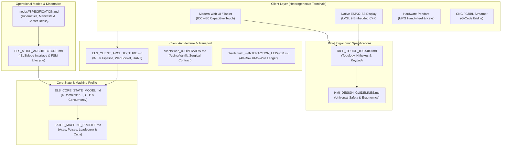

# NanoELS H5 — System Architecture & Design Decision Ledger

> **Document Role:** Master System Index, Architectural Decision Record (ADR) & High-Level Philosophy  
> **Status:** Living Document  
> **Target Platform:** NanoELS H5 Core Motion Controller & Multi-Client Suite  
> **Date:** October 7, 2026  

---

## 1. System Vision & Architecture Topology

The **NanoELS H5 Redesign** transforms a single-client embedded leadscrew into a modular, multi-client industrial motion system. The architecture completely decouples physical motion generation, domain state management, network transport, and client human-machine interfaces (HMI).



---

## 1.1 Historical Context & Evolutionary Journey (Guide for Future Agents)

To understand why the codebase is structured as it is and avoid repeating past misconceptions or treating legacy hacks as sacred cows, all agents and contributors must understand the three evolutionary phases of this project:

```
┌────────────────────────────────┐     ┌────────────────────────────────┐     ┌────────────────────────────────┐
│ PHASE 0: Legacy Monolith       │     │ PHASE 1: C++ Modularization    │     │ PHASE 2: Architectural Rewrite │
│ • Single 370KB `h5.ino` file   │ ──► │ • Extracted into C++ units     │ ──► │ • Ground-up modular architecture│
│ • Nextion serial tightly bound │     │   (Axis, Motion, Config, etc.) │     │ • 5 decoupled foundational pillars│
│ • 200+ procedural globals      │     │ • 1:1 behavioral port of .ino  │     │ • Modernized underlying engine │
│ • Ad-hoc timing & sleep hacks  │     │ • Preserved legacy quirks      │     │ • Obsoletes legacy baggage     │
└────────────────────────────────┘     └────────────────────────────────┘     └────────────────────────────────┘
```

### The Three Phases in Detail

#### Phase 0: Origin — The Russian `h5.ino` Monolith
The project began as an open-source Russian electronic leadscrew (ELS) controller implemented in a single, massive ~370 KB Arduino sketch file (`h5.ino`). While functionally impressive for hobbyist lathe automation, the codebase had severe architectural limitations:
* **Entangled Concerns:** High-frequency timer ISRs (stepper pulse generation) were directly interleaved with slow Nextion LCD serial packet decoding, operator state management, and hardware calibration.
* **Global State Explosion:** Over 200 unencapsulated global variables interacted without access control or thread safety.
* **Hardcoded Hardware & UI Assumptions:** Hardcoded for a specific low-resolution Nextion serial screen, Soviet/Russian lathe conventions, and fixed hardware wiring.
* **Ad-Hoc Timing Hacks:** Loaded with arbitrary delay loops and timing flags (`stepTimeMs`, `delayBetweenStepsMs`, `zNeedsRest`, `tftFirstUpload`, `showKeyPresses`) created to work around serial bottlenecks and Nextion display limitations.

#### Phase 1: The UI Ambition & In-Flight Modularization
The primary goal was to bring a modern, high-resolution touch UI / tablet DRO (and eventually WebSocket streaming) to the lathe controller so operators would no longer be restricted to the clunky, low-resolution Nextion interface.
* **The Impasse:** Attempting to build a responsive, bidirectional modern interface on top of the monolithic `h5.ino` proved fragile, unstable, and nearly impossible to maintain.
* **The Refactoring Effort:** The user and team undertook a major modularization effort, extracting the 370KB monolith into separate C++ classes and compilation units under `src/`:
  - [`Axis.cpp`](file:///c:/Users/Emil/Documents/Code/nanoels/h5/src/Axis.cpp) / [`Axis.h`](file:///c:/Users/Emil/Documents/Code/nanoels/h5/include/Axis.h) — Stepper pulse generation and DRO scale reading.
  - [`Motion.cpp`](file:///c:/Users/Emil/Documents/Code/nanoels/h5/src/Motion.cpp) / [`MotionController.cpp`](file:///c:/Users/Emil/Documents/Code/nanoels/h5/src/MotionController.cpp) — Spindle synchronization, electronic gearing, and threading.
  - [`Config.cpp`](file:///c:/Users/Emil/Documents/Code/nanoels/h5/src/Config.cpp) / [`Config.h`](file:///c:/Users/Emil/Documents/Code/nanoels/h5/include/Config.h) — NVS storage and global machine configuration.
  - [`Input.cpp`](file:///c:/Users/Emil/Documents/Code/nanoels/h5/src/Input.cpp) / [`Input.h`](file:///c:/Users/Emil/Documents/Code/nanoels/h5/include/Input.h) — Hardware keypads, MPG handwheel, and joystick.
  - [`Display.cpp`](file:///c:/Users/Emil/Documents/Code/nanoels/h5/src/Display.cpp) / [`Display.h`](file:///c:/Users/Emil/Documents/Code/nanoels/h5/include/Display.h) — Nextion display communication.
  - [`SettingsService.cpp`](file:///c:/Users/Emil/Documents/Code/nanoels/h5/src/SettingsService.cpp) / [`SettingsService.h`](file:///c:/Users/Emil/Documents/Code/nanoels/h5/include/SettingsService.h) — Early settings abstraction.
* **The Lingering Hybrid Problem:** While the code was physically separated into `.cpp` and `.h` files, it was **not yet architecturally redesigned**. It remained a direct 1:1 translation of the legacy `.ino`. It still relied on raw globals (`SCREW_Z_DU`, `MOTOR_STEPS_Z`, `ENCODER_PPR`), legacy naming units (deci-microns `du`), legacy Nextion state machines, and legacy configuration schemas.

#### Phase 2: The Breakthrough — True Architectural Modernization
As work progressed, a crucial realization emerged: **Restricting the new modern UI and system capabilities to only what the old Russian `.ino` supported was holding the entire project back.**
* Instead of merely putting a cosmetic web facade over legacy Arduino quirks, the decision was made to **redesign both the UI and the underlying controller functionality from first principles**.
* The platform was reconceptualized as a modern, industrial-grade, multi-client motion system built on five decoupled architectural pillars:
  1. **Core State Model ([`ELS_CORE_STATE_MODEL.md`](file:///c:/Users/Emil/Documents/Code/nanoels/h5/UI_redesign/docs/ELS_CORE_STATE_MODEL.md)):** 4-domain separation (`K`, `I`, `C`, `P`), atomic point-in-time telemetry snapshots, and FreeRTOS dual-core concurrency.
  2. **Lathe Machine Profile ([`LATHE_MACHINE_PROFILE.md`](file:///c:/Users/Emil/Documents/Code/nanoels/h5/UI_redesign/docs/LATHE_MACHINE_PROFILE.md)):** Hardware capability bitmasks, typed machine geometry, and verified physical machine presets (WM210V 8×16).
  3. **Operational Mode Architecture ([`ELS_MODE_ARCHITECTURE.md`](file:///c:/Users/Emil/Documents/Code/nanoels/h5/UI_redesign/docs/ELS_MODE_ARCHITECTURE.md)):** Object-oriented `IELSMode` state machines, atomic motion primitives (`MoveTo`, `FollowSpindle`), and decoupled mode lifecycles.
  4. **Client Architecture & Transport ([`ELS_CLIENT_ARCHITECTURE.md`](file:///c:/Users/Emil/Documents/Code/nanoels/h5/UI_redesign/docs/ELS_CLIENT_ARCHITECTURE.md)):** 3-tier pipeline (`ITransport` $\rightarrow$ `ITelemetrySerializer` $\rightarrow$ `ICommandTranslator`), multi-client multiplexing, and the Zero-WiFi control plane safety mandate.
  5. **Properties & Settings System ([`ELS_PROPERTIES_AND_SETTINGS.md`](file:///c:/Users/Emil/Documents/Code/nanoels/h5/UI_redesign/docs/ELS_PROPERTIES_AND_SETTINGS.md)):** 4-tier taxonomy, dynamic preset defaults vs. sparse user overrides in NVS, and a systematic deprecation path for legacy baggage.

---

### Guide & Rules of Engagement for Future Agents

Future AI agents and human contributors working in this repository MUST adhere to the following rules:

#### 1. Understand the "Active Construction Site" Reality
The repository currently represents an **evolutionary bridge** between Phase 1 and Phase 2.
* You will encounter legacy variables, legacy functions, and legacy NVS keys in `src/Config.cpp`, `src/Motion.cpp`, etc., living side-by-side with modern constructs like `LatheProfile.h` and `SettingsService.h`.
* **Do NOT assume legacy code is correct or sacred!** Just because a global variable or function exists in the code does not mean it must be preserved. Ask: *Is this part of the modern 5-pillar architecture, or is it an unmigrated vestige of Phase 0/1?*

#### 2. The 4-Way Disposition Matrix (Audit Before Touching)
When inspecting or modifying any existing parameter, struct, or subsystem, classify each element into one of four buckets:

| Disposition | Meaning | Action | Examples |
| :--- | :--- | :--- | :--- |
| **Keep & Modernize** | True machine physics or motion requirements. | Move into typed structs (`LatheConfiguration`, `SettingsService`) with clean naming. | Leadscrew pitch, motor steps, encoder PPR, axis acceleration, DRO scale resolution. |
| **Relocate** | Misplaced domain: cycle/machining parameters dumped into machine settings. | Move from machine config into `IntentState` (`I.*`) or `CycleState` (`C.*`). | `safeDistanceDu`, `slotLeftReductionDu`, `threadAngle`, `springPasses`. |
| **Discard** | Obsolete baggage from Phase 0/1. | Remove completely or mark deprecated; do NOT propagate into new designs. | `stepTimeMs`, `delayBetweenStepsMs`, `zNeedsRest`, `showKeyPresses`, `tftFirstUpload`. |
| **Introduce New** | Modern capability required by Phase 2 architecture. | Implement according to the 5 authoritative specification documents. | Capability bitmask (`LatheCapabilityFlags`), Machine Profile presets, Sparse NVS overrides. |

#### 3. Respect Real-Time Motion Safety
While legacy baggage should be eliminated, the core real-time motion physics and hardware safety constraints are sacred:
* **Dual-Core ESP32 Isolation:** Core 0 handles Wi-Fi, WebSockets, and supervisory telemetry; Core 1 handles real-time stepper timer ISRs and encoder interrupts. Never perform blocking I/O, heavy JSON serialization, or NVS operations inside Core 1 motion loops.
* **The Controller is the Sole Authority:** Never put motion control logic or safety interlocks exclusively on the client (Web UI/display). Clients transmit operator intent; the controller enforces boundaries, kinematics, and safety.
* **Radical Hardware Fidelity:** Never create "ghost limits", "ghost pause", or simulated state in client code that doesn't map directly to controller registers.

#### 4. Pair-Programming & Collaboration Mindset
* You are an **active pair programming partner**, not a passive code churner.
* Always explain your design choices, evaluate trade-offs, and align on conceptual models with the user *before* writing or modifying large chunks of code.
* If you see legacy code that contradicts the modern architecture, flag it, discuss it, and follow the documented deprecation strategy.

#### 5. Clean Milestone Commits
* Always structure work into logical, self-contained phases.
* Compile and verify the build (`pio run`) at each milestone.
* Commit cleanly to git between phases so changes are inspectable, bisectable, and easily reverted if needed.

---

## 2. Authoritative Document Hierarchy & Cross-Index

To prevent documentation divergence, technical specifications, parameter manifests, and interface schemas are housed strictly within dedicated standalone documents. Consult the authoritative document for each domain:

| Domain | Authoritative Document | Contents & Scope |
| :--- | :--- | :--- |
| **Universal HMI Principles** | [`hmi/HMI_DESIGN_GUIDELINES.md`](./hmi/HMI_DESIGN_GUIDELINES.md) | Universal human factors, operator Cartesian perspective, hardware fidelity, running lockout, and 4-tier semantic colors across all clients. |
| **800×480 Touch Profile** | [`hmi/RICH_TOUCH_800X480.md`](./hmi/RICH_TOUCH_800X480.md) | Canvas geometry (42/408/30px), touch hitboxes ($\ge 44\text{px}$ primary, $\ge 38\text{px}$ secondary), ATM calculator keypad, distance-to-boundary chips, and runstack layout. |
| **Core State & Concurrency** | [`ELS_CORE_STATE_MODEL.md`](./ELS_CORE_STATE_MODEL.md) | The 4-domain state model (`K` Kinematic, `I` Intent, `C` Configuration, `P` Profile), point-in-time atomic snapshots, FreeRTOS multi-core concurrency, and sparse NVS registry. |
| **Properties & Settings System** | [`ELS_PROPERTIES_AND_SETTINGS.md`](./ELS_PROPERTIES_AND_SETTINGS.md) | The 4-tier property taxonomy, dynamic preset defaults vs. sparse user overrides, in-memory cache, and legacy migration audit. |
| **Mode Architecture & FSM** | [`ELS_MODE_ARCHITECTURE.md`](./ELS_MODE_ARCHITECTURE.md) | `IELSMode` C++ interface contract, composite mode orchestration, atomic motion primitives, multi-client safety, and mode lifecycle state transitions. |
| **Operational Modes Catalog** | [`modes/README.md`](./modes/README.md) | Master catalog of all 8 operational modes, hardware capability requirements (`CAP_*`), motion categories, and direct links to mode specifications. |
| **Machine Profile & Geometry**| [`LATHE_MACHINE_PROFILE.md`](./LATHE_MACHINE_PROFILE.md) | Physical lathe geometry, axis pulse math, encoder PPR, capability bitmasks, and standard fastener datasets. |
| **Client Transport Pipeline** | [`ELS_CLIENT_ARCHITECTURE.md`](./ELS_CLIENT_ARCHITECTURE.md) | 3-tier client pipeline (`ITransport` $\rightarrow$ `ITelemetrySerializer` $\rightarrow$ `ICommandTranslator`), multi-channel WebSocket server, and the Zero-WiFi control plane mandate. |
| **Web UI Architecture** | [`clients/web_ui/OVERVIEW.md`](./clients/web_ui/OVERVIEW.md) | Zero-build modular ES structure, Alpine.js reactive boundary contract, presentation layer unit formatting, and Lathe Digital Twin visualizer. |
| **UI Interaction Ledger** | [`clients/web_ui/INTERACTION_LEDGER.md`](./clients/web_ui/INTERACTION_LEDGER.md) | Comprehensive 40-row ledger mapping every UI gesture (D-pad jog, keypad set, nudge, runstack) to canonical wire commands (`CMD.*`). |

---

## 3. Core Architectural Tenets & Design Decisions

### 1. The Controller is the Sole Authority
* Connected clients (Web UI, tablet DROs, pendants, secondary displays) are pure reactive observers. Mode execution, cycle orchestration, and kinematics run deterministically on the controller MCU.
* The client transmits *operator intent* (`CMD.*`), and state flows outward via domain-namespaced telemetry (`K`, `I`, `C`, `P`).

### 2. Radical Hardware Fidelity & Transparency
* The core motion firmware operates strictly on a binary state engine: `STOPPED` (`isOn == false`) or `RUNNING` (`isOn == true`). There is no native software pause.
* What displays on the DRO limit chips reflects the exact hardware boundary registers currently active in the motion core (`z_min`/`z_max`, `x_min`/`x_max`). Zero "ghost limits."
* No "ghost actions" during autonomous multi-pass cycles (such as fabricating a mid-cycle "next pass" button when firmware cannot support it).

### 3. Safety-First Running Lockout & Unoccluded STOP
* On an operating metal lathe, modal popups, keypad sheets, and warning banners that occlude live DRO coordinates or cover the red **`STOP`** button are life-safety hazards.
* When active motion is engaged (`isOn == true`), all modal dialog triggers become silent no-ops, setup fields are locked, and mode switching is prohibited.
* The red **`STOP`** button is permanently anchored in the bottom-right corner across all views with an intentional 12px air gap separating it from start controls.

### 4. Preservation of Operator Intent (Lossless State)
* In traditional systems, operator inputs are flattened into raw floats (`dupr` or slope $C$). Backward calculation induces floating-point round-trip drift (e.g. `20 TPI` returning as `19.9998`, or `1:19` taper returning as `1:18.99`).
* The controller stores exact typed operator intent in `IntentState` (`thPitch = 20`, `thFmt = TPI`, `tpMode = RATIO`, `tpVal = 19`) alongside canonical deci-microns, guaranteeing zero decimal jitter.

### 5. Machinist Mental Model & Ergonomic Reference Frames
* All controls align with the operator's apron viewpoint: $Z-$ toward the chuck, $Z+$ toward the tailstock, $X-$ plunging into the workpiece toward center, and $X+$ retracting toward the operator.
* Machinists think in drawing dimensions (`LENGTH`, `STROKE`, `DOC`), which automatically map to machine envelopes relative to tool touch-off.
* Limit chips present **distance-to-boundary** ($5.843 \rightarrow 0.000\text{ mm}$) with vector arrow-into-wall glyphs (`|←`, `→|`, `⤒`, `⭳`).

### 6. Zero-WiFi Control Plane Mandate
* Executing real-time automated cutting cycles or emergency stops over wireless Wi-Fi in an industrial environment with motor and VFD EMI noise introduces hazardous failure modes.
* The primary machine control plane is strictly wired over physical UART serial (`Serial1`) or on-chip memory. Wi-Fi and WebSockets are dedicated to supervisory telemetric observation and parameter setup.

---

## 4. Key Architectural Milestones & Solutions Log

* **Decoupled 3-Tier Client Pipeline:** Separated physical transports (`ITransport`) from protocol translation (`ICommandTranslator`) and the core motion dispatcher (`CommandDispatcher`), enabling concurrent Web, Nextion, and GRBL clients.
* **Two-Way Pass Derivation Macro Bridge:** Resolved the gap between machinists thinking in `MAX DOC` and NanoELS firmware executing discrete `turnPasses` by calculating $\text{turnPasses} = \lceil\text{Total Depth} / \text{Max DOC}\rceil$ while allowing manual pass overrides that recalculate actual DOC.
* **Asymmetric Anti-Trap Limit State Machine:** Solved silent firmware limit stalls by evaluating limit contact locally from telemetry (`distanceToStop == 0`), locking out further jog steps into the wall while keeping the retreat jog arrow 100% accessible.
* **Separation of Continuous Gearing vs. Canned Taper Cycles:** Resolved telemetry collisions on legacy `MODE_CONE` by introducing clear state-ownership yield triggers on the display controller, separating single-pass manual taper feed (`GEARBOX Z+X`) from automated multi-pass cycles (`TAPER`).
* **Conversational Fastener Wizard & Skim Pass Verification:** Created a 4-stage conversational thread selector (ISO Metric, UN, NPT, BSPT) paired with a human-in-the-loop Skim Pass verification workflow to eliminate chuck runout and calibrate tool zero before cutting.
* **Cross-Mode "Prepare Stock" Bridge:** Established an intelligent bridge allowing operators to transition directly from Threading to Turning or Taper to machine the exact target major diameter ($OD$) or pipe cone before engaging screw cutting.
* **Hardware Lathe Profile & Capability Bitmask (Session 1.1):** Replaced scattered compiler `#define` flags with structured `LatheConfiguration`, typed physical geometry, a 32-bit hardware capability bitmask (`LatheCapabilityFlags`), and verified machine presets (tailored to the user's WM210V 8×16 lathe).
* **Authoritative 4-Tier Properties & Settings Architecture:** Formulated the definitive settings taxonomy (`ELS_PROPERTIES_AND_SETTINGS.md`), establishing the "Dynamic Preset Defaults vs. Sparse User Overrides" NVS engine, universal reset mechanics, and a complete audit/deprecation map for legacy `.ino` configuration cruft.
* **Evolutionary Ledger & Guide for Future Agents:** Codified the project's historical journey from Phase 0 (`h5.ino` monolith) $\rightarrow$ Phase 1 (C++ modularization) $\rightarrow$ Phase 2 (true architectural rewrite), establishing the 4-way disposition matrix and pair-programming rules of engagement.
