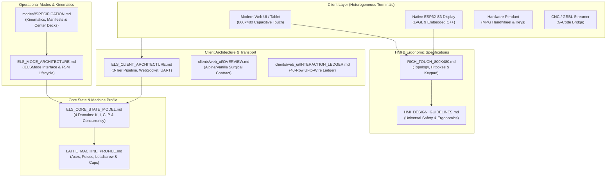

# NanoELS H5 — System Architecture & Design Decision Ledger

> **Document Role:** Master System Index, Architectural Decision Record (ADR) & High-Level Philosophy  
> **Status:** Living Document  
> **Target Platform:** NanoELS H5 Core Motion Controller & Multi-Client Suite  
> **Date:** October 7, 2026  

---

## 1. System Vision & Architecture Topology

The **NanoELS H5 Redesign** transforms a single-client embedded leadscrew into a modular, multi-client industrial motion system. The architecture completely decouples physical motion generation, domain state management, network transport, and client human-machine interfaces (HMI).

---

## 2. Authoritative Document Hierarchy & Cross-Index

To prevent documentation divergence, technical specifications, parameter manifests, and interface schemas are housed strictly within dedicated standalone documents. Consult the authoritative document for each domain:

| Domain | Authoritative Document | Contents & Scope |
| :--- | :--- | :--- |
| **Universal HMI Principles** | [`hmi/HMI_DESIGN_GUIDELINES.md`](./hmi/HMI_DESIGN_GUIDELINES.md) | Universal human factors, operator Cartesian perspective, hardware fidelity, running lockout, and 4-tier semantic colors across all clients. |
| **800×480 Touch Profile** | [`hmi/RICH_TOUCH_800X480.md`](./hmi/RICH_TOUCH_800X480.md) | Canvas geometry (42/408/30px), touch hitboxes ($\ge 44\text{px}$ primary, $\ge 38\text{px}$ secondary), ATM calculator keypad, distance-to-boundary chips, and runstack layout. |
| **Core State & Concurrency** | [`ELS_CORE_STATE_MODEL.md`](./ELS_CORE_STATE_MODEL.md) | The 4-domain state model (`K` Kinematic, `I` Intent, `C` Configuration, `P` Profile), point-in-time atomic snapshots, FreeRTOS multi-core concurrency, and sparse NVS registry. |
| **Mode Architecture & FSM** | [`ELS_MODE_ARCHITECTURE.md`](./ELS_MODE_ARCHITECTURE.md) | `IELSMode` C++ interface contract, composite mode orchestration, atomic motion primitives, multi-client safety, and mode lifecycle state transitions. |
| **Operational Modes Catalog** | [`modes/README.md`](./modes/README.md) | Master catalog of all 8 operational modes, hardware capability requirements (`CAP_*`), motion categories, and direct links to mode specifications. |
| **Machine Profile & Geometry**| [`LATHE_MACHINE_PROFILE.md`](./LATHE_MACHINE_PROFILE.md) | Physical lathe geometry, axis pulse math, encoder PPR, capability bitmasks, and standard fastener datasets. |
| **Client Transport Pipeline** | [`ELS_CLIENT_ARCHITECTURE.md`](./ELS_CLIENT_ARCHITECTURE.md) | 3-tier client pipeline (`ITransport` $\rightarrow$ `ITelemetrySerializer` $\rightarrow$ `ICommandTranslator`), multi-channel WebSocket server, and the Zero-WiFi control plane mandate. |
| **Web UI Architecture** | [`clients/web_ui/OVERVIEW.md`](./clients/web_ui/OVERVIEW.md) | Zero-build modular ES structure, Alpine.js reactive boundary contract, presentation layer unit formatting, and Lathe Digital Twin visualizer. |
| **UI Interaction Ledger** | [`clients/web_ui/INTERACTION_LEDGER.md`](./clients/web_ui/INTERACTION_LEDGER.md) | Comprehensive 40-row ledger mapping every UI gesture (D-pad jog, keypad set, nudge, runstack) to canonical wire commands (`CMD.*`). |

---

## 3. Core Architectural Tenets & Design Decisions

### 1. The Controller is the Sole Authority
* Connected clients (Web UI, tablet DROs, pendants, secondary displays) are pure reactive observers. Mode execution, cycle orchestration, and kinematics run deterministically on the controller MCU.
* The client transmits *operator intent* (`CMD.*`), and state flows outward via domain-namespaced telemetry (`K`, `I`, `C`, `P`).

### 2. Radical Hardware Fidelity & Transparency
* The core motion firmware operates strictly on a binary state engine: `STOPPED` (`isOn == false`) or `RUNNING` (`isOn == true`). There is no native software pause.
* What displays on the DRO limit chips reflects the exact hardware boundary registers currently active in the motion core (`z_min`/`z_max`, `x_min`/`x_max`). Zero "ghost limits."
* No "ghost actions" during autonomous multi-pass cycles (such as fabricating a mid-cycle "next pass" button when firmware cannot support it).

### 3. Safety-First Running Lockout & Unoccluded STOP
* On an operating metal lathe, modal popups, keypad sheets, and warning banners that occlude live DRO coordinates or cover the red **`STOP`** button are life-safety hazards.
* When active motion is engaged (`isOn == true`), all modal dialog triggers become silent no-ops, setup fields are locked, and mode switching is prohibited.
* The red **`STOP`** button is permanently anchored in the bottom-right corner across all views with an intentional 12px air gap separating it from start controls.

### 4. Preservation of Operator Intent (Lossless State)
* In traditional systems, operator inputs are flattened into raw floats (`dupr` or slope $C$). Backward calculation induces floating-point round-trip drift (e.g. `20 TPI` returning as `19.9998`, or `1:19` taper returning as `1:18.99`).
* The controller stores exact typed operator intent in `IntentState` (`thPitch = 20`, `thFmt = TPI`, `tpMode = RATIO`, `tpVal = 19`) alongside canonical deci-microns, guaranteeing zero decimal jitter.

### 5. Machinist Mental Model & Ergonomic Reference Frames
* All controls align with the operator's apron viewpoint: $Z-$ toward the chuck, $Z+$ toward the tailstock, $X-$ plunging into the workpiece toward center, and $X+$ retracting toward the operator.
* Machinists think in drawing dimensions (`LENGTH`, `STROKE`, `DOC`), which automatically map to machine envelopes relative to tool touch-off.
* Limit chips present **distance-to-boundary** ($5.843 \rightarrow 0.000\text{ mm}$) with vector arrow-into-wall glyphs (`|←`, `→|`, `⤒`, `⭳`).

### 6. Zero-WiFi Control Plane Mandate
* Executing real-time automated cutting cycles or emergency stops over wireless Wi-Fi in an industrial environment with motor and VFD EMI noise introduces hazardous failure modes.
* The primary machine control plane is strictly wired over physical UART serial (`Serial1`) or on-chip memory. Wi-Fi and WebSockets are dedicated to supervisory telemetric observation and parameter setup.

---

## 4. Key Architectural Milestones & Solutions Log

* **Decoupled 3-Tier Client Pipeline:** Separated physical transports (`ITransport`) from protocol translation (`ICommandTranslator`) and the core motion dispatcher (`CommandDispatcher`), enabling concurrent Web, Nextion, and GRBL clients.
* **Two-Way Pass Derivation Macro Bridge:** Resolved the gap between machinists thinking in `MAX DOC` and NanoELS firmware executing discrete `turnPasses` by calculating $\text{turnPasses} = \lceil\text{Total Depth} / \text{Max DOC}\rceil$ while allowing manual pass overrides that recalculate actual DOC.
* **Asymmetric Anti-Trap Limit State Machine:** Solved silent firmware limit stalls by evaluating limit contact locally from telemetry (`distanceToStop == 0`), locking out further jog steps into the wall while keeping the retreat jog arrow 100% accessible.
* **Separation of Continuous Gearing vs. Canned Taper Cycles:** Resolved telemetry collisions on legacy `MODE_CONE` by introducing clear state-ownership yield triggers on the display controller, separating single-pass manual taper feed (`GEARBOX Z+X`) from automated multi-pass cycles (`TAPER`).
* **Conversational Fastener Wizard & Skim Pass Verification:** Created a 4-stage conversational thread selector (ISO Metric, UN, NPT, BSPT) paired with a human-in-the-loop Skim Pass verification workflow to eliminate chuck runout and calibrate tool zero before cutting.
* **Cross-Mode "Prepare Stock" Bridge:** Established an intelligent bridge allowing operators to transition directly from Threading to Turning or Taper to machine the exact target major diameter ($OD$) or pipe cone before engaging screw cutting.
