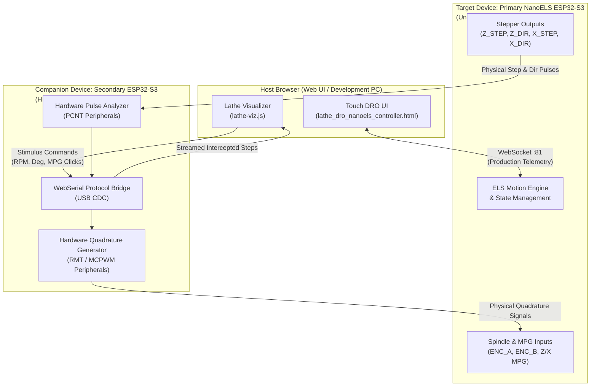

# Hardware-in-the-Loop (HIL) Test Rig & Step Interceptor

## 1. Executive Summary & Objective

The **Hardware-in-the-Loop (HIL) Test Rig** is a proposed secondary companion device and verification pipeline designed to validate NanoELS motion generation down to physical digital outputs without modifying production firmware or state-change telemetry.

Currently, the digital twin lathe visualizer (`clients/web_ui/dev/lathe-viz.js`) derives its carriage position from high-level state updates (`UI.z`, `UI.x`, or `MachineModel` kinematics) sent over WebSocket. This leaves a critical **verification gap**: any bugs occurring between high-level state computation and physical stepper pulse emission remain completely invisible.

Furthermore, manual testing cannot realistically spin physical optical encoders at operational speeds (e.g., 600–1500 RPM for threading), and bench stepper motors cannot quantitatively detect dropped steps or timing violations.

This architecture introduces a **secondary ESP32-S3** acting as an automated stimulus generator and pulse analyzer connected directly to the primary controller and the browser visualizer.

---

## 2. The Core Problem & Constraints

### 2.1 The "Observer Effect" Constraint
Modifying the primary controller's state-change messaging or telemetry protocol to include step counters was explicitly ruled out:
* Altering telemetry packet size, JSON/canonical formatting, or WebSocket push intervals introduces CPU and network overhead on ESP32 Core 0.
* Changing execution timing can mask or trigger race conditions (Heisenbugs) in the motion planner and step execution loops.
* **Requirement:** The primary NanoELS controller must run **100% unmodified production firmware** with standard telemetry.

### 2.2 Blind Spots in Pure State-Based Visualization
High-level state reporting can say an axis is at target position while physical steps were degraded or lost due to:
* **Step Pulse Timing & Starvation:** Jitter in `micros()` step intervals or FreeRTOS task scheduling.
* **Backlash & Direction Setup Violations:** Missing the minimum setup delay (`DIRECTION_SETUP_DELAY_US`) before the first step pulse upon reversal.
* **Acceleration Clamping:** Step rate saturation under `speedMax` / `speedStart` limits.
* **Accumulator / Bresenham Drift:** Small fractional roundoff discrepancies accumulating over long threading or taper passes.

---

## 3. System Architecture

---

## 4. Companion ESP32-S3 Responsibilities

The secondary ESP32-S3 runs a lightweight dedicated firmware project (to be located in `tools/hil_rig/`) serving two real-time roles:

### 4.1 Hardware Quadrature Generator (Stimulus)
Generates real electrical square waves with strict phase alignment ($90^\circ$ phase shift) to simulate physical hardware encoders:
* **Spindle Encoder:** 
  * Drives primary `ENC_A` (GPIO 14) and `ENC_B` (GPIO 13).
  * Capable of continuous high-speed rotation from 10 RPM to 3,000+ RPM (up to 120 kHz pulse rates on a 600 PPR encoder) using ESP32-S3 **RMT** or **MCPWM** hardware peripherals.
  * Supports programmable acceleration ramps, sudden reversals, and index pulse simulation.
* **MPG Handwheel:**
  * Drives primary MPG input pins for Z and X.
  * Simulates discrete tactile clicks or continuous handwheel spinning without physical manual operation.

### 4.2 Hardware Pulse Analyzer (Capture)
Sniffs output pins from the primary controller:
* Sniffs `Z_STEP` (GPIO 35), `Z_DIR` (GPIO 42), `X_STEP` (GPIO 20), and `X_DIR` (GPIO 19).
* Uses the secondary ESP32-S3's hardware **Pulse Counter (PCNT)** units to count edges in hardware up to several MHz without missing pulses.
* Inspects direction state at every step transition to detect direction-setup-time violations.

### 4.3 WebSerial Communication Bridge
* Communicates directly with the browser via the native **Web Serial API** (`navigator.serial`) over standard USB-C.
* **Commands Inbound from Visualizer:**
  * `SET_RPM <rpm>`: Set constant spindle speed.
  * `TURN_DEG <deg>`: Rotate spindle by exact angle.
  * `MPG_JOG <axis> <clicks>`: Inject MPG detent pulses.
* **Telemetry Outbound to Visualizer:**
  * High-frequency binary or compact ASCII packet: `STEPS Z:<count> X:<count> RPM:<measured_rpm>`.

---

## 5. Wiring Specification (Inter-ESP Interconnect)

| Signal Name | Primary NanoELS Pin | Secondary Companion Pin | Purpose |
| :--- | :--- | :--- | :--- |
| **GND** | GND | GND | Common reference ground |
| **Spindle Phase A** | GPIO 14 (`ENC_A`) | GPIO `<out_a>` | Injected spindle quadrature phase A |
| **Spindle Phase B** | GPIO 13 (`ENC_B`) | GPIO `<out_b>` | Injected spindle quadrature phase B |
| **Z Step Sniff** | GPIO 35 (`Z_STEP`) | GPIO `<pcnt_z_step>` | Hardware step pulse counter (Z axis) |
| **Z Dir Sniff** | GPIO 42 (`Z_DIR`) | GPIO `<pcnt_z_dir>` | Hardware direction level monitor (Z axis) |
| **X Step Sniff** | GPIO 20 (`X_STEP`) | GPIO `<pcnt_x_step>` | Hardware step pulse counter (X axis) |
| **X Dir Sniff** | GPIO 19 (`X_DIR`) | GPIO `<pcnt_x_dir>` | Hardware direction level monitor (X axis) |
| **Optional: Z MPG A** | GPIO 18 (`Z_PULSE_A`) | GPIO `<out_mpg_za>` | Injected Z handwheel pulse A |
| **Optional: Z MPG B** | GPIO 8 (`Z_PULSE_B`) | GPIO `<out_mpg_zb>` | Injected Z handwheel pulse B |

---

## 6. Verification Metrics & Invariants

When running the HIL rig, the visualizer or automated test scripts verify the following physical invariants:

1. **Exact Gear Ratio Invariant:**
   For a given spindle rotation count $N_{\text{rev}}$, the accumulated steps on $Z$ must satisfy:
   $$N_{\text{steps}} = N_{\text{rev}} \times \frac{\text{Thread Pitch (mm)}}{\text{Leadscrew Pitch (mm)}} \times \text{Motor Steps Per Rev}$$
   *Any variance indicates dropped steps, Bresenham accumulator truncation, or timer starvation.*

2. **Direction Setup Delay Check:**
   The companion board verifies that the delay between a `DIR` pin edge and the subsequent `STEP` rising edge strictly exceeds the stepper driver minimum setup specification (e.g., $\ge 5\,\mu\text{s}$).

3. **Following Error & Stop Clamping:**
   Verifies that carriage motion stops at the exact planned step coordinate when encountering programmed electronic limits (`leftStop` / `rightStop`).

---

## 7. Dual-Mode Visualizer Architecture

The web visualizer (`clients/web_ui/dev/lathe-viz.js`) will support two operating modes:

1. **Standalone / Simulation Mode (Default):**
   * Uses existing software commands (`CMD.spindleSim`, `CMD.spindleSimTurn`).
   * Renders motion from WebSocket state updates or emulator variables.
   * Useful for rapid web UI prototyping on a laptop with no hardware connected.

2. **HIL Hardware Mode (When Companion Plugged In):**
   * Visualizer connects to the secondary ESP32-S3 over WebSerial.
   * Visualizer carriage position is driven **exclusively** by the companion's counted physical step pulses.
   * Discrepancies between the Touch DRO display and the visualizer immediately highlight motion engine bugs.
